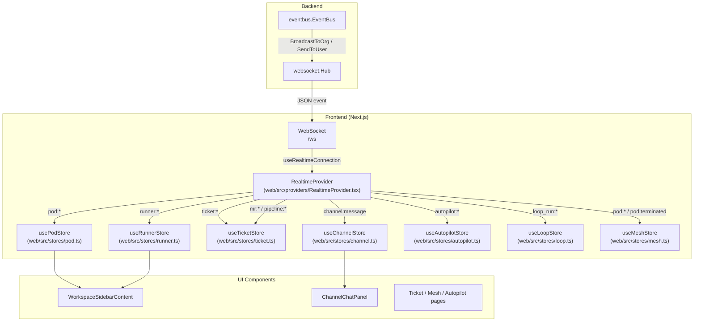
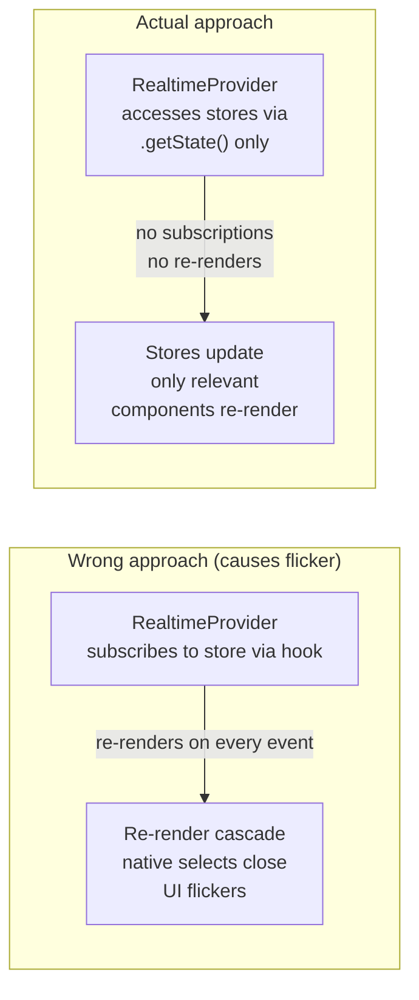
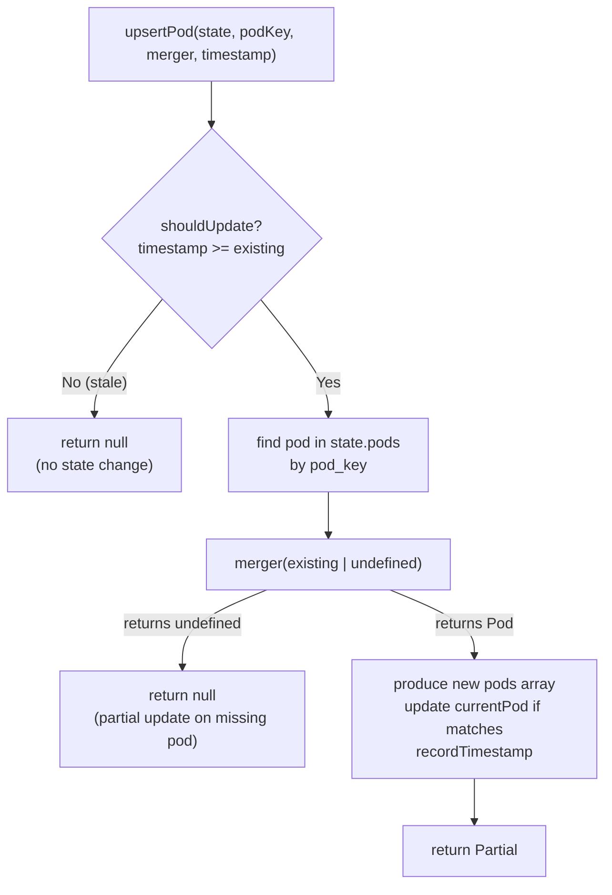
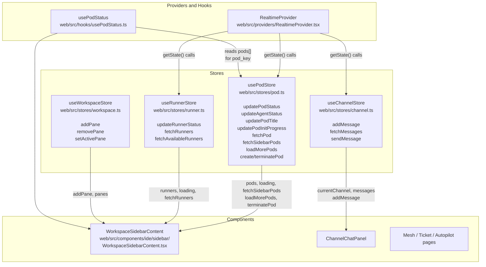
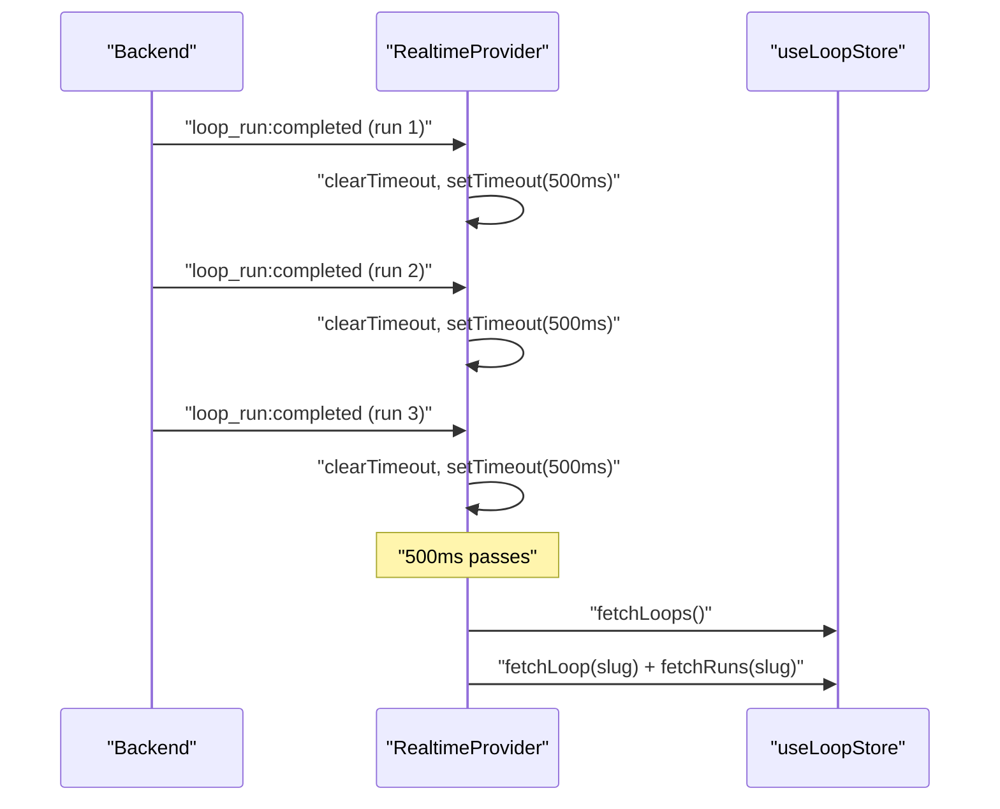

<!-- source: DeepWiki mcp.deepwiki.com · repo AgentsMesh/AgentsMesh · page 5.5 Real-time State Management · fetched 2026-10-26 -->

# Real-time State Management

<details>
<summary>Relevant source files</summary>

The following files were used as context for generating this wiki page:

- [backend/cmd/server/eventbus_setup.go](backend/cmd/server/eventbus_setup.go)
- [web/src/components/ide/sidebar/WorkspaceSidebarContent.tsx](web/src/components/ide/sidebar/WorkspaceSidebarContent.tsx)
- [web/src/components/pwa/PushNotificationManager.tsx](web/src/components/pwa/PushNotificationManager.tsx)
- [web/src/hooks/usePodStatus.ts](web/src/hooks/usePodStatus.ts)
- [web/src/providers/RealtimeProvider.tsx](web/src/providers/RealtimeProvider.tsx)
- [web/src/stores/__tests__/pod.test.ts](web/src/stores/__tests__/pod.test.ts)
- [web/src/stores/__tests__/terminalConnection.test.ts](web/src/stores/__tests__/terminalConnection.test.ts)
- [web/src/stores/__tests__/workspace.test.ts](web/src/stores/__tests__/workspace.test.ts)
- [web/src/stores/channel.ts](web/src/stores/channel.ts)
- [web/src/stores/pod.ts](web/src/stores/pod.ts)
- [web/src/stores/runner.ts](web/src/stores/runner.ts)

</details>


This page documents the client-side state management architecture of the AgentsMesh web frontend: how Zustand stores maintain application state, how `RealtimeProvider` ingests backend WebSocket events and dispatches them to the correct stores, and the design decisions that prevent stale data and rendering issues.

This page focuses on frontend state. For the backend event bus and WebSocket hub that produce these events, see [Real-time Events and WebSocket (2.10)](#2.10). For terminal WebSocket connections (a separate binary protocol not covered here), see [Terminal Workspace (5.1)](#5.1).

---

## Architecture Overview

The system has two complementary update paths. Components can trigger explicit API fetches, but status changes that originate on the backend (runner going offline, pod status changing, channel message arriving) arrive via a single persistent WebSocket managed by `RealtimeProvider`.

**Event flow: backend → frontend state**



Sources: [web/src/providers/RealtimeProvider.tsx:1-368](), [backend/cmd/server/eventbus_setup.go:59-111]()

---

## RealtimeProvider

`RealtimeProvider` is a React context provider placed at the authenticated dashboard layout level. It owns the WebSocket lifecycle and contains a single `handleEvent` dispatch function that routes every incoming event to the appropriate store action.

### Key design: `getState()` instead of reactive store subscriptions



All store mutations in `handleEvent` use `useXxxStore.getState().action(...)` rather than hooks, ensuring `RealtimeProvider` itself never re-renders due to store changes. The context value it exposes (`connectionState`, `reconnect`) is separately memoized via `useMemo`.

Sources: [web/src/providers/RealtimeProvider.tsx:59-63](), [web/src/providers/RealtimeProvider.tsx:357-361]()

### Event Routing Table

| Event type(s) | Store action called |
|---|---|
| `pod:created` | `usePodStore.getState().fetchPod(pod_key)` + `useMeshStore.getState().fetchTopology()` |
| `pod:status_changed` | `updatePodStatus(...)` or `fetchPod(...)` if pod missing; also `fetchTopology()` |
| `pod:agent_status_changed` | `updateAgentStatus(pod_key, agent_status)` |
| `pod:terminated` | `updatePodStatus(pod_key, "terminated")` + `fetchTopology()` |
| `pod:title_changed` | `updatePodTitle(pod_key, title)` |
| `pod:init_progress` | `updatePodInitProgress(pod_key, phase, progress, message)` |
| `runner:online` / `runner:offline` / `runner:updated` | `updateRunnerStatus(runner_id, status)` |
| `ticket:created` / `ticket:updated` / `ticket:status_changed` / `ticket:moved` / `ticket:deleted` | `useTicketStore.getState().fetchTickets()` |
| `channel:message` | `useChannelStore.getState().addMessage(...)` (only if matching `currentChannel`) |
| `terminal:notification` | `onTerminalNotification` callback prop |
| `task:completed` | `onTaskCompleted` callback prop |
| `autopilot:status_changed` | `updateAutopilotControllerStatus(...)` |
| `autopilot:iteration` | `addIteration(key, iterationData)` |
| `autopilot:created` | `fetchAutopilotControllers()` |
| `autopilot:terminated` | `removeAutopilotController(key)` |
| `autopilot:thinking` | `updateThinking(key, data)` |
| `mr:created` / `mr:updated` / `mr:merged` / `mr:closed` | `fetchTickets()` and/or `fetchPods()` based on which IDs are set |
| `pipeline:updated` | `fetchTickets()` and/or `fetchPods()` |
| `loop_run:started` / `loop_run:completed` / `loop_run:failed` | `fetchLoops()`, `fetchLoop()`, `fetchRuns()` — debounced 500ms |
| `loop_run:warning` | `toast.warning(...)` via sonner |

Sources: [web/src/providers/RealtimeProvider.tsx:67-325]()

### Reconnection Recovery

When `connectionState` transitions to `"connected"`, `RealtimeProvider` refreshes all primary stores to recover any events missed during the disconnect window:

```
usePodStore.getState().fetchSidebarPods(currentSidebarFilter)
useRunnerStore.getState().fetchRunners()
useTicketStore.getState().fetchTickets()
useMeshStore.getState().fetchTopology()
useAutopilotStore.getState().fetchAutopilotControllers()
useLoopStore.getState().fetchLoops()
```

Sources: [web/src/providers/RealtimeProvider.tsx:344-355]()

---

## Pod Store (`usePodStore`)

The pod store is the most complex store due to the need to reconcile real-time WebSocket events with paginated API responses.

**File:** [web/src/stores/pod.ts]()

### State Shape

| Field | Type | Purpose |
|---|---|---|
| `pods` | `Pod[]` | All pods currently loaded |
| `currentPod` | `Pod \| null` | The pod selected in detail views |
| `loading` | `boolean` | Sidebar loading spinner (owned by `fetchSidebarPods`) |
| `error` | `string \| null` | Last error message |
| `initProgress` | `Record<string, PodInitProgress>` | Phase/progress/message per pod during initialization |
| `podTimestamps` | `Record<string, number>` | Timestamp of last known mutation per pod (staleness guard) |
| `podTotal` | `number` | Total pod count from API (for pagination) |
| `podHasMore` | `boolean` | Whether more pages are available |
| `loadingMore` | `boolean` | Spinner for "load more" button |
| `currentSidebarFilter` | `string` | Active filter tab (`"running"`, `"completed"`, `"all"`) |

### `SIDEBAR_STATUS_MAP`

Maps filter tab names to the comma-separated status strings sent to the API:

```
running   → "running,initializing"
completed → "terminated,failed,paused,completed,error,orphaned"
all       → ""  (no filter)
```

Sources: [web/src/stores/pod.ts:9-13]()

### `upsertPod` — Unified Write Path

All pod mutations go through the internal `upsertPod` function [web/src/stores/pod.ts:110-142](). It:

1. Checks `shouldUpdate` — skips the write if `timestamp < podTimestamps[podKey]` (stale event).
2. Finds the pod by `pod_key` in the current array.
3. Calls the `merger` callback with the existing pod (or `undefined` for new ones).
4. Produces an updated `pods` array and syncs `currentPod` if it matches.
5. Records the new timestamp.



Sources: [web/src/stores/pod.ts:77-142]()

### In-flight Request Deduplication

The module-level `fetchPodInflight` map [web/src/stores/pod.ts:70]() prevents redundant API calls when multiple WebSocket events arrive for the same pod before the first response returns. Subsequent calls for the same `pod_key` reuse the existing `Promise<void>`.

### Merge Strategy During API Fetches

`fetchSidebarPods` and `fetchPods` both capture `fetchStartTs = Date.now()` before the API call. After the response arrives, pods whose `podTimestamps[pod_key] > fetchStartTs` are preserved from local state (a WebSocket event updated them while the request was in flight).

Sources: [web/src/stores/pod.ts:156-259]()

### Store Actions

| Action | Description |
|---|---|
| `fetchPods(filters?)` | Full list fetch. Does **not** set `loading` (fire-and-forget). |
| `fetchSidebarPods(statusFilter)` | Paged fetch for sidebar. Sets `loading`. Resets to page 1. |
| `loadMorePods()` | Appends next page, deduplicating against real-time additions. |
| `fetchPod(podKey)` | Single pod fetch (background, no `loading` flag). Deduplicates in-flight requests. |
| `createPod(data)` | Creates pod via API, prepends to `pods`, sets `currentPod`. |
| `terminatePod(podKey)` | Terminates via API; treats 404 as already terminated. Updates local state. |
| `setCurrentPod(pod)` | Sets `currentPod` directly. |
| `updatePodStatus(...)` | Targeted status update from WebSocket. Clears error fields when leaving error state. |
| `updateAgentStatus(...)` | Updates only `agent_status` field. |
| `updatePodTitle(...)` | Updates only `title` field. |
| `updatePodInitProgress(...)` | Updates `initProgress[podKey]`. |
| `clearInitProgress(podKey)` | Removes progress entry for a pod. |
| `clearError()` | Clears `error`. |

Sources: [web/src/stores/pod.ts:144-413]()

---

## Runner Store (`useRunnerStore`)

**File:** [web/src/stores/runner.ts]()

Simpler than the pod store. The key real-time action is `updateRunnerStatus`:

- Updates `status` on the matching runner in both `runners` and `availableRunners`.
- Removes the runner from `availableRunners` if the new status is anything other than `"online"`.
- Syncs `currentRunner` if it matches.

### State Shape

| Field | Type | Purpose |
|---|---|---|
| `runners` | `Runner[]` | All runners for the organization |
| `availableRunners` | `Runner[]` | Online runners eligible to host new pods |
| `currentRunner` | `Runner \| null` | Runner shown in detail view |
| `tokens` | `GRPCRegistrationToken[]` | Registration tokens for this org |
| `loading` | `boolean` | Loading flag for `fetchRunners` |
| `error` | `string \| null` | Last error |

Helper functions exported alongside the store:

- `getRunnerStatusInfo(status)` — Returns label, text color, and dot color for display.
- `canAcceptPods(runner)` — Returns `true` if `status === "online"` and `current_pods < max_concurrent_pods`.
- `formatHostInfo(hostInfo)` — Formats OS, arch, CPU, and RAM into a display string.

Sources: [web/src/stores/runner.ts:34-204]()

---

## Channel Store (`useChannelStore`)

**File:** [web/src/stores/channel.ts]()

### State Shape

| Field | Type | Purpose |
|---|---|---|
| `channels` | `Channel[]` | All channels for the org |
| `currentChannel` | `Channel \| null` | Currently viewed channel |
| `messages` | `ChannelMessage[]` | Messages for `currentChannel` |
| `loading` | `boolean` | List loading |
| `channelLoading` | `boolean` | Single channel fetch loading |
| `messagesLoading` | `boolean` | Message fetch loading |
| `error` | `string \| null` | Last error |

### Real-time Integration

`addMessage` is called by `RealtimeProvider` on `channel:message` events, but only when the event's `channel_id` matches `currentChannel.id`. Messages are deduplicated by `id` to handle the race between the WebSocket event and the REST response from `sendMessage`:

```
addMessage: (message) =>
  set((state) => ({
    messages: state.messages.some((m) => m.id === message.id)
      ? state.messages
      : [...state.messages, message],
  }))
```

Sources: [web/src/stores/channel.ts:261-267](), [web/src/providers/RealtimeProvider.tsx:167-185]()

---

## Workspace Store (`useWorkspaceStore`)

**File:** `web/src/stores/workspace.ts` (exercised by [web/src/stores/__tests__/workspace.test.ts]())

Manages the multi-pane terminal workspace layout. Persisted to `localStorage` via Zustand's `persist` middleware.

### State Shape

| Field | Type | Purpose |
|---|---|---|
| `panes` | `Pane[]` | Open terminal panes (each tied to a `podKey`) |
| `activePane` | `string \| null` | ID of the focused pane |
| `gridLayout` | `{ type, rows, cols }` | Current grid configuration |
| `mobileActiveIndex` | `number` | Active pane index on mobile (always synced with `activePane`) |
| `terminalFontSize` | `number` | Font size (clamped 10–24) |
| `_hasHydrated` | `boolean` | Whether `persist` has hydrated from localStorage |

### Key Actions

| Action | Behavior |
|---|---|
| `addPane(podKey)` | If pod already open, focuses that pane; otherwise creates new one and assigns grid position. Returns pane ID. |
| `removePane(id)` | Removes pane, selects next/first remaining pane as active. |
| `clearAllPanes()` | Removes all panes, resets active and `mobileActiveIndex`. |
| `setActivePane(id)` | Sets active pane, syncs `mobileActiveIndex`. |
| `setMobileActiveIndex(i)` | Sets index, syncs `activePane`. Guards against out-of-range values. |
| `setGridLayout(layout)` | Updates grid configuration. |
| `updatePanePosition(id, pos)` | Updates `gridPosition` for drag-and-drop layout. |
| `setTerminalFontSize(size)` | Clamps to [10, 24] before storing. |
| `getPaneByPodKey(podKey)` | Lookup helper returning `Pane \| undefined`. |
| `setHasHydrated(v)` | Called by `persist` after localStorage hydration. |

The workspace store is **not** connected to `RealtimeProvider`. It changes only when the user opens or closes terminal panes.

Sources: [web/src/stores/__tests__/workspace.test.ts:1-441](), [web/src/components/ide/sidebar/WorkspaceSidebarContent.tsx:44-45]()

---

## Store Relationship Diagram

This diagram maps the concrete store files and actions to the components and hooks that consume them.



Sources: [web/src/providers/RealtimeProvider.tsx:1-368](), [web/src/stores/pod.ts:1-413](), [web/src/stores/runner.ts:1-165](), [web/src/stores/channel.ts:1-272](), [web/src/components/ide/sidebar/WorkspaceSidebarContent.tsx:1-273]()

---

## `usePodStatus` Hook

**File:** [web/src/hooks/usePodStatus.ts]()

A convenience hook for tracking a specific pod's readiness within a component. It:

1. Selects the pod from `usePodStore` using a granular selector `state.pods.find(p => p.pod_key === podKey)` — minimizes re-renders to only when that specific pod changes.
2. Calls `fetchPod(podKey)` once on mount if the pod isn't already in the store.
3. Retries up to `MAX_FETCH_RETRIES = 3` on transient failures, stopping permanently on a 404.
4. Live store data (from WebSocket events) always overrides a fetch error, so a transient network failure won't permanently shadow a pod that later becomes available via real-time updates.

Returns `{ podStatus, isPodReady, podError }`.

Terminal states mapped to `podError`:

| Status | `podError` value |
|---|---|
| `"failed"` | `"Pod failed"` |
| `"terminated"` | `"Pod terminated"` |
| `"orphaned"` | `"Pod orphaned - Runner connection lost"` |
| `"error"` | `storePod.error_message \|\| "Pod error"` |
| all others | `null` |

Sources: [web/src/hooks/usePodStatus.ts:1-82]()

---

## Loop Run Event Debouncing

Loop run events (`loop_run:started`, `loop_run:completed`, `loop_run:failed`) can fire rapidly in bursts. `RealtimeProvider` coalesces them with a 500ms debounce using a `loopDebounceRef` ref rather than a module-level timer, ensuring the timer is cleaned up when the component unmounts.



Sources: [web/src/providers/RealtimeProvider.tsx:55-57](), [web/src/providers/RealtimeProvider.tsx:290-310](), [web/src/providers/RealtimeProvider.tsx:335-342]()

---

