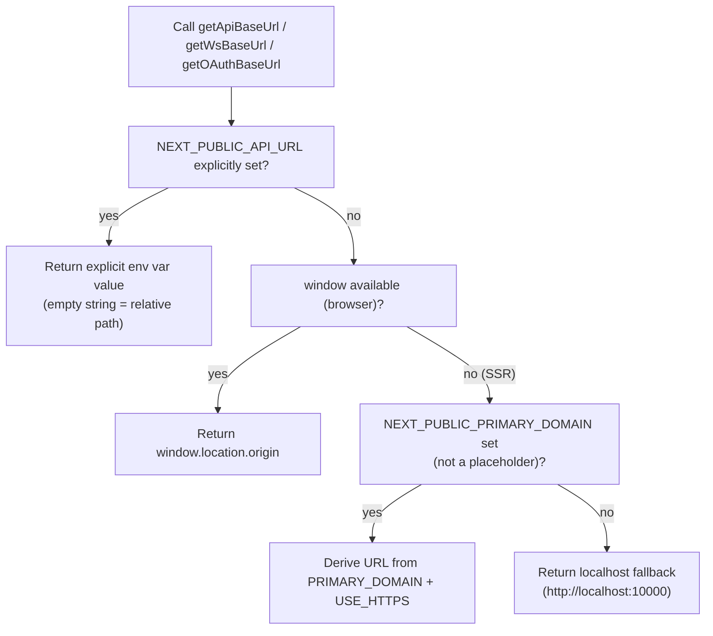
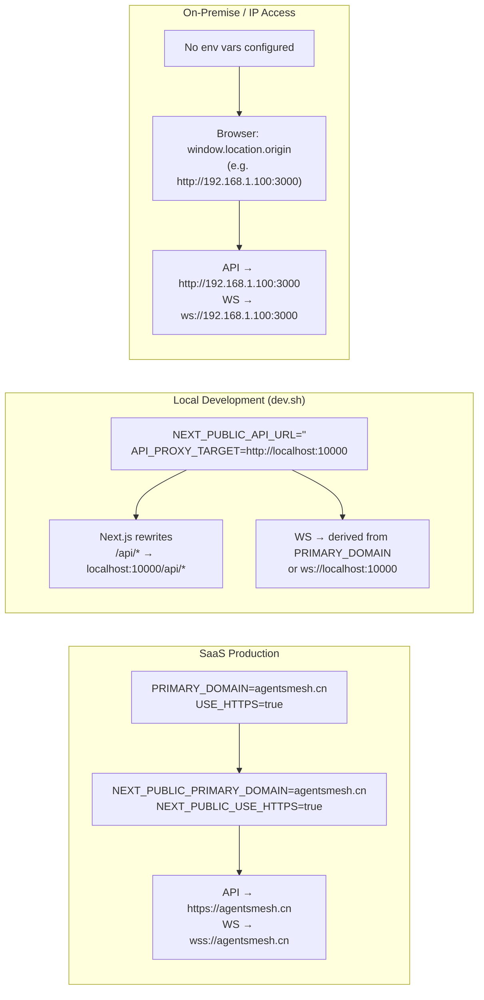

<!-- source: DeepWiki mcp.deepwiki.com · repo AgentsMesh/AgentsMesh · page 5.6 Environment and API Configuration · fetched 2026-10-26 -->

# Environment and API Configuration

<details>
<summary>Relevant source files</summary>

The following files were used as context for generating this wiki page:

- [web-admin/next.config.ts](web-admin/next.config.ts)
- [web-admin/src/lib/api/base.ts](web-admin/src/lib/api/base.ts)
- [web/next.config.ts](web/next.config.ts)
- [web/src/lib/env.ts](web/src/lib/env.ts)

</details>


This page documents how the web frontend (`web/`) and web admin (`web-admin/`) resolve API endpoint URLs at runtime. It covers the environment variable hierarchy, deployment-scenario handling, Next.js rewrite proxying for local development, and the `ApiClient` abstraction used in the admin panel.

For backend configuration (environment variables consumed by the Go server), see [Backend Configuration](#2.7). For the web admin application itself, see [Web Admin](#6).

---

## Overview

Both `web` and `web-admin` must connect to the same backend API, but the correct base URL differs across deployment scenarios: SaaS production, on-premise IP-only access, and local development. Rather than hardcoding a URL, the applications apply a resolution hierarchy at runtime and expose a small set of helper functions from `web/src/lib/env.ts`.

---

## URL Resolution Hierarchy

All URL resolver functions (`getApiBaseUrl`, `getWsBaseUrl`, `getOAuthBaseUrl`) follow the same four-step priority order:

**Resolution order (highest to lowest priority)**



Sources: [web/src/lib/env.ts:92-114]()

> **Note on `NEXT_PUBLIC_API_URL=""`**: An empty string is a valid, intentional value meaning "use relative paths via Next.js rewrites". The resolver returns `""` immediately on this check. This is distinct from the variable being absent.

---

## Environment Variables Reference

| Variable | Scope | Purpose |
|---|---|---|
| `PRIMARY_DOMAIN` | Server-only (build/run) | Canonical domain, e.g. `agentsmesh.cn`. Mapped to `NEXT_PUBLIC_PRIMARY_DOMAIN` via `next.config.ts`. |
| `USE_HTTPS` | Server-only (build/run) | `"true"` / `"false"`. Mapped to `NEXT_PUBLIC_USE_HTTPS`. |
| `NEXT_PUBLIC_PRIMARY_DOMAIN` | Client-accessible | Exposed by Next.js from `PRIMARY_DOMAIN`. Placeholder `__PRIMARY_DOMAIN__` replaced by `docker-entrypoint.sh` at container start. |
| `NEXT_PUBLIC_USE_HTTPS` | Client-accessible | Exposed by Next.js from `USE_HTTPS`. Placeholder `__USE_HTTPS__` replaced at runtime. |
| `NEXT_PUBLIC_API_URL` | Client-accessible | Overrides all derivation logic. Set to `""` in local dev (enables proxy mode). |
| `NEXT_PUBLIC_WS_URL` | Client-accessible | Explicit WebSocket URL. Falls back to converting `NEXT_PUBLIC_API_URL` scheme (`http→ws`). |
| `NEXT_PUBLIC_OAUTH_URL` | Client-accessible | Explicit OAuth redirect base URL. Required when OAuth callback differs from the API URL. |
| `API_PROXY_TARGET` | Server-only (dev) | Written by `dev.sh` to `.env.local`. Used by Next.js rewrites to forward `/api/*` to the local backend. |
| `ALLOWED_DEV_ORIGINS` | Server-only (build) | Comma-separated list of origins allowed during Next.js development server. |

Sources: [web/src/lib/env.ts:1-36](), [web/next.config.ts:27-33](), [web-admin/next.config.ts:11-17]()

---

## Placeholder Substitution Mechanism

`PRIMARY_DOMAIN` and `USE_HTTPS` are **server-side** variables. If they were inlined at build time into client bundles, the Docker image would be permanently bound to specific values baked during the CI build.

To avoid this, `next.config.ts` emits placeholder strings when the variables are not set at build time:

[web/next.config.ts:27-33]()

At container startup, `docker-entrypoint.sh` replaces `__PRIMARY_DOMAIN__` and `__USE_HTTPS__` in the built JavaScript with the actual values from the container's environment. The helper `getPrimaryDomain()` and `isHttpsEnabled()` guard against un-replaced placeholders by checking for the `__` prefix:

[web/src/lib/env.ts:46-60]()

---

## Exported URL Functions

All functions are exported from `web/src/lib/env.ts`.

### `getApiBaseUrl()`

Returns the base URL for REST API calls (e.g., `fetch("/api/v1/...")`).

- In local dev (proxy mode): returns `""` so that `fetch("/api/v1/...")` uses relative paths that Next.js rewrites forward to the backend.
- In the browser (production/on-premise): returns `window.location.origin`.
- SSR: derives from `PRIMARY_DOMAIN`.

[web/src/lib/env.ts:92-114]()

### `getWsBaseUrl()`

Returns the base URL for WebSocket connections (must be an absolute URL; WebSocket cannot go through Next.js rewrites).

Special case: when `NEXT_PUBLIC_API_URL=""` (local dev proxy mode), REST is proxied but WebSocket is not. In this case the function falls back to `PRIMARY_DOMAIN`-derived `ws://` or `wss://`, not `window.location.origin`, because `window.location` would incorrectly point to the Next.js dev server port rather than the backend.

[web/src/lib/env.ts:145-177]()

### `getOAuthBaseUrl()`

Returns the base URL for OAuth redirect links. Because OAuth involves browser-level redirects directly to the backend (not proxied), this always returns an absolute URL.

[web/src/lib/env.ts:120-139]()

### `getServerUrl()` and `getServerUrlSSR()`

Used specifically for runner registration instructions displayed to the user (not for internal API calls).

- `getServerUrl()`: browser-only, returns `window.location.origin`. Using it in SSR causes a hydration mismatch.
- `getServerUrlSSR()`: safe for SSR; returns `NEXT_PUBLIC_API_URL` or the hardcoded default `https://agentsmesh.ai`.

[web/src/lib/env.ts:188-215]()

---

## Deployment Scenarios



Sources: [web/src/lib/env.ts:1-36](), [web/next.config.ts:38-58]()

---

## Next.js Rewrite Proxy (Local Development)

When `NODE_ENV=development` and `API_PROXY_TARGET` is set (written to `.env.local` by `dev.sh`), `next.config.ts` installs rewrites that forward API traffic to the local backend:

[web/next.config.ts:38-58]()

| Incoming path | Forwarded to |
|---|---|
| `/api/:path*` | `${API_PROXY_TARGET}/api/:path*` |
| `/health` | `${API_PROXY_TARGET}/health` |

This allows the frontend to make calls to `/api/v1/...` without CORS issues during development. The rewrite is only active when both `NODE_ENV=development` and `API_PROXY_TARGET` are present.

The `web-admin` app uses a similar pattern but derives its proxy target from `PRIMARY_DOMAIN` rather than a dedicated `API_PROXY_TARGET` variable:

[web-admin/next.config.ts:20-34]()

Sources: [web/next.config.ts:38-58](), [web-admin/next.config.ts:20-34]()

---

## `ApiClient` (web-admin)

The web admin panel uses a class-based `ApiClient` in `web-admin/src/lib/api/base.ts`. The web frontend uses individual `fetch` wrappers in each API module; `ApiClient` centralizes this for the admin panel.

**`ApiClient` structure and wiring**

```mermaid
classDiagram
    class ApiClient {
        -baseUrl: string
        +get(endpoint, params)
        +post(endpoint, data)
        +put(endpoint, data)
        +patch(endpoint, data)
        +delete(endpoint, data)
        +postFormData(endpoint, formData)
        -request(endpoint, options)
    }

    class "getApiUrl()" {
        <<function>>
        "NEXT_PUBLIC_API_URL || window.location.origin"
        "|| PRIMARY_DOMAIN-derived || localhost:10000"
    }

    class apiClient {
        <<singleton>>
        "baseUrl = API_URL + /api/v1/admin"
    }

    ApiClient --> "getApiUrl()" : "constructed with"
    apiClient --> ApiClient : "instance of"
```

The `request` private method on `ApiClient`:
- Injects `Authorization: Bearer <token>` from `getAuthToken()` on every request.
- Calls `useAuthStore.getState().logout()` and throws on a `401` response, expiring the session.
- Throws a typed `ApiError` (`{ error: string, status: number }`) on any other non-OK response.

The exported singleton `apiClient` is instantiated with the base path `/api/v1/admin`:

[web-admin/src/lib/api/base.ts:33](), [web-admin/src/lib/api/base.ts:167]()

The `getApiUrl()` function inside `web-admin/src/lib/api/base.ts` mirrors the logic of `getApiBaseUrl()` from `web/src/lib/env.ts` but is a local implementation without the proxy-mode (`""`) handling, since the admin panel always uses an absolute URL.

[web-admin/src/lib/api/base.ts:7-31]()

Sources: [web-admin/src/lib/api/base.ts:1-167]()

---

## Function-to-Deployment-Scenario Matrix

| Function | Local Dev (`API_URL=""`) | Browser (on-premise) | SSR / Build-time |
|---|---|---|---|
| `getApiBaseUrl()` | `""` (relative path) | `window.location.origin` | `PRIMARY_DOMAIN`-derived or `localhost:10000` |
| `getWsBaseUrl()` | `PRIMARY_DOMAIN`-derived or `ws://localhost:10000` | `ws(s)://window.location.host` | `PRIMARY_DOMAIN`-derived or `ws://localhost:10000` |
| `getOAuthBaseUrl()` | `""` → `window.location.origin` | `window.location.origin` | `PRIMARY_DOMAIN`-derived or `localhost:10000` |
| `getServerUrl()` | `window.location.origin` | `window.location.origin` | ⚠️ Not safe for SSR (use `getServerUrlSSR()`) |
| `getServerUrlSSR()` | `NEXT_PUBLIC_API_URL` or `https://agentsmesh.ai` | (same) | `NEXT_PUBLIC_API_URL` or `https://agentsmesh.ai` |

Sources: [web/src/lib/env.ts:92-216]()

---

