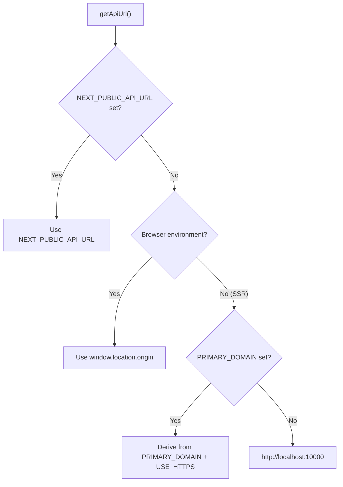
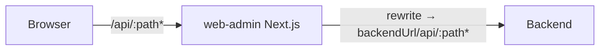
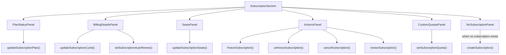
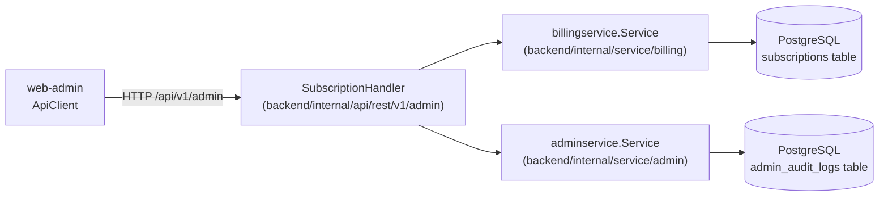

<!-- source: DeepWiki mcp.deepwiki.com · repo AgentsMesh/AgentsMesh · page 6 Web Admin · fetched 2026-10-26 -->

# Web Admin

<details>
<summary>Relevant source files</summary>

The following files were used as context for generating this wiki page:

- [backend/internal/api/rest/v1/admin/subscriptions.go](backend/internal/api/rest/v1/admin/subscriptions.go)
- [backend/internal/api/rest/v1/invitations.go](backend/internal/api/rest/v1/invitations.go)
- [backend/internal/api/rest/v1/pods.go](backend/internal/api/rest/v1/pods.go)
- [backend/internal/api/rest/v1/repositories.go](backend/internal/api/rest/v1/repositories.go)
- [backend/internal/domain/organization/organization.go](backend/internal/domain/organization/organization.go)
- [backend/internal/service/billing/service.go](backend/internal/service/billing/service.go)
- [backend/internal/service/billing/subscription.go](backend/internal/service/billing/subscription.go)
- [backend/internal/service/organization/interface.go](backend/internal/service/organization/interface.go)
- [backend/internal/service/organization/service.go](backend/internal/service/organization/service.go)
- [backend/migrations/000053_fix_missing_subscriptions.down.sql](backend/migrations/000053_fix_missing_subscriptions.down.sql)
- [backend/migrations/000053_fix_missing_subscriptions.up.sql](backend/migrations/000053_fix_missing_subscriptions.up.sql)
- [web-admin/next.config.ts](web-admin/next.config.ts)
- [web-admin/src/app/(dashboard)/organizations/[id]/_components/subscription-section.tsx](web-admin/src/app/(dashboard)/organizations/[id]/_components/subscription-section.tsx)
- [web-admin/src/lib/api/base.ts](web-admin/src/lib/api/base.ts)
- [web/next.config.ts](web/next.config.ts)
- [web/src/lib/env.ts](web/src/lib/env.ts)

</details>


The Web Admin (`web-admin/`) is a standalone Next.js application that serves as an internal operator console for the AgentsMesh platform. It is separate from the main user-facing frontend (see [Web Frontend](#5)) and is intended for platform administrators — not end users. Its primary responsibilities are organization administration and subscription lifecycle management.

---

## Application Structure

The web-admin is a Next.js application built with `output: "standalone"`. It uses a dashboard layout with routes under `src/app/(dashboard)/`. The application authenticates via a bearer token stored in a Zustand store (`useAuthStore`) and communicates with the backend exclusively through the `/api/v1/admin` route group (see [REST API Routes](#2.1) for backend route registration).

**Application layout — key files:**

| Path | Purpose |
|---|---|
| `web-admin/next.config.ts` | Next.js configuration, domain env mapping, API proxying |
| `web-admin/src/lib/api/base.ts` | `ApiClient` class and URL resolution |
| `web-admin/src/lib/api/admin.ts` | Domain-specific API functions (typed wrappers) |
| `web-admin/src/stores/auth.ts` | Auth state and token management |
| `web-admin/src/app/(dashboard)/organizations/[id]/` | Per-organization admin views |

Sources: [web-admin/next.config.ts:1-51](), [web-admin/src/lib/api/base.ts:1-167]()

---

## API Client

The `ApiClient` class in `web-admin/src/lib/api/base.ts` is the single HTTP abstraction used by all admin API functions. It is instantiated once and exported as `apiClient`.

**Instantiation:**
```
export const apiClient = new ApiClient(`${API_URL}/api/v1/admin`);
```

The base URL is resolved at module load time by `getApiUrl()` [web-admin/src/lib/api/base.ts:7-31]().

### URL Resolution

The `getApiUrl()` function resolves the backend base URL using the following priority:



Sources: [web-admin/src/lib/api/base.ts:7-31]()

### Authentication

All requests from `ApiClient` attach a `Bearer` token header using `getAuthToken()`. On a `401` response, the client calls `useAuthStore.getState().logout()` to clear the session.

[web-admin/src/lib/api/base.ts:55-88]()

### Available Methods

| Method | Signature |
|---|---|
| `get` | `get<T>(endpoint, params?)` |
| `post` | `post<T>(endpoint, data?)` |
| `put` | `put<T>(endpoint, data?)` |
| `patch` | `patch<T>(endpoint, data?)` |
| `delete` | `delete<T>(endpoint, data?)` |
| `postFormData` | `postFormData<T>(endpoint, formData)` |

Sources: [web-admin/src/lib/api/base.ts:91-165]()

---

## Environment and Domain Configuration

The `web-admin/next.config.ts` mirrors the pattern used by the main web frontend (see [Environment and API Configuration](#5.6)). It maps backend-level variables to `NEXT_PUBLIC_*` counterparts at build time, using runtime-replaceable placeholders for Docker deployments.

**Variable mapping (build time):**

| Source Variable | NEXT_PUBLIC Variable | Default Placeholder |
|---|---|---|
| `PRIMARY_DOMAIN` | `NEXT_PUBLIC_PRIMARY_DOMAIN` | `__PRIMARY_DOMAIN__` |
| `USE_HTTPS` | `NEXT_PUBLIC_USE_HTTPS` | `__USE_HTTPS__` |

Placeholders are replaced at container startup by `docker-entrypoint.sh`. This avoids Next.js build-time constant folding that would hard-code environment values into the bundle.

The `next.config.ts` also registers an API rewrite rule that proxies `/api/*` to the backend:



Sources: [web-admin/next.config.ts:1-51]()

---

## Subscription Management UI

The `SubscriptionSection` component [web-admin/src/app/(dashboard)/organizations/[id]/_components/subscription-section.tsx]() is the primary admin interface for managing an organization's subscription. It is rendered on the per-organization detail page.

### Component Decomposition

**Subscription management component tree:**



Sources: [web-admin/src/app/(dashboard)/organizations/[id]/_components/subscription-section.tsx:72-358]()

### Sub-panels

| Component | Function |
|---|---|
| `PlanStatusPanel` | Displays plan name and status badge; provides an inline `<Select>` to change plan immediately |
| `BillingDetailsPanel` | Shows billing cycle, auto-renew toggle, and current period dates |
| `SeatsPanel` | Renders a seat usage progress bar and an input to set a new seat count |
| `ActionsPanel` | Provides Freeze/Unfreeze, Cancel, and Renew (with month count input) controls |
| `CustomQuotasPanel` | Displays per-resource quota overrides vs. plan defaults; allows setting new override values |
| `NoSubscriptionPanel` | Shown when `GET /subscription` returns 404; provides a form to create a new subscription |

The `CustomQuotasPanel` supports overrides for these resources, defined as `QUOTA_RESOURCES` [web-admin/src/app/(dashboard)/organizations/[id]/_components/subscription-section.tsx:43]():

- `users`
- `runners`
- `concurrent_pods`
- `repositories`
- `pod_minutes`

A limit value of `-1` represents unlimited.

---

## Backend Admin API

The web-admin calls backend endpoints under `/api/v1/admin`. The subscription-related routes are registered by `SubscriptionHandler` [backend/internal/api/rest/v1/admin/subscriptions.go:31-47]().

**Admin subscription API — route map:**

```mermaid
flowchart LR
    subgraph "SubscriptionHandler"
        direction TB
        G["GET  /organizations/:id/subscription"] --> GS["GetSubscription()"]
        GP["GET  /organizations/:id/subscription/plans"] --> LP["ListPlans()"]
        PC["POST /organizations/:id/subscription/create"] --> AC["AdminCreateSubscription()"]
        PU["PUT  /organizations/:id/subscription/plan"] --> UP["AdminUpdatePlan()"]
        SU["PUT  /organizations/:id/subscription/seats"] --> US["AdminUpdateSeats()"]
        CU["PUT  /organizations/:id/subscription/cycle"] --> UC["AdminUpdateCycle()"]
        PF["POST /organizations/:id/subscription/freeze"] --> FZ["Freeze()"]
        UF["POST /organizations/:id/subscription/unfreeze"] --> UN["Unfreeze()"]
        CA["POST /organizations/:id/subscription/cancel"] --> CX["Cancel()"]
        RN["POST /organizations/:id/subscription/renew"] --> RE["AdminRenew()"]
        AR["PUT  /organizations/:id/subscription/auto-renew"] --> SA["SetAutoRenew()"]
        QO["PUT  /organizations/:id/subscription/quotas"] --> SQ["SetCustomQuota()"]
    end
```



Sources: [backend/internal/api/rest/v1/admin/subscriptions.go:31-47]()

### Key Backend Behaviours

- **`AdminUpdatePlan`**: Directly changes the plan in the database without checking payment constraints. Syncs the redundant `subscription_plan` field in the `organizations` table. [backend/internal/api/rest/v1/admin/subscriptions.go:132-167]()
- **`AdminRenew`**: Extends the period from `current_period_end` or `now`, whichever is later. Reactivates canceled or frozen subscriptions. [backend/internal/service/billing/subscription.go:179-213]()
- **`AdminCancelSubscription`**: Marks the subscription as canceled without calling any external payment provider API (Stripe, LemonSqueezy, etc.). [backend/internal/service/billing/subscription.go:217-236]()
- **`AdminCreateSubscription`**: Creates a new `active` subscription for organizations missing a record. Fails with `ErrSubscriptionAlreadyExists` if one already exists. [backend/internal/service/billing/subscription.go:95-138]()
- **`SetCustomQuota`**: Persists a per-resource limit override in the `custom_quotas` JSON field of the subscription record, independent of the plan's default limits.

All mutating handlers call `logAction()` which delegates to `LogAdminAction()` to write audit records via `adminservice.Service`. [backend/internal/api/rest/v1/admin/subscriptions.go:407-409]()

### Subscription Response Shape

The `subscriptionResponse()` helper [backend/internal/api/rest/v1/admin/subscriptions.go:418-474]() assembles the JSON response body. Key fields:

| Field | Type | Description |
|---|---|---|
| `status` | string | `active`, `trialing`, `frozen`, `canceled`, `expired` |
| `billing_cycle` | string | `monthly` or `yearly` |
| `current_period_start` / `current_period_end` | timestamp | Current billing period |
| `seat_count` | int | Allocated seats |
| `seat_usage` | object | `used_seats`, `total_seats`, `available_seats` |
| `custom_quotas` | object | Per-resource limit overrides (null if none set) |
| `has_stripe` / `has_alipay` / `has_wechat` / `has_lemonsqueezy` | bool | Payment provider presence flags |
| `downgrade_to_plan` | string? | Pending plan downgrade scheduled at period end |
| `plan` | object | Full plan details including limits |

---

## Relationship to Backend Billing Service

The web-admin does not contact the billing service directly — all interactions go through the backend's admin REST API. The admin API handlers hold references to both `adminservice.Service` and `billingservice.Service`.



Sources: [backend/internal/api/rest/v1/admin/subscriptions.go:17-28](), [backend/internal/service/billing/subscription.go:1-50]()

For background on how subscriptions are modeled and what plan-level constraints exist, see [Billing and Subscriptions](#2.6).

---

