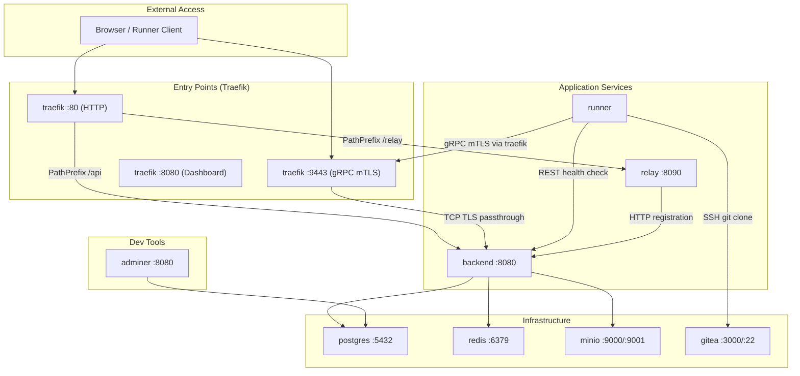
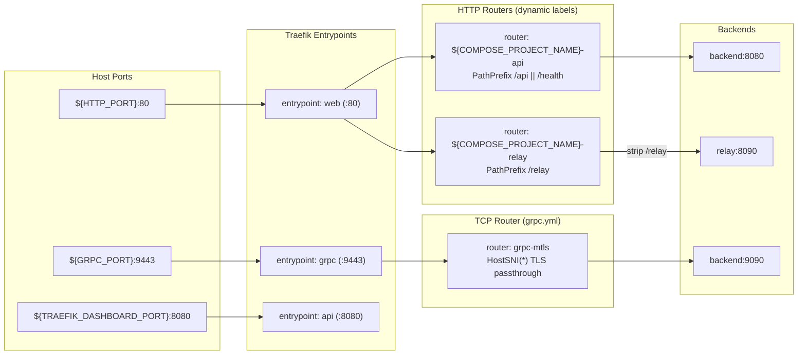

<!-- source: DeepWiki mcp.deepwiki.com · repo AgentsMesh/AgentsMesh · page 7.1 Docker Compose Services · fetched 2026-10-26 -->

# Docker Compose Services

<details>
<summary>Relevant source files</summary>

The following files were used as context for generating this wiki page:

- [.claude/skills/worktree/SKILL.md](.claude/skills/worktree/SKILL.md)
- [CLAUDE.md](CLAUDE.md)
- [deploy/dev/.gitignore](deploy/dev/.gitignore)
- [deploy/dev/backend.Dockerfile](deploy/dev/backend.Dockerfile)
- [deploy/dev/dev.sh](deploy/dev/dev.sh)
- [deploy/dev/docker-compose.yml](deploy/dev/docker-compose.yml)
- [deploy/dev/gitea/init-gitea.sh](deploy/dev/gitea/init-gitea.sh)
- [deploy/dev/init-seed.sh](deploy/dev/init-seed.sh)
- [deploy/dev/nginx/conf.d/default.conf](deploy/dev/nginx/conf.d/default.conf)
- [deploy/dev/nginx/nginx.conf](deploy/dev/nginx/nginx.conf)
- [deploy/dev/runner-entrypoint.sh](deploy/dev/runner-entrypoint.sh)
- [deploy/dev/runner-ssh/id_ed25519.pub](deploy/dev/runner-ssh/id_ed25519.pub)
- [deploy/dev/runner.Dockerfile](deploy/dev/runner.Dockerfile)
- [deploy/dev/seed/seed.sql](deploy/dev/seed/seed.sql)
- [deploy/dev/traefik/dynamic/grpc.yml](deploy/dev/traefik/dynamic/grpc.yml)
- [deploy/dev/web.Dockerfile](deploy/dev/web.Dockerfile)
- [relay/.air.toml](relay/.air.toml)
- [runner/.gitignore](runner/.gitignore)
- [runner/internal/config/config_grpc_test.go](runner/internal/config/config_grpc_test.go)
- [runner/internal/envpath/envpath_test.go](runner/internal/envpath/envpath_test.go)
- [web/src/components/ui/block-editor.tsx](web/src/components/ui/block-editor.tsx)
- [web/src/lib/api/base.ts](web/src/lib/api/base.ts)

</details>


This page documents the individual services defined in `deploy/dev/docker-compose.yml` — the Docker Compose file used by the local development environment. It covers each service's image or Dockerfile, exposed ports, environment variables, volumes, health checks, and inter-service dependencies.

For the overall dev workflow (running `dev.sh`, database migrations, seed data, and local runner setup), see [Development Environment](#7). For Gitea initialization and SSH deploy key setup, see [Local Runner and Gitea Setup](#7.2).

---

## Service Map

**Docker Compose service dependency and routing diagram:**



Sources: [deploy/dev/docker-compose.yml:1-420](), [deploy/dev/traefik/dynamic/grpc.yml:1-20]()

---

## Services

### postgres

| Property | Value |
|----------|-------|
| Image | `postgres:16-alpine` |
| Host Port | `${POSTGRES_PORT:-5432}` → container `5432` |
| Database | `agentsmesh` |
| User | `agentsmesh` |
| Password | `${POSTGRES_PASSWORD:-agentsmesh_dev}` |
| Volume | `postgres_data:/var/lib/postgresql/data` |

The primary relational database. All backend domain models (users, organizations, runners, pods, tickets, channels) are persisted here.

**Health check:** `pg_isready -U agentsmesh` — interval 10s, retries 5. Both `backend` and `runner` declare `condition: service_healthy` dependencies that block on this check.

Sources: [deploy/dev/docker-compose.yml:18-33]()

---

### redis

| Property | Value |
|----------|-------|
| Image | `redis:7-alpine` |
| Host Port | `${REDIS_PORT:-6379}` → container `6379` |
| Persistence | AOF via `--appendonly yes` |
| Volume | `redis_data:/data` |

Used by the backend for caching, session storage, and the event bus (pub/sub). The backend connects using `REDIS_URL=redis://redis:6379`.

**Health check:** `redis-cli ping` — interval 10s, retries 5.

Sources: [deploy/dev/docker-compose.yml:36-48]()

---

### minio

| Property | Value |
|----------|-------|
| Image | `minio/minio:latest` |
| API Host Port | `${MINIO_API_PORT:-9000}` → container `9000` |
| Console Host Port | `${MINIO_CONSOLE_PORT:-9001}` → container `9001` |
| Credentials | `${MINIO_ROOT_USER:-minioadmin}` / `${MINIO_ROOT_PASSWORD:-minioadmin}` |
| Volume | `minio_data:/data` |

S3-compatible object storage. The backend is configured with:

```
STORAGE_ENDPOINT=minio:9000          # internal Docker hostname
STORAGE_PUBLIC_ENDPOINT=localhost:${MINIO_API_PORT}  # for presigned URL generation
STORAGE_BUCKET=agentsmesh
STORAGE_USE_PATH_STYLE=true
```

**Health check:** `mc ready local` — interval 10s, retries 5.

Sources: [deploy/dev/docker-compose.yml:51-68](), [deploy/dev/docker-compose.yml:169-179]()

---

### gitea

| Property | Value |
|----------|-------|
| Image | `gitea/gitea:1.22` |
| HTTP Host Port | `${GITEA_HTTP_PORT:-3001}` → container `3000` |
| SSH Host Port | `${GITEA_SSH_PORT:-2222}` → container `22` |
| Database | SQLite (embedded) |
| Volume | `gitea_data:/data` |

A lightweight self-hosted Git server used by the local development environment so the runner can clone and push to repositories without requiring external access.

Key configuration:
- `GITEA__security__INSTALL_LOCK=true` — skips first-run wizard.
- `GITEA__server__ROOT_URL=http://gitea:3000/` — internal Docker DNS name.
- `GITEA__service__DISABLE_REGISTRATION=true` — users are created by the init script only.

After Gitea starts, `dev.sh` calls `deploy/dev/gitea/init-gitea.sh` to create the `gitea-admin` user, the `dev-org` organization, the `demo-webapp` and `demo-api` repos, and registers the runner's SSH deploy key.

**Health check:** `curl -f http://localhost:3000/api/v1/version` — interval 10s, start_period 30s, retries 10.

Sources: [deploy/dev/docker-compose.yml:69-98](), [deploy/dev/gitea/init-gitea.sh:1-245]()

---

### adminer

| Property | Value |
|----------|-------|
| Image | `adminer:latest` |
| Host Port | `${ADMINER_PORT:-8081}` → container `8080` |
| Depends On | `postgres` |

A database management web UI. Access at `http://localhost:${ADMINER_PORT}`. No health check is defined. It does not expose any application-critical path.

Sources: [deploy/dev/docker-compose.yml:100-107]()

---

### backend

The Go API server, rebuilt on source changes using [Air](https://github.com/air-verse/air).

| Property | Value |
|----------|-------|
| Dockerfile | `deploy/dev/backend.Dockerfile` |
| Internal port | `8080` (not exposed directly; routed via Traefik) |
| gRPC port | `9090` (internal only; routed via Traefik TLS passthrough) |
| Depends On | `postgres` (healthy), `redis` (healthy) |

**Build context:** `deploy/dev/backend.Dockerfile` installs `air` and `golang-migrate`, then downloads Go modules. Source code at `../../backend` is bind-mounted for hot reload.

**Key environment variables:**

| Variable | Value in Dev |
|----------|-------------|
| `PRIMARY_DOMAIN` | `localhost:${HTTP_PORT}` |
| `USE_HTTPS` | `false` |
| `DB_HOST` | `postgres` |
| `REDIS_URL` | `redis://redis:6379` |
| `STORAGE_ENDPOINT` | `minio:9000` |
| `PKI_CA_CERT_FILE` | `/app/ssl/ca.crt` |
| `PKI_CA_KEY_FILE` | `/app/ssl/ca.key` |
| `GRPC_ADDRESS` | `:9090` |
| `GRPC_PUBLIC_ENDPOINT` | `grpcs://127.0.0.1:${GRPC_PORT}` |
| `SERVER_ADDRESS` | `:8080` |
| `EMAIL_PROVIDER` | `console` (prints to stdout) |

**Volumes:**

| Host Path | Container Path | Purpose |
|-----------|----------------|---------|
| `../../backend` | `/app` | Source code (hot reload) |
| `../../proto` | `/proto` | Shared proto module |
| `go-mod-cache` | `/go/pkg/mod` | Go module cache |
| `go-build-cache` | `/root/.cache/go-build` | Go build cache |
| `../../backend/logs` | `/app/logs` | Log files |
| `./ssl` | `/app/ssl:ro` | CA cert/key for PKI |

**Traefik routing labels:**

```
PathPrefix(`/api`) || PathPrefix(`/health`) → backend:8080
```

Router name is prefixed with `${COMPOSE_PROJECT_NAME}` to prevent conflicts between simultaneously running worktrees.

**Health check:** `wget --spider http://localhost:8080/health` — interval 30s, start_period 30s.

Sources: [deploy/dev/docker-compose.yml:109-244](), [deploy/dev/backend.Dockerfile:1-30]()

---

### runner

The Runner daemon, run as UID/GID `1000:1000` (non-root) for compatibility with AI CLI tools such as Claude Code.

| Property | Value |
|----------|-------|
| Dockerfile | `deploy/dev/runner.Dockerfile` |
| User | `1000:1000` (user `runner`) |
| Depends On | `backend` (healthy) |

**Build:** `deploy/dev/runner.Dockerfile` installs `air`, AI CLI tools (`claude`, `codex`, `gemini`, `opencode`), creates the `runner` user, and pre-downloads Go modules. Source at `../../runner` is bind-mounted.

**Startup:** The `entrypoint` field points to `deploy/dev/runner-entrypoint.sh` (mounted read-only). This script:
1. Polls `${BACKEND_URL}/health` until the backend is ready.
2. Generates a client TLS certificate signed by the CA in `/app/ssl/` (ECDSA P-256, CN=`dev-runner`, O=`dev-org`).
3. Initializes AI CLI config files (Claude, Codex, Gemini).
4. Writes `~/.agentsmesh/config.yaml` with gRPC endpoint and cert paths.
5. Launches `air` for hot-reload of the runner binary.

**Key environment variables:**

| Variable | Value |
|----------|-------|
| `BACKEND_URL` | `http://backend:8080` |
| `GRPC_ENDPOINT` | `traefik:9443` |
| `RUNNER_NODE_ID` | `dev-runner` |
| `RUNNER_ORG_SLUG` | `dev-org` |
| `MAX_CONCURRENT_PODS` | `10` |
| `WORKSPACE` | `/workspace` |

**Volumes:**

| Mount | Container Path | Purpose |
|-------|----------------|---------|
| `../../runner` | `/app` | Source code (hot reload) |
| `./ssl` | `/app/ssl:ro` | CA cert for signing runner cert |
| `runner_workspace` | `/workspace` | Pod sandbox workspaces |
| `runner_config` | `/home/runner/.agentsmesh` | Persisted runner config & certs |
| `runner_claude_config` | `/home/runner/.claude` | Claude Code config |
| `runner_codex_config` | `/home/runner/.codex` | OpenAI Codex config |
| `runner_gemini_config` | `/home/runner/.gemini` | Gemini CLI config |
| `./runner-ssh` | `/home/runner/.ssh:ro` | SSH deploy key for Git |
| `runner-go-mod-cache` | `/go/pkg/mod` | Go module cache |
| `runner-go-build-cache` | `/home/runner/.cache/go-build` | Go build cache |

Sources: [deploy/dev/docker-compose.yml:249-320](), [deploy/dev/runner.Dockerfile:1-127](), [deploy/dev/runner-entrypoint.sh:1-344]()

---

### relay

The WebSocket relay service that forwards terminal data between browsers and runners.

| Property | Value |
|----------|-------|
| Dockerfile | `deploy/dev/relay.Dockerfile` |
| Internal port | `8090` (not exposed directly; routed via Traefik) |
| Depends On | `backend` (healthy) |

**Key environment variables:**

| Variable | Value |
|----------|-------|
| `SERVER_ADDRESS` | `:8090` |
| `JWT_SECRET` | `${JWT_SECRET}` (must match backend) |
| `BACKEND_URL` | `http://backend:8080` |
| `INTERNAL_API_SECRET` | `${INTERNAL_API_SECRET}` |
| `RELAY_ID` | `dev-relay-1` |
| `RELAY_INTERNAL_URL` | `ws://relay:8090` |
| `PRIMARY_DOMAIN` | `${PRIMARY_DOMAIN}` |

`RELAY_INTERNAL_URL` is the Docker-internal address that runners use to connect directly. The public WebSocket URL (`ws(s)://{PRIMARY_DOMAIN}/relay`) is derived from `PRIMARY_DOMAIN` and is the address used by browsers.

**Traefik routing labels:**

```
PathPrefix(`/relay`) → strip /relay prefix → relay:8090
```

A `stripprefix` middleware removes the `/relay` path prefix before forwarding to the relay container.

**Volumes:** Source code, proto module, and Go caches — same pattern as backend and runner.

**Health check:** `wget --spider http://localhost:8090/health` — interval 30s, start_period 10s.

Sources: [deploy/dev/docker-compose.yml:321-383]()

---

### traefik

The unified HTTP/gRPC entry point for the development environment.

| Property | Value |
|----------|-------|
| Image | `traefik:v3.2` |
| HTTP Host Port | `${HTTP_PORT:-80}` → container `80` |
| gRPC Host Port | `${GRPC_PORT:-9443}` → container `9443` |
| Dashboard Host Port | `${TRAEFIK_DASHBOARD_PORT:-8080}` → container `8080` |
| Depends On | `backend` |

**Configuration files** (bind-mounted read-only):
- `./traefik/traefik.yml` — static config (generated by `dev.sh`'s `generate_traefik_config`). Defines entry points `web` (`:80`) and `grpc` (`:9443`), enables the Docker provider with constraints scoped to `COMPOSE_PROJECT_NAME`.
- `./traefik/dynamic/grpc.yml` — dynamic config for gRPC TLS passthrough.

**gRPC TLS passthrough:** The `grpc` entry point uses a TCP router with `HostSNI("*")` and `tls.passthrough: true`. This forwards the raw TLS stream to `backend:9090` without Traefik terminating TLS. The backend performs mTLS verification itself.

**Routing diagram:**



Sources: [deploy/dev/docker-compose.yml:384-400](), [deploy/dev/traefik/dynamic/grpc.yml:1-20](), [deploy/dev/dev.sh:136-168]()

---

## Volumes

All named volumes are declared at the bottom of `docker-compose.yml`.

| Volume | Used By | Purpose |
|--------|---------|---------|
| `postgres_data` | `postgres` | PostgreSQL data files |
| `redis_data` | `redis` | Redis AOF persistence |
| `minio_data` | `minio` | Object storage data |
| `gitea_data` | `gitea` | Gitea repos, config, SQLite DB |
| `go-mod-cache` | `backend` | Go module cache |
| `go-build-cache` | `backend` | Go build artifact cache |
| `runner-go-mod-cache` | `runner` | Runner Go module cache |
| `runner-go-build-cache` | `runner` | Runner build artifact cache |
| `runner_workspace` | `runner` | Pod sandbox working directories |
| `runner_config` | `runner` | `~/.agentsmesh` — config + mTLS certs |
| `runner_claude_config` | `runner` | `~/.claude` — Claude Code session |
| `runner_codex_config` | `runner` | `~/.codex` — Codex CLI config |
| `runner_gemini_config` | `runner` | `~/.gemini` — Gemini CLI config |
| `relay-go-mod-cache` | `relay` | Relay Go module cache |
| `relay-go-build-cache` | `relay` | Relay build artifact cache |

Sources: [deploy/dev/docker-compose.yml:402-420]()

---

## Port Allocation

`dev.sh` assigns each worktree a unique `PORT_OFFSET` value (0–500) derived from a hash of the git worktree name. Ports are calculated as:

```
HTTP_PORT  = 10000 + offset * 50
GRPC_PORT  = 10001 + offset * 50
POSTGRES   = 10002 + offset * 50
REDIS      = 10003 + offset * 50
MINIO_API  = 10004 + offset * 50
MINIO_CON  = 10005 + offset * 50
ADMINER    = 10006 + offset * 50
WEB_PORT   = 10007 + offset * 50
TRAEFIK    = 10008 + offset * 50
GITEA_HTTP = 10009 + offset * 50
GITEA_SSH  = 10010 + offset * 50
```

The `main` branch always uses offset 0, giving it the base port values. A secondary worktree gets a deterministic but non-conflicting set of ports, allowing multiple worktrees to run in parallel on the same machine.

The `COMPOSE_PROJECT_NAME` is set to `agentsmesh-${worktree_name}`, which namespaces all containers, volumes, networks, and Traefik router names.

Sources: [deploy/dev/dev.sh:54-69](), [deploy/dev/dev.sh:185-244]()

---

## Hot Reload

Both `backend` and `runner` (and `relay`) use [Air](https://github.com/air-verse/air) for hot reload in development:

- **backend:** `CMD ["air", "-c", ".air.toml"]` — watches `../../backend`, rebuilds `./cmd/server` on `.go` changes.
- **runner:** entrypoint script calls `exec air -c .air.toml` if `air` is on PATH.
- **relay:** Air config at `relay/.air.toml` builds `./cmd/relay` with a `kill_delay = "5s"` to allow the old process to release port `8090` before the new binary starts.

The web frontend (`web` and `web-admin`) intentionally runs **outside Docker** for better Turbopack performance. `dev.sh` starts the local Next.js process directly. See [Development Environment](#7) for details.

Sources: [deploy/dev/backend.Dockerfile:28-30](), [deploy/dev/runner-entrypoint.sh:315-327](), [relay/.air.toml:1-50]()

---

