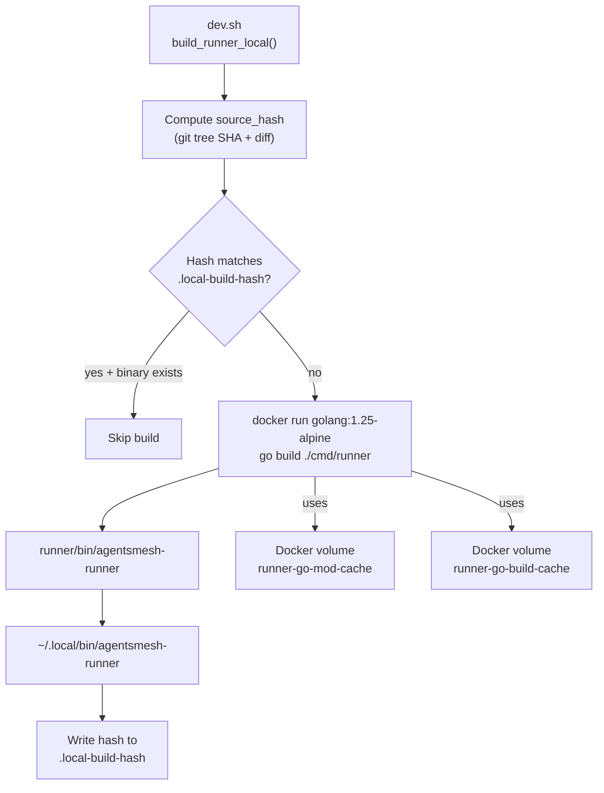
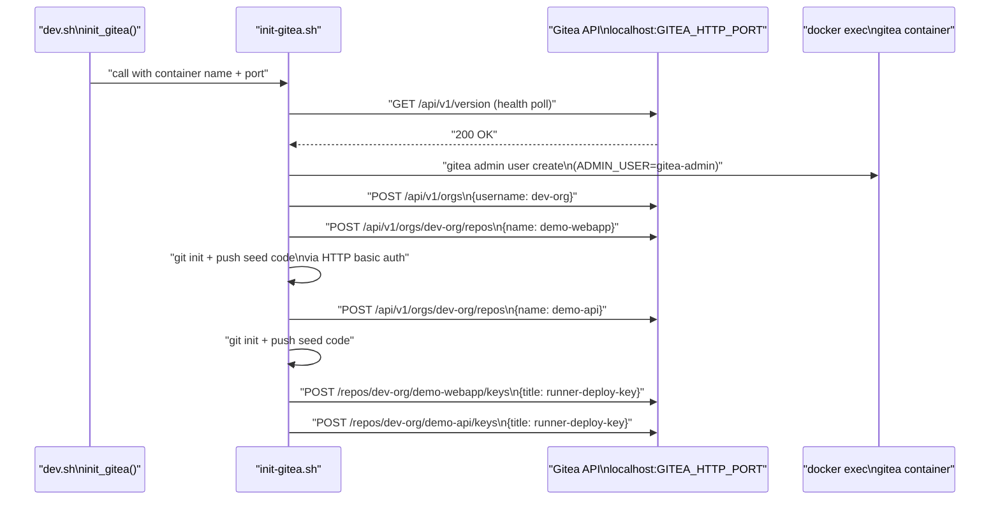
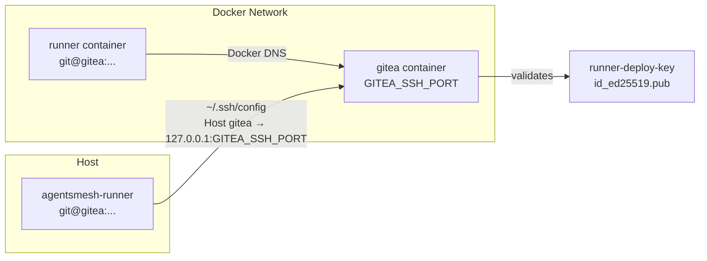
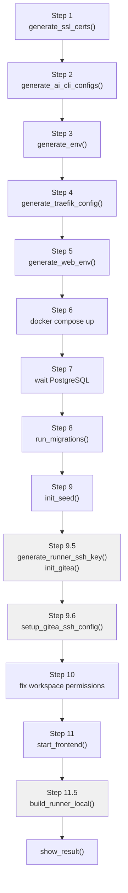

<!-- source: DeepWiki mcp.deepwiki.com · repo AgentsMesh/AgentsMesh · page 7.2 Local Runner and Gitea Setup · fetched 2026-10-26 -->

# Local Runner and Gitea Setup

<details>
<summary>Relevant source files</summary>

The following files were used as context for generating this wiki page:

- [deploy/dev/dev.sh](deploy/dev/dev.sh)
- [deploy/dev/gitea/init-gitea.sh](deploy/dev/gitea/init-gitea.sh)
- [deploy/dev/runner-ssh/id_ed25519.pub](deploy/dev/runner-ssh/id_ed25519.pub)
- [relay/.air.toml](relay/.air.toml)
- [runner/.gitignore](runner/.gitignore)
- [runner/.goreleaser.yml](runner/.goreleaser.yml)
- [runner/README.md](runner/README.md)
- [runner/internal/config/config.go](runner/internal/config/config.go)
- [runner/internal/config/config_defaults_test.go](runner/internal/config/config_defaults_test.go)
- [runner/internal/config/config_grpc_test.go](runner/internal/config/config_grpc_test.go)
- [runner/internal/envpath/envpath_test.go](runner/internal/envpath/envpath_test.go)
- [web/public/install.ps1](web/public/install.ps1)
- [web/public/install.sh](web/public/install.sh)
- [web/src/app/docs/runners/setup/page.tsx](web/src/app/docs/runners/setup/page.tsx)

</details>


This page covers the developer-side workflows that `dev.sh` orchestrates beyond the Docker Compose services: building the runner binary from source, assigning worktree-isolated port ranges, initializing Gitea with seed repositories and SSH deploy keys, and registering a local runner process against the development backend. For the Docker Compose service definitions themselves, see [7.1](#7.1). For general runner installation and registration in production, see [3.1](#3.1).

---

## Local Runner Binary Build

The `build_runner_local` function in [deploy/dev/dev.sh:735-802]() compiles the runner from local source using a Docker container running `golang:1.25-alpine`. **No local Go toolchain is required.**

### Build Mechanics

- **Source hash detection** — A hash is computed from the git tree SHAs of `runner/` and `proto/` plus any uncommitted diff. If the hash matches `.local-build-hash` and the binary exists, the build is skipped.
- **Docker volume reuse** — The same Go module cache and build cache volumes used by the Docker Compose `runner` service (`runner-go-mod-cache`, `runner-go-build-cache`) are reused, so repeated builds are fast.
- **Output path** — The binary is installed to `~/.local/bin/agentsmesh-runner`. If that directory is absent from `$PATH`, `dev.sh` prints a warning with the required export line.
- **Target platform** — The build targets `GOOS=darwin GOARCH=arm64` (the developer's host). Cross-compilation targets for CI are handled by GoReleaser (see [8.2](#8.2)).

**Diagram: build_runner_local data flow**



Sources: [deploy/dev/dev.sh:735-802](), [runner/.gitignore:1-2]()

---

## Port Allocation by Worktree

To allow multiple git worktrees to run simultaneously without port conflicts, `dev.sh` assigns each worktree a deterministic port offset.

### Algorithm

1. **`get_worktree_name()`** ([deploy/dev/dev.sh:42-52]()) — reads `git rev-parse --git-dir`. If the path contains `.git/worktrees/<name>`, it extracts `<name>`; otherwise it uses the current branch name. Non-alphanumeric characters are replaced with `-` and lowercased.

2. **`calculate_port_offset()`** ([deploy/dev/dev.sh:55-69]()) — for `main` or `master`, offset is `0`. For any other name, a 6-character hex MD5 prefix is taken and reduced to the range `1–500` via modulo, giving a step of 50 ports per worktree.

3. **Port formula** — All service ports follow `BASE + (offset × 50)`, where `BASE` is the service's base port:

| Service | Base port | Env var |
|---|---|---|
| Traefik HTTP | 10000 | `HTTP_PORT` |
| Traefik gRPC | 10001 | `GRPC_PORT` |
| PostgreSQL | 10002 | `POSTGRES_PORT` |
| Redis | 10003 | `REDIS_PORT` |
| MinIO API | 10004 | `MINIO_API_PORT` |
| MinIO Console | 10005 | `MINIO_CONSOLE_PORT` |
| Adminer | 10006 | `ADMINER_PORT` |
| Web (Next.js) | 10007 | `WEB_PORT` |
| Traefik Dashboard | 10008 | `TRAEFIK_DASHBOARD_PORT` |
| Gitea HTTP | 10009 | `GITEA_HTTP_PORT` |
| Gitea SSH | 10010 | `GITEA_SSH_PORT` |

For example, a worktree named `feature-auth` with MD5 prefix `a3f1b2` gets `offset = (0xa3f1b2 % 500) + 1 = 179`, so its HTTP port is `10000 + 179 × 50 = 18950`.

The computed values are written to `deploy/dev/.env` by `generate_env()` ([deploy/dev/dev.sh:171-245]()) and are idempotent — if `.env` already exists for the current project name, ports are preserved to keep runner configs stable.

Sources: [deploy/dev/dev.sh:42-69](), [deploy/dev/dev.sh:171-245]()

---

## Gitea Initialization

Gitea is a self-hosted Git service running as a Docker container. The `init_gitea()` function in [deploy/dev/dev.sh:413-435]() waits for Gitea's HTTP API to become reachable, then delegates to [deploy/dev/gitea/init-gitea.sh]().

### Initialization Steps

**Diagram: init-gitea.sh execution sequence**



Sources: [deploy/dev/dev.sh:413-435](), [deploy/dev/gitea/init-gitea.sh:1-243]()

### Admin Credentials

| Resource | Value |
|---|---|
| Admin user | `gitea-admin` |
| Admin password | `gitea-admin-123` |
| Organization | `dev-org` |
| Seed repos | `dev-org/demo-webapp`, `dev-org/demo-api` |

### Deploy Key Registration

The `add_deploy_key()` function ([deploy/dev/gitea/init-gitea.sh:146-211]()) handles key rotation: it compares the fingerprint of the currently registered key (title `runner-deploy-key`) against the local public key (`deploy/dev/runner-ssh/id_ed25519.pub`). If they differ, the stale key is deleted before the new one is registered. This ensures that re-generated SSH keys (e.g., on a new machine) are automatically propagated without manual cleanup.

Sources: [deploy/dev/gitea/init-gitea.sh:146-211]()

---

## Runner SSH Key and Host Configuration

### Generating the SSH Keypair

`generate_runner_ssh_key()` ([deploy/dev/dev.sh:440-454]()) creates an ed25519 keypair at `deploy/dev/runner-ssh/id_ed25519` if it does not exist. The private key is excluded from version control via `.gitignore`; only `id_ed25519.pub` is committed ([deploy/dev/runner-ssh/id_ed25519.pub:1-1]()). The key comment is `agentsmesh-dev-runner@local`.

### SSH Config for Host-Side Runners

Inside Docker, the hostname `gitea` resolves via Docker's internal DNS. A local runner process running on the host has no such resolution. `setup_gitea_ssh_config()` ([deploy/dev/dev.sh:462-497]()) writes a managed block to `~/.ssh/config` that maps the `gitea` hostname to `127.0.0.1` on the worktree-specific `GITEA_SSH_PORT`:

```
# BEGIN AgentsMesh dev gitea
Host gitea
    HostName 127.0.0.1
    Port <GITEA_SSH_PORT>
    IdentityFile <repo>/deploy/dev/runner-ssh/id_ed25519
    IdentitiesOnly yes
    StrictHostKeyChecking no
    UserKnownHostsFile /dev/null
# END AgentsMesh dev gitea
```

The function is idempotent: it removes any existing `BEGIN AgentsMesh dev gitea … END` block before writing, so it can be re-run safely after a port change.

With this in place, any `git@gitea:dev-org/demo-webapp.git` clone URL issued from the host resolves correctly.

**Diagram: SSH resolution paths for Docker vs. host runners**



Sources: [deploy/dev/dev.sh:440-497](), [deploy/dev/runner-ssh/id_ed25519.pub:1-1]()

---

## Registering and Running a Local Runner

After `dev.sh` completes, a locally built binary is available at `~/.local/bin/agentsmesh-runner`. To register and connect it to the local backend:

```bash
# Obtain a token from the dev UI: Settings → Runners → Create Token
agentsmesh-runner register \
  --server http://localhost:<HTTP_PORT> \
  --token <TOKEN>

# Start the runner (foreground)
agentsmesh-runner run
```

The `register` command writes `~/.agentsmesh/config.yaml` with the `server_url`, `grpc_endpoint` (`grpcs://127.0.0.1:<GRPC_PORT>`), and mTLS certificate paths. `dev.sh` displays the exact `HTTP_PORT` in the startup summary printed by `show_result()` ([deploy/dev/dev.sh:626-655]()).

The runner configuration file structure is defined by `Config` in [runner/internal/config/config.go:12-79](). Key fields relevant to local development:

| Field | Source | Local dev value |
|---|---|---|
| `server_url` | `register` flag | `http://localhost:<HTTP_PORT>` |
| `grpc_endpoint` | assigned during `register` | `grpcs://127.0.0.1:<GRPC_PORT>` |
| `cert_file` / `key_file` / `ca_file` | written by `register` | `~/.agentsmesh/certs/` |
| `workspace_root` | default | `/workspace` |
| `mcp_port` | default | `19000` |

Sources: [deploy/dev/dev.sh:626-655](), [runner/internal/config/config.go:12-79]()

---

## Resetting Runners

The `reset_runners()` function ([deploy/dev/dev.sh:501-594]()) provides a clean-slate recovery when runners are in a bad state:

1. Kills any `agentsmesh-runner` process on the host via `pkill`.
2. Releases ports `19000` (MCP server), `19080` (web console), and `9090` (health check) if occupied.
3. Starts Docker Desktop if not running.
4. Force-recreates the Docker `runner` and `relay` containers.
5. Patches `~/.agentsmesh/config.yaml` if `grpc_endpoint` does not match the current `GRPC_PORT` from `.env`.

Invoke it with:

```bash
./dev.sh --reset-runners
```

Sources: [deploy/dev/dev.sh:501-594]()

---

## Full dev.sh Initialization Sequence

The following diagram maps each step in `main()` to the function it calls, showing where the local runner and Gitea work fits in the overall startup flow.

**Diagram: dev.sh main() step → function mapping**



> Steps 9.5, 9.6, and 11.5 are the Gitea and local runner steps documented on this page.

Sources: [deploy/dev/dev.sh:804-896]()

---

