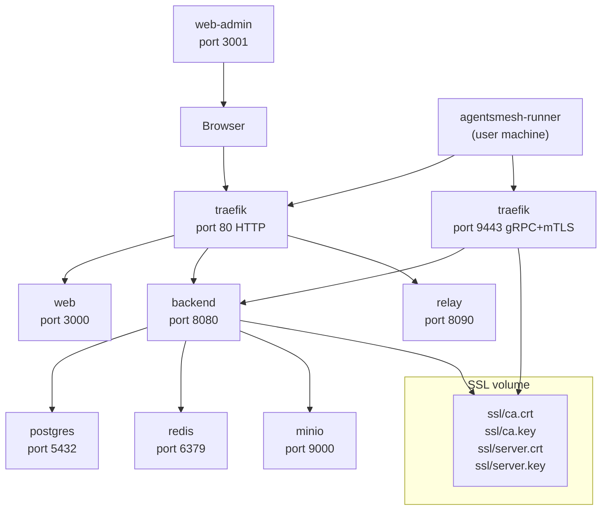

<!-- source: DeepWiki mcp.deepwiki.com · repo AgentsMesh/AgentsMesh · page 8 Deployment · fetched 2026-10-26 -->

# Deployment

<details>
<summary>Relevant source files</summary>

The following files were used as context for generating this wiki page:

- [.gitlab-ci.yml](.gitlab-ci.yml)
- [backend/internal/infra/storage/s3.go](backend/internal/infra/storage/s3.go)
- [ci/backend.Dockerfile](ci/backend.Dockerfile)
- [ci/build-onpremise.sh](ci/build-onpremise.sh)
- [ci/pack-onpremise.sh](ci/pack-onpremise.sh)
- [ci/relay.Dockerfile](ci/relay.Dockerfile)
- [ci/runner.Dockerfile](ci/runner.Dockerfile)
- [ci/web-admin.Dockerfile](ci/web-admin.Dockerfile)
- [ci/web.Dockerfile](ci/web.Dockerfile)
- [deploy/dev/runner-ssh/README.md](deploy/dev/runner-ssh/README.md)
- [deploy/onpremise/README.md](deploy/onpremise/README.md)
- [deploy/onpremise/docker-compose.yml](deploy/onpremise/docker-compose.yml)
- [deploy/onpremise/scripts/generate-certs.sh](deploy/onpremise/scripts/generate-certs.sh)
- [deploy/onpremise/scripts/install.sh](deploy/onpremise/scripts/install.sh)
- [deploy/onpremise/scripts/load-images.sh](deploy/onpremise/scripts/load-images.sh)
- [deploy/onpremise/seed/onpremise-seed.sql](deploy/onpremise/seed/onpremise-seed.sql)
- [e2e/README.md](e2e/README.md)
- [runner/internal/workspace/repo_auth.go](runner/internal/workspace/repo_auth.go)
- [runner/internal/workspace/workspace.go](runner/internal/workspace/workspace.go)
- [runner/internal/workspace/workspace_utils.go](runner/internal/workspace/workspace_utils.go)
- [web/src/lib/terminalScheduler.ts](web/src/lib/terminalScheduler.ts)
- [web/vitest.config.ts](web/vitest.config.ts)

</details>


This page provides an overview of the three deployment models used by AgentsMesh: the hosted SaaS CI/CD pipeline, the public runner binary release process, and on-premise self-hosted installation. For local development setup, see [Development Environment](#7).

---

## Deployment Models

AgentsMesh is designed to support two distinct operator roles:

| Model | Who runs the infrastructure | Components deployed | Details |
|---|---|---|---|
| **SaaS (hosted)** | AgentsMesh team | Backend, Web, Web-Admin, Relay | [CI/CD Pipeline](#8.1), [Release Process](#8.2) |
| **On-Premise** | Customer team | All services (self-hosted) | [On-Premise Deployment](#8.3) |
| **Runner (BYOK)** | End user (agent host machine) | Runner binary only | [Installation and Registration](#3.1) |

In all deployment models, the Runner binary runs on the **user's own machine**. Only the control plane services (Backend, Web, Relay) vary between SaaS and on-premise.

---

## Service Components and Build Artifacts

Each service in the system has a corresponding Dockerfile and produced artifact.

**Service-to-Dockerfile mapping:**

| Service | Dockerfile | Image name | Port |
|---|---|---|---|
| Backend (Go) | `ci/backend.Dockerfile` | `agentsmesh/backend` | 8080 (HTTP), 9090 (gRPC) |
| Web Frontend (Next.js) | `ci/web.Dockerfile` | `agentsmesh/web` | 3000 |
| Web Admin (Next.js) | `ci/web-admin.Dockerfile` | `agentsmesh/web-admin` | 3001 |
| Relay (Go) | `ci/relay.Dockerfile` | `agentsmesh/relay` | 8090 |
| Runner (Go) | `ci/runner.Dockerfile` | `agentsmesh/runner` | — |

The runner binary is also distributed as a standalone binary via GitHub Releases and Homebrew; the Docker image is used for containerized or dev environments only.

Sources: [ci/backend.Dockerfile:1-67](), [ci/web.Dockerfile:1-94](), [ci/web-admin.Dockerfile:1-86](), [ci/runner.Dockerfile:1-72](), [ci/relay.Dockerfile:1-45]()

---

## Build Pipeline Overview

**Diagram: Pipeline stages and service images**

```mermaid
flowchart TD
    MR["Merge Request"] --> T["test stage"]
    MAIN["main branch push"] --> B["build stage"]
    TAG["git tag push"] --> RL["release stage"]

    T --> TB["test-backend"]
    T --> TW["test-web"]
    T --> TWA["test-web-admin"]
    T --> TR["test-runner"]
    T --> TRL["test-relay"]

    T --> VBB["verify-build-backend"]
    T --> VBW["verify-build-web"]
    T --> VBWA["verify-build-web-admin"]
    T --> VBR["verify-build-runner"]
    T --> VBRL["verify-build-relay"]

    B --> BBK["build-backend\nagentsmesh/backend:SHA"]
    B --> BW["build-web\nagentsmesh/web:SHA"]
    B --> BWA["build-web-admin\nagentsmesh/web-admin:SHA"]
    B --> BRN["build-runner\nagentsmesh/runner:SHA"]
    B --> BRL["build-relay\nagentsmesh/relay:SHA"]

    BBK --> DCN["deploy:cn-prod:backend"]
    BW --> DCW["deploy:cn-prod:web"]
    BWA --> DCWA["deploy:cn-prod:web-admin"]
    BRL --> DCRL["deploy:cn-prod:cn-relay-01"]
    DCN --> MCN["migrate:cn-prod"]

    BBK --> DUS["deploy:uswest-prod:backend"]
    BW --> DUW["deploy:uswest-prod:web"]
    BWA --> DUWA["deploy:uswest-prod:web-admin"]
    BRL --> DURL["deploy:uswest-prod:uswest-relay-01"]
    DUS --> MUS["migrate:uswest-prod"]

    RL --> GR["GoReleaser\nRunner binary"]
    RL --> HB["Homebrew tap update"]
```



Sources: [.gitlab-ci.yml:1-701]()

---

## SaaS Production Environments

The hosted SaaS deployment runs on two independent environments:

| Environment | GitLab env name | Primary URL | Notes |
|---|---|---|---|
| China | `cn-production` | `https://agentsmesh.cn` | Deploys to `aliyun-s001` |
| US West | `uswest-production` | `https://agentsmesh.ai` | Deploys to `aliyun-us-west-001` |

Each environment also has one or more relay nodes deployed separately:

| Relay node | Environment | URL |
|---|---|---|
| `cn-relay-01` | cn-production | `01.relay.agentsmesh.cn:8443` |
| `uswest-relay-01` | uswest-production | `01.relay.agentsmesh.ai:8443` |
| `uswest-relay-beijing-02` | uswest-production | `beijing-02.relay.agentsmesh.ai:8443` |

Deployments are triggered automatically on every push to `main` when relevant files change. Each deploy job SSH-executes a `deploy.sh` script on the target host. Database migrations run automatically after backend deployment when files under `backend/migrations/` change.

For complete pipeline details, see [CI/CD Pipeline](#8.1).

Sources: [.gitlab-ci.yml:415-701]()

---

## Runner Binary Distribution

The runner binary is released as a standalone executable targeting multiple OS/architecture combinations. It is distributed through:

- **GitHub Releases** — via GoReleaser, triggered on git tags
- **Homebrew tap** — automatically updated as part of the release pipeline
- **Windows installer** — bundled in the release artifacts
- **Install script** — `curl -fsSL https://agentsmesh.ai/install.sh | sh`

The runner does not require the hosted backend to be accessible during install; it only connects outbound during `register` and `run`. For details on the release pipeline configuration, see [Release Process](#8.2).

---

## On-Premise Deployment

On-premise deployment uses a Docker Compose stack that mirrors the production services, replacing external dependencies with locally managed containers.

**Diagram: On-premise docker-compose service topology**



Sources: [deploy/onpremise/docker-compose.yml:1-289]()

**On-premise installation steps:**

| Step | Tool | Description |
|---|---|---|
| 1 | `install.sh --ip <SERVER_IP>` | Main entry point; runs all steps below |
| 2 | `load-images.sh` | Loads pre-exported `.tar` images into Docker |
| 3 | `generate-certs.sh` | Generates CA + server TLS certs (ECDSA P-256) |
| 4 | `docker compose up -d` | Starts all services |
| 5 | `migrate` (in backend container) | Applies database schema migrations |
| 6 | `onpremise-seed.sql` | Creates admin user, default org, and runner token |

Sources: [deploy/onpremise/scripts/install.sh:1-324](), [deploy/onpremise/scripts/generate-certs.sh:1-96](), [deploy/onpremise/seed/onpremise-seed.sql:1-127]()

**Key configuration variables** set in the generated `.env`:

| Variable | Description |
|---|---|
| `SERVER_IP` | IP address for all service URLs |
| `DB_PASSWORD` | PostgreSQL password (randomly generated) |
| `JWT_SECRET` | Shared JWT signing secret |
| `INTERNAL_API_SECRET` | Backend-to-relay authentication |
| `MINIO_ROOT_PASSWORD` | MinIO admin password |
| `GRPC_PORT` | Port for runner gRPC connections (default: `9443`) |

The web and web-admin containers use a `docker-entrypoint.sh` pattern where `PRIMARY_DOMAIN` and `USE_HTTPS` are injected at container start time by replacing placeholder strings embedded during the Next.js build (`__PRIMARY_DOMAIN__`, `__USE_HTTPS__`).

For the complete on-premise setup guide, see [On-Premise Deployment](#8.3).

Sources: [ci/web.Dockerfile:35-36](), [ci/web-admin.Dockerfile:32-33](), [deploy/onpremise/docker-compose.yml:88-160]()

---

## Air-Gapped Packaging

For environments without internet access, the `ci/build-onpremise.sh` and `ci/pack-onpremise.sh` scripts produce a self-contained tarball:

```
agentsmesh-onpremise-{VERSION}.tar.gz
├── docker-compose.yml
├── .env.template
├── traefik/
├── ssl/           (generated by install.sh)
├── seed/
│   └── onpremise-seed.sql
├── images/
│   ├── backend.tar
│   ├── web.tar
│   ├── web-admin.tar
│   ├── relay.tar
│   ├── postgres.tar
│   ├── redis.tar
│   ├── minio.tar
│   └── traefik.tar
└── scripts/
    ├── install.sh
    ├── load-images.sh
    └── generate-certs.sh
```

The `load-images.sh` script loads each `.tar` into the local Docker daemon using `docker load`, making the installation fully offline after the tarball is transferred.

Sources: [ci/build-onpremise.sh:1-138](), [ci/pack-onpremise.sh:1-94](), [deploy/onpremise/scripts/load-images.sh:1-72](), [deploy/onpremise/README.md:83-114]()

---

