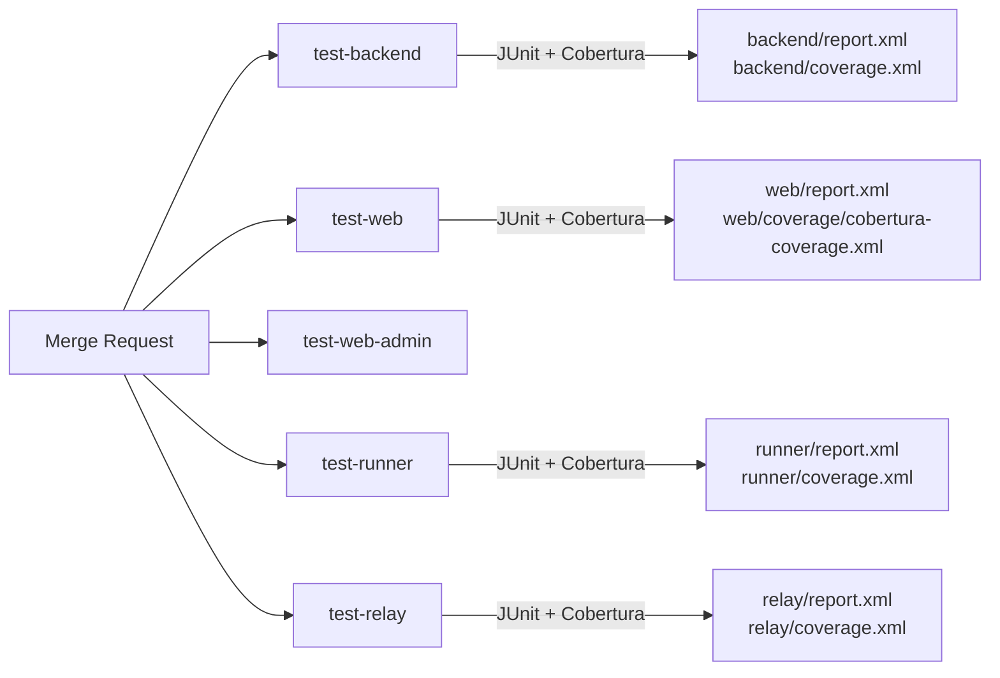
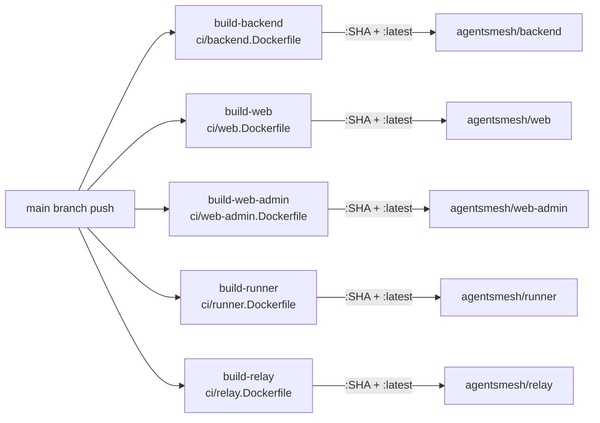
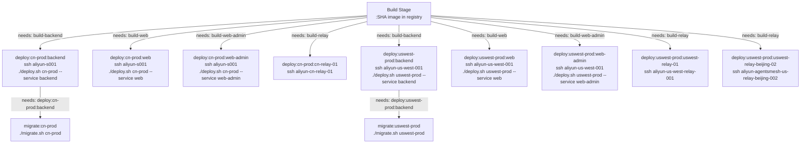
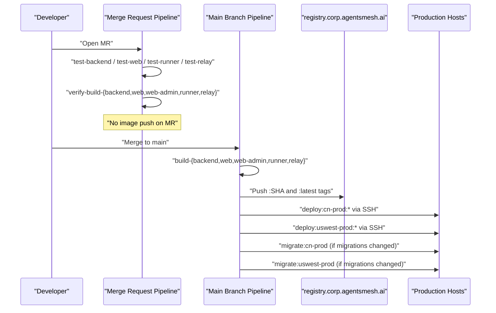

<!-- source: DeepWiki mcp.deepwiki.com · repo AgentsMesh/AgentsMesh · page 8.1 CI/CD Pipeline · fetched 2026-10-26 -->

# CI/CD Pipeline

<details>
<summary>Relevant source files</summary>

The following files were used as context for generating this wiki page:

- [.gitlab-ci.yml](.gitlab-ci.yml)
- [ci/backend.Dockerfile](ci/backend.Dockerfile)
- [ci/relay.Dockerfile](ci/relay.Dockerfile)
- [ci/runner.Dockerfile](ci/runner.Dockerfile)
- [ci/web-admin.Dockerfile](ci/web-admin.Dockerfile)
- [ci/web.Dockerfile](ci/web.Dockerfile)
- [runner/internal/workspace/repo_auth.go](runner/internal/workspace/repo_auth.go)
- [runner/internal/workspace/workspace.go](runner/internal/workspace/workspace.go)
- [runner/internal/workspace/workspace_utils.go](runner/internal/workspace/workspace_utils.go)
- [web/src/lib/terminalScheduler.ts](web/src/lib/terminalScheduler.ts)
- [web/vitest.config.ts](web/vitest.config.ts)

</details>


This page documents the GitLab CI/CD pipeline that builds, tests, and deploys the SaaS-hosted AgentsMesh services. It covers pipeline stages, job trigger rules, Dockerfile structure for each service, and multi-region deployment topology. For the runner binary release process (GitHub Actions, GoReleaser, code signing), see [8.2](#8.2). For on-premise deployment, see [8.3](#8.3).

---

## Overview

The pipeline is defined in [.gitlab-ci.yml:1-702]() and consists of five ordered stages:

| Stage | Purpose |
|---|---|
| `test` | Run unit tests and verify Docker builds on merge requests |
| `build` | Build and push Docker images on `main` branch commits |
| `package` | *(Reserved for future use / runner release packaging)* |
| `release` | *(Triggered by tags via included runner pipeline)* |
| `deploy` | Deploy images to production environments via SSH |

A secondary pipeline for the runner binary is included conditionally:

```yaml
include:
  - local: 'runner/.gitlab-ci.yml'
    rules:
      - if: $CI_COMMIT_TAG
```

[.gitlab-ci.yml:1-5]()

This means `runner/.gitlab-ci.yml` only activates on tagged commits. The main pipeline handles service deployments on every push to `main`.

---

## Global Variables

[.gitlab-ci.yml:7-22]()

| Variable | Value | Purpose |
|---|---|---|
| `REGISTRY` | `registry.corp.agentsmesh.ai` | Internal container registry |
| `BACKEND_IMAGE` | `${REGISTRY}/agentsmesh/backend` | Backend image name |
| `WEB_IMAGE` | `${REGISTRY}/agentsmesh/web` | Web frontend image name |
| `WEB_ADMIN_IMAGE` | `${REGISTRY}/agentsmesh/web-admin` | Admin panel image name |
| `RUNNER_IMAGE` | `${REGISTRY}/agentsmesh/runner` | Runner daemon image name |
| `RELAY_IMAGE` | `${REGISTRY}/agentsmesh/relay` | Relay service image name |
| `VERSION` | `${CI_COMMIT_TAG:-dev}` | Defaults to `dev` unless on a tag |
| `GO_VERSION` | `1.25` | Go toolchain version used in all Go builds |
| `GOPROXY` | `https://goproxy.cn,...,direct` | China-region Go module proxy |
| `NPM_REGISTRY` | `https://repo.huaweicloud.com/...` | China-region npm mirror |
| `REGISTRY_PREFIX` | `${REGISTRY}/library/` | Internal Docker Hub mirror prefix |

`REGISTRY_PREFIX` is passed as a `--build-arg` to every `docker build` call, allowing Dockerfiles to pull base images (e.g., `golang`, `node`, `alpine`) from the internal mirror rather than Docker Hub, avoiding rate-limit timeouts in CI.

Sources: [.gitlab-ci.yml:7-22]()

---

## Pipeline Trigger Rules

Jobs in this pipeline use GitLab's `rules` keyword for precise activation. There are two primary patterns:

**Pattern A — MR-only** (runs on merge request events, changes to specific paths):
```yaml
rules:
  - if: $CI_PIPELINE_SOURCE == "merge_request_event"
    changes:
      - backend/**/*
  - if: $CI_PIPELINE_SOURCE == "web"
```

**Pattern B — Main branch** (runs on pushes to `main`, same path filtering):
```yaml
rules:
  - if: $CI_COMMIT_BRANCH == "main"
    changes:
      - backend/**/*
      - proto/**/*
      - ci/backend.Dockerfile
  - if: $CI_PIPELINE_SOURCE == "web"
```

The `$CI_PIPELINE_SOURCE == "web"` condition allows manually triggering any job from the GitLab UI regardless of changed files.

Sources: [.gitlab-ci.yml:74-79](), [.gitlab-ci.yml:319-325]()

---

## Test Stage

The test stage runs two categories of jobs: **unit tests** and **build verification**.

### Unit Test Jobs

**Pipeline overview — Test stage:**



| Job | Image | Working Dir | Test Command |
|---|---|---|---|
| `test-backend` | `golang:${GO_VERSION}` | `backend/` | `gotestsum --junitfile report.xml -- -race -coverprofile=coverage.out ./...` |
| `test-web` | `node:20-alpine` | `web/` | `pnpm lint && pnpm test:run --coverage` |
| `test-web-admin` | `node:20-alpine` | `web-admin/` | `pnpm lint && pnpm build` |
| `test-runner` | `golang:${GO_VERSION}` | `runner/` | `gotestsum --junitfile report.xml -- -race -coverprofile=coverage.out ./...` |
| `test-relay` | `golang:${GO_VERSION}` | `relay/` | `gotestsum --junitfile report.xml -- -race -coverprofile=coverage.out ./...` |

- `test-backend` spins up `postgres:16-alpine` and `redis:7-alpine` as CI services, with `DATABASE_URL` and `REDIS_URL` injected as environment variables.
- Go tests run with the `-race` flag and atomic coverage mode.
- Coverage results are exported in Cobertura format for GitLab's coverage visualization.
- Web tests use Vitest configured in [web/vitest.config.ts:1-34](), with `jsdom` environment, `v8` coverage provider, and JUnit reporter.

Sources: [.gitlab-ci.yml:34-198](), [web/vitest.config.ts:1-34]()

### Build Verification Jobs

These jobs run only on merge requests and perform a full Docker build without pushing to the registry. They catch Dockerfile or source compilation errors before code is merged.

| Job | Dockerfile | Changed Paths Watched |
|---|---|---|
| `verify-build-backend` | `ci/backend.Dockerfile` | `backend/**/*`, `proto/**/*`, `ci/backend.Dockerfile` |
| `verify-build-web` | `ci/web.Dockerfile` | `web/**/*`, `ci/web.Dockerfile` |
| `verify-build-web-admin` | `ci/web-admin.Dockerfile` | `web-admin/**/*`, `ci/web-admin.Dockerfile` |
| `verify-build-runner` | `ci/runner.Dockerfile` | `runner/**/*`, `proto/**/*`, `ci/runner.Dockerfile` |
| `verify-build-relay` | `ci/relay.Dockerfile` | `relay/**/*`, `ci/relay.Dockerfile` |

Sources: [.gitlab-ci.yml:200-298]()

---

## Build Stage

Build jobs run only on pushes to the `main` branch. Each job produces two tags:

- `${IMAGE}:${CI_COMMIT_SHORT_SHA}` — immutable, pinned to a specific commit
- `${IMAGE}:latest` — floating tag, always points to the most recent main build

Both tags are pushed to the internal registry at `registry.corp.agentsmesh.ai`.

**Diagram — Build stage image outputs:**



The `backend` and `runner` builds require the `proto/` directory to be in the build context because their `go.mod` files reference it via a `replace` directive. Both Dockerfiles are therefore built from the project root with `-f ci/<service>.Dockerfile`.

Sources: [.gitlab-ci.yml:300-413](), [ci/backend.Dockerfile:15-18](), [ci/runner.Dockerfile:15-19]()

---

## Dockerfiles

All service Dockerfiles follow a multi-stage build pattern to minimize final image size.

### `ci/backend.Dockerfile`

[ci/backend.Dockerfile:1-67]()

| Stage | Base Image | Purpose |
|---|---|---|
| `builder` | `golang:${GO_VERSION}` | Compile the `server` binary with `CGO_ENABLED=0` |
| final | `alpine:3.19` | Runtime image with `ca-certificates`, `tzdata`, `curl`, `git`, and `migrate` |

Notable details:
- The `golang-migrate` binary is installed in the final image so database migrations can be run manually against the container.
- `proto/` is copied before `backend/go.mod` to satisfy the local module replace directive.
- A `/data/acme` directory is created for ACME (Let's Encrypt) certificate storage.
- The binary runs as a non-root `app` user (UID 1000).

### `ci/web.Dockerfile`

[ci/web.Dockerfile:1-94]()

| Stage | Base Image | Purpose |
|---|---|---|
| `deps` | `node:20-alpine` | Install npm/pnpm dependencies |
| `builder` | `node:20-alpine` | Run `pnpm build`, produce Next.js standalone output |
| `runner` | `node:20-alpine` | Serve `server.js` via `docker-entrypoint.sh` |

Key pattern: `NEXT_PUBLIC_PRIMARY_DOMAIN` and `NEXT_PUBLIC_USE_HTTPS` are baked into the build as placeholder strings (`__PRIMARY_DOMAIN__` and `__USE_HTTPS__`). The `docker-entrypoint.sh` script performs a string substitution at container start time, enabling runtime configuration without rebuilding the image. See [5.6](#5.6) for how the frontend resolves these at runtime.

### `ci/web-admin.Dockerfile`

[ci/web-admin.Dockerfile:1-86]()

Same three-stage pattern as `web.Dockerfile`. Runs on port `3001` instead of `3000`. Accepts `NPM_REGISTRY` as a `--build-arg` to point pnpm at the Huawei Cloud npm mirror during CI builds.

### `ci/runner.Dockerfile`

[ci/runner.Dockerfile:1-71]()

| Stage | Base Image | Purpose |
|---|---|---|
| `builder` | `golang:${GO_VERSION}` | Compile the `runner` binary with `CGO_ENABLED=0 -tags nocgo` |
| final | `alpine:3.19` | Runtime with `git`, `openssh-client`, `bash`, `curl` |

The `nocgo` build tag disables CGO-dependent code paths (e.g., PTY on Linux). Git and SSH are included because the runner clones repositories and manages worktrees. The working directory is `/workspace`.

### `ci/relay.Dockerfile`

[ci/relay.Dockerfile:1-45]()

The simplest Dockerfile: golang builder produces the `relay` binary, copied into a minimal `alpine:3.19` image with only `ca-certificates` and `tzdata`. Exposes port `8090`.

---

## Deploy Stage

Deployments are triggered automatically on `main` branch pushes (after successful builds) or manually via the GitLab UI. Deployments use SSH to reach production servers and run a `deploy.sh` script on each host.

**Diagram — Deploy stage topology:**



Sources: [.gitlab-ci.yml:415-701]()

### Production Environments

| Environment Name | URL | Primary Host |
|---|---|---|
| `cn-production` | `https://agentsmesh.cn` | `aliyun-s001` |
| `uswest-production` | `https://agentsmesh.ai` | `aliyun-us-west-001` |

### Relay Nodes

| Job Name | Host | Environment | URL |
|---|---|---|---|
| `deploy:cn-prod:cn-relay-01` | `aliyun-cn-relay-01` | `cn-production` | `https://01.relay.agentsmesh.cn:8443` |
| `deploy:uswest-prod:uswest-relay-01` | `aliyun-us-west-relay-001` | `uswest-production` | `https://01.relay.agentsmesh.ai:8443` |
| `deploy:uswest-prod:uswest-relay-beijing-02` | `aliyun-agentsmesh-us-relay-beijing-002` | `uswest-production` | `https://beijing-02.relay.agentsmesh.ai:8443` |

`uswest-relay-beijing-02` is described in the pipeline as a "Beijing accelerator for US West" — a relay node physically located in Beijing that serves users connecting to the US West backend.

### Deploy Script Invocation

Each service deployment follows this pattern on the remote host:

```
cd /opt/agentsmesh && git pull origin main
./deploy.sh <env> --service <service> --version <DEPLOY_VERSION>
```

`DEPLOY_VERSION` defaults to `${CI_COMMIT_SHORT_SHA}`. It can be overridden when triggering the pipeline manually (via `$CI_PIPELINE_SOURCE == "web"`) to perform a rollback to any previously built SHA.

Relay deployments use a slightly different invocation:

```
cd /opt/agentsmesh/relay && ./deploy.sh <relay-name> --pull
```

Sources: [.gitlab-ci.yml:434-438](), [.gitlab-ci.yml:508-510](), [.gitlab-ci.yml:639-641]()

---

## Database Migrations

Migration jobs run in the `deploy` stage and are gated on the corresponding backend deploy job completing successfully. They only activate when files under `backend/migrations/**/*` change.

| Job | Depends On | Host |
|---|---|---|
| `migrate:cn-prod` | `deploy:cn-prod:backend` | `aliyun-s001` |
| `migrate:uswest-prod` | `deploy:uswest-prod:backend` | `aliyun-us-west-001` |

Invocation on host:

```
./migrate.sh <env> --direction up [--steps N]
```

The `MIGRATE_DIRECTION` variable defaults to `up`. `MIGRATE_STEPS` is empty by default (runs all pending migrations). Both can be overridden for manual rollbacks via the GitLab web UI. Migrations run **after** the backend is deployed so the new binary is already in place.

The `migrate` binary is installed in the backend Docker image ([ci/backend.Dockerfile:35-38]()) but the migration job itself runs the `migrate.sh` script on the host rather than inside the container, keeping migration control out-of-band from the server process.

Sources: [.gitlab-ci.yml:521-546](), [.gitlab-ci.yml:673-701](), [ci/backend.Dockerfile:35-38]()

---

## Full Pipeline Flow

**End-to-end pipeline — Merge Request vs Main Branch:**



Sources: [.gitlab-ci.yml:1-702]()

---

