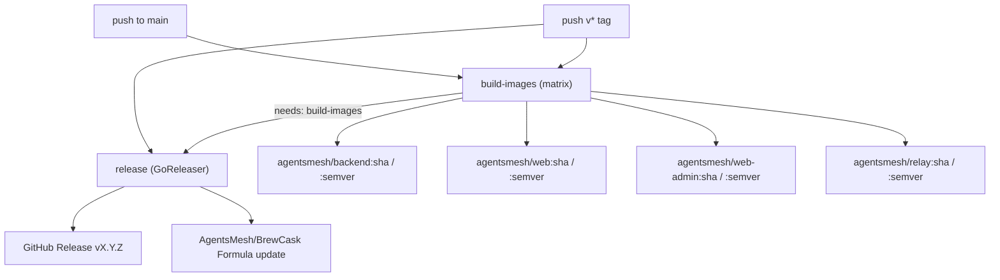
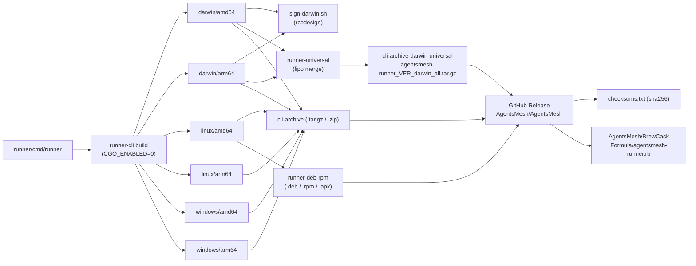

<!-- source: DeepWiki mcp.deepwiki.com · repo AgentsMesh/AgentsMesh · page 8.2 Release Process · fetched 2026-10-26 -->

# Release Process

<details>
<summary>Relevant source files</summary>

The following files were used as context for generating this wiki page:

- [.github/workflows/release.yml](.github/workflows/release.yml)
- [.gitlab-ci.yml](.gitlab-ci.yml)
- [backend/internal/service/runner/version_checker.go](backend/internal/service/runner/version_checker.go)
- [backend/internal/service/runner/version_checker_test.go](backend/internal/service/runner/version_checker_test.go)
- [ci/backend.Dockerfile](ci/backend.Dockerfile)
- [ci/relay.Dockerfile](ci/relay.Dockerfile)
- [ci/runner.Dockerfile](ci/runner.Dockerfile)
- [ci/web-admin.Dockerfile](ci/web-admin.Dockerfile)
- [ci/web.Dockerfile](ci/web.Dockerfile)
- [docs/rfc/RFC-003-runner-release-pipeline.md](docs/rfc/RFC-003-runner-release-pipeline.md)
- [runner/.goreleaser.yml](runner/.goreleaser.yml)
- [runner/README.md](runner/README.md)
- [runner/build/scripts/sign-darwin.sh](runner/build/scripts/sign-darwin.sh)
- [runner/internal/config/config.go](runner/internal/config/config.go)
- [runner/internal/config/config_defaults_test.go](runner/internal/config/config_defaults_test.go)
- [runner/internal/updater/updater.go](runner/internal/updater/updater.go)
- [runner/internal/updater/updater_test.go](runner/internal/updater/updater_test.go)
- [runner/internal/workspace/repo_auth.go](runner/internal/workspace/repo_auth.go)
- [runner/internal/workspace/workspace.go](runner/internal/workspace/workspace.go)
- [runner/internal/workspace/workspace_utils.go](runner/internal/workspace/workspace_utils.go)
- [web/public/install.ps1](web/public/install.ps1)
- [web/public/install.sh](web/public/install.sh)
- [web/src/app/docs/runners/setup/page.tsx](web/src/app/docs/runners/setup/page.tsx)
- [web/src/lib/terminalScheduler.ts](web/src/lib/terminalScheduler.ts)
- [web/vitest.config.ts](web/vitest.config.ts)

</details>


This page documents the public release pipeline for AgentsMesh: how Docker images are built and pushed to Docker Hub, how the runner binary is compiled and distributed via GitHub Releases, how macOS code signing works, and how the Homebrew formula is kept up to date.

For the internal GitLab CI/CD pipeline that builds and deploys the SaaS services to production servers, see [8.1](). For how runners self-update after a release lands, see [3.8]().

---

## Overview

AgentsMesh has two parallel release pipelines:

| Pipeline | Platform | Trigger | Output |
|---|---|---|---|
| GitHub Actions (`.github/workflows/release.yml`) | Public | Push to `main` or `v*` tag | Docker Hub images; GitHub Release with runner binaries |
| GitLab CI (`.gitlab-ci.yml`) | Internal | Push to `main` or `v*` tag | Internal registry images; production deployments |

This page focuses on the **GitHub Actions** pipeline, which produces all public-facing artifacts.

Sources: [.github/workflows/release.yml:1-120](), [.gitlab-ci.yml:1-10]()

---

## Pipeline Trigger and Job Structure

**Release pipeline flow**



Sources: [.github/workflows/release.yml:13-120]()

The `release` job has the conditional `if: startsWith(github.ref, 'refs/tags/v')`, so it only runs on version tags. The `build-images` job runs on every push to `main` and on every version tag.

---

## Docker Image Builds

### Service Matrix

The `build-images` job uses a matrix strategy to build four services in parallel:

| Service | Dockerfile | Build Context |
|---|---|---|
| `backend` | `ci/backend.Dockerfile` | `.` (repo root) |
| `web` | `ci/web.Dockerfile` | `./web` |
| `web-admin` | `ci/web-admin.Dockerfile` | `./web-admin` |
| `relay` | `ci/relay.Dockerfile` | `.` (repo root) |

Sources: [.github/workflows/release.yml:21-76]()

### Image Tags

The `docker/metadata-action` generates tags based on the event:

| Event | Tags Applied |
|---|---|
| Push to `main` | `sha-<short_sha>` |
| Push of `v1.2.3` tag | `1.2.3`, `1.2` |

Images are pushed to Docker Hub under the `agentsmesh` namespace (e.g., `agentsmesh/backend:1.2.3`). Both `linux/amd64` and `linux/arm64` platforms are built using Docker Buildx.

### Dockerfile Internals

All service Dockerfiles follow a multi-stage build pattern:

- **Backend** ([ci/backend.Dockerfile:1-67]()): `golang` builder → `alpine` final. Installs `golang-migrate` for running database migrations. Build context must be the project root so the `proto/` directory is accessible.
- **Web** ([ci/web.Dockerfile:1-94]()): `node:20-alpine` deps stage → builder stage → runner stage. Uses placeholder env vars (`__PRIMARY_DOMAIN__`, `__USE_HTTPS__`) replaced at container start by `docker-entrypoint.sh`.
- **Web-Admin** ([ci/web-admin.Dockerfile:1-87]()): Same pattern as web, runs on port `3001`.
- **Relay** ([ci/relay.Dockerfile:1-45]()): `golang` builder → `alpine` final.
- **Runner** ([ci/runner.Dockerfile:1-72]()): `golang` builder → `alpine` final. Includes `git`, `openssh-client`, and `bash` for workspace operations.

`GOPROXY` and `NPM_REGISTRY` are passed as build arguments for region-specific mirror overrides.

Sources: [ci/backend.Dockerfile:1-10](), [ci/web.Dockerfile:32-48](), [ci/runner.Dockerfile:26-26]()

---

## Runner Binary Release (GoReleaser)

The `release` job installs `rcodesign` for macOS signing, then runs GoReleaser from the `runner/` subdirectory using the config at `runner/.goreleaser.yml`.

**GoReleaser artifact pipeline**



Sources: [runner/.goreleaser.yml:1-272](), [.github/workflows/release.yml:82-120]()

### Build Configuration

Defined in [runner/.goreleaser.yml:15-37]():

- **Binary name**: `agentsmesh-runner`
- **Entry point**: `./cmd/runner`
- **CGO**: disabled (`CGO_ENABLED=0`) — no system dependencies
- **ldflags**: inject `main.version` and `main.buildTime` at build time
- **`replace: false`** on `universal_binaries` preserves individual architecture archives alongside the universal one

### Release Artifacts

| File Pattern | Description |
|---|---|
| `agentsmesh-runner_X.Y.Z_darwin_all.tar.gz` | macOS Universal (amd64 + arm64) |
| `agentsmesh-runner_X.Y.Z_darwin_amd64.tar.gz` | macOS Intel |
| `agentsmesh-runner_X.Y.Z_darwin_arm64.tar.gz` | macOS Apple Silicon |
| `agentsmesh-runner_X.Y.Z_linux_amd64.tar.gz` | Linux x86-64 |
| `agentsmesh-runner_X.Y.Z_linux_arm64.tar.gz` | Linux ARM64 |
| `agentsmesh-runner_X.Y.Z_linux_amd64.deb` | Debian/Ubuntu package |
| `agentsmesh-runner_X.Y.Z_linux_amd64.rpm` | RHEL/Fedora package |
| `agentsmesh-runner_X.Y.Z_linux_amd64.apk` | Alpine package |
| `agentsmesh-runner_X.Y.Z_windows_amd64.zip` | Windows x86-64 |
| `agentsmesh-runner_X.Y.Z_windows_arm64.zip` | Windows ARM64 |
| `checksums.txt` | SHA256 checksums for all artifacts |

Sources: [runner/.goreleaser.yml:39-57](), [docs/rfc/RFC-003-runner-release-pipeline.md:291-305]()

### Linux Package Contents

The `nfpm` section ([runner/.goreleaser.yml:70-115]()) specifies what goes into the `.deb`, `.rpm`, and `.apk` packages:

| Path | Source | Type |
|---|---|---|
| `/usr/local/bin/agentsmesh-runner` | binary | executable |
| `/etc/systemd/system/agentsmesh-runner.service` | `build/linux/runner.service` | config |
| `/etc/agentsmesh/` | (dir) | directory (mode 0755) |

Post-install script: `runner/build/linux/postinst.sh`  
Pre-remove script: `runner/build/linux/prerm.sh`

---

## macOS Code Signing

### Signing Script

[runner/build/scripts/sign-darwin.sh:1-27]() is called as a GoReleaser `post` build hook for every `darwin` target binary ([runner/.goreleaser.yml:33-37]()):

```
post:
  - cmd: sh -c '[ "{{ .Os }}" = "darwin" ] && ./build/scripts/sign-darwin.sh "{{ .Path }}" || true'
```

The script:
1. Decodes `MACOS_CERTIFICATE` (base64-encoded `.p12` file) to a temp file
2. Calls `rcodesign sign` with the p12, password, `runtime` code signature flag, and entitlements from `build/darwin/entitlements.plist`
3. Exits silently (`exit 0`) if `MACOS_CERTIFICATE` is not set, allowing unsigned local builds

### Required GitHub Secrets

| Secret | Purpose |
|---|---|
| `MACOS_CERTIFICATE` | Base64-encoded Developer ID `.p12` certificate |
| `MACOS_CERTIFICATE_PASSWORD` | Password for the `.p12` file |
| `HOMEBREW_TAP_TOKEN` | GitHub token with write access to `AgentsMesh/BrewCask` |
| `GITHUB_TOKEN` | Standard Actions token for creating the GitHub Release |

Sources: [runner/build/scripts/sign-darwin.sh:1-27](), [.github/workflows/release.yml:100-119]()

---

## Homebrew Tap Update

GoReleaser automatically commits an updated formula to `AgentsMesh/BrewCask` after a successful release ([runner/.goreleaser.yml:220-252]()):

- **Repository**: `AgentsMesh/BrewCask`
- **Formula file**: `Formula/agentsmesh-runner.rb`
- **Commit author**: `AgentsMesh Bot <bot@agentsmesh.ai>`
- **Install block**: `bin.install "agentsmesh-runner"`
- **Covers**: `cli-archive` (per-arch tarballs) and `cli-archive-darwin-universal` (universal binary)

The formula includes `test`, `caveats`, and a `description` block. Users install via:

```bash
brew tap agentsmesh/tap https://github.com/AgentsMesh/BrewCask
brew install agentsmesh/tap/agentsmesh-runner
```

Sources: [runner/.goreleaser.yml:219-252](), [runner/README.md:32-38]()

---

## Release Changelog

GoReleaser generates the changelog automatically from git commit history ([runner/.goreleaser.yml:140-163]()), grouped by conventional commit prefix:

| Group | Regexp | Order |
|---|---|---|
| New Features | `feat(...)` | 0 |
| Bug Fixes | `fix(...)` | 1 |
| Performance | `perf(...)` | 2 |
| Other | (all remaining) | 999 |

Commits prefixed with `docs:`, `test:`, `chore:`, `ci:`, and merge commits are excluded from the changelog.

Pre-releases are auto-detected from the tag: a tag like `v1.0.0-beta.1` sets `prerelease: auto` in the GitHub Release.

Sources: [runner/.goreleaser.yml:140-173]()

---

## Post-Release: Version Distribution

After a release is published to GitHub, two systems consume the new version information.

**Version information flow after a release**

```mermaid
flowchart LR
    github_api["GitHub API\nreleases/latest"] --> |"polls every 1h"| VersionChecker["VersionChecker\nbackend/internal/service/runner/version_checker.go"]
    VersionChecker --> |"SET runner:latest_version"| redis["Redis\nTTL: 1h"]
    redis --> |"GET runner:latest_version"| rest_api["REST API\n(runner version endpoint)"]

    github_api --> |"on startup / every 24h"| GitHubReleaseDetector["GitHubReleaseDetector\nrunner/internal/updater/"]
    GitHubReleaseDetector --> Updater["Updater\nupdater.go"]
    Updater --> |"CheckForUpdate"| semver_cmp["semver comparison\ncurrent vs latest"]
    semver_cmp --> |"HasUpdate=true"| Download["Updater.Download()"]
    Download --> Apply["Updater.Apply()\natomicReplace()"]
    Apply --> |"restart"| runner_process["Runner Process"]

    runner_process --> |"backup before update"| CreateBackup["Updater.CreateBackup()\nexecPath + .bak"]
    CreateBackup --> |"on failure"| Rollback["Updater.Rollback()"]
```



Sources: [backend/internal/service/runner/version_checker.go:1-157](), [runner/internal/updater/updater.go:1-254]()

### Backend `VersionChecker`

`VersionChecker` ([backend/internal/service/runner/version_checker.go:33-38]()) runs as a background goroutine in the backend process:

- Polls `https://api.github.com/repos/AgentsMesh/AgentsMesh/releases/latest` every `1h`
- Stores the normalized version string (e.g., `1.2.3`) under Redis key `runner:latest_version` with a 1-hour TTL
- `NormalizeVersion` strips the `v` prefix from the GitHub tag name
- Returns `""` gracefully on Redis unavailability (silently degrades)

### Runner `Updater`

`Updater` ([runner/internal/updater/updater.go:35-79]()) implements the self-update logic:

| Method | Purpose |
|---|---|
| `CheckForUpdate(ctx)` | Calls `GitHubReleaseDetector.DetectLatest`, compares semver |
| `Download(ctx, version, progress)` | Downloads asset to a temp file |
| `Apply(tmpPath)` | Atomically replaces the current executable (`atomicReplace`) |
| `UpdateNow(ctx, progress)` | Convenience wrapper: check → download → apply |
| `UpdateToVersion(ctx, version, progress)` | Updates to a specific version |
| `CreateBackup()` | Copies `execPath` to `execPath + ".bak"` |
| `Rollback()` | Restores from `.bak` file |

The `allowPrerelease` field (controlled by `AutoUpdateConfig.Channel` = `"stable"` or `"beta"`) gates whether pre-release tags are considered as available updates.

Sources: [runner/internal/updater/updater.go:23-33](), [runner/internal/config/config.go:82-100]()

---

## Installation Scripts

Two shell scripts are served from `web/public/` and used by the one-line install commands:

**`install.sh`** ([web/public/install.sh:1-292]()) — macOS and Linux:
- Calls the GitHub API to get the latest release tag
- Detects OS/arch; uses `darwin_all` (universal binary) for macOS
- Downloads `agentsmesh-runner_{VERSION}_{PLATFORM}.tar.gz` from GitHub Releases
- Installs to `~/.local/bin` by default (no `sudo` required)
- Prints PATH configuration hint if install dir is not in `$PATH`

**`install.ps1`** ([web/public/install.ps1:1-227]()) — Windows:
- Downloads `agentsmesh-runner_{VERSION}_{PLATFORM}.zip` from GitHub Releases
- Installs to `$LOCALAPPDATA\Programs\agentsmesh` by default
- Adds the install directory to the user `PATH` environment variable automatically

---

## Creating a Release

To publish a new runner release:

```bash
# 1. Ensure code is merged to main
git checkout main && git pull origin main

# 2. Create and push a version tag
git tag -a v1.2.3 -m "Release v1.2.3"
git push origin v1.2.3
```

Pushing the tag triggers the GitHub Actions `release.yml` workflow, which:
1. Runs `build-images` for all four Docker services
2. Runs `release` (GoReleaser) for the runner binary
3. Signs macOS binaries, creates the universal binary
4. Publishes the GitHub Release with all artifacts and changelog
5. Pushes an updated Homebrew formula to `AgentsMesh/BrewCask`

To re-release the same tag (after a fix):

```bash
git tag -d v1.2.3
git push origin :refs/tags/v1.2.3
git tag -a v1.2.3 -m "Release v1.2.3 (revised)"
git push origin v1.2.3
```

Sources: [runner/README.md:132-148](), [docs/rfc/RFC-003-runner-release-pipeline.md:263-289]()

---

