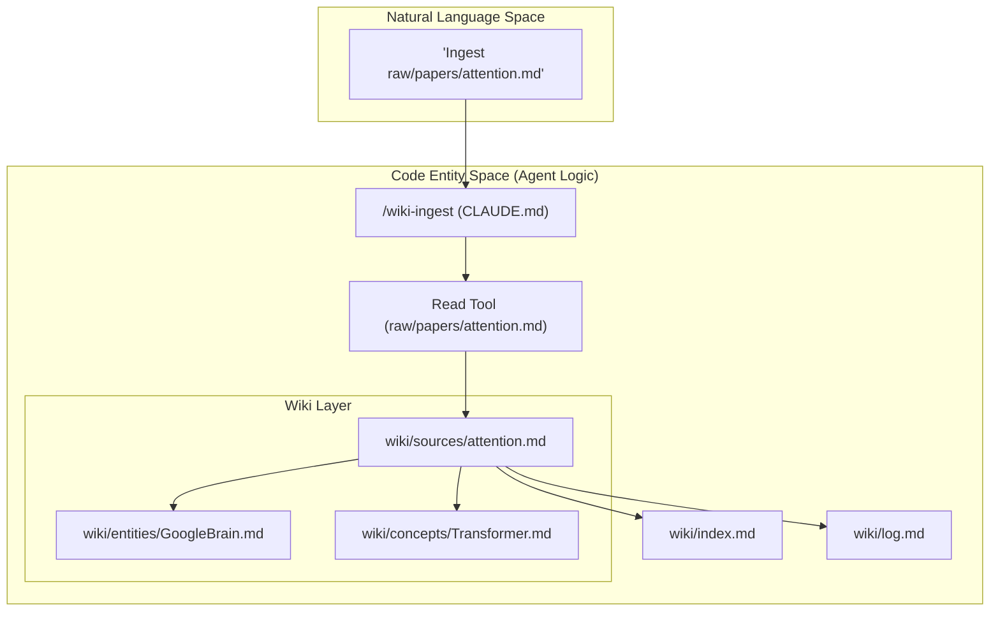
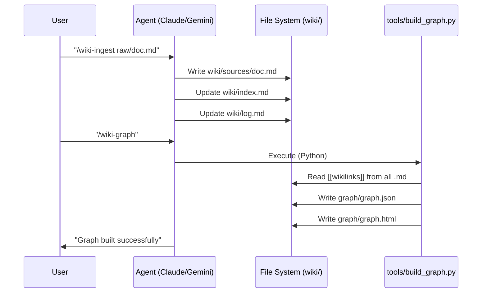

<!-- source: DeepWiki mcp.deepwiki.com · repo SamurAIGPT/llm-wiki-agent · page 1.1 Getting Started · fetched 2026-10-26 -->

# Getting Started

<details>
<summary>Relevant source files</summary>

The following files were used as context for generating this wiki page:

- [AGENTS.md](AGENTS.md)
- [CLAUDE.md](CLAUDE.md)
- [GEMINI.md](GEMINI.md)
- [README.md](README.md)
- [requirements.txt](requirements.txt)

</details>


This page provides a step-by-step guide to setting up the LLM Wiki Agent, installing its dependencies, and executing your first knowledge ingestion. The system is designed to function primarily as an "agent skill" where an LLM (Claude, Codex, or Gemini) manages a persistent markdown wiki as its long-term memory [README.md:5-7]().

## Initial Setup

To begin, clone the repository and navigate into the project directory.

```bash
git clone https://github.com/SamurAIGPT/llm-wiki-agent.git
cd llm-wiki-agent
```
[README.md:31-34]()

### Dependencies
The project supports two modes of operation:
1.  **Agent-Native Mode:** The agent reads instructions from schema files (`CLAUDE.md`, `AGENTS.md`, or `GEMINI.md`) and performs file operations directly. No Python installation is required for basic workflows [CLAUDE.md:3-4]().
2.  **Tool-Assisted Mode:** Standalone Python scripts in `tools/` provide advanced features like semantic relationship inference and automated graph visualization [CLAUDE.md:138-142]().

To use the Python tools, install the required packages:
```bash
pip install -r requirements.txt
```
[requirements.txt:1-2]()

| Dependency | Purpose |
| :--- | :--- |
| `anthropic` | Powers the LLM-driven logic in `tools/` scripts [requirements.txt:1](). |
| `networkx` | Used for graph construction and Louvain community detection [requirements.txt:2](). |

---

## Choosing an Agent Interface

The LLM Wiki Agent is compatible with several AI coding interfaces. Each interface relies on a specific configuration file to understand the wiki's structure and workflows.

### 1. Claude Code
Claude Code is the primary recommended interface. It automatically detects `CLAUDE.md` and supports custom slash commands [CLAUDE.md:1-5]().
*   **Command:** `claude`
*   **Config:** `CLAUDE.md` [README.md:39]()

### 2. Codex / OpenCode
These agents look for general instructions on how to interact with the codebase [AGENTS.md:1-3]().
*   **Command:** `codex` or `opencode`
*   **Config:** `AGENTS.md` [README.md:40-41]()

### 3. Gemini CLI
For users preferring the Gemini ecosystem, the agent follows a similar workflow pattern adapted for Gemini [GEMINI.md:1-3]().
*   **Command:** `gemini`
*   **Config:** `GEMINI.md` [README.md:42]()

---

## Running the First Ingest

The "Ingest" workflow is the entry point for all data. It transforms a raw markdown file into a structured set of wiki pages.

### Data Flow: Natural Language to Code Entity Space
The following diagram illustrates how a natural language request is translated into specific file system entities by the agent.

**Diagram: Ingest Workflow Mapping**

**Sources:** [CLAUDE.md:60-74](), [README.md:9-11]()

### Step-by-Step Execution
1.  **Place Source:** Drop a markdown file into the `raw/` directory (e.g., `raw/my-document.md`) [README.md:5]().
2.  **Trigger Agent:** Open your agent and type:
    *   Claude Code: `/wiki-ingest raw/my-document.md` [CLAUDE.md:9]()
    *   Other Agents: `ingest raw/my-document.md` [AGENTS.md:14]()
3.  **Agent Operations:** The agent will:
    *   Read `wiki/index.md` to check for existing context [CLAUDE.md:66]().
    *   Generate a summary in `wiki/sources/` [CLAUDE.md:67]().
    *   Extract entities (People/Orgs) and concepts (Ideas) into their respective directories [CLAUDE.md:70-71]().
    *   Update the global `wiki/overview.md` [CLAUDE.md:69]().

---

## System Interaction Model

The system bridges the gap between unstructured documents and a structured knowledge graph. The following diagram shows how different code components interact during a standard session.

**Diagram: System Component Interaction**

**Sources:** [CLAUDE.md:134-143](), [README.md:182-187]()

### Summary of Commands
| Action | Slash Command (Claude) | Shorthand (Other) | Result |
| :--- | :--- | :--- | :--- |
| **Ingest** | `/wiki-ingest <file>` | `ingest <file>` | Creates source/entity/concept pages [CLAUDE.md:60-74](). |
| **Query** | `/wiki-query <text>` | `query: <text>` | Synthesizes answer from wiki [CLAUDE.md:106-114](). |
| **Lint** | `/wiki-lint` | `lint` | Finds broken links/contradictions [CLAUDE.md:118-130](). |
| **Graph** | `/wiki-graph` | `build graph` | Generates interactive `graph.html` [CLAUDE.md:134-143](). |

**Sources:** [README.md:45-56](), [CLAUDE.md:5-13](), [AGENTS.md:13-17]()

---

