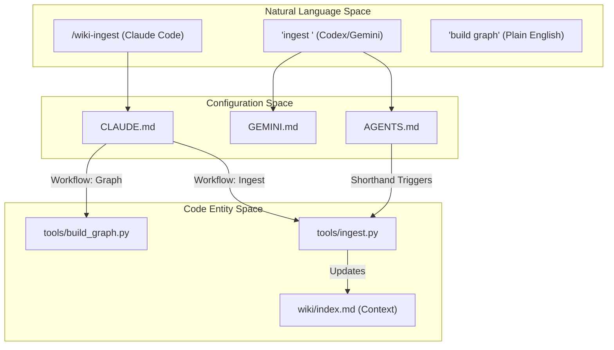
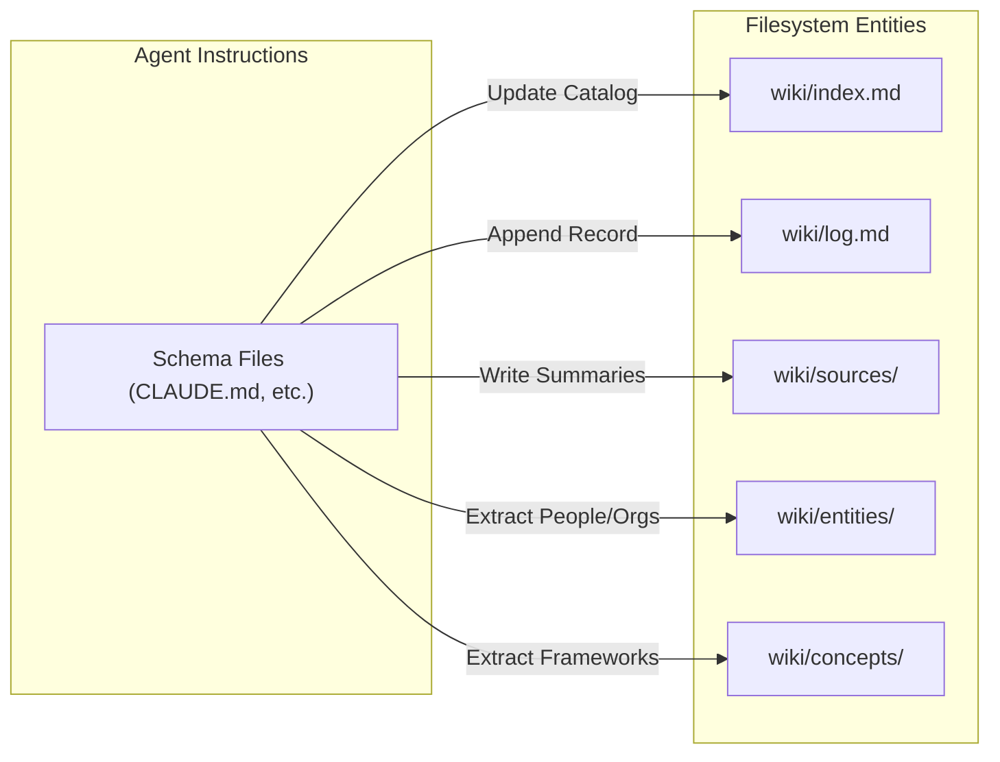

<!-- source: DeepWiki mcp.deepwiki.com · repo SamurAIGPT/llm-wiki-agent · page 2 Agent Configuration · fetched 2026-10-26 -->

# Agent Configuration

Relevant source files

The following files were used as context for generating this wiki page:

- [AGENTS.md](AGENTS.md)
- [CLAUDE.md](CLAUDE.md)
- [GEMINI.md](GEMINI.md)

The LLM Wiki Agent is designed to be "agent-native," meaning it can be operated by various AI coding assistants without requiring a specialized API or server. This is achieved through markdown-based configuration files that define schemas, workflows, and directory structures directly within the repository.

The system supports three primary configuration schemas:
1.  **Claude Code (`CLAUDE.md`)**: The primary interface utilizing slash commands.
2.  **Codex/OpenCode (`AGENTS.md`)**: A generalized schema for coding agents.
3.  **Gemini CLI (`GEMINI.md`)**: Optimized for Google's Gemini-based tools.

### Configuration Hierarchy and Agent Mapping

The following diagram illustrates how natural language triggers in different agent interfaces map to the underlying filesystem-based configuration and subsequent code execution.

**Agent Trigger to Code Execution Flow**

Sources: [CLAUDE.md:5-12](), [AGENTS.md:13-18](), [GEMINI.md:13-17]()

---

### Core Schema Components

Regardless of the specific agent, all configuration files enforce a unified structure to ensure consistency across the knowledge base.

| Component | Purpose | Code Reference |
| :--- | :--- | :--- |
| **Directory Layout** | Defines the "ownership" of folders like `wiki/` and `raw/`. | [CLAUDE.md:24-38]() |
| **Page Frontmatter** | YAML schema for `title`, `type`, `tags`, and `sources`. | [CLAUDE.md:46-54]() |
| **Naming Conventions** | Enforces `kebab-case` for sources and `TitleCase` for entities/concepts. | [CLAUDE.md:152-158]() |
| **Index/Log Format** | Standardizes how the agent reads the catalog and appends audit trails. | [CLAUDE.md:159-189]() |

#### Shared Directory Ownership
The agents are instructed that the `raw/` directory is immutable, while the `wiki/` directory is entirely owned and managed by the agent [CLAUDE.md:27-28](). This separation ensures that original data remains untouched while the agent-generated synthesis evolves.

Sources: [CLAUDE.md:24-38](), [AGENTS.md:21-35](), [GEMINI.md:21-35]()

---

### Claude Code Schema (CLAUDE.md)

`CLAUDE.md` is the most feature-rich configuration file. It introduces **Slash Commands** (e.g., `/wiki-ingest`, `/wiki-query`) which provide a structured CLI-like experience within the Claude Code interface [CLAUDE.md:7-12](). 

It also defines the specific four-pass logic for the **Ingest Workflow**, which includes reading context from `wiki/index.md` and `wiki/overview.md` before generating new content [CLAUDE.md:60-74]().

For a deep dive into these definitions, see [CLAUDE.md — Claude Code Schema](#2.1).

Sources: [CLAUDE.md:1-189]()

---

### Alternative Agent Schemas (AGENTS.md & GEMINI.md)

While Claude Code uses slash commands, other agents like Codex or Gemini CLI rely on **Shorthand Triggers** and plain English descriptions.

**Trigger Mapping Comparison**

| Agent | Ingest Trigger | Graph Trigger |
| :--- | :--- | :--- |
| **Claude Code** | `/wiki-ingest` | `/wiki-graph` |
| **Codex/OpenCode** | `ingest <file>` | `build graph` |
| **Gemini CLI** | `ingest <file>` | `build graph` |

These configurations also provide fallback instructions. For example, if the environment lacks Python dependencies, the agents are instructed to manually parse `[[wikilinks]]` using `grep` to build `graph/graph.json` [CLAUDE.md:144-149](), [AGENTS.md:137-142]().

For more details on these alternative interfaces, see [AGENTS.md & GEMINI.md — Alternative Agent Schemas](#2.2).

**Configuration to Filesystem Mapping**

Sources: [CLAUDE.md:24-38](), [CLAUDE.md:159-189](), [AGENTS.md:21-35]()

---

