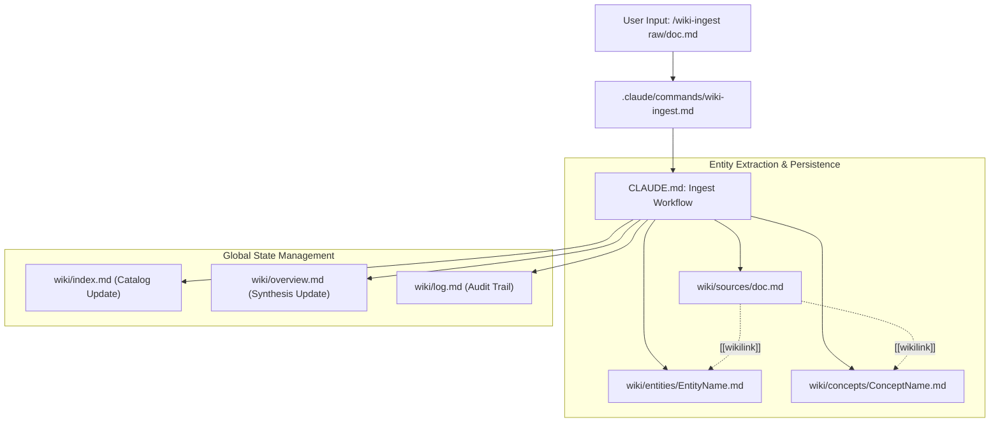
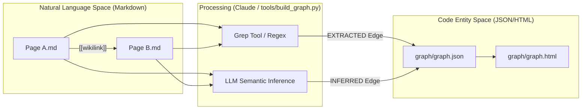

<!-- source: DeepWiki mcp.deepwiki.com · repo SamurAIGPT/llm-wiki-agent · page 2.1 CLAUDE.md — Claude Code Schema · fetched 2026-10-26 -->

# CLAUDE.md — Claude Code Schema

<details>
<summary>Relevant source files</summary>

The following files were used as context for generating this wiki page:

- [.claude/commands/wiki-graph.md](.claude/commands/wiki-graph.md)
- [.claude/commands/wiki-ingest.md](.claude/commands/wiki-ingest.md)
- [.claude/commands/wiki-lint.md](.claude/commands/wiki-lint.md)
- [.claude/commands/wiki-query.md](.claude/commands/wiki-query.md)
- [CLAUDE.md](CLAUDE.md)

</details>


This page provides a technical deep dive into `CLAUDE.md`, the primary configuration file that governs how Claude Code interacts with the LLM Wiki Agent. It defines the slash commands, directory structures, metadata schemas, and the four core workflows that allow Claude to manage the wiki autonomously without external Python scripts.

## Overview and Purpose

`CLAUDE.md` serves as the system prompt and operational manual for Claude Code. It bridges the gap between natural language instructions and structured filesystem operations. By defining specific workflows and naming conventions, it ensures that the LLM maintains a consistent knowledge base across multiple sessions.

**Sources:** [CLAUDE.md:1-5]()

---

## Slash Commands & Trigger Mapping

Claude Code maps specific slash commands to internal workflows defined in the `.claude/commands/` directory. These commands provide a shorthand for complex multi-step operations.

| Command | System Trigger | Target File |
| :--- | :--- | :--- |
| `/wiki-ingest` | `ingest raw/file.md` | [.claude/commands/wiki-ingest.md:1-19]() |
| `/wiki-query` | `query: <question>` | [.claude/commands/wiki-query.md:1-15]() |
| `/wiki-lint` | `lint the wiki` | [.claude/commands/wiki-lint.md:1-20]() |
| `/wiki-graph` | `build the knowledge graph` | [.claude/commands/wiki-graph.md:1-19]() |

**Sources:** [CLAUDE.md:5-18](), [.claude/commands/wiki-ingest.md:3-5](), [.claude/commands/wiki-query.md:3-5](), [.claude/commands/wiki-lint.md:3-3](), [.claude/commands/wiki-graph.md:3-3]()

---

## Directory Layout & Taxonomy

The system enforces a strict directory hierarchy. Claude "owns" the `wiki/` and `graph/` directories, while the `raw/` directory is treated as an immutable source of truth.

### Filesystem Structure
- `raw/`: Immutable source documents. [CLAUDE.md:27-27]()
- `wiki/`: The active knowledge layer. [CLAUDE.md:28-28]()
    - `index.md`: Central catalog for routing and discovery. [CLAUDE.md:29-29]()
    - `log.md`: Append-only audit trail for operations. [CLAUDE.md:30-30]()
    - `overview.md`: High-level synthesis of all knowledge. [CLAUDE.md:31-31]()
    - `sources/`: Summaries of individual files in `raw/`. [CLAUDE.md:32-32]()
    - `entities/`: Pages for people, companies, and projects. [CLAUDE.md:33-33]()
    - `concepts/`: Pages for ideas, frameworks, and theories. [CLAUDE.md:34-34]()
    - `syntheses/`: Persisted answers to complex queries. [CLAUDE.md:35-35]()
- `graph/`: Artifacts for visualization (JSON/HTML). [CLAUDE.md:36-36]()

**Sources:** [CLAUDE.md:24-38]()

---

## Page Frontmatter & Naming Conventions

Consistency in file naming and metadata is critical for Claude's `Grep` and `Read` tools to function effectively.

### Metadata Schema
All wiki pages must include a YAML frontmatter block:
```yaml
---
title: "Page Title"
type: source | entity | concept | synthesis
tags: []
sources: []       # Slugs of source pages informing this content
last_updated: YYYY-MM-DD
---
```
**Sources:** [CLAUDE.md:44-54]()

### Naming Standards
- **Source Slugs**: `kebab-case` (matches the filename in `raw/`). [CLAUDE.md:154-154]()
- **Entity/Concept Pages**: `TitleCase.md` (e.g., `TransformerArchitecture.md`). [CLAUDE.md:155-156]()
- **Wikilinks**: Always use the `[[PageName]]` format to facilitate graph extraction. [CLAUDE.md:56-56]()

---

## Core Workflow Definitions

### 1. Ingest Workflow
The Ingest workflow transforms raw text into structured wiki components. It is a multi-file write operation that maintains global state.

**Data Flow: Raw to Wiki**
1. **Read**: Ingests the full text of the target file in `raw/`. [CLAUDE.md:65-65]()
2. **Context**: Reads `wiki/index.md` and `wiki/overview.md` to prevent duplication. [CLAUDE.md:66-66]()
3. **Write Source**: Creates `wiki/sources/<slug>.md`. [CLAUDE.md:67-67]()
4. **Update Globals**: Updates the `index.md` catalog and the `overview.md` synthesis. [CLAUDE.md:68-69]()
5. **Extract Entities/Concepts**: Creates or updates pages in `entities/` and `concepts/`. [CLAUDE.md:70-71]()
6. **Log**: Appends an entry to `wiki/log.md` using the standard format: `## [YYYY-MM-DD] ingest | <Title>`. [CLAUDE.md:73-73]()

**Sources:** [CLAUDE.md:60-74](), [.claude/commands/wiki-ingest.md:7-16]()

### 2. Query Workflow
The Query workflow acts as a local RAG (Retrieval-Augmented Generation) loop.

**Logic Flow: Natural Language to Synthesis**
1. **Discovery**: Claude reads `wiki/index.md` to find relevant page paths. [CLAUDE.md:111-111]()
2. **Retrieval**: Claude uses the `Read` tool on up to 10 identified pages. [.claude/commands/wiki-query.md:9-9]()
3. **Synthesis**: Generates a response with `[[wikilink]]` citations. [CLAUDE.md:113-113]()
4. **Persistence**: Offers to save the result to `wiki/syntheses/`. [CLAUDE.md:114-114]()

**Sources:** [CLAUDE.md:106-116](), [.claude/commands/wiki-query.md:7-12]()

### 3. Lint Workflow
The Lint workflow performs structural and semantic validation using `Grep` and `Glob`.

**Conceptual Mapping: Linting Rules**
- **Structural**: Detects **Orphan pages** (no inbound links) and **Broken links** (missing targets). [CLAUDE.md:123-124]()
- **Heuristic**: Identifies **Missing entity pages** if a name appears in 3+ pages. [CLAUDE.md:127-127]()
- **Semantic**: Flags **Contradictions** and **Stale summaries** by comparing timestamps and claims. [CLAUDE.md:125-126]()

**Sources:** [CLAUDE.md:118-132](), [.claude/commands/wiki-lint.md:5-17]()

### 4. Graph Workflow
The Graph workflow builds a network representation of the wiki.

**Implementation Logic: Two-Pass Extraction**
1. **Pass 1 (Deterministic)**: Grep for all `[[wikilinks]]` to create `EXTRACTED` edges. [CLAUDE.md:139-139]()
2. **Pass 2 (Inferred)**: Claude analyzes page content to find implicit relationships, creating `INFERRED` edges with confidence scores. [CLAUDE.md:140-140]()
3. **Visualization**: Generates `graph/graph.json` and a `vis.js` based `graph/graph.html`. [CLAUDE.md:142-142]()

**Sources:** [CLAUDE.md:134-150](), [.claude/commands/wiki-graph.md:7-14]()

---

## Technical Architecture Diagrams

### Diagram 1: Ingest Pipeline (Natural Language to Code Entities)
This diagram illustrates how a single `/wiki-ingest` command propagates through the system's files and directories.

Title: Ingest Workflow Data Flow

**Sources:** [CLAUDE.md:60-74](), [.claude/commands/wiki-ingest.md:7-16]()

### Diagram 2: Graph Construction Logic
This diagram bridges the gap between the markdown files (Natural Language) and the graph artifacts (Data Entities).

Title: Graph Generation Logic

**Sources:** [CLAUDE.md:134-150](), [.claude/commands/wiki-graph.md:7-14]()

---

## State Tracking: Index and Log Formats

### Index Format
The `wiki/index.md` acts as the system's routing table. Claude uses this to find the relative paths of entities and concepts.
- **Sources**: Lists `sources/slug.md` with one-line summaries. [CLAUDE.md:167-168]()
- **Entities/Concepts**: Lists `entities/TitleCase.md` and `concepts/TitleCase.md`. [CLAUDE.md:170-174]()

### Log Format
The `wiki/log.md` is designed for high-speed parsing via `grep`.
- **Structure**: `## [YYYY-MM-DD] <operation> | <title>` [CLAUDE.md:182-182]()
- **Operations**: `ingest`, `query`, `lint`, `graph`. [CLAUDE.md:188-188]()

**Sources:** [CLAUDE.md:159-189]()

---

