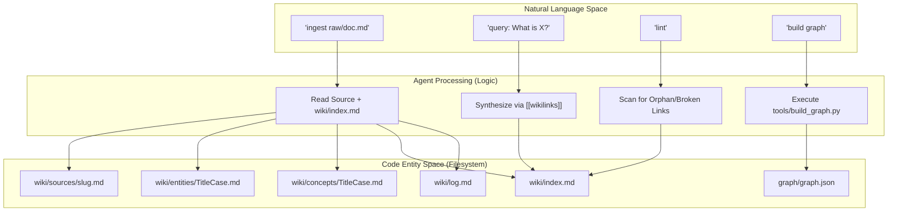
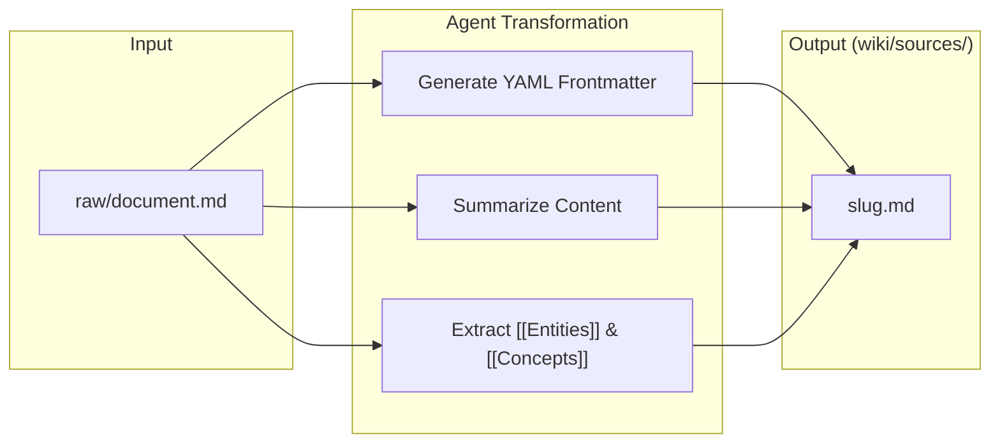

<!-- source: DeepWiki mcp.deepwiki.com · repo SamurAIGPT/llm-wiki-agent · page 2.2 AGENTS.md & GEMINI.md — Alternative Agent Schemas · fetched 2026-10-26 -->

# AGENTS.md & GEMINI.md — Alternative Agent Schemas

Relevant source files

The following files were used as context for generating this wiki page:

- [AGENTS.md](AGENTS.md)
- [GEMINI.md](GEMINI.md)

This page documents the configuration and behavioral instructions for alternative LLM agents, specifically those using the `AGENTS.md` (Codex/OpenCode) and `GEMINI.md` (Gemini CLI) schemas. While `CLAUDE.md` is optimized for Claude Code's tool-calling capabilities, these files provide a structured framework for agents that rely more heavily on direct filesystem manipulation and natural language instructions.

## Purpose and Scope

The `AGENTS.md` and `GEMINI.md` files serve as "System Instructions" for non-Claude agents. They define the same four core workflows (Ingest, Query, Lint, Graph) but use a simplified shorthand trigger syntax [AGENTS.md:13-18]() [GEMINI.md:13-17](). These schemas ensure that regardless of the LLM used, the resulting wiki structure remains consistent and interoperable.

---

## Shorthand Trigger Syntax

Both schemas define a set of "shorthand triggers" that allow the user to initiate complex workflows without verbose descriptions.

| Command | Workflow | Description |
| :--- | :--- | :--- |
| `ingest <file>` | **Ingest** | Processes a raw file into the wiki. |
| `query: <question>` | **Query** | Searches the wiki and synthesizes an answer. |
| `lint` | **Lint** | Performs structural and semantic health checks. |
| `build graph` | **Graph** | Generates the knowledge graph files. |

**Sources:** [AGENTS.md:13-18](), [GEMINI.md:13-17]()

---

## Implementation Logic & Data Flow

The following diagram illustrates how the Agent (Codex/Gemini) maps these natural language triggers to specific file operations and directory structures.

### Diagram: Trigger to Code Entity Mapping

**Sources:** [AGENTS.md:57-71](), [AGENTS.md:103-112](), [GEMINI.md:57-69](), [GEMINI.md:99-107]()

---

## Workflow Details

### 1. Ingest Workflow
The Ingest workflow is the primary method for data entry. Unlike the Python-based `tools/ingest.py`, the agent-based ingest is expected to manually perform the following sequence:
1. **Context Acquisition**: Read the source document and the current `wiki/index.md` and `wiki/overview.md` [AGENTS.md:62-63]().
2. **File Creation**: Write the summary to `wiki/sources/<slug>.md` using the mandatory `kebab-case` naming convention [AGENTS.md:64,148]().
3. **Cross-Linking**: Update or create `wiki/entities/` and `wiki/concepts/` pages using `TitleCase.md` [AGENTS.md:67-68,149-150]().
4. **Audit Trail**: Append a standardized entry to `wiki/log.md` in the format `## [YYYY-MM-DD] ingest | <Title>` [AGENTS.md:70,175]().

### 2. Query Workflow
The agent acts as a retrieval engine:
- It parses `wiki/index.md` to identify relevant files [AGENTS.md:108]().
- It synthesizes an answer using `[[PageName]]` wikilink citations [AGENTS.md:110]().
- It offers to persist the result in `wiki/syntheses/` [AGENTS.md:111]().

### 3. Lint Workflow
The Lint workflow focuses on wiki integrity. The agent is instructed to check for:
- **Orphan pages**: Pages with no inbound links [AGENTS.md:120]().
- **Broken links**: Links to non-existent pages [AGENTS.md:121]().
- **Missing entities**: Entities mentioned 3+ times without a dedicated page [AGENTS.md:124]().

### 4. Graph Workflow
The agent first attempts to run `python tools/build_graph.py --open` [AGENTS.md:135](). If the environment lacks Python, the agent is instructed to manually build `graph/graph.json` and `graph/graph.html` by extracting all `[[wikilinks]]` and inferring implicit relationships [AGENTS.md:137-142]().

---

## Comparison of Schema Structures

The alternative schemas maintain strict compatibility with the core system but differ slightly in their presentation to the agent.

### Schema Comparison Table

| Feature | AGENTS.md (Codex/OpenCode) | GEMINI.md (Gemini CLI) |
| :--- | :--- | :--- |
| **Primary Focus** | Manual filesystem orchestration | CLI-based interaction |
| **Ingest Steps** | 9 detailed steps [AGENTS.md:61-70]() | 8 summarized steps [GEMINI.md:61-68]() |
| **Graph Logic** | Detailed manual fallback [AGENTS.md:137-142]() | Simplified manual fallback [GEMINI.md:122]() |
| **Naming** | Strict Kebab/TitleCase [AGENTS.md:146-150]() | Strict Kebab/TitleCase [GEMINI.md:126-129]() |

### Data Flow: Page Generation

The following diagram shows the internal data flow when an agent generates a new `source` page.

**Sources:** [AGENTS.md:72-99](), [GEMINI.md:70-95]()

---

## Global State Maintenance

Agents are required to maintain three global state files during every operation:
1. **`wiki/index.md`**: Must be updated to include new pages under the correct section (Sources, Entities, Concepts, or Syntheses) [AGENTS.md:152-171]().
2. **`wiki/overview.md`**: Must be revised if a new ingest changes the high-level understanding of the knowledge base [AGENTS.md:66]().
3. **`wiki/log.md`**: Must receive an append-only update for every workflow execution [AGENTS.md:173-178]().

**Sources:** [AGENTS.md:21-35](), [GEMINI.md:21-35]()

---

