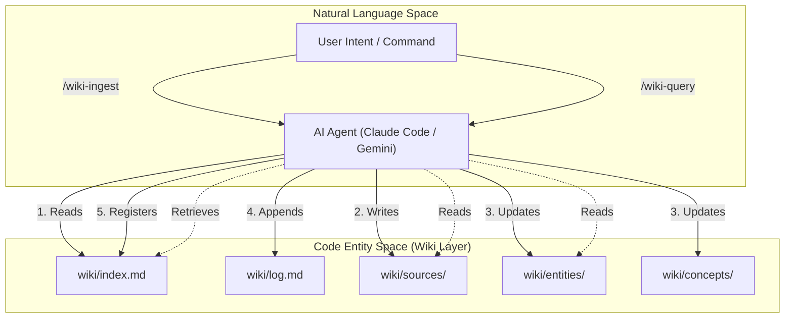
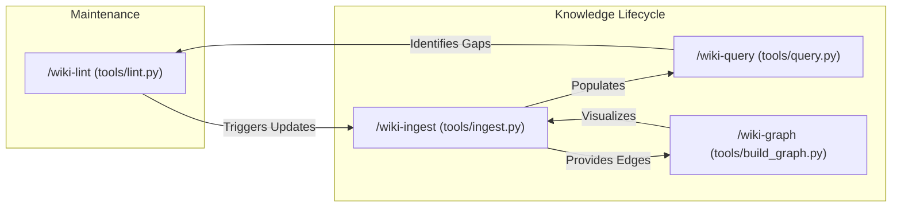

<!-- source: DeepWiki mcp.deepwiki.com · repo SamurAIGPT/llm-wiki-agent · page 3 Core Workflows · fetched 2026-10-26 -->

# Core Workflows

Relevant source files

The following files were used as context for generating this wiki page:

- [AGENTS.md](AGENTS.md)
- [CLAUDE.md](CLAUDE.md)
- [GEMINI.md](GEMINI.md)

The LLM Wiki Agent operates through four primary workflows that transform raw documents into a structured, interlinked knowledge base. These workflows are designed to be executed either by an AI agent (like Claude Code) following the instructions in `CLAUDE.md` [CLAUDE.md:1-189](), or programmatically via Python scripts in the `tools/` directory [CLAUDE.md:37-37]().

### Workflow Execution Model
The system bridges "Natural Language Space" (user intent) and "Code Entity Space" (file operations and scripts) through a standardized command interface.

| Workflow | Agent Trigger (Claude Code) | Python Tool | Primary Output |
| :--- | :--- | :--- | :--- |
| **Ingest** | `/wiki-ingest` | `tools/ingest.py` | `wiki/sources/`, `wiki/entities/`, `wiki/concepts/` |
| **Query** | `/wiki-query` | `tools/query.py` | `wiki/syntheses/` (optional) |
| **Lint** | `/wiki-lint` | `tools/lint.py` | `wiki/lint-report.md` |
| **Graph** | `/wiki-graph` | `tools/build_graph.py` | `graph/graph.json`, `graph/graph.html` |

**Sources:** [CLAUDE.md:7-12](), [AGENTS.md:13-17](), [GEMINI.md:13-17]()

---

### 1. Ingest Workflow
The Ingest workflow is the primary entry point for data. It transforms an immutable file in `raw/` [CLAUDE.md:27-27]() into a set of interlinked Markdown pages. The process involves reading the source, checking existing context in `wiki/index.md` [CLAUDE.md:66-66](), and generating a structured summary.

**Key Responsibilities:**
- Creating a source summary page with `type: source` [CLAUDE.md:78-84]().
- Extracting and updating `entities/` (People, Orgs) and `concepts/` (Ideas) [CLAUDE.md:70-71]().
- Updating the global `wiki/overview.md` to reflect new knowledge [CLAUDE.md:69-69]().
- Identifying contradictions with existing wiki pages [CLAUDE.md:72-72]().

For details, see [Ingest Workflow](#3.1).

**Sources:** [CLAUDE.md:60-74](), [AGENTS.md:57-71](), [GEMINI.md:57-68]()

---

### 2. Query Workflow
The Query workflow provides a retrieval-augmented synthesis (RAG) interface. Instead of a simple vector search, it uses the `wiki/index.md` [CLAUDE.md:111-111]() as a map to identify relevant pages across the taxonomy.

**Key Responsibilities:**
- Multi-page retrieval based on user questions [CLAUDE.md:112-112]().
- Synthesizing answers using `[[WikiLinks]]` for inline citations [CLAUDE.md:113-113]().
- Optional persistence of answers to `wiki/syntheses/` for future reference [CLAUDE.md:114-114]().

For details, see [Query Workflow](#3.2).

**Sources:** [CLAUDE.md:106-115](), [AGENTS.md:103-112](), [GEMINI.md:99-107]()

---

### 3. Lint Workflow
The Lint workflow ensures the structural and semantic integrity of the wiki. It acts as a "health check" to prevent the knowledge base from becoming fragmented or inconsistent.

**Key Responsibilities:**
- **Structural Checks:** Identifying **Orphan pages** (no inbound links) and **Broken links** [CLAUDE.md:123-124]().
- **Semantic Checks:** Detecting **Contradictions** between pages and identifying **Data gaps** [CLAUDE.md:125-128]().
- **Heuristic Discovery:** Suggesting new entity pages for terms mentioned in 3+ documents [CLAUDE.md:127-127]().

For details, see [Lint Workflow](#3.3).

**Sources:** [CLAUDE.md:118-132](), [AGENTS.md:115-127](), [GEMINI.md:110-116]()

---

### 4. Graph Workflow
The Graph workflow visualizes the connections between entities, concepts, and sources. It utilizes `tools/build_graph.py` to generate a navigable knowledge graph [CLAUDE.md:138-143]().

**Key Responsibilities:**
- **Deterministic Extraction:** Parsing all `[[wikilinks]]` as `EXTRACTED` edges [CLAUDE.md:139-139]().
- **Semantic Inference:** Using LLMs to infer implicit relationships (`INFERRED` edges) [CLAUDE.md:140-140]().
- **Clustering:** Running Louvain community detection to group related topics [CLAUDE.md:141-141]().

For details, see [Graph Workflow](#3.4).

**Sources:** [CLAUDE.md:134-150](), [AGENTS.md:131-143](), [GEMINI.md:118-123]()

---

### System Data Flow Diagram
The following diagram illustrates how user commands trigger transitions between the "Natural Language Space" and the physical "Wiki Layer."

**Sources:** [CLAUDE.md:24-38](), [CLAUDE.md:60-74](), [CLAUDE.md:106-115]()

### Workflow Interdependencies
The workflows are designed to be circular: Ingest builds the data, Query consumes it, Lint fixes it, and Graph visualizes the resulting structure.

**Sources:** [CLAUDE.md:118-129](), [CLAUDE.md:134-143](), [AGENTS.md:115-127]()

---

