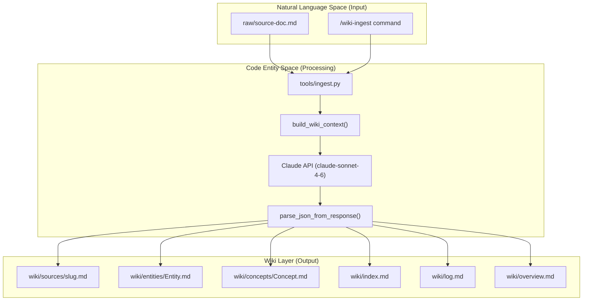
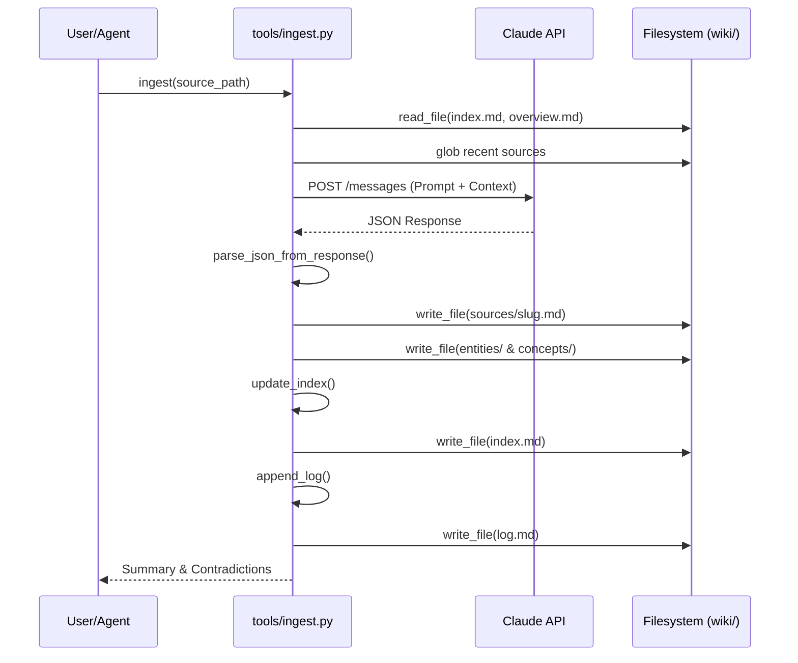

<!-- source: DeepWiki mcp.deepwiki.com · repo SamurAIGPT/llm-wiki-agent · page 3.1 Ingest Workflow · fetched 2026-10-26 -->

# Ingest Workflow

Relevant source files

The following files were used as context for generating this wiki page:

- [.claude/commands/wiki-ingest.md](.claude/commands/wiki-ingest.md)
- [CLAUDE.md](CLAUDE.md)
- [tools/ingest.py](tools/ingest.py)

The Ingest Workflow is the primary entry point for adding knowledge to the LLM Wiki. It transforms raw, immutable source documents into structured, interlinked wiki pages. This process can be driven either by an LLM agent (via Claude Code slash commands) or programmatically using the provided Python utility.

## Overview

The ingest pipeline performs a comprehensive update of the wiki state. Rather than just summarizing a document, it cross-references the new information with existing content, updates the global index and overview, creates or updates entity and concept pages, and flags any semantic contradictions.

### Workflow Triggers
- **Claude Code:** `/wiki-ingest raw/path/to/file.md` [CLAUDE.md:9]()
- **Python CLI:** `python tools/ingest.py raw/path/to/file.md` [tools/ingest.py:6-7]()

## Data Flow & System Architecture

The following diagram illustrates how the ingest process bridges the gap between raw files and the structured wiki data model.

**Ingest Data Flow: Raw to Wiki**

**Sources:** [CLAUDE.md:60-74](), [tools/ingest.py:93-189]()

## Technical Implementation

### 1. Context Assembly
Before calling the LLM, the system gathers the current state of the wiki to ensure consistency. The `build_wiki_context()` function in `tools/ingest.py` performs the following:
- Reads `wiki/index.md` to provide a catalog of existing pages [tools/ingest.py:52-53]().
- Reads `wiki/overview.md` to provide the high-level synthesis [tools/ingest.py:54-55]().
- Reads the 5 most recently modified source pages in `wiki/sources/` to facilitate contradiction checking and relevant interlinking [tools/ingest.py:57-61]().

### 2. The LLM Prompt
The ingest logic uses a structured prompt that includes the `CLAUDE.md` schema, the assembled wiki context, and the new source content [tools/ingest.py:110-141](). It requests a single JSON object containing:
- **`source_page`**: Full markdown for the new source summary [tools/ingest.py:129]().
- **`entity_pages` / `concept_pages`**: Arrays of objects containing paths and updated content for related entities and concepts [tools/ingest.py:132-137]().
- **`overview_update`**: A revised version of the living synthesis [tools/ingest.py:131]().
- **`contradictions`**: A list of any claims that conflict with the existing wiki context [tools/ingest.py:138]().

### 3. State Persistence
Once the LLM returns the JSON payload, the system updates the filesystem:
- **New Source**: Created at `wiki/sources/<slug>.md` [tools/ingest.py:161]().
- **Entities/Concepts**: Files are written to their respective directories. If they already exist, they are overwritten with the updated content including the new source references [tools/ingest.py:164-169]().
- **Index**: The `update_index()` function injects a new markdown link into the appropriate section of `wiki/index.md` [tools/ingest.py:76-85]().
- **Audit Log**: An entry is prepended to `wiki/log.md` using the standard `## [YYYY-MM-DD] ingest | <Title>` format [tools/ingest.py:88-90]().

**Sequence: Ingest Execution**

**Sources:** [tools/ingest.py:93-189](), [.claude/commands/wiki-ingest.md:7-16]()

## Source Page Structure

Every source page generated during ingest follows a strict template to ensure it remains parseable by both humans and LLMs:

| Section | Description |
| :--- | :--- |
| **Frontmatter** | YAML containing `title`, `type: source`, `tags`, `date`, and `source_file` path [CLAUDE.md:78-84](). |
| **Summary** | A 2–4 sentence high-level overview [CLAUDE.md:86-87](). |
| **Key Claims** | Bulleted list of the primary arguments or findings [CLAUDE.md:89-91](). |
| **Key Quotes** | Significant direct quotes with context [CLAUDE.md:93-94](). |
| **Connections** | `[[WikiLinks]]` to related Entity and Concept pages [CLAUDE.md:96-98](). |
| **Contradictions** | Explicit flagging of conflicts with other wiki pages [CLAUDE.md:100-101](). |

## Contradiction Flagging

One of the most critical steps in the ingest workflow is the detection of contradictions [CLAUDE.md:72](). During the LLM call, the model compares the "New source to ingest" against the "Current wiki state" [tools/ingest.py:115-121](). 

If the model identifies a conflict (e.g., a new paper refuting a claim in an older summary), it:
1. Adds a description to the `contradictions` field in the JSON response [tools/ingest.py:138]().
2. Includes the contradiction in the `## Contradictions` section of the new source page [CLAUDE.md:100-101]().
3. Prints a warning to the console/agent interface during the final report [tools/ingest.py:182-186]().

**Sources:**
- [CLAUDE.md:60-102]() (Workflow definition and page formats)
- [tools/ingest.py:1-196]() (Python implementation details)
- [.claude/commands/wiki-ingest.md:1-19]() (Slash command logic)

---

