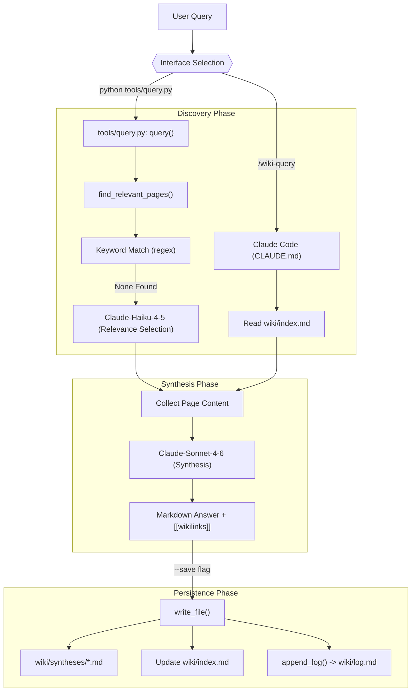
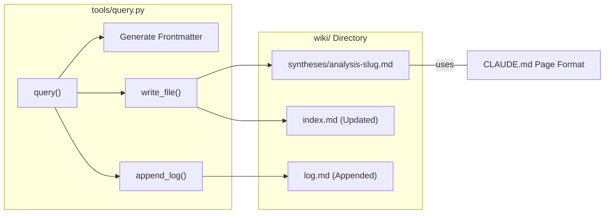

<!-- source: DeepWiki mcp.deepwiki.com · repo SamurAIGPT/llm-wiki-agent · page 3.2 Query Workflow · fetched 2026-10-26 -->

# Query Workflow

Relevant source files

The following files were used as context for generating this wiki page:

- [.claude/commands/wiki-query.md](.claude/commands/wiki-query.md)
- [CLAUDE.md](CLAUDE.md)
- [tools/query.py](tools/query.py)

The Query Workflow is a retrieval-augmented synthesis pipeline designed to extract and consolidate information from the wiki's distributed knowledge base. Unlike traditional RAG which often relies on vector embeddings, this system utilizes a two-stage discovery process: deterministic keyword matching against the `wiki/index.md` followed by an LLM-assisted relevance selection. The final output is a structured synthesis featuring `[[wikilink]]` citations and optional persistence to the `wiki/syntheses/` directory.

The workflow is accessible via the Claude Code slash command `/wiki-query` or the standalone `tools/query.py` script.

### System Data Flow: Natural Language to Code Entities

The following diagram illustrates how a natural language query moves through the system's code entities to produce a synthesized answer.

**Query Execution Path**

**Sources:** [CLAUDE.md:106-115](), [.claude/commands/wiki-query.md:1-15](), [tools/query.py:41-58](), [tools/query.py:65-169]()

---

### Retrieval and Discovery Logic

The workflow prioritizes a "small-to-large" context gathering strategy to avoid context window overflow and ensure high signal-to-noise ratios.

#### 1. Page Discovery
The system first reads `wiki/index.md` to identify potential matches [tools/query.py:69-70](). 
- **Keyword Matching:** The `find_relevant_pages` function uses regular expressions to extract all links from the index and checks if words from the user's question (longer than 3 characters) appear in the page titles [tools/query.py:42-52]().
- **LLM-Assisted Selection:** If keyword matching fails to find sufficient results, the `tools/query.py` script calls `claude-haiku-4-5` with the full index content. The model is instructed to return a JSON array of the top 10 most relevant file paths [tools/query.py:79-96]().
- **Context Capping:** The total number of retrieved pages is capped at 12 to maintain performance and stay within model limits [tools/query.py:57]().

#### 2. Synthesis and Citation
Once the relevant `.md` files are identified, their full content is concatenated into a `pages_context` string [tools/query.py:99-102](). This context, along with the system schema from `CLAUDE.md`, is sent to `claude-sonnet-4-6` [tools/query.py:107-129]().

The model is required to:
- Generate a well-structured Markdown response.
- Use `[[PageName]]` syntax for inline citations [tools/query.py:116-127]().
- Include a `## Sources` section at the bottom listing every page referenced [.claude/commands/wiki-query.md:11]().

**Sources:** [tools/query.py:41-58](), [tools/query.py:78-97](), [tools/query.py:109-129](), [.claude/commands/wiki-query.md:7-12]()

---

### Persistence and Logging

Users can choose to persist a query's output as a permanent "Synthesis" page. This converts a transient answer into a long-term knowledge asset.

| Action | Entity Involved | Implementation Detail |
| :--- | :--- | :--- |
| **File Creation** | `wiki/syntheses/<slug>.md` | Created with standard YAML frontmatter including `type: synthesis` [tools/query.py:146-156](). |
| **Index Update** | `wiki/index.md` | Appends the new synthesis under the `## Syntheses` header [tools/query.py:158-164](). |
| **Audit Trail** | `wiki/log.md` | Appends a `query` operation entry using the `append_log()` function [tools/query.py:167-169](). |

**Code Entity Relationship: Persistence**

**Sources:** [CLAUDE.md:180-189](), [tools/query.py:137-169](), [tools/query.py:60-63]()

---

### Tool Usage Reference: `tools/query.py`

The Python implementation provides a programmatic interface for batch queries or automated synthesis generation.

**Key Functions:**
- `find_relevant_pages(question, index_content)`: Performs the initial regex-based search for matching titles in the index [tools/query.py:41-58]().
- `query(question, save_path)`: The main orchestrator that manages the Anthropic API calls for both selection (Haiku) and synthesis (Sonnet) [tools/query.py:65-169]().
- `append_log(entry)`: Ensures the query is recorded in the global `wiki/log.md` for auditability [tools/query.py:60-63]().

**CLI Usage Examples:**
- Basic query: `python tools/query.py "What are the main themes?"` [tools/query.py:6]()
- Query and save (interactive slug prompt): `python tools/query.py "How does X relate to Y?" --save` [tools/query.py:7]()
- Query and save to specific path: `python tools/query.py "Summary" --save synthesis/my-analysis.md` [tools/query.py:8]()

**Sources:** [tools/query.py:1-13](), [tools/query.py:41-63](), [tools/query.py:65-177]()

---

