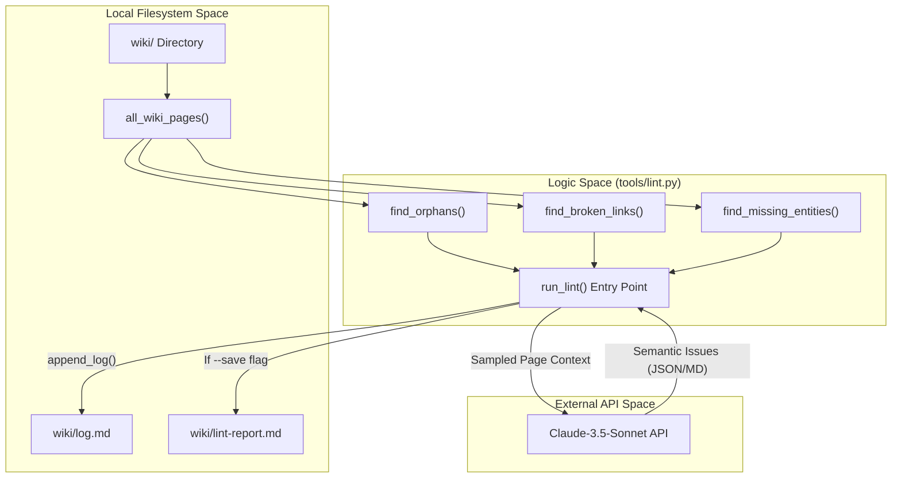
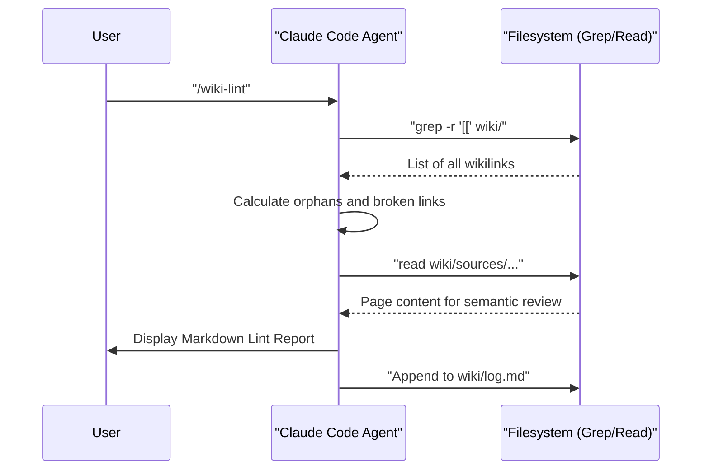

<!-- source: DeepWiki mcp.deepwiki.com · repo SamurAIGPT/llm-wiki-agent · page 3.3 Lint Workflow · fetched 2026-10-26 -->

# Lint Workflow

Relevant source files

The following files were used as context for generating this wiki page:

- [.claude/commands/wiki-lint.md](.claude/commands/wiki-lint.md)
- [CLAUDE.md](CLAUDE.md)
- [tools/lint.py](tools/lint.py)

The **Lint Workflow** is a two-phase health check designed to maintain the integrity and quality of the wiki. It combines deterministic structural analysis (detecting broken links and orphans) with LLM-powered semantic analysis (identifying contradictions and data gaps). This workflow ensures that as the wiki grows through automated ingests, it remains a cohesive and accurate knowledge base rather than a collection of fragmented summaries.

### Overview of Linting Phases

The system executes two distinct types of checks:
1.  **Structural Checks**: Handled via file system traversal, regex-based link extraction, and mention counting.
2.  **Semantic Checks**: Handled by passing a sample of wiki pages to the Claude API to reason about conflicting claims and content freshness.

---

### Implementation & Data Flow

The linting process can be triggered via the Claude Code slash command `/wiki-lint` or programmatically via `tools/lint.py`. Both methods follow the same logic for identifying issues.

#### Logic Flow: Structural vs. Semantic
The following diagram illustrates how the `tools/lint.py` script coordinates data between the local file system and the Anthropic API.

**Diagram: Lint Workflow Data Flow**

**Sources:** [tools/lint.py:36-182](), [CLAUDE.md:118-130]()

---

### Structural Checks (Deterministic)

Structural checks rely on the `extract_wikilinks` function, which uses a regex `\[\[([^\]]+)\]\]` to find all internal references [tools/lint.py:41-42]().

| Check | Code Entity | Logic |
| :--- | :--- | :--- |
| **Orphan Pages** | `find_orphans()` | Identifies pages in the `wiki/` directory that have zero inbound `[[links]]` from any other page, excluding `overview.md` [tools/lint.py:54-62](). |
| **Broken Links** | `find_broken_links()` | Iterates through all extracted `[[links]]` and checks if the target string resolves to a valid file path using `page_name_to_path()` [tools/lint.py:65-72](). |
| **Missing Entities** | `find_missing_entities()` | Scans for terms that are frequently mentioned (3+ times) across different pages but do not yet have a dedicated page in `entities/` or `concepts/` [tools/lint.py:75-85](). |

**Sources:** [tools/lint.py:45-85](), [.claude/commands/wiki-lint.md:7-10]()

---

### Semantic Checks (LLM-Assisted)

Semantic checks address issues that cannot be caught by simple string matching. Because sending the entire wiki to an LLM may exceed context limits, `tools/lint.py` creates a context window by sampling the first 20 pages and truncating them to 1500 characters each [tools/lint.py:109-113]().

The `run_lint()` function prompts `claude-sonnet-4-6` to identify the following:
*   **Contradictions**: Conflicting claims between different source summaries [CLAUDE.md:125]().
*   **Stale Summaries**: Pages that have not been updated despite newer ingested sources providing more current information [CLAUDE.md:126]().
*   **Data Gaps**: Critical questions that the current wiki content cannot answer, resulting in suggestions for new source documents to ingest [CLAUDE.md:128]().

**Sources:** [tools/lint.py:115-140](), [.claude/commands/wiki-lint.md:12-15]()

---

### Integration with Claude Code

When using the `/wiki-lint` command, Claude Code follows the `Lint Workflow` defined in the system prompt. It utilizes the `Grep` and `Read` tools to perform structural checks manually if the Python environment is unavailable [CLAUDE.md:122-130]().

**Diagram: Claude Code Tool Usage for Linting**

**Sources:** [.claude/commands/wiki-lint.md:1-20](), [CLAUDE.md:118-130]()

### Reporting and Logging

Every linting operation concludes by generating a report and updating the system audit trail:
*   **Report Generation**: A markdown file is created (optionally saved to `wiki/lint-report.md`) containing sections for Structural Issues, Contradictions, Stale Content, and Data Gaps [tools/lint.py:145-182]().
*   **Audit Trail**: The script appends a grep-parseable entry to `wiki/log.md` using the format `## [YYYY-MM-DD] lint | Wiki health check` [tools/lint.py:203-204]().

**Sources:** [tools/lint.py:197-204](), [CLAUDE.md:180-189]()

---

