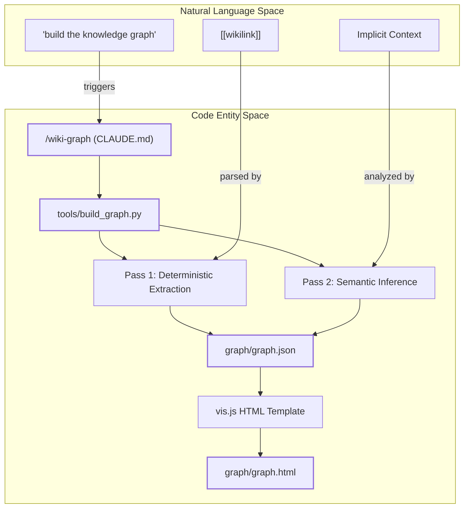
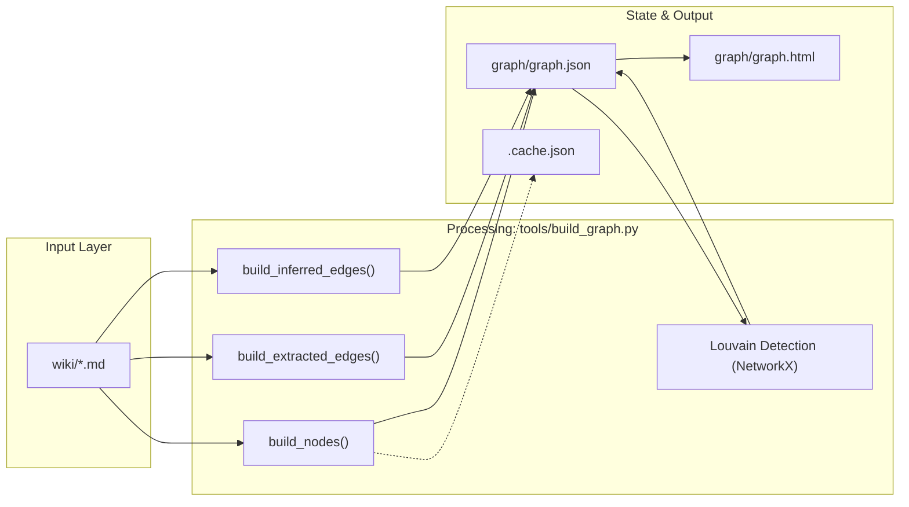

<!-- source: DeepWiki mcp.deepwiki.com · repo SamurAIGPT/llm-wiki-agent · page 3.4 Graph Workflow · fetched 2026-10-26 -->

# Graph Workflow

Relevant source files

The following files were used as context for generating this wiki page:

- [.claude/commands/wiki-graph.md](.claude/commands/wiki-graph.md)
- [CLAUDE.md](CLAUDE.md)
- [graph/.gitkeep](graph/.gitkeep)
- [tools/build_graph.py](tools/build_graph.py)

The **Graph Workflow** is a two-pass pipeline responsible for transforming the flat Markdown files of the `wiki/` directory into a structured, navigable knowledge graph. It combines deterministic parsing of `[[wikilinks]]` with LLM-based semantic inference to uncover implicit relationships between entities, concepts, and sources.

## Workflow Overview

The workflow can be triggered via the `/wiki-graph` slash command in Claude Code or by executing the `tools/build_graph.py` script. The process results in two primary artifacts: a data-rich `graph/graph.json` and an interactive `graph/graph.html` visualization powered by `vis.js`.

### Data Flow & Execution

The system follows a tiered approach to building the graph, ensuring that even if the Python environment lacks specific dependencies (like `networkx`), a functional graph can still be generated manually by the agent.

Sources: [CLAUDE.md:134-150](), [.claude/commands/wiki-graph.md:1-19](), [tools/build_graph.py:1-18]()

---

## Technical Implementation

### Pass 1: Deterministic Extraction
The first pass scans all `.md` files in `wiki/sources/`, `wiki/entities/`, and `wiki/concepts/` [tools/build_graph.py:71-73](). It uses a regular expression `r'\[\[([^\]]+)\]\]'` to identify every explicit wikilink [tools/build_graph.py:76-77](). These are tagged as `EXTRACTED` edges with a confidence score of `1.0` [tools/build_graph.py:140]().

### Pass 2: Semantic Inference (Claude-Assisted)
If the `--no-infer` flag is not used, the workflow initiates a second pass using the `claude-haiku-4-5` model [tools/build_graph.py:176]().
1.  **Change Detection**: The script uses SHA256 hashing and a `.cache.json` file to identify which pages have been modified since the last build [tools/build_graph.py:152-158]().
2.  **Contextual Analysis**: For each changed page, Claude is provided with the page content, a list of all existing nodes, and currently extracted edges [tools/build_graph.py:180-191]().
3.  **Edge Classification**: Claude identifies "hidden" connections.
    *   **INFERRED**: High-confidence (≥ 0.7) relationships [tools/build_graph.py:199]().
    *   **AMBIGUOUS**: Low-confidence (< 0.7) relationships [tools/build_graph.py:199]().

### Community Detection
If `networkx` is installed, the script constructs a `nx.Graph()` and applies the Louvain community detection algorithm via `nx_community.louvain_communities` [tools/build_graph.py:31-33](). This assigns a `group` ID to each node, which is used by the visualization to cluster related topics.

---

## System Architecture: Graph Construction

The following diagram maps the internal functions of `tools/build_graph.py` to the data structures they produce.

Sources: [tools/build_graph.py:103-142](), [tools/build_graph.py:145-223](), [tools/build_graph.py:431-450]()

---

## Data Schema & Visual Encoding

### Node & Edge Metadata
The graph data is stored in `graph/graph.json` with the following visual mappings:

| Element | Property | Logic / Source |
| :--- | :--- | :--- |
| **Node Color** | `type` | `source` (#4CAF50), `entity` (#2196F3), `concept` (#FF9800), `synthesis` (#9C27B0) [tools/build_graph.py:48-54]() |
| **Edge Color** | `type` | `EXTRACTED` (#555555), `INFERRED` (#FF5722), `AMBIGUOUS` (#BDBDBD) [tools/build_graph.py:56-60]() |
| **Node Label** | `title` | Extracted from YAML frontmatter [tools/build_graph.py:108-109]() |
| **Edge Label** | `relationship` | Semantic description generated by Claude [tools/build_graph.py:218]() |

### Manual Fallback (Agent-Driven)
If the Python environment is unavailable, the `CLAUDE.md` instructions direct the agent to simulate the `build_graph.py` logic:
1.  Use `grep` to find all `[[wikilinks]]` [CLAUDE.md:145]().
2.  Manually construct the `nodes` and `edges` JSON arrays [CLAUDE.md:146-147]().
3.  Inject the data into the `vis.js` HTML template [CLAUDE.md:148]().

Sources: [CLAUDE.md:134-150](), [tools/build_graph.py:47-60](), [tools/build_graph.py:103-117]()

---

