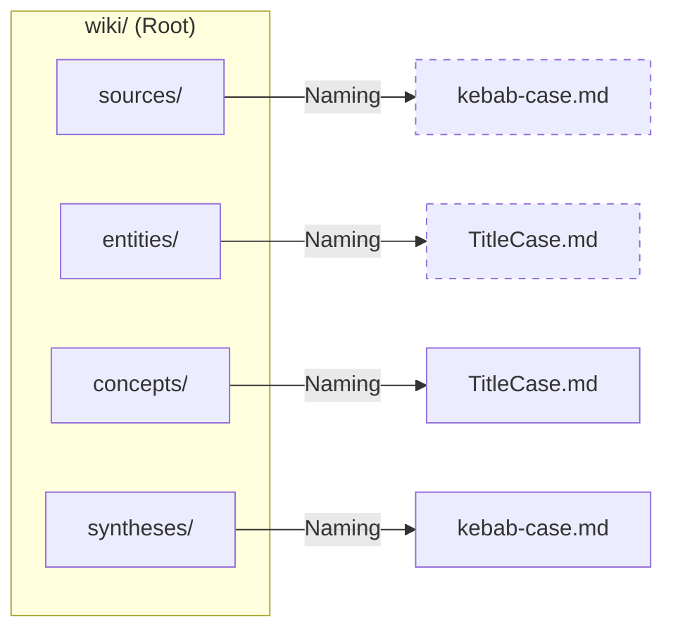

<!-- source: DeepWiki mcp.deepwiki.com · repo SamurAIGPT/llm-wiki-agent · page 4 Wiki Directory Structure & Data Model · fetched 2026-10-26 -->

# Wiki Directory Structure & Data Model

<details>
<summary>Relevant source files</summary>

The following files were used as context for generating this wiki page:

- [CLAUDE.md](CLAUDE.md)
- [wiki/index.md](wiki/index.md)
- [wiki/log.md](wiki/log.md)
- [wiki/overview.md](wiki/overview.md)

</details>


The `wiki/` directory serves as the primary state store and "source of truth" for the LLM Wiki Agent. Unlike traditional RAG systems that rely on vector databases, this system uses a structured filesystem-as-database approach. This allows LLMs to navigate knowledge using standard file operations (read, grep, list) and maintains human-readable transparency.

The data model is organized into specialized subdirectories based on knowledge type, governed by a strict frontmatter schema and linked through a central indexing layer.

## High-Level Data Flow

The following diagram illustrates how raw information is transformed into structured wiki entities and how the different components of the `wiki/` directory interact.

**Knowledge Transformation Map**
```mermaid
graph TD
    subgraph "Natural Language Space (Input)"
        RAW["raw/ (Source Documents)"]
    end

    subgraph "Code Entity Space (System State)"
        direction TB
        INDEX["wiki/index.md (Central Catalog)"]
        LOG["wiki/log.md (Audit Trail)"]
        OVERVIEW["wiki/overview.md (Global Synthesis)"]
        
        subgraph "Knowledge Taxonomy"
            SOURCES["wiki/sources/ (Summaries)"]
            ENTITIES["wiki/entities/ (People/Orgs)"]
            CONCEPTS["wiki/concepts/ (Ideas/Methods)"]
            SYNTHESES["wiki/syntheses/ (Query Results)"]
        end
    end

    RAW -->|"/wiki-ingest"| SOURCES
    SOURCES -->|Update| INDEX
    SOURCES -->|Update| OVERVIEW
    SOURCES -->|Append| LOG
    
    SOURCES -.->|[[wikilinks]]| ENTITIES
    SOURCES -.->|[[wikilinks]]| CONCEPTS
    ENTITIES -.->|[[wikilinks]]| CONCEPTS
    
    INDEX -->|Route Query| SOURCES
    INDEX -->|Route Query| ENTITIES
    INDEX -->|Route Query| CONCEPTS
```
Sources: [CLAUDE.md:24-38](), [CLAUDE.md:60-74]()

---

## Global State Files
The root of the `wiki/` directory contains three critical files that manage the global state of the knowledge base. These files allow the agent to perform rapid discovery without scanning every individual page.

*   **`wiki/index.md`**: The central routing layer. It categorizes every page in the wiki to help the LLM identify relevant context during queries.
*   **`wiki/overview.md`**: A high-level synthesis that is updated during every ingest to reflect the current state of the entire knowledge base.
*   **`wiki/log.md`**: An append-only audit trail that records every operation (`ingest`, `query`, `lint`, `graph`) in a grep-parseable format.

For details, see [Global State Files (index.md, overview.md, log.md)](#4.1).

Sources: [wiki/index.md:1-15](), [wiki/overview.md:1-18](), [wiki/log.md:1-10]()

---

## Page Types & Frontmatter Schema
Every file within the knowledge taxonomy must follow a standardized Markdown format with YAML frontmatter. This metadata allows the agent to track provenance (which raw files informed a page) and temporal relevance.

**Mandatory Frontmatter Fields:**
| Field | Description |
|---|---|
| `title` | The human-readable name of the page. |
| `type` | Must be one of: `source`, `entity`, `concept`, or `synthesis`. |
| `sources` | A list of slugs from `wiki/sources/` that inform this page. |
| `last_updated` | ISO 8601 date of the last modification. |

For details, see [Page Types & Frontmatter Schema](#4.2).

Sources: [CLAUDE.md:44-54](), [CLAUDE.md:78-84]()

---

## Knowledge Taxonomy
The system divides knowledge into four distinct subdirectories. This separation of concerns prevents the LLM from conflating specific document summaries with general conceptual definitions.

**Directory Structure and Naming Conventions**


*   **`sources/`**: Contains one page per file in `raw/`. Focuses on summaries, key claims, and direct quotes.
*   **`entities/`**: Dedicated to specific "nouns" like people, companies, or projects (e.g., `OpenAI.md`).
*   **`concepts/`**: Dedicated to abstract "ideas" or frameworks (e.g., `ReinforcementLearning.md`).
*   **`syntheses/`**: Stores the output of complex queries that the user has chosen to persist.

For details, see [Knowledge Taxonomy (sources/, entities/, concepts/, syntheses/)](#4.3).

Sources: [CLAUDE.md:152-158](), [CLAUDE.md:167-178]()

---

