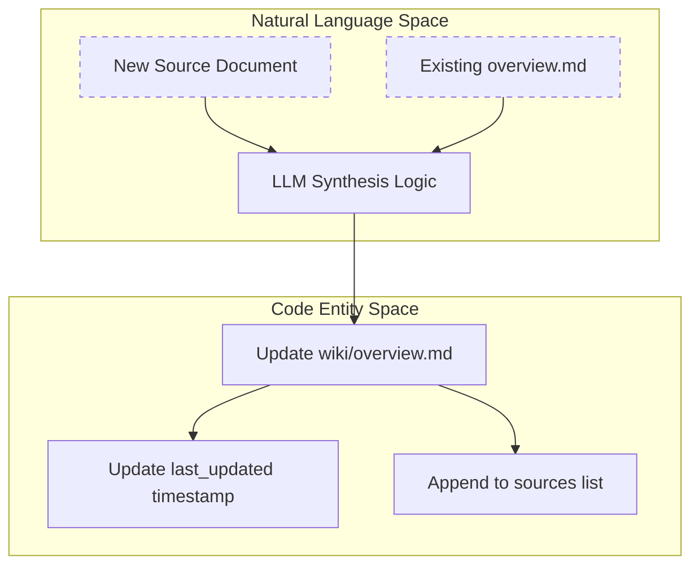
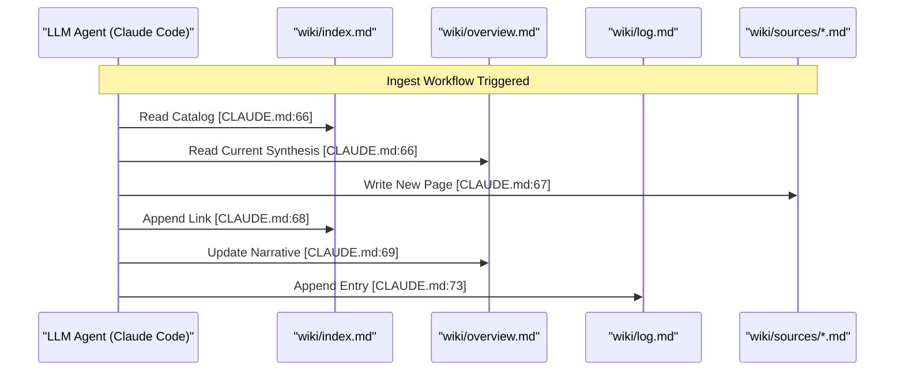

<!-- source: DeepWiki mcp.deepwiki.com · repo SamurAIGPT/llm-wiki-agent · page 4.1 Global State Files (index.md, overview.md, log.md) · fetched 2026-10-26 -->

# Global State Files (index.md, overview.md, log.md)

<details>
<summary>Relevant source files</summary>

The following files were used as context for generating this wiki page:

- [CLAUDE.md](CLAUDE.md)
- [wiki/index.md](wiki/index.md)
- [wiki/log.md](wiki/log.md)
- [wiki/overview.md](wiki/overview.md)

</details>


The LLM Wiki Agent relies on three global state files located in the `wiki/` directory to maintain system-wide context, navigation, and auditability. These files serve as the "brain" and "memory" of the wiki, ensuring that the LLM agent can discover existing knowledge and track its own operations without scanning every individual file in the repository.

## 1. wiki/index.md: The Central Catalog

`wiki/index.md` acts as the primary routing layer and directory for the entire wiki [wiki/index.md:1-3](). It is designed to be small enough to fit into the LLM's context window during the initial phase of any workflow, allowing the agent to identify which specific page slugs exist before performing deeper reads [CLAUDE.md:111-112]().

### Implementation and Structure
The file is partitioned into four primary sections corresponding to the wiki's taxonomy [CLAUDE.md:159-178]():
- **Sources**: Maps source document titles to their `wiki/sources/` slugs.
- **Entities**: Lists people, companies, and projects found in `wiki/entities/`.
- **Concepts**: Lists frameworks and theories found in `wiki/concepts/`.
- **Syntheses**: Catalogs saved query answers in `wiki/syntheses/`.

### Data Flow: Index Update
Every time a new source is processed via the Ingest Workflow, the agent is required to update this file [CLAUDE.md:68-69]().

| Step | Component | Action |
| :--- | :--- | :--- |
| 1 | `Ingest Workflow` | Reads `wiki/index.md` to check for existing slugs [CLAUDE.md:66-66](). |
| 2 | `LLM Agent` | Generates new entries for the source and any newly created entity/concept pages [CLAUDE.md:68-71](). |
| 3 | `Write Tool` | Appends or inserts the new markdown links into the appropriate sections [CLAUDE.md:159-178](). |

**Sources:** [CLAUDE.md:60-74](), [CLAUDE.md:159-178](), [wiki/index.md:1-15]()

---

## 2. wiki/overview.md: The Living Synthesis

`wiki/overview.md` is a high-level, "birds-eye view" of the entire knowledge base. Unlike the index, which is a flat list of links, the overview is a narrative synthesis that evolves as new data is ingested [wiki/overview.md:11-11]().

### Technical Details
- **Frontmatter**: It follows the standard synthesis schema, including a `sources` array that lists all slugs contributing to the current overview [wiki/overview.md:1-7]().
- **Update Frequency**: It is updated on **every** ingest operation [CLAUDE.md:69-69]().
- **Purpose**: It provides the LLM with immediate semantic context of the "current state of knowledge" so that new information can be reconciled against existing claims [CLAUDE.md:66-66]().

### Logic for "Living Synthesis"

**Sources:** [CLAUDE.md:66-69](), [wiki/overview.md:1-18]()

---

## 3. wiki/log.md: The Audit Trail

`wiki/log.md` is an append-only chronological record of every operation performed by the agent or the Python tools [wiki/log.md:3-3](). It is specifically formatted to be "grep-friendly" for both humans and automated scripts.

### Format and Operations
Each entry follows a strict single-line header format: `## [YYYY-MM-DD] <operation> | <title>` [CLAUDE.md:182-184]().

Supported operations logged include [CLAUDE.md:188-189]():
- `ingest`: When a new file is added to the wiki.
- `query`: When a complex synthesis is generated.
- `lint`: When a health check is performed.
- `graph`: When the knowledge graph is rebuilt.

### Integration with Shell Tools
Because of the predictable header format, the state of the wiki can be queried via standard CLI tools without parsing the full markdown file [wiki/log.md:7-7]():
```bash
grep "^## \[" wiki/log.md | tail -10
```

**Sources:** [CLAUDE.md:180-189](), [wiki/log.md:1-10]()

---

## 4. System Interaction Diagram

This diagram illustrates how the three global files interact with the core workflows and the filesystem.

**Global State Interaction**


**Sources:** [CLAUDE.md:60-74](), [CLAUDE.md:159-189]()

---

