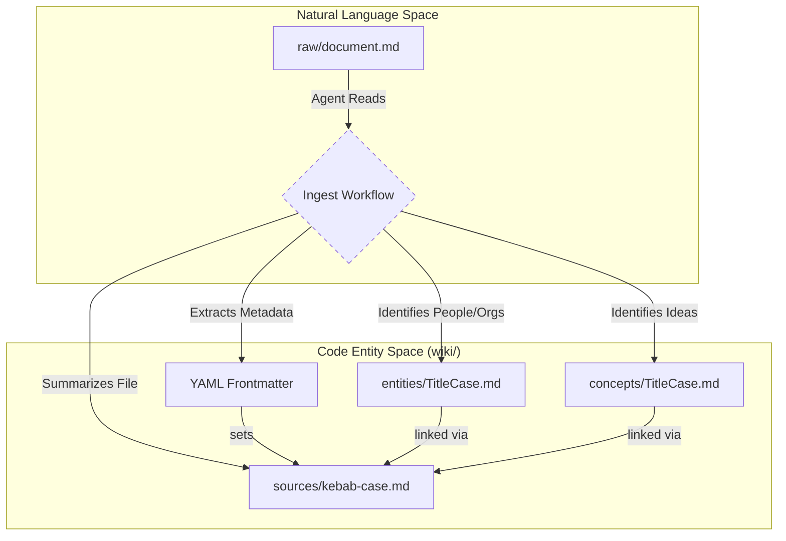
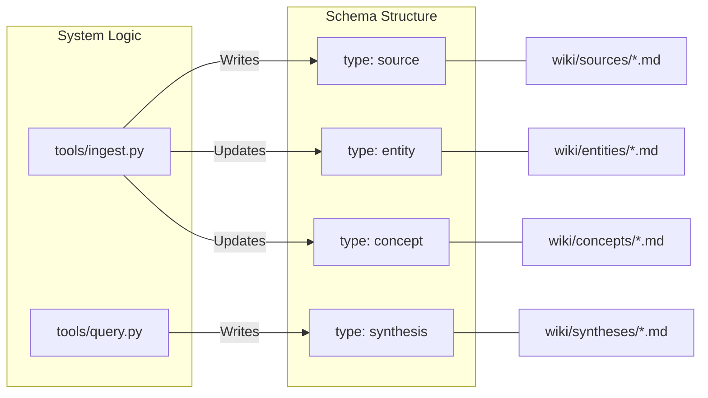

<!-- source: DeepWiki mcp.deepwiki.com · repo SamurAIGPT/llm-wiki-agent · page 4.2 Page Types & Frontmatter Schema · fetched 2026-10-26 -->

# Page Types & Frontmatter Schema

<details>
<summary>Relevant source files</summary>

The following files were used as context for generating this wiki page:

- [AGENTS.md](AGENTS.md)
- [CLAUDE.md](CLAUDE.md)
- [GEMINI.md](GEMINI.md)
- [wiki/index.md](wiki/index.md)

</details>


This page documents the structural requirements for the LLM Wiki Agent's data model. The system relies on a strict filesystem-as-database approach where metadata is stored in YAML frontmatter and relationships are defined via standard `[[wikilinks]]`.

## Overview of Page Types

The wiki categorizes knowledge into four distinct types, each residing in its own subdirectory. This separation allows the agent to distinguish between primary evidence (sources), atomic nodes (entities/concepts), and derived intelligence (syntheses).

| Type | Directory | Purpose | Naming Convention |
| :--- | :--- | :--- | :--- |
| **Source** | `wiki/sources/` | Summaries of individual files from `raw/`. | `kebab-case.md` |
| **Entity** | `wiki/entities/` | People, companies, projects, or products. | `TitleCase.md` |
| **Concept** | `wiki/concepts/` | Ideas, frameworks, methods, or theories. | `TitleCase.md` |
| **Synthesis** | `wiki/syntheses/` | Persistent answers to complex cross-source queries. | `kebab-case.md` |

**Sources:** [CLAUDE.md:24-38](), [CLAUDE.md:152-158](), [AGENTS.md:146-151]()

---

## Mandatory Frontmatter Schema

Every page in the `wiki/` directory must contain a YAML frontmatter block at the very top of the file. This schema is used by the `Query Workflow` to filter relevant context and by the `Graph Workflow` to categorize nodes.

### Schema Definition
```yaml
---
title: "Display Title"
type: source | entity | concept | synthesis
tags: []             # List of strings for thematic grouping
sources: []          # List of source slugs (filenames) informing this page
last_updated: YYYY-MM-DD
---
```

### Field Descriptions
*   **title**: The human-readable name of the page, used in the `wiki/index.md` catalog [CLAUDE.md:161-178]().
*   **type**: Must be one of the four defined types. This determines the node color in the knowledge graph [CLAUDE.md:49]().
*   **tags**: Optional metadata for ad-hoc grouping.
*   **sources**: A critical field for provenance. For `entity` and `concept` pages, this list tracks which `source` pages contributed to the definition [CLAUDE.md:51]().
*   **last_updated**: Used by the `Lint Workflow` to identify stale summaries [CLAUDE.md:126]().

**Sources:** [CLAUDE.md:44-54](), [AGENTS.md:41-51](), [GEMINI.md:41-51]()

---

## Source Page Format Template

Source pages serve as the entry point for all knowledge in the wiki. They are generated during the `Ingest Workflow` and follow a specific Markdown structure to ensure the agent can reliably extract claims and contradictions.

### Implementation Template
```markdown
---
title: "Source Title"
type: source
tags: []
date: YYYY-MM-DD
source_file: raw/path/to/file.pdf
---

## Summary
2–4 sentence high-level summary.

## Key Claims
- Atomic claim 1
- Atomic claim 2

## Key Quotes
> "Direct quote from source" — context or page number

## Connections
- [[EntityName]] — description of the relationship
- [[ConceptName]] — how this source uses the concept

## Contradictions
- Contradicts [[OtherPage]] on: specific point of disagreement
```

**Sources:** [CLAUDE.md:75-102](), [AGENTS.md:72-99](), [GEMINI.md:70-95]()

---

## Naming Conventions & Slugs

The system enforces specific naming conventions to ensure that `[[wikilinks]]` resolve correctly across different operating systems and agent interfaces.

### Entity & Concept Naming (TitleCase)
Entities and concepts use `TitleCase.md` (e.g., `ReinforcementLearning.md` or `OpenAI.md`). This allows them to be easily distinguished from general prose and matches the standard convention for "WikiWords".

### Source & Synthesis Naming (kebab-case)
Source pages use `kebab-case.md` and should ideally match the filename of the original document in the `raw/` directory. Syntheses also use `kebab-case.md` based on a slugified version of the query title.

**Sources:** [CLAUDE.md:152-158](), [AGENTS.md:146-151](), [GEMINI.md:126-130]()

---

## Data Flow: From Raw to Structured Wiki

The following diagrams illustrate how the agent transforms unstructured data into the typed schema defined above.

### Logic Flow: Ingest Transformation
This diagram shows how the `Ingest Workflow` (triggered by `/wiki-ingest`) maps raw content to specific frontmatter fields and page types.


**Sources:** [CLAUDE.md:60-74](), [AGENTS.md:57-70](), [GEMINI.md:57-68]()

### Metadata Association Map
This diagram bridges the conceptual "Page" with the actual filesystem implementation used by the agent's `Read` and `Write` tools.


**Sources:** [CLAUDE.md:24-38](), [CLAUDE.md:106-114](), [AGENTS.md:103-111]()

---

