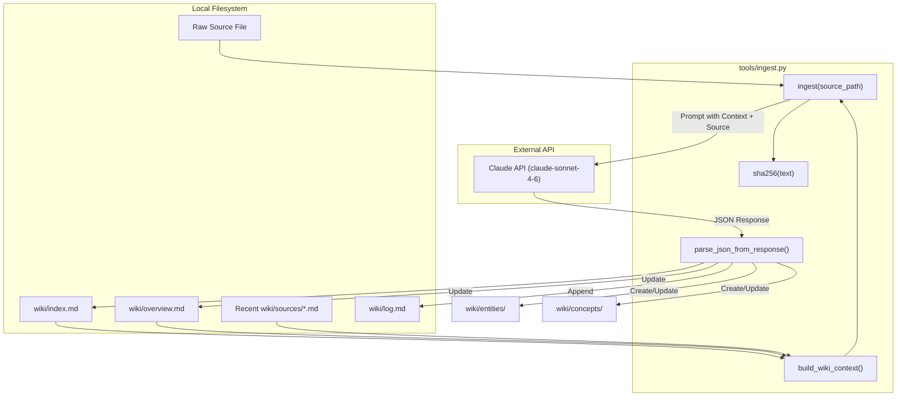
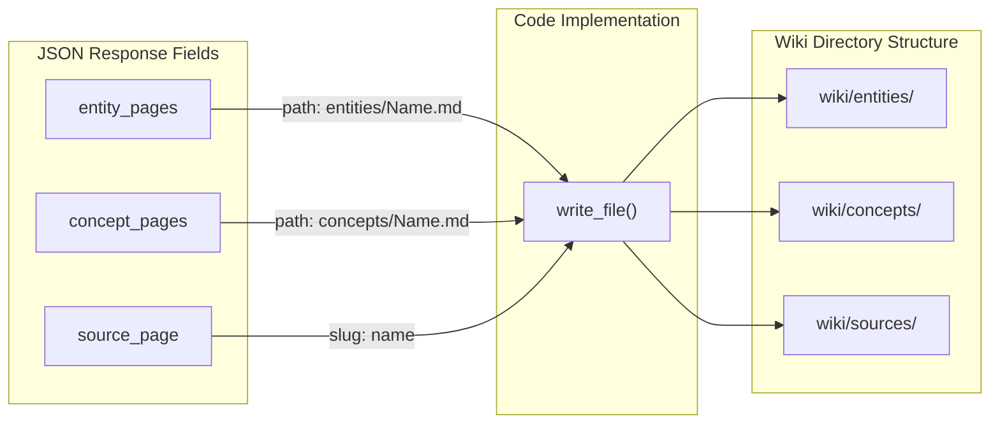

<!-- source: DeepWiki mcp.deepwiki.com · repo SamurAIGPT/llm-wiki-agent · page 5.1 tools/ingest.py · fetched 2026-10-26 -->

# tools/ingest.py

<details>
<summary>Relevant source files</summary>

The following files were used as context for generating this wiki page:

- [requirements.txt](requirements.txt)
- [tools/ingest.py](tools/ingest.py)

</details>


The `tools/ingest.py` script is the primary entry point for transforming raw source documents into structured wiki knowledge. It automates the extraction of entities, concepts, and summaries by leveraging the Claude API, ensuring that new information is integrated into the existing wiki state while maintaining consistency and reporting contradictions [tools/ingest.py:2-16]().

## CLI Usage

The script is executed from the command line and requires a path to a source document (typically a markdown or text file) [tools/ingest.py:5-7]().

```bash
python tools/ingest.py <path-to-source>
```

Upon execution, the script performs the following high-level steps:
1. Calculates a SHA256 hash of the source for tracking [tools/ingest.py:100-103]().
2. Gathers the current wiki state (Index, Overview, and recent Source pages) to provide context to the LLM [tools/ingest.py:50-62]().
3. Sends the source and context to Claude Sonnet 3.5 (`claude-sonnet-4-6`) [tools/ingest.py:144-148]().
4. Parses the JSON response and updates the filesystem [tools/ingest.py:159-182]().

**Sources:** [tools/ingest.py:1-16](), [tools/ingest.py:93-108](), [tools/ingest.py:144-148]()

## Data Flow and Implementation

The ingestion process bridges the gap between raw unstructured files and the structured "Wiki Layer."

### Ingestion Logic Diagram
This diagram illustrates how the `ingest()` function coordinates data between the local filesystem and the Anthropic API.

"Ingest Workflow Data Flow"

**Sources:** [tools/ingest.py:50-62](), [tools/ingest.py:93-141](), [tools/ingest.py:159-182]()

### Key Functions

| Function | Description |
| :--- | :--- |
| `sha256(text)` | Generates a 16-character hash of the source content to identify unique versions [tools/ingest.py:36-37](). |
| `build_wiki_context()` | Aggregates `index.md`, `overview.md`, and the 5 most recently modified source pages into a single string to prevent duplicate entries and detect contradictions [tools/ingest.py:50-62](). |
| `parse_json_from_response(text)` | Uses regex to strip markdown fences and extract the core JSON object from the LLM's response [tools/ingest.py:65-74](). |
| `update_index(new_entry, section)` | Injects a new markdown link into the specified section of `wiki/index.md` [tools/ingest.py:76-85](). |
| `append_log(entry)` | Prepends a timestamped entry to `wiki/log.md` for auditability [tools/ingest.py:88-90](). |

**Sources:** [tools/ingest.py:36-90]()

## Claude API Integration

The script utilizes the `claude-sonnet-4-6` model (Claude 3.5 Sonnet) with a high `max_tokens` limit of 8192 to accommodate large wiki page generation [tools/ingest.py:145-146]().

### Prompt Structure
The prompt is constructed by concatenating three main components:
1. **Schema and Conventions**: The contents of `CLAUDE.md` to ensure the LLM follows the project's specific formatting rules [tools/ingest.py:112-113]().
2. **Current Wiki State**: The output of `build_wiki_context()` [tools/ingest.py:115-116]().
3. **Source Document**: The content of the file being ingested [tools/ingest.py:118-121]().

### JSON Response Schema
The script enforces a strict JSON response format. If the LLM fails to provide valid JSON, the raw response is saved to `/tmp/ingest_debug.txt` for troubleshooting [tools/ingest.py:125-157]().

```json
{
  "title": "Title",
  "slug": "kebab-case-slug",
  "source_page": "Markdown content",
  "index_entry": "- [Title](sources/slug.md) — summary",
  "overview_update": "Full updated overview or null",
  "entity_pages": [{"path": "entities/Name.md", "content": "..."}],
  "concept_pages": [{"path": "concepts/Name.md", "content": "..."}],
  "contradictions": ["list of strings"],
  "log_entry": "## [date] ingest | ..."
}
```
**Sources:** [tools/ingest.py:125-141](), [tools/ingest.py:151-157]()

## Entity and Concept Mapping

The script maps extracted knowledge into specific directory structures based on the LLM's classification.

"Code Entity to Filesystem Mapping"

**Sources:** [tools/ingest.py:160-170](), [tools/ingest.py:128-137]()

## Contradiction Reporting

One of the critical features of `ingest.py` is its ability to identify conflicting information. Because the `build_wiki_context` function includes recent source pages [tools/ingest.py:59-61](), the LLM can compare the new source against existing knowledge. If the LLM populates the `contradictions` array in the JSON response, the script prints these warnings to the console after the files have been written [tools/ingest.py:181-186]().

**Sources:** [tools/ingest.py:138](), [tools/ingest.py:181-186]()

---

