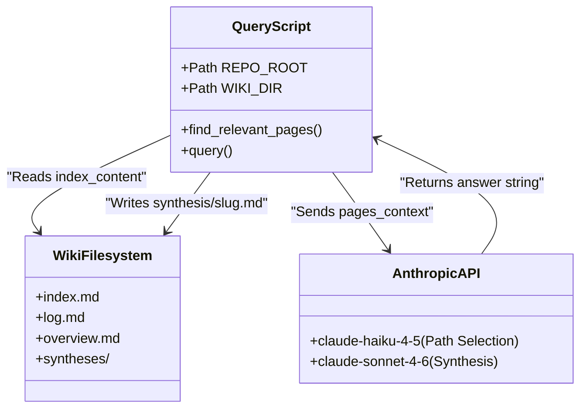

<!-- source: DeepWiki mcp.deepwiki.com · repo SamurAIGPT/llm-wiki-agent · page 5.2 tools/query.py · fetched 2026-10-26 -->

# tools/query.py

<details>
<summary>Relevant source files</summary>

The following files were used as context for generating this wiki page:

- [requirements.txt](requirements.txt)
- [tools/query.py](tools/query.py)

</details>


The `tools/query.py` script implements the retrieval-augmented synthesis pipeline for the LLM Wiki Agent. It enables users to perform complex queries across the ingested knowledge base, automatically selecting relevant context from existing wiki pages and generating structured answers with `[[wikilink]]` citations.

## CLI Usage

The script is designed for both interactive use and automated synthesis persistence.

| Command | Description |
| :--- | :--- |
| `python tools/query.py "Question"` | Performs a query and prints the result to `stdout`. |
| `python tools/query.py "Question" --save` | Performs a query and prompts the user for a filename to save in `wiki/syntheses/`. |
| `python tools/query.py "Question" --save path/to/file.md` | Performs a query and saves directly to the specified path. |

**Sources:** [tools/query.py:5-13](), [tools/query.py:171-177]()

## Data Flow: Retrieval and Synthesis

The `query` function [tools/query.py:65-169]() coordinates the multi-step process of turning a natural language question into a cited synthesis.

### 1. Page Selection (Hybrid Retrieval)
The script uses a two-tier approach to identify relevant wiki pages within the `wiki/` directory:

*   **Keyword Match:** The `find_relevant_pages` function [tools/query.py:41-57]() extracts all links from `wiki/index.md` and checks if any word in the link title (length > 3) matches the question [tools/query.py:48-52]().
*   **Claude-Assisted Selection:** If keyword matching fails to find more than one page, the script calls the `claude-haiku-4-5` model [tools/query.py:79-88](). It provides the entire `wiki/index.md` content and asks the LLM to return a JSON array of relevant file paths [tools/query.py:86-87]().
*   **Context Cap:** To prevent context window overflow, the selection is capped at **12 pages** [tools/query.py:57](). The `wiki/overview.md` is always included by default if it exists [tools/query.py:53-56]().

### 2. Answer Synthesis
The synthesis is performed by `claude-sonnet-4-6` [tools/query.py:111-129](). The prompt includes:
*   The system schema from `CLAUDE.md` [tools/query.py:107-119]().
*   The full text of all selected relevant pages [tools/query.py:98-103]().
*   Instructions to use `[[PageName]]` wikilink syntax for citations [tools/query.py:116]().

### 3. Persistence and Indexing
If the `--save` flag is used, the script:
1.  Generates a synthesis page with YAML frontmatter (type: `synthesis`) [tools/query.py:147-153]().
2.  Writes the file to `wiki/syntheses/` [tools/query.py:156]().
3.  Appends the new synthesis to the `## Syntheses` section of `wiki/index.md` [tools/query.py:159-164]().
4.  Logs the operation to `wiki/log.md` [tools/query.py:167-168]().

**Sources:** [tools/query.py:41-57](), [tools/query.py:78-97](), [tools/query.py:111-129](), [tools/query.py:146-164]()

## System Architecture Diagram

This diagram illustrates how the `query.py` script bridges the user's natural language request with the structured filesystem state.

### Query Execution Logic
```mermaid
graph TD
    User["User Question"] -->|argparse| Q["query() Function"]
    Q -->|Read| Index["wiki/index.md"]
    
    subgraph Selection["Retrieval Layer"]
        Index -->|Regex| KW["Keyword Matcher"]
        KW -->|Fallback| Haiku["Claude Haiku (Selection)"]
    end
    
    Selection -->|File Paths| Context["Context Builder"]
    Context -->|Read Files| Disk[("wiki/ Directory")]
    
    subgraph Synthesis["LLM Layer"]
        Context -->|Aggregated Text| Sonnet["Claude Sonnet (Synthesis)"]
        Sonnet -->|Markdown + [[links]]| Output["Final Answer"]
    end
    
    Output -->|--save flag| Persistence["write_file()"]
    Persistence -->|New Page| SynDir["wiki/syntheses/*.md"]
    Persistence -->|Update| Index
    Output -->|Print| Console["Stdout"]

    style Selection stroke-dasharray: 5 5
    style Synthesis stroke-dasharray: 5 5
```
**Sources:** [tools/query.py:65-169](), [tools/query.py:41-57]()

## Implementation Details

### Key Functions

| Function | Role |
| :--- | :--- |
| `find_relevant_pages(question, index_content)` | Uses regex `r'\[([^\]]+)\]\(([^)]+)\)'` to parse the index and perform keyword filtering [tools/query.py:41-57](). |
| `query(question, save_path)` | The main orchestrator for API calls to Anthropic and filesystem updates [tools/query.py:65-169](). |
| `append_log(entry)` | Prepends query metadata to `wiki/log.md` to maintain an audit trail [tools/query.py:60-62](). |
| `write_file(path, content)` | Utility to ensure parent directories exist before writing wiki pages [tools/query.py:35-39](). |

### Data Entities Mapping
The following diagram maps internal Python variables and logic to the resulting Wiki structures.


**Sources:** [tools/query.py:24-28](), [tools/query.py:67-112](), [tools/query.py:146-164]()

## Synthesis Format
When a query is saved, it follows the standard Wiki schema defined in `CLAUDE.md`. The title is truncated to 80 characters, and the `type` is explicitly set to `synthesis`.

```markdown
---
title: "User's Question..."
type: synthesis
tags: []
sources: []
last_updated: YYYY-MM-DD
---

[Synthesized Content from Claude]

## Sources
- [[SourcePage1]]
- [[SourcePage2]]
```
**Sources:** [tools/query.py:147-156](), [tools/query.py:126-127]()

---

