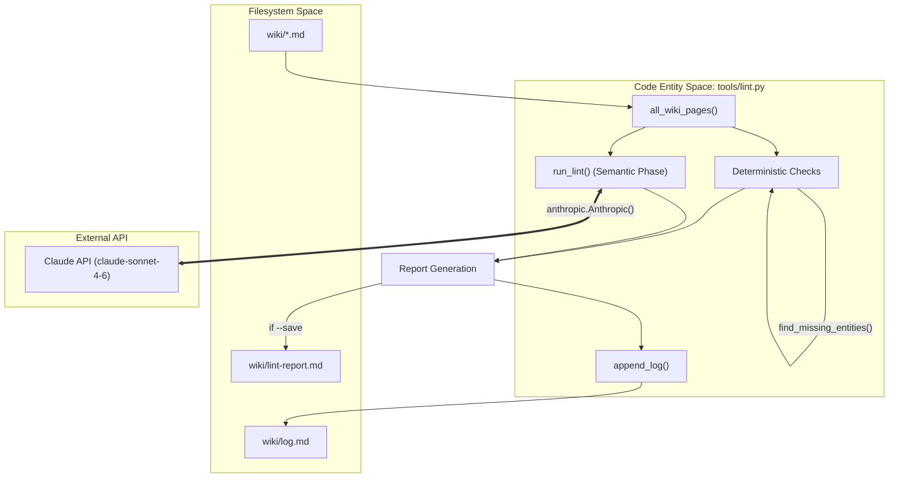
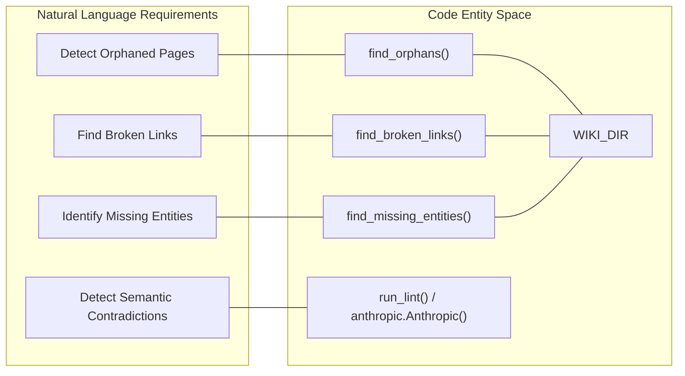

<!-- source: DeepWiki mcp.deepwiki.com · repo SamurAIGPT/llm-wiki-agent · page 5.3 tools/lint.py · fetched 2026-10-26 -->

# tools/lint.py

Relevant source files

The following files were used as context for generating this wiki page:

- [requirements.txt](requirements.txt)
- [tools/lint.py](tools/lint.py)

The `tools/lint.py` script is a diagnostic utility designed to maintain the structural integrity and semantic consistency of the LLM Wiki. It performs a two-phase health check: a deterministic structural analysis of the filesystem and a semantic analysis using the Claude API to identify high-level data quality issues.

### CLI Usage

The script is executed from the command line and supports optional persistence of its findings.

| Command | Description |
| :--- | :--- |
| `python tools/lint.py` | Runs all checks and outputs the report to `stdout`. |
| `python tools/lint.py --save` | Runs all checks, outputs to `stdout`, and saves the report to `wiki/lint-report.md`. |

**Sources:**
- [tools/lint.py:5-15]()
- [tools/lint.py:191-200]()

---

### Structural Analysis Algorithms

The script performs three primary deterministic checks by scanning all Markdown files in the `wiki/` directory, excluding `index.md`, `log.md`, and `lint-report.md` [tools/lint.py:36-38]().

#### 1. Orphan Detection
A page is considered an "orphan" if it has no inbound `[[wikilinks]]` from any other page in the wiki. The `find_orphans` function [tools/lint.py:54-62]() builds an `inbound` frequency map by:
1. Iterating through every page.
2. Extracting links using `extract_wikilinks` [tools/lint.py:41-42]().
3. Resolving those links to file paths via `page_name_to_path` [tools/lint.py:45-51]().
4. Incrementing the count for each resolved path.

#### 2. Broken Link Resolution
The `find_broken_links` function [tools/lint.py:65-72]() identifies `[[wikilinks]]` that do not resolve to any existing file stem. It uses a case-insensitive matching heuristic in `page_name_to_path` to check if a link name matches a filename [tools/lint.py:49-51]().

#### 3. Missing Entity Heuristic
The script identifies potential new entities that should have their own pages but currently do not. The `find_missing_entities` function [tools/lint.py:75-85]() flags any term used inside a `[[wikilink]]` that:
1. Does not have a corresponding file in the wiki.
2. Is mentioned in **3 or more** different pages.

**Sources:**
- [tools/lint.py:41-85]()

---

### Semantic Linting via Claude API

After structural checks, the script performs a semantic audit using the `claude-sonnet-4-6` model [tools/lint.py:118]().

#### Context Construction
Due to context window constraints, the script selects a sample of the first 20 pages [tools/lint.py:109](). It concatenates these pages into a `pages_context` string, truncating each page to the first 1500 characters to ensure the prompt remains within limits [tools/lint.py:110-113]().

#### Analysis Categories
The Claude API is prompted to identify four specific categories of issues:
1. **Contradictions**: Conflicting claims between different pages.
2. **Stale Content**: Summaries that have been superseded by newer information.
3. **Data Gaps**: Important questions the current wiki cannot answer.
4. **Depth Issues**: Concepts mentioned frequently but lacking detailed explanation.

**Sources:**
- [tools/lint.py:107-142]()

---

### Data Flow and System Interaction

The following diagrams illustrate how `tools/lint.py` interacts with the filesystem and external APIs.

#### Linting Pipeline Logic
"This diagram shows the flow from raw wiki files to the final lint report."

**Sources:**
- [tools/lint.py:36-38]()
- [tools/lint.py:88-142]()
- [tools/lint.py:185-203]()

#### Natural Language to Code Entity Mapping
"This diagram bridges the conceptual 'health check' requirements to the specific functions and files in the codebase."

**Sources:**
- [tools/lint.py:9-15]()
- [tools/lint.py:27]()
- [tools/lint.py:54]()
- [tools/lint.py:65]()
- [tools/lint.py:75]()
- [tools/lint.py:115-117]()

---

### Output Format

The script generates a Markdown report with the following structure:

1. **Header**: `# Wiki Lint Report — [ISO-DATE]` [tools/lint.py:146]().
2. **Structural Issues**:
   - **Orphan Pages**: List of relative paths to files with no inbound links [tools/lint.py:155-157]().
   - **Broken Wikilinks**: List of files and the specific `[[link]]` that failed to resolve [tools/lint.py:161-163]().
   - **Missing Entity Pages**: List of `[[wikilinks]]` mentioned 3+ times that lack a file [tools/lint.py:167-169]().
3. **Semantic Issues**: The raw text response from the Claude API containing Contradictions, Stale Content, Data Gaps, and Depth issues [tools/lint.py:178]().

Every run of the script appends a summary entry to `wiki/log.md` [tools/lint.py:203]().

**Sources:**
- [tools/lint.py:145-182]()
- [tools/lint.py:203]()

---

