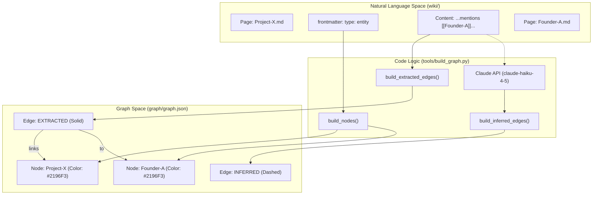
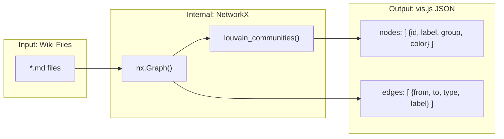

<!-- source: DeepWiki mcp.deepwiki.com · repo SamurAIGPT/llm-wiki-agent · page 5.4 tools/build_graph.py · fetched 2026-10-26 -->

# tools/build_graph.py

<details>
<summary>Relevant source files</summary>

The following files were used as context for generating this wiki page:

- [graph/.gitkeep](graph/.gitkeep)
- [requirements.txt](requirements.txt)
- [tools/build_graph.py](tools/build_graph.py)

</details>


The `tools/build_graph.py` script is a specialized utility designed to transform the flat Markdown file structure of the wiki into a structured knowledge graph. It performs two-pass edge extraction (deterministic and semantic), calculates graph metrics such as community detection, and generates an interactive HTML visualization using `vis.js`.

### Overview and CLI Usage

The script serves as the backend for the "Graph Workflow," providing both a data file (`graph/graph.json`) and a visual interface (`graph/graph.html`) for exploring relationships between sources, entities, and concepts.

| Flag | Description |
| :--- | :--- |
| `--no-infer` | Skips the Claude API semantic inference pass. Useful for rapid local development or offline use. |
| `--open` | Automatically opens the generated `graph.html` in the default system web browser upon completion. |

**Usage Examples:**
```bash
python tools/build_graph.py               # Full build with Claude-assisted inference
python tools/build_graph.py --no-infer    # Fast build using only explicit [[wikilinks]]
python tools/build_graph.py --open        # Build and view immediately
```
Sources: `[tools/build_graph.py:1-18]()`

---

### Data Flow and Pipeline

The graph construction follows a linear pipeline that transitions from raw filesystem data to a processed graph object.

#### Graph Construction Process
1.  **Page Discovery**: Scans the `wiki/` directory for all `.md` files, excluding system files like `index.md` or `log.md` `[tools/build_graph.py:71-73]()`.
2.  **Node Generation**: Parses frontmatter to determine node types (`source`, `entity`, `concept`, `synthesis`) and assigns colors based on the `TYPE_COLORS` mapping `[tools/build_graph.py:103-117]()`.
3.  **Pass 1: Deterministic Extraction**: Scans page content for `[[wikilink]]` patterns and creates `EXTRACTED` edges `[tools/build_graph.py:120-142]()`.
4.  **Pass 2: Semantic Inference**: Uses the Claude API (`claude-haiku-4-5`) to identify implicit relationships between pages that are not explicitly linked `[tools/build_graph.py:145-223]()`.
5.  **Graph Analysis**: If `networkx` is available, it performs Louvain community detection to group related nodes `[tools/build_graph.py:226-241]()`.
6.  **Serialization**: Saves the combined data to `graph/graph.json` and renders the `vis.js` template to `graph/graph.html`.

#### Relationship Logic: Natural Language to Graph Edge
The following diagram illustrates how the script converts Markdown syntax and LLM reasoning into graph components.

**Entity and Relationship Extraction Diagram**

Sources: `[tools/build_graph.py:47-60]()`, `[tools/build_graph.py:103-117]()`, `[tools/build_graph.py:120-142]()`, `[tools/build_graph.py:145-170]()`

---

### Implementation Details

#### SHA256 Caching and Performance
To minimize API costs and execution time, the script implements a caching mechanism using `.cache.json` `[tools/build_graph.py:43]()`.
- For every page, a SHA256 hash of the content is calculated `[tools/build_graph.py:67-68]()`.
- During `build_inferred_edges`, only pages with modified hashes (or new pages) are sent to Claude for semantic analysis `[tools/build_graph.py:152-158]()`.
- If no pages have changed, the script skips Pass 2 entirely `[tools/build_graph.py:159-161]()`.

#### Edge Types and Visualization
The script categorizes relationships into three distinct types, each with specific visual properties in the HTML output.

| Edge Type | Origin | Confidence | Color |
| :--- | :--- | :--- | :--- |
| `EXTRACTED` | Explicit `[[wikilink]]` | 1.0 | `#555555` |
| `INFERRED` | Claude API Analysis | $\ge 0.7$ | `#FF5722` |
| `AMBIGUOUS` | Claude API Analysis | $< 0.7$ | `#BDBDBD` |

Sources: `[tools/build_graph.py:14-18]()`, `[tools/build_graph.py:56-60]()`, `[tools/build_graph.py:199-201]()`

#### Community Detection
If `networkx` is installed, the script utilizes the Louvain method via `nx_community.louvain_communities` `[tools/build_graph.py:32]()`.
- It constructs a `nx.Graph` object from the extracted nodes and edges `[tools/build_graph.py:228-232]()`.
- It identifies clusters (communities) of highly interconnected nodes `[tools/build_graph.py:234-235]()`.
- Each node is assigned a `group` ID corresponding to its community, which `vis.js` uses for visual clustering `[tools/build_graph.py:236-241]()`.

**Data Structure Transformation**

Sources: `[tools/build_graph.py:226-241]()`, `[tools/build_graph.py:244-255]()`

### HTML Generation
The `graph/graph.html` file is generated using a hardcoded template (omitted for brevity in this reference) that embeds the `graph.json` data into a `vis.Network` constructor. It supports:
- Physics-based layout (force-directed graph).
- Search/Filtering by node type.
- Click-to-open functionality that links back to the local Markdown source file `[tools/build_graph.py:115]()`.

Sources: `[tools/build_graph.py:10-12]()`, `[tools/build_graph.py:244-260]()`

---

