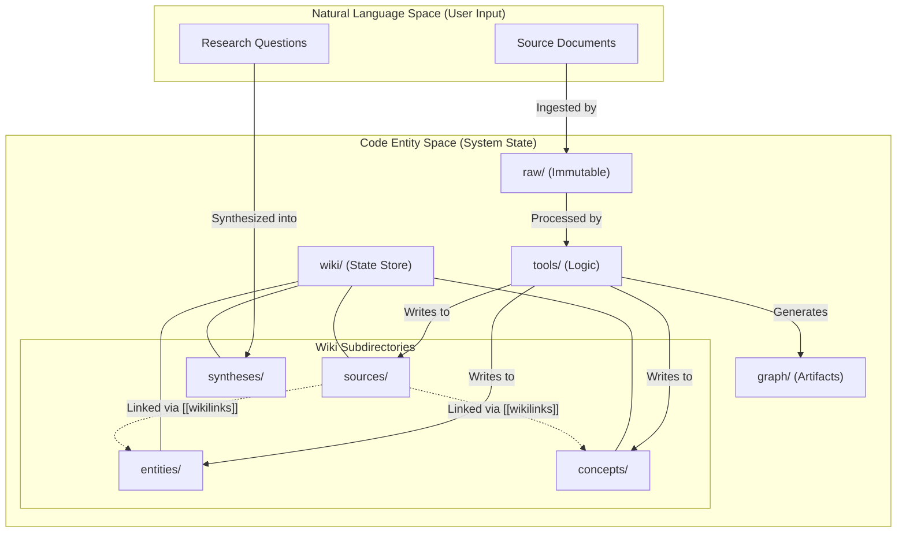
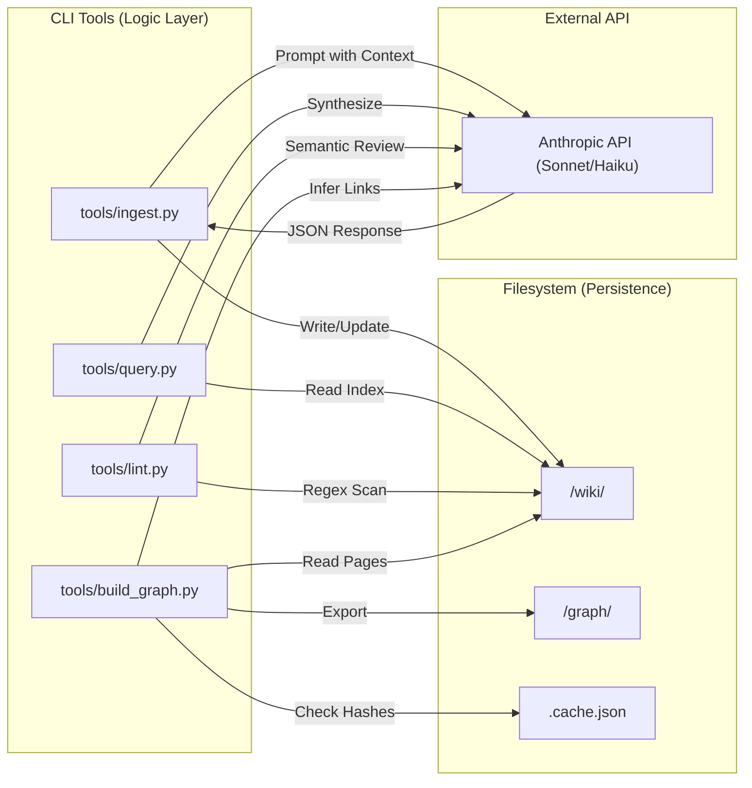

<!-- source: DeepWiki mcp.deepwiki.com · repo SamurAIGPT/llm-wiki-agent · page 6 Glossary · fetched 2026-10-26 -->

# Glossary

Relevant source files

The following files were used as context for generating this wiki page:

- [.claude/commands/wiki-graph.md](.claude/commands/wiki-graph.md)
- [.claude/commands/wiki-ingest.md](.claude/commands/wiki-ingest.md)
- [.claude/commands/wiki-lint.md](.claude/commands/wiki-lint.md)
- [.claude/commands/wiki-query.md](.claude/commands/wiki-query.md)
- [AGENTS.md](AGENTS.md)
- [CLAUDE.md](CLAUDE.md)
- [GEMINI.md](GEMINI.md)
- [README.md](README.md)
- [tools/build_graph.py](tools/build_graph.py)
- [tools/ingest.py](tools/ingest.py)
- [tools/lint.py](tools/lint.py)
- [tools/query.py](tools/query.py)

This glossary defines the technical terms, directory structures, and implementation concepts used within the LLM Wiki Agent codebase. It serves as a reference for understanding the system's "Filesystem-as-Database" model and the relationship between agent workflows and standalone Python tools.

## Core Concepts

| Term | Definition | Code Pointer |
| :--- | :--- | :--- |
| **Agent Skill** | A set of instructions (schema) that allows an LLM agent to perform complex, multi-step tasks like wiki maintenance. | [README.md:5-5]() |
| **Wiki Layer** | The collection of structured Markdown files that represent the system's persistent state. | [CLAUDE.md:28-35]() |
| **Frontmatter** | YAML metadata at the top of every wiki page used for indexing and type categorization. | [CLAUDE.md:44-54]() |
| **Wikilink** | A link between pages using the `[[PageName]]` syntax, used for deterministic graph extraction. | [CLAUDE.md:56-56]() |
| **Living Synthesis** | The `overview.md` file, which is iteratively updated during every ingest to reflect the current state of knowledge. | [CLAUDE.md:31-31]() |
| **Slug** | A URL-friendly, kebab-case version of a filename used for source and synthesis pages. | [CLAUDE.md:154-157]() |

**Sources:** [README.md:1-25](), [CLAUDE.md:24-58](), [CLAUDE.md:152-158]()

---

## Directory Taxonomy

The codebase enforces a strict directory layout where the agent "owns" the `wiki/` and `graph/` directories, while the `raw/` directory remains immutable.

### Data Space Mapping
The following diagram maps the logical data types to their physical locations and the specific code entities responsible for managing them.

**Logical to Physical Entity Map**

**Sources:** [CLAUDE.md:24-38](), [AGENTS.md:21-35](), [tools/ingest.py:28-33]()

---

## Workflow Definitions

### Ingest Workflow
The process of transforming a raw document into structured wiki pages. It involves reading the source, checking for contradictions against `wiki/index.md` and `wiki/overview.md`, and generating or updating multiple files.
*   **Key Function:** `ingest()` in `tools/ingest.py` [tools/ingest.py:93-195]().
*   **Key Logic:** Uses `build_wiki_context()` to provide Claude with the current state before generation [tools/ingest.py:50-62]().

### Query Workflow
Retrieval-augmented synthesis based on the wiki content.
*   **Key Function:** `query()` in `tools/query.py` [tools/query.py:65-177]().
*   **Heuristic Retrieval:** `find_relevant_pages()` uses keyword matching to select up to 12 pages [tools/query.py:41-57]().
*   **LLM Retrieval:** If keywords fail, it uses `claude-haiku-4-5` to select relevant paths from the index [tools/query.py:79-96]().

### Lint Workflow
A health check for the wiki's structural and semantic integrity.
*   **Structural Checks:** Deterministic detection of **Orphan Pages** (no inbound links), **Broken Links**, and **Missing Entity Pages** (entities mentioned 3+ times without a file) [tools/lint.py:54-85]().
*   **Semantic Checks:** Uses `claude-sonnet-4-6` to identify contradictions and data gaps [tools/lint.py:115-142]().

### Graph Workflow
The construction of a knowledge graph from the wiki's link structure.
*   **Pass 1 (EXTRACTED):** Deterministic parsing of `[[wikilinks]]` [tools/build_graph.py:120-142]().
*   **Pass 2 (INFERRED):** Semantic relationship detection using `claude-haiku-4-5` [tools/build_graph.py:145-225]().
*   **Clustering:** Uses `networkx` for Louvain community detection to group related nodes [tools/build_graph.py:236-248]().

**Sources:** [CLAUDE.md:60-150](), [tools/ingest.py:9-16](), [tools/query.py:2-13](), [tools/lint.py:9-15](), [tools/build_graph.py:14-18]()

---

## Implementation Jargon

### Deterministic vs. Semantic
The system distinguishes between logic that is code-driven (deterministic) and logic that is LLM-driven (semantic).

| Jargon | Meaning | Code Implementation |
| :--- | :--- | :--- |
| **EXTRACTED Edge** | A graph connection found by regex parsing `[[links]]`. | `build_extracted_edges()` [tools/build_graph.py:120]() |
| **INFERRED Edge** | A graph connection suggested by the LLM based on content analysis. | `build_inferred_edges()` [tools/build_graph.py:145]() |
| **AMBIGUOUS Edge** | An inferred relationship with a confidence score below 0.7. | `build_inferred_edges()` [tools/build_graph.py:199]() |
| **SHA256 Caching** | Storing hashes of wiki pages to avoid re-processing unchanged files during graph builds. | `sha256()` [tools/build_graph.py:67]() & `load_cache()` [tools/build_graph.py:89]() |

### System Components Map
This diagram shows how the Python tools interact with the filesystem and the Anthropic API to perform these operations.

**Tool & API Interaction Flow**

**Sources:** [tools/ingest.py:105-157](), [tools/query.py:69-135](), [tools/lint.py:88-182](), [tools/build_graph.py:103-270]()