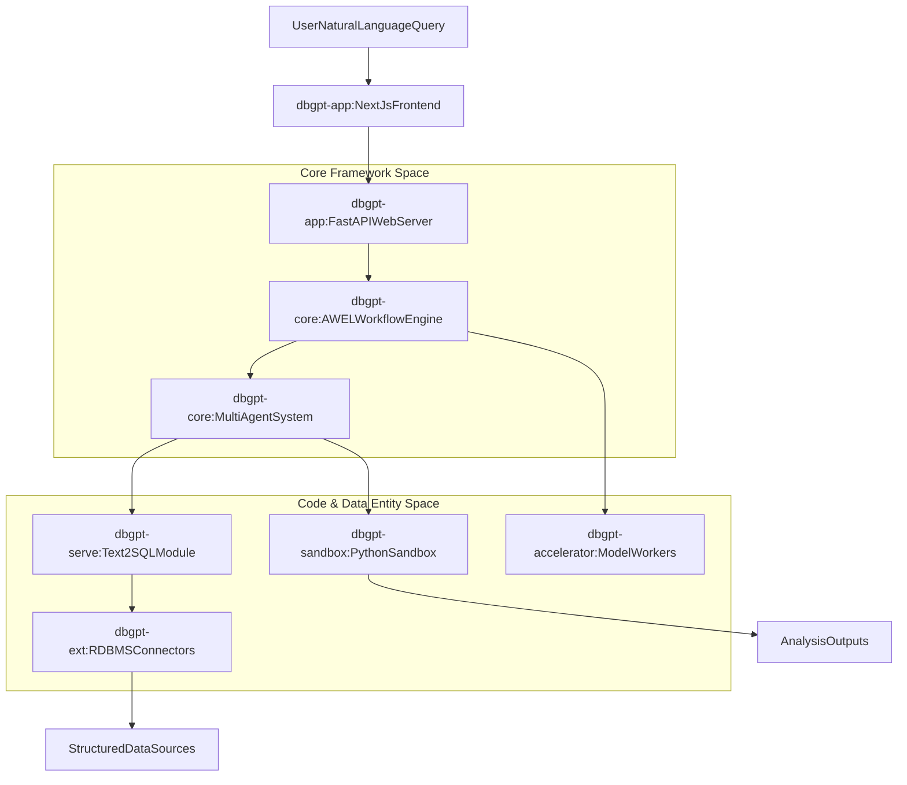
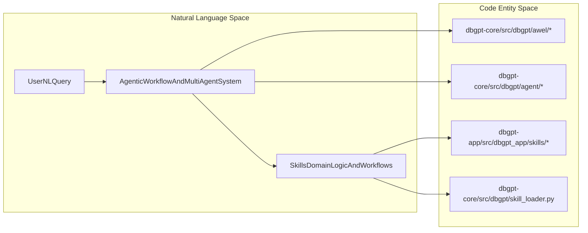
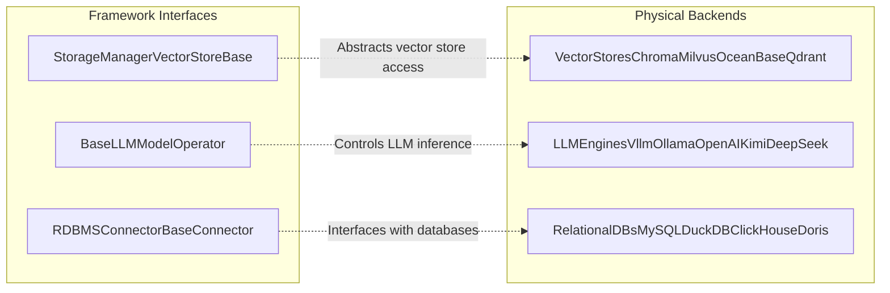

<!-- source: DeepWiki mcp.deepwiki.com · repo eosphoros-ai/DB-GPT · page 1 DB-GPT Overview · fetched 2026-10-26 -->

# DB-GPT Overview

Relevant source files

The following files were used as context for generating this wiki page:

- [README.hi.md](README.hi.md)
- [README.ja.md](README.ja.md)
- [README.ma.md](README.ma.md)
- [README.md](README.md)
- [README.ta.md](README.ta.md)
- [README.zh.md](README.zh.md)
- [assets/ding.jpg](assets/ding.jpg)
- [assets/wechat.jpg](assets/wechat.jpg)
- [docs/static/img/agentic-multi-file/file-preview-zh.jpg](docs/static/img/agentic-multi-file/file-preview-zh.jpg)
- [docs/static/img/knowledge/knowledge_reference_chat_zh.jpg](docs/static/img/knowledge/knowledge_reference_chat_zh.jpg)
- [examples/rag/retriever_evaluation_example.py](examples/rag/retriever_evaluation_example.py)
- [packages/dbgpt-accelerator/dbgpt-acc-auto/pyproject.toml](packages/dbgpt-accelerator/dbgpt-acc-auto/pyproject.toml)
- [packages/dbgpt-accelerator/dbgpt-acc-auto/src/dbgpt_acc_auto/_version.py](packages/dbgpt-accelerator/dbgpt-acc-auto/src/dbgpt_acc_auto/_version.py)
- [packages/dbgpt-accelerator/dbgpt-acc-flash-attn/pyproject.toml](packages/dbgpt-accelerator/dbgpt-acc-flash-attn/pyproject.toml)
- [packages/dbgpt-accelerator/dbgpt-acc-flash-attn/src/dbgpt_acc_flash_attn/_version.py](packages/dbgpt-accelerator/dbgpt-acc-flash-attn/src/dbgpt_acc_flash_attn/_version.py)
- [packages/dbgpt-app/src/dbgpt_app/_version.py](packages/dbgpt-app/src/dbgpt_app/_version.py)
- [packages/dbgpt-client/pyproject.toml](packages/dbgpt-client/pyproject.toml)
- [packages/dbgpt-client/src/dbgpt_client/_version.py](packages/dbgpt-client/src/dbgpt_client/_version.py)
- [packages/dbgpt-core/src/dbgpt/_version.py](packages/dbgpt-core/src/dbgpt/_version.py)
- [packages/dbgpt-core/src/dbgpt/storage/metadata/db_storage.py](packages/dbgpt-core/src/dbgpt/storage/metadata/db_storage.py)
- [packages/dbgpt-ext/src/dbgpt_ext/_version.py](packages/dbgpt-ext/src/dbgpt_ext/_version.py)
- [packages/dbgpt-serve/src/dbgpt_serve/_version.py](packages/dbgpt-serve/src/dbgpt_serve/_version.py)
- [pyproject.toml](pyproject.toml)
- [scripts/install/install.sh](scripts/install/install.sh)
- [scripts/install/lib/common.sh](scripts/install/lib/common.sh)

DB-GPT is an open-source **agentic AI data assistant** designed to drive next-generation AI + Data applications. It enables users and teams to connect seamlessly to diverse data sources—including databases, Excel/CSV files, data warehouses, and knowledge bases—while empowering natural language querying, autonomous SQL generation, Python/code-driven analysis workflows, and execution of reusable skills within secure sandboxed environments [README.md:57-67]().

More than a simple assistant interface, DB-GPT is a platform and framework for building AI-native data agents, orchestrated workflows, and intelligent applications. Its foundation centers on the **Agentic Workflow Expression Language (AWEL)** and the **Service-Oriented Multi-Model Management Framework (SMMF)**, which together provide sophisticated coordination for multi-modal, data-driven AI tasks [README.ja.md:56-59]().

Sources: [README.md:57-67](), [README.ja.md:56-59]()

---

## Architecture Pillars

DB-GPT’s architecture bridges natural language understanding with data operations and code execution to deliver an end-to-end AI + Data workflow. The system is built around the following core pillars.

### System Architecture

The overall system starts with user natural language (NL) queries submitted via the web UI, processed through a layered stack involving the FastAPI backend, AWEL orchestration engine, multi-agent coordination, model management, data connectors, and sandboxed execution environments:

Sources: [README.md:69-70](), [README.ja.md:63-82]()

---

### Key Capabilities

- **Agentic Data Analysis:** Autonomous task planning, decomposition into steps, tool invocation, and iterative workflow execution through a multi-agent system [README.md:73-75]().

- **Autonomous SQL + Code Generation and Execution:** Natural language inputs yield SQL queries and Python code that can be executed for data retrieval, dataset cleanup, metric computation, and report generation [README.md:77-80]().

- **Multi-Source Data Access:** Support for structured and unstructured sources including relational databases, spreadsheet files, documents, and knowledge bases [README.md:82-85]().

- **Skills-Driven Extensibility:** Domain knowledge, analytical methods, and execution flows packaged as reusable skills that agents load and execute [README.md:87-90]().

- **Retrieval-Augmented Generation (RAG) & Knowledge Graphs:** Enables sophisticated retrieval over vector stores (Chroma, Milvus, PGVector, etc.) and graph databases (Neo4j, TuGraph) for knowledge-enhanced question answering [README.ja.md:71-82]().

- **Service-Oriented Multi-Model Management Framework (SMMF):** Manages both local AI models (vLLM, HuggingFace, llama.cpp) and cloud proxy LLMs (OpenAI, Moonshot/Kimi, MiniMax, DeepSeek, ZhipuAI, etc.) with distributed serving capabilities [README.ja.md:58](), [packages/dbgpt-accelerator/dbgpt-acc-auto/pyproject.toml:67-73]().

- **Sandboxed Execution Environment:** Runs code safely within isolated Python and JavaScript sandboxes powered by Lyric workers to avoid security risks and ensure reliable execution [README.md:96-98](), [pyproject.toml:31-40]().

Sources: [README.md:73-98](), [README.ja.md:58-82](), [packages/dbgpt-accelerator/dbgpt-acc-auto/pyproject.toml:67-73](), [pyproject.toml:31-40]()

---

## Monorepo Organization

DB-GPT’s source is organized as a modular monorepo managed with the `uv` workspace tool. This design breaks down the system into focused packages, each responsible for key aspects of the platform. This modularity simplifies development, testing, and deployment [pyproject.toml:31-40]().

| Package             | Description                                                                                                          |
|---------------------|----------------------------------------------------------------------------------------------------------------------|
| `dbgpt-core`        | Core framework: AWEL workflow engine, base agent classes, interfaces for LLM, storage, skill loading, serialization. |
| `dbgpt-app`         | Main application: FastAPI backend, Next.js frontend, built-in skills, web assets, and APIs.                           |
| `dbgpt-serve`       | Backend server: chat handling, data source and knowledge management, REST API routes.                                |
| `dbgpt-ext`         | Extensions: RAG subsystem, vector and graph database adapters, data source connectors.                               |
| `dbgpt-client`      | Python SDK client for programmatic access to chat, knowledge, workflows, and data source services.                   |
| `dbgpt-sandbox`     | Isolated environments for secure execution of Python/JS code with Lyric workers.                                    |
| `dbgpt-accelerator` | Hardware-aware model driver adapters and accelerators (e.g., vLLM, flash attention).                                 |

All packages use synchronized versioning for coordinated releases [packages/dbgpt-core/pyproject.toml:3](), [packages/dbgpt-client/src/dbgpt_client/_version.py:1](), [packages/dbgpt-ext/src/dbgpt_ext/_version.py:1]().

For details, see [Monorepo Package Structure](#1.3) on package roles and interdependencies.

Sources: [pyproject.toml:31-40](), [packages/dbgpt-core/pyproject.toml:3](), [packages/dbgpt-client/src/dbgpt_client/_version.py:1](), [packages/dbgpt-ext/src/dbgpt_ext/_version.py:1]()

---

## Bridging Natural Language with Code Entities

This diagram connects natural language concepts like user queries and skills with their core code implementations in DB-GPT:

Sources: [README.md:63-70](), [pyproject.toml:31-40]()

---

## Mapping Models, Connectors, and Storage

This diagram outlines how DB-GPT abstracts connections to models, vector stores, and data sources, mapping interfaces to implementations:

Sources: [README.ja.md:80-82](), [packages/dbgpt-accelerator/dbgpt-acc-auto/pyproject.toml:67-73]()

---

## Wiki Navigation

This overview page links out to detailed child pages covering installation, configuration, and the monorepo layout:

- **[Getting Started & Installation](#1.1)** — Installation from source, install.sh script, Docker usage, environment setup, running webserver, and development container guidance.

- **[Configuration Reference](#1.2)** — TOML-based config system, profiles (proxy, local, GraphRAG, BM25, cloud storage), environment variables, app config schema.

- **[Monorepo Package Structure](#1.3)** — Comprehensive layout of monorepo workspaces, package dependencies, testing and localization infrastructure.

Sources: [README.md:127-155](), [pyproject.toml:31-40]()

---

