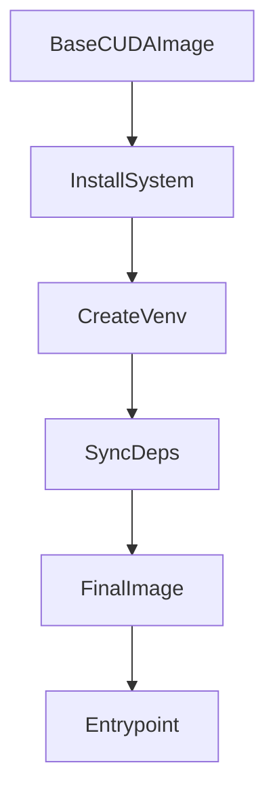
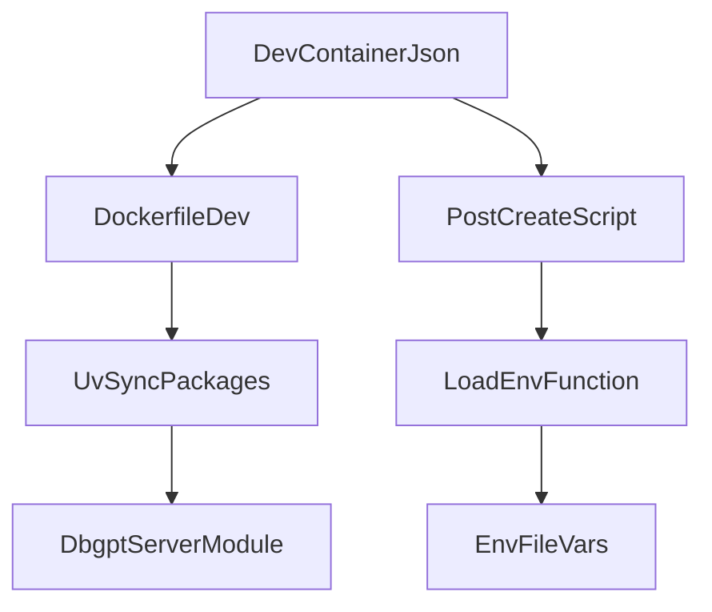

<!-- source: DeepWiki mcp.deepwiki.com · repo eosphoros-ai/DB-GPT · page 1.1 Getting Started & Installation · fetched 2026-10-26 -->

# Getting Started & Installation

<details>
<summary>Relevant source files</summary>

The following files were used as context for generating this wiki page:

- [README.hi.md](README.hi.md)
- [README.ja.md](README.ja.md)
- [README.ma.md](README.ma.md)
- [README.md](README.md)
- [README.ta.md](README.ta.md)
- [README.zh.md](README.zh.md)
- [assets/ding.jpg](assets/ding.jpg)
- [assets/wechat.jpg](assets/wechat.jpg)
- [docs/docs/application/advanced_tutorial/api.md](docs/docs/application/advanced_tutorial/api.md)
- [docs/docs/application/advanced_tutorial/cli.md](docs/docs/application/advanced_tutorial/cli.md)
- [docs/docs/application/fine_tuning_manual/text_to_sql.md](docs/docs/application/fine_tuning_manual/text_to_sql.md)
- [docs/docs/installation/sourcecode.md](docs/docs/installation/sourcecode.md)
- [docs/docs/quickstart.md](docs/docs/quickstart.md)
- [docs/sidebars.js](docs/sidebars.js)
- [docs/static/img/agentic-multi-file/file-preview-zh.jpg](docs/static/img/agentic-multi-file/file-preview-zh.jpg)
- [docs/static/img/knowledge/knowledge_reference_chat_zh.jpg](docs/static/img/knowledge/knowledge_reference_chat_zh.jpg)
- [examples/rag/retriever_evaluation_example.py](examples/rag/retriever_evaluation_example.py)
- [packages/dbgpt-core/src/dbgpt/storage/metadata/db_storage.py](packages/dbgpt-core/src/dbgpt/storage/metadata/db_storage.py)
- [scripts/install/install.sh](scripts/install/install.sh)
- [scripts/install/lib/common.sh](scripts/install/lib/common.sh)
- [scripts/setup_autodl_env.sh](scripts/setup_autodl_env.sh)

</details>


This page provides a comprehensive technical guide for installing and configuring DB-GPT from source, via the installation script, or through containerized environments. It covers environment preparation, dependency management using the `uv` package manager `[docs/docs/quickstart.md:29-30]`, configuration profiles, running the FastAPI webserver `[packages/dbgpt-app/src/dbgpt_app/dbgpt_server.py:1-50]`, and setting up a VS Code development container `[.devcontainer.json:1-52]`.

---

## 1. Environment Requirements

DB-GPT supports two primary execution modes depending on available hardware resources:

- **Proxy Model**: Relies on external LLM API providers such as OpenAI, DeepSeek, Moonshot, MiniMax, or SiliconFlow. This mode has minimal hardware requirements since inference happens remotely.
- **Local Model**: Runs inference locally on hardware using acceleration backends such as `vLLM`, Hugging Face transformers, or `llama.cpp`. This requires substantial CPU/GPU resources.

| Startup Mode | CPU * MEM | GPU | Remarks |
| :----------- | :------- | :-- | :------ |
| **Proxy Model** | 4C * 8G | None | Proxy models do not require local GPU hardware acceleration. Suitable for lightweight setups. |
| **Local Model** | 8C * 32G | 24G+ | Recommended for local execution of models like GLM-4 or Qwen-2.5 for smooth performance. |

The default embedded metadata persistence layer uses SQLite, requiring no external database services for basic deployments.

Sources: `[README.md:131-154]()`, `[README.zh.md:147-166]()`, `[docs/docs/installation/sourcecode.md:3-9]()`

---

## 2. Installation Methods

DB-GPT provides multiple installation workflows catering to different user preferences and environments:

- Automated one-line installer shell script.
- Manual source code installation with Python environment synchronization via the `uv` package manager.
- Containerized deployment using official Docker images.

### 2.1 One-Line Installer Script

The shell script located at `scripts/install/install.sh` automates environment preparation, system dependency installation, repository cloning, and sets environment variables. It supports profiles to pre-configure model access, e.g., OpenAI or Moonshot.

**Example commands:**

```bash
# Basic installation on macOS or Linux
curl -fsSL https://raw.githubusercontent.com/eosphoros-ai/DB-GPT/main/scripts/install/install.sh | bash

# Installation specifying OpenAI profile and API key
curl -fsSL https://raw.githubusercontent.com/eosphoros-ai/DB-GPT/main/scripts/install/install.sh \
  | OPENAI_API_KEY=sk-xxx bash -s -- --profile openai
```

This script also supports other profiles such as `kimi` (Moonshot API) and `minimax` (OpenAI-compatible).

Once installation completes, switch directory to the cloned repo and start the webserver with the selected profile.

Sources: `[README.md:127-154]()`, `[README.zh.md:147-166]()`, `[scripts/install/install.sh:1-50]()`

### 2.2 Installation from Source

For manual control, you can clone the repository and synchronize all dependencies with `uv`, a Python package environment manager focused on repeatable and isolated installs `[docs/docs/quickstart.md:29-30]`.

```bash
git clone https://github.com/eosphoros-ai/DB-GPT.git
cd DB-GPT

uv sync --all-packages \
  --extra "base" \
  --extra "proxy_openai" \
  --extra "rag" \
  --extra "storage_chromadb" \
  --extra "dbgpts"
```

This command installs core DB-GPT dependencies along with support for OpenAI proxy LLMs, retrieval-augmented generation (RAG), ChromaDB vector storage, and official dbgpts example skills.

Sources: `[docs/docs/quickstart.md:21-120]()`, `[docs/docs/installation/sourcecode.md:13-90]()`

---

## 3. Configuration & Startup

DB-GPT uses TOML configuration files stored in the `configs/` directory, which specify model providers, API keys, and other runtime options `[docs/docs/quickstart.md:124-142]`.

**Example partial configuration snippet:**

```toml
[models]
[[models.llms]]
name = "gpt-4o"
provider = "proxy/openai"
api_key = "your-openai-api-key"
```

To start the webserver using a configuration file, run:

```bash
uv run dbgpt start webserver --config configs/dbgpt-proxy-openai.toml
```

Alternatively, you can start the application server directly via Python entrypoints:

```bash
uv run python packages/dbgpt-app/src/dbgpt_app/dbgpt_server.py --config configs/dbgpt-proxy-openai.toml
```

After startup, the web UI is accessible at `http://localhost:5670` `[README.zh.md:174-174]`.

Sources: `[README.zh.md:168-174]()`, `[docs/docs/quickstart.md:122-147]()`, `[packages/dbgpt-app/src/dbgpt_app/dbgpt_server.py:1-50]()`

---

## 4. Containerized Deployment with Docker

DB-GPT provides official Dockerfiles for building container images optimized for CUDA-enabled GPUs or CPU-only environments. The multi-stage build process includes a builder stage that installs Python, Rust toolchain for native extensions, a Python virtual environment setup at `/app/.venv`, and dependency synchronization using `uv`.

The final runtime image copies the virtual environment and source code, and sets the entrypoint to launch the DB-GPT webserver.

### Docker Image Build Flow



Sources: `[docker/base/Dockerfile:1-126]()`

---

## 5. VS Code Development Container Setup

The `.devcontainer` directory includes a development container configuration for consistent developer environments. The main configuration orchestrates builds using `Dockerfile.dev` `[.devcontainer.json:1-52]`.

The dev container setup:
- Loads environment variables from `.env`.
- Runs `uv sync --all-packages` to install dependencies.
- Provides the full source code inside the container.
- Launches the webserver or developer tools with the installed environment.

### Dev Container Initialization Flow



Sources: `[.devcontainer.json:1-52]()`, `[.devcontainer/Dockerfile.dev:1-56]()`, `[.devcontainer/post-create.sh:1-71]()`

---

## 6. Architecture Diagrams Bridging Natural Language Space and Code Entities

To clarify the installation and runtime flow from natural language user interaction to backend execution, two detailed diagrams below associate system components with concretely named code entities.

### 6.1 Installation and Startup Flow

```mermaid
graph LR
  Script["InstallScript[\"install.sh\"]"] --> Clone["GitClone[\"~/.dbgpt/DB-GPT\"]"]
  Clone --> Sync["UvSync[\"uv sync --all-packages\"]"]
  Sync --> Param["ParameterLoad[\"dbgpt/core/interface/parameter.py\"]"]
  Param --> SysApp["SystemRegistry[\"dbgpt.component.SystemApp\"]"]
  SysApp --> Server["WebServer[\"dbgpt_app/dbgpt_server.py\"]"]
  Server --> Manager["WorkerManager[\"dbgpt.model.cluster.worker.Manager\"]"]
```

Sources: `[README.md:131-160]()`, `[docker/base/Dockerfile:1-126]()`, `[packages/dbgpt-app/src/dbgpt_app/dbgpt_server.py:1-50]()`

### 6.2 User Query to Execution Flow

```mermaid
graph LR
  User["NaturalLanguageQuery[\"User Input\"]"] --> Frontend["NextJSClient[\"React Frontend\"]"]
  Frontend --> APIRouter["FastAPIRouter[\"dbgpt-serve REST API\"]"]
  APIRouter --> AgentCore["AgentFramework[\"dbgpt/agent\"]"]
  AgentCore --> LLMMgr["ModelManager[\"SMMF Proxy/Local\"]"]
  AgentCore --> RAG["KnowledgeRetriever[\"RAG Subsystem\"]"]
  AgentCore --> Sandbox["CodeSandbox[\"dbgpt-sandbox\"]"]
  Sandbox --> Result["ExecutionResult[\"Analysis Reports\"]"]
  Result --> Frontend
```

Sources: `[docker/base/Dockerfile:1-126]()`, `[README.md:1-155]()`

---

Sources:  
`[README.md:1-155]()`  
`[README.zh.md:147-174]()`  
`[scripts/install/install.sh:1-50]()`  
`[docs/docs/quickstart.md:1-150]()`  
`[docs/docs/installation/sourcecode.md:1-100]()`  
`[docker/base/Dockerfile:1-129]()`  
`[packages/dbgpt-app/src/dbgpt_app/dbgpt_server.py:1-50]()`  
`[.devcontainer.json:1-52]()`  
`[.devcontainer/Dockerfile.dev:1-56]()`  
`[.devcontainer/post-create.sh:1-71]()`

---

