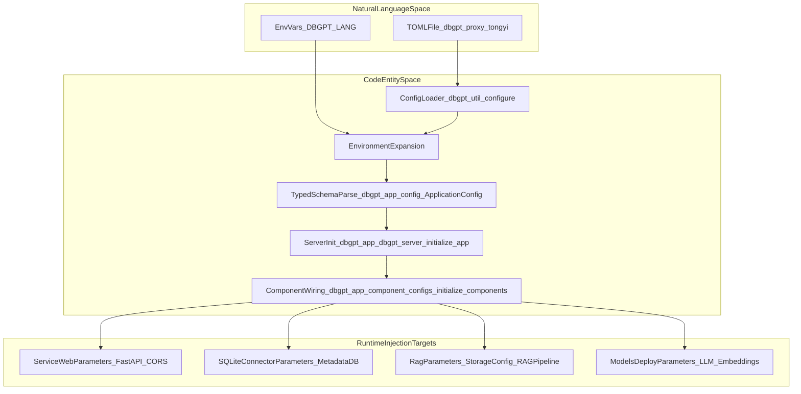
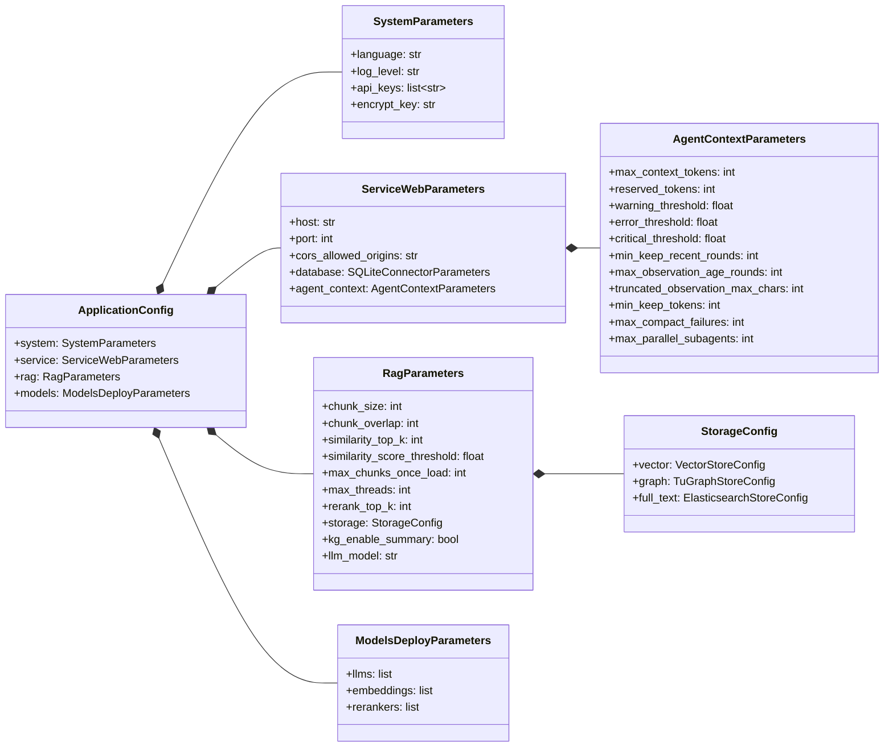
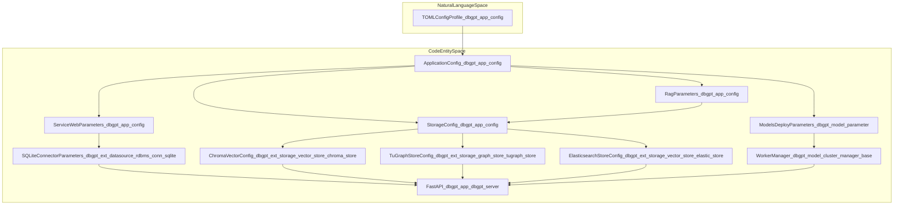

<!-- source: DeepWiki mcp.deepwiki.com · repo eosphoros-ai/DB-GPT · page 1.2 Configuration Reference · fetched 2026-10-26 -->

# Configuration Reference

<details>
<summary>Relevant source files</summary>

The following files were used as context for generating this wiki page:

- [configs/dbgpt-app-config.example.toml](configs/dbgpt-app-config.example.toml)
- [configs/dbgpt-graphrag.toml](configs/dbgpt-graphrag.toml)
- [configs/dbgpt-local-glm.toml](configs/dbgpt-local-glm.toml)
- [configs/dbgpt-local-llama-cpp-server.toml](configs/dbgpt-local-llama-cpp-server.toml)
- [configs/dbgpt-local-llama-cpp.toml](configs/dbgpt-local-llama-cpp.toml)
- [configs/dbgpt-local-qwen.toml](configs/dbgpt-local-qwen.toml)
- [configs/dbgpt-local-vllm.toml](configs/dbgpt-local-vllm.toml)
- [configs/dbgpt-proxy-aimlapi.toml](configs/dbgpt-proxy-aimlapi.toml)
- [configs/dbgpt-proxy-ollama.toml](configs/dbgpt-proxy-ollama.toml)
- [configs/dbgpt-proxy-openai.toml](configs/dbgpt-proxy-openai.toml)
- [configs/dbgpt-proxy-siliconflow-mysql.toml](configs/dbgpt-proxy-siliconflow-mysql.toml)
- [configs/dbgpt-proxy-siliconflow.toml](configs/dbgpt-proxy-siliconflow.toml)
- [configs/dbgpt-proxy-tongyi.toml](configs/dbgpt-proxy-tongyi.toml)
- [docs/docs/config-reference/llm/aimlapi_aimlapideploymodelparameters_a1b2c3.mdx](docs/docs/config-reference/llm/aimlapi_aimlapideploymodelparameters_a1b2c3.mdx)
- [docs/docs/config-reference/llm/index.mdx](docs/docs/config-reference/llm/index.mdx)
- [docs/docs/config-reference/llm/minimax_minimaxdeploymodelparameters_a1b2c4.mdx](docs/docs/config-reference/llm/minimax_minimaxdeploymodelparameters_a1b2c4.mdx)
- [docs/docs/installation/docker.md](docs/docs/installation/docker.md)
- [docs/docs/installation/docker_compose.md](docs/docs/installation/docker_compose.md)
- [docs/docs/installation/integrations/aimlapi_llm_install.md](docs/docs/installation/integrations/aimlapi_llm_install.md)
- [packages/dbgpt-app/src/dbgpt_app/config.py](packages/dbgpt-app/src/dbgpt_app/config.py)
- [packages/dbgpt-app/src/dbgpt_app/dbgpt_server.py](packages/dbgpt-app/src/dbgpt_app/dbgpt_server.py)
- [packages/dbgpt-core/src/dbgpt/model/cluster/apiserver/api.py](packages/dbgpt-core/src/dbgpt/model/cluster/apiserver/api.py)
- [packages/dbgpt-core/src/dbgpt/model/parameter.py](packages/dbgpt-core/src/dbgpt/model/parameter.py)
- [packages/dbgpt-core/src/dbgpt/model/proxy/llms/aimlapi.py](packages/dbgpt-core/src/dbgpt/model/proxy/llms/aimlapi.py)
- [packages/dbgpt-core/src/dbgpt/util/fastapi.py](packages/dbgpt-core/src/dbgpt/util/fastapi.py)
- [packages/dbgpt-core/src/dbgpt/util/tests/test_fastapi.py](packages/dbgpt-core/src/dbgpt/util/tests/test_fastapi.py)
- [packages/dbgpt-ext/src/dbgpt_ext/rag/embeddings/__init__.py](packages/dbgpt-ext/src/dbgpt_ext/rag/embeddings/__init__.py)
- [packages/dbgpt-ext/src/dbgpt_ext/rag/embeddings/aimlapi.py](packages/dbgpt-ext/src/dbgpt_ext/rag/embeddings/aimlapi.py)
- [packages/dbgpt-ext/src/dbgpt_ext/rag/embeddings/siliconflow.py](packages/dbgpt-ext/src/dbgpt_ext/rag/embeddings/siliconflow.py)

</details>


DB-GPT utilizes a hierarchical configuration system built on **TOML** files, supporting environment variable interpolation to enable dynamic, secure, and environment-specific settings. These configurations are parsed at runtime into strongly typed Python dataclasses following the `ApplicationConfig` schema (`packages/dbgpt-app/src/dbgpt_app/config.py`), offering structured, validated, and extensible app parameters.

This page details the full configuration system, including:
- The TOML format and defined profiles.
- Use of environment variables in configs.
- The main Python dataclasses schema.
- Injection into runtime components.
- Typical configuration profiles for proxy backends, local models, RAG setups, and cloud storage.
- Data flow visualizations linking natural language configuration concepts to code entities.

---

## TOML Configuration System

### Structure and Syntax

DB-GPT’s main configuration files use TOML format with a hierarchical section organization (`configs/dbgpt-app-config.example.toml`):

- **`[system]`**: Core system-level settings such as `language`, `log_level`, `api_keys`, and `encrypt_key` (`packages/dbgpt-app/src/dbgpt_app/config.py`).
- **`[service.web]`**: Webserver binding parameters for `host`, `port`, CORS origins (`cors_allowed_origins`), and database connection settings (`service.web.database`) (`configs/dbgpt-proxy-tongyi.toml`).
- **`[service.web.agent_context]`**: Controls agent conversation context-window token budget (`max_context_tokens`, `reserved_tokens`, thresholds) (`packages/dbgpt-app/src/dbgpt_app/config.py`).
- **`[rag]`** and **`[rag.storage]`**: Retrieval-Augmented Generation parameters including chunking options (`chunk_size`, `chunk_overlap`) and knowledge storage backends (`vector`, `graph`, `full_text`) (`packages/dbgpt-app/src/dbgpt_app/config.py`).
- **`[models]`**: Configurations for model groups such as `llms`, `embeddings`, and `rerankers` with provider and API key information (`configs/dbgpt-proxy-tongyi.toml`).

Sources:
- [configs/dbgpt-app-config.example.toml:1-58]()
- [packages/dbgpt-app/src/dbgpt_app/config.py:32-132]()

### Environment Variable Interpolation

TOML supports environment variable expansion using the syntax (`configs/dbgpt-proxy-tongyi.toml`):

```toml
key = "${env:ENV_VAR_NAME:-default_value}"
```

This enables sensitive configuration (e.g., API keys) and environment-specific overrides without modifying files directly.

Sources:
- [configs/dbgpt-proxy-tongyi.toml:3-56]()

### Proxy Profile Example (Tongyi Proxy)

```toml
[system]
language = "${env:DBGPT_LANG:-en}"
api_keys = []
encrypt_key = "your_secret_key"

[service.web]
host = "0.0.0.0"
port = 5670
cors_allowed_origins = "${env:DBGPT_CORS_ALLOWED_ORIGINS:-*}"

[service.web.agent_context]
max_context_tokens = 0
reserved_tokens = 4096
warning_threshold = 0.70
error_threshold = 0.90
critical_threshold = 0.95
max_parallel_subagents = 3

[service.web.database]
type = "sqlite"
path = "pilot/meta_data/dbgpt.db"

[rag.storage.vector]
type = "chroma"
persist_path = "pilot/data"

[models]
[[models.llms]]
name = "qwen-plus"
provider = "${env:LLM_MODEL_PROVIDER:-proxy/tongyi}"
api_base = "https://dashscope.aliyuncs.com/compatible-mode/v1"
api_key = "${env:DASHSCOPE_API_KEY}"

[[models.embeddings]]
name = "text-embedding-v3"
provider = "${env:EMBEDDING_MODEL_PROVIDER:-proxy/tongyi}"
api_url = "https://dashscope.aliyuncs.com/compatible-mode/v1/embeddings"
api_key = "${env:DASHSCOPE_API_KEY}"
```

Sources:
- [configs/dbgpt-proxy-tongyi.toml:1-56]()

---

## Configuration Parsing and Injection Flow

The following diagram bridges natural language configuration concepts to code entities (`ApplicationConfig`, `initialize_app`, `initialize_components`) during server startup:

Title: "Configuration Parsing and Runtime Injection Data Flow"


Sources:
- [packages/dbgpt-app/src/dbgpt_app/config.py:1-220]()
- [packages/dbgpt-app/src/dbgpt_app/dbgpt_server.py:137-175]()

---

## Configuration Profiles

DB-GPT supplies several TOML configuration profiles catering to different deployment needs:

### Proxy Model Profiles

| Profile Name | Description | Reference File |
|---|---|---|
| `proxy/tongyi` | Tongyi AI proxy LLM & embeddings | [configs/dbgpt-proxy-tongyi.toml]() |
| `proxy/openai` | OpenAI-compatible proxy | [configs/dbgpt-proxy-openai.toml]() |
| `proxy/siliconflow` | SiliconFlow proxy LLM & embeddings | [configs/dbgpt-proxy-siliconflow.toml]() |
| `proxy/siliconflow-mysql` | SiliconFlow proxy with MySQL DB | [configs/dbgpt-proxy-siliconflow-mysql.toml]() |
| `proxy/aimlapi` | AI/ML API proxy configuration | [configs/dbgpt-proxy-aimlapi.toml]() |

Sources:
- [configs/dbgpt-proxy-tongyi.toml:1-56]()
- [configs/dbgpt-proxy-openai.toml:1-52]()
- [configs/dbgpt-proxy-siliconflow.toml:1-58]()
- [configs/dbgpt-proxy-siliconflow-mysql.toml:1-45]()

### Local Model Profiles

Intended for self-hosted offline deployments running local LLM inference:

- `local-vllm`: Uses `VLLMDeployModelParameters` for local vLLM backend.
- `local-llama-cpp`: Uses `LlamaCppModelParameters` or `LlamaServerParameters` for quantized llama models.
- `local-qwen`: Loads local Qwen weights from disk via HuggingFace adapter (`HFLLMDeployModelParameters`).

Sources:
- [docs/docs/config-reference/llm/index.mdx:1-135]()

### GraphRAG and Hybrid Storage Profiles

RAG profiles extend the configuration with multi-modal knowledge storage backends (`configs/dbgpt-graphrag.toml`):

- **Vector Store**: `ChromaVectorConfig` (`persist_path`)
- **Knowledge Graph Store**: `TuGraphStoreConfig` (`host`, `port`, `username`, `password`)
- **Full-text Search Store**: `ElasticsearchStoreConfig` (`hosts`, optionally enabled)

These profiles enable hybrid storage for RAG via vector embeddings, knowledge graph querying, and full-text search indexing.

Sources:
- [configs/dbgpt-graphrag.toml:1-73]()
- [packages/dbgpt-app/src/dbgpt_app/config.py:63-84]()

---

## Environment Variables Usage

Key environment variables commonly referenced in configuration TOML files include:

| Env Variable | Purpose | Reference |
|---|---|---|
| `DBGPT_LANG` | Application language choice (`en`, `zh`, etc.) | [configs/dbgpt-proxy-openai.toml:3]() |
| `DBGPT_CORS_ALLOWED_ORIGINS` | CORS allowed origins policy | [configs/dbgpt-proxy-tongyi.toml:12]() |
| `OPENAI_API_KEY` | API key for OpenAI proxy LLM | [configs/dbgpt-proxy-openai.toml:46]() |
| `DASHSCOPE_API_KEY` | API key for Tongyi proxy LLM | [configs/dbgpt-proxy-tongyi.toml:50]() |
| `SILICONFLOW_API_KEY` | API key for SiliconFlow proxy | [configs/dbgpt-proxy-siliconflow.toml:47]() |
| `MYSQL_HOST`, `MYSQL_USER`, `MYSQL_PASSWORD` | MySQL metadata DB credentials | [configs/dbgpt-proxy-siliconflow-mysql.toml:16-20]() |

Sources:
- [configs/dbgpt-proxy-openai.toml:3-46]()
- [configs/dbgpt-proxy-tongyi.toml:12-50]()
- [configs/dbgpt-proxy-siliconflow.toml:47]()
- [configs/dbgpt-proxy-siliconflow-mysql.toml:16-20]()

---

## Application Configuration Schema (Python Dataclasses)

Configuration is represented declaratively via Python dataclasses in `dbgpt_app.config`. The following diagram maps these dataclasses and their aggregation relationships:

Title: "ApplicationConfig Dataclass Schema Aggregation"


Sources:
- [packages/dbgpt-app/src/dbgpt_app/config.py:32-132]()

---

## Runtime Usage of Configuration

At runtime, the parsed `ApplicationConfig` dataclass is injected into core system components for:

- Webserver and API server setup (`ServiceWebParameters`).
- Metadata relational database connection (`SQLiteConnectorParameters`).
- Knowledge storage backends for retrieval augmentation (`RagParameters` with `StorageConfig`).
- Model deployment and API server management (`ModelsDeployParameters`).

Title: "Runtime Consumption of Configuration Objects"


Sources:
- [packages/dbgpt-app/src/dbgpt_app/config.py:30-220]()
- [packages/dbgpt-app/src/dbgpt_app/dbgpt_server.py:137-175]()

---

## Implementation Details

### FastAPI Webserver Integration

The `ServiceWebParameters` configuration is passed to `initialize_app()` (`dbgpt_app.dbgpt_server`) which sets up the FastAPI app, mounts routers, and configures CORS using `build_cors_config()` (`dbgpt-core.util.fastapi`). This function interprets `cors_allowed_origins` with support for wildcards and origin restrictions.

Sources:
- [packages/dbgpt-app/src/dbgpt_app/dbgpt_server.py:137-170]()
- [packages/dbgpt-core/src/dbgpt/util/fastapi.py:1-50]()
- [packages/dbgpt-core/src/dbgpt/util/tests/test_fastapi.py:1-43]()

### Model and Provider Registrations

Models are configured under `[models.llms]`, `[models.embeddings]`, and `[models.rerankers]` sections in TOML. These entries are parsed into deployment parameter classes that control model loading, concurrency, and API parameters.

The providers (e.g., `proxy/tongyi`, `proxy/openai`, `local-llama-cpp`) correspond to specific model adapters implementing logic for inference or API calls.

The OpenAI-compatible RESTful API server in `dbgpt-core.model.cluster.apiserver.api` reflects these settings to expose model inference endpoints securely, with API key authorization and request validation.

Sources:
- [packages/dbgpt-core/src/dbgpt/model/cluster/apiserver/api.py:103-120]()

---

## Summary

DB-GPT’s TOML-based configuration system provides a structured mechanism for environment variable interpolation, type-safe Python dataclass parsing via `ApplicationConfig`, and runtime component injection across web services, storage backends, and model management frameworks. It supports diverse deployment profiles — from proxy-based cloud LLMs to local model runners and advanced RAG knowledge backends — providing flexibility and secure, manageable configuration for enterprise-grade operations.

Sources:
- [packages/dbgpt-app/src/dbgpt_app/config.py:1-220]()
- [configs/dbgpt-app-config.example.toml:1-70]()

---

