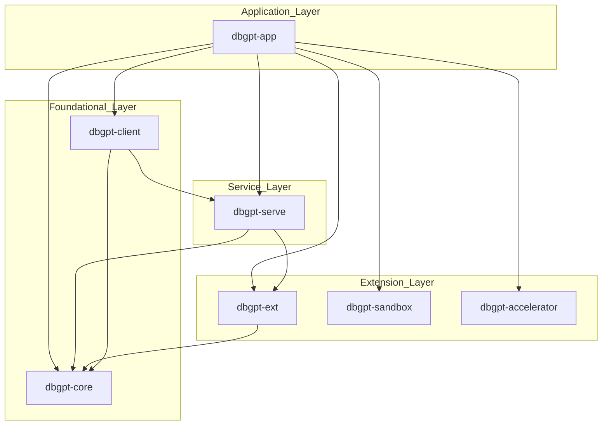
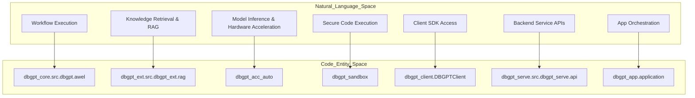
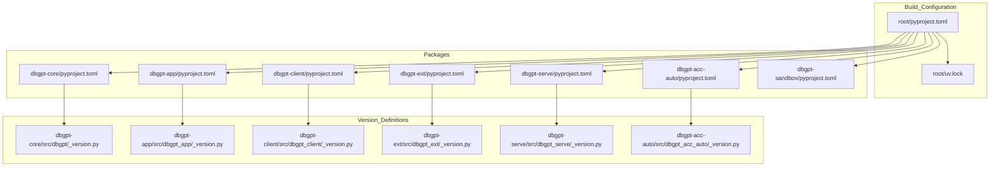

<!-- source: DeepWiki mcp.deepwiki.com · repo eosphoros-ai/DB-GPT · page 1.3 Monorepo Package Structure · fetched 2026-10-26 -->

# Monorepo Package Structure

Relevant source files

The following files were used as context for generating this wiki page:

- [packages/dbgpt-accelerator/dbgpt-acc-auto/pyproject.toml](packages/dbgpt-accelerator/dbgpt-acc-auto/pyproject.toml)
- [packages/dbgpt-accelerator/dbgpt-acc-auto/src/dbgpt_acc_auto/_version.py](packages/dbgpt-accelerator/dbgpt-acc-auto/src/dbgpt_acc_auto/_version.py)
- [packages/dbgpt-accelerator/dbgpt-acc-flash-attn/pyproject.toml](packages/dbgpt-accelerator/dbgpt-acc-flash-attn/pyproject.toml)
- [packages/dbgpt-accelerator/dbgpt-acc-flash-attn/src/dbgpt_acc_flash_attn/_version.py](packages/dbgpt-accelerator/dbgpt-acc-flash-attn/src/dbgpt_acc_flash_attn/_version.py)
- [packages/dbgpt-app/pyproject.toml](packages/dbgpt-app/pyproject.toml)
- [packages/dbgpt-app/src/dbgpt_app/_version.py](packages/dbgpt-app/src/dbgpt_app/_version.py)
- [packages/dbgpt-client/pyproject.toml](packages/dbgpt-client/pyproject.toml)
- [packages/dbgpt-client/src/dbgpt_client/_version.py](packages/dbgpt-client/src/dbgpt_client/_version.py)
- [packages/dbgpt-core/pyproject.toml](packages/dbgpt-core/pyproject.toml)
- [packages/dbgpt-core/src/dbgpt/_version.py](packages/dbgpt-core/src/dbgpt/_version.py)
- [packages/dbgpt-ext/pyproject.toml](packages/dbgpt-ext/pyproject.toml)
- [packages/dbgpt-ext/src/dbgpt_ext/_version.py](packages/dbgpt-ext/src/dbgpt_ext/_version.py)
- [packages/dbgpt-serve/pyproject.toml](packages/dbgpt-serve/pyproject.toml)
- [packages/dbgpt-serve/src/dbgpt_serve/_version.py](packages/dbgpt-serve/src/dbgpt_serve/_version.py)
- [pyproject.toml](pyproject.toml)
- [uv.lock](uv.lock)

This page details the organization and package layout of the DB-GPT monorepo. DB-GPT employs a **uv workspace** monorepo strategy (`pyproject.toml`), enabling multiple interdependent yet modular Python packages to coexist with unified dependency management, versioning (`_version.py`), and development tooling. This modular decomposition supports project scalability, clear dependency boundaries, and selective installation of components.

Sources: [pyproject.toml:31-40]()

---

## Workspace Overview

At the root, the root `pyproject.toml` defines the uv workspace members and shared development dependencies. The monorepo organizes the primary packages under the `packages/` directory, each as individual workspace members:

| Package Name          | Directory                          | Role Description                                                                                     |
|-----------------------|----------------------------------|---------------------------------------------------------------------------------------------------|
| **dbgpt-core**        | `packages/dbgpt-core`             | Core foundational framework implementing AWEL engine, core interfaces, component system, utilities |
| **dbgpt-app**         | `packages/dbgpt-app`              | Main application container orchestrating all packages into a deployable unified system             |
| **dbgpt-serve**       | `packages/dbgpt-serve`            | Backend service layer exposing model serving, REST API endpoints, and conversation management      |
| **dbgpt-ext**         | `packages/dbgpt-ext`              | Extensions including RAG, knowledge graph, advanced datasource connectors                          |
| **dbgpt-client**      | `packages/dbgpt-client`           | Official Python client SDK for DB-GPT system APIs                                                 |
| **dbgpt-sandbox**     | `packages/dbgpt-sandbox`          | Secure isolated sandbox environment for safe code execution                                       |
| **dbgpt-accelerator** | `packages/dbgpt-accelerator/dbgpt-acc*` | Hardware acceleration packages including `dbgpt-acc-auto` and `dbgpt-acc-flash-attn`            |

Each package contains its own `pyproject.toml` to declare dependencies, build tooling, and metadata but is collectively managed in the uv workspace for synchronized dependency resolution, version locking (`uv.lock`), and consistent environment setup.

Sources: [pyproject.toml:15-40]()

---

## Dependency Relationships and Flow

The following graph visualizes the dependency topology and interaction flow between the packages. It shows how foundational packages underpin higher layers, and how application orchestration aggregates the components.

- `dbgpt-core` is the foundation with essential interfaces and workflow engine.
- `dbgpt-ext` builds on core providing advanced knowledge and datasource connectors.
- `dbgpt-serve` depends on core and ext to provide backend services.
- `dbgpt-client` depends on core and serve to implement client APIs.
- `dbgpt-app` integrates all upper layers, including sandbox and accelerator packages.
- `dbgpt-sandbox` runs isolated environments consumed by app.
- `dbgpt-accelerator` offers optimized ML runtimes mainly used by app.

Sources:  
[packages/dbgpt-app/pyproject.toml:12-22](),  
[packages/dbgpt-ext/pyproject.toml:12-15](),  
[packages/dbgpt-serve/pyproject.toml:1-15](),  
[pyproject.toml:15-40]()

---

## Package Roles & Technical Details

### 1. dbgpt-core (`packages/dbgpt-core`)

- **Role:** Core foundational framework providing the declarative AWEL workflow engine, core interfaces, component system, and utility libraries.
- **Implementation Highlights:**
  - **AWEL (Agentic Workflow Expression Language):** A DAG-based declarative engine that composes operators, triggers, and runners to automate agentic workflows.
  - **Core Interfaces/Data Models:** Abstractions such as `LLM`, `Message`, `Prompt`, `Embeddings`, `KnowledgeStore`, `Cache`, `File`, `Variable`, and `OutputParser`.
  - **Component System:** `SystemApp` registry manages component lifecycles, service registration, and dependency injection.
  - **CLI Entrypoint:** Exposes command-line interface via `dbgpt.cli.cli_scripts:main`.
- **Build & Dependencies:**
  - Uses `hatchling` build backend.
  - Dependencies include `typeguard` (runtime typing), `cloudpickle` (workflow serialization), and `apscheduler` (scheduling DAG runs).
- **Code Location:** `src/dbgpt`
- **Version:** 0.8.2

Sources:  
[packages/dbgpt-core/pyproject.toml:1-27](),  
[packages/dbgpt-core/src/dbgpt/_version.py:1]()

### 2. dbgpt-ext (`packages/dbgpt-ext`)

- **Role:** Extension package providing Retrieval-Augmented Generation (RAG), knowledge graph integration, and advanced datasource connectors.
- **Key Features:**
  - Implements document chunking, indexing, embedding, and RAG pipelines.
  - Integrates knowledge graphs via Neo4j and TuGraph adapters.
  - Supports many datasource connectors: MySQL, Postgres, Oracle, ClickHouse, Milvus, ChromaDB, Qdrant, Elasticsearch, Weaviate, and more.
  - Provides document format loaders for PDF, DOCX, PPTX, Markdown, CSV.
  - Optional cloud file storage backends support Aliyun OSS and AWS S3.
- **Dependency:** Depends on `dbgpt-core` package.
- **Extras:** Defines extras groups for RAG, graph RAG, storage, and datasources.
- **Code Location:** `src/dbgpt_ext`
- **Version:** 0.8.2

Sources:  
[packages/dbgpt-ext/pyproject.toml:12-91](),  
[packages/dbgpt-ext/src/dbgpt_ext/_version.py:1]()

### 3. dbgpt-serve (`packages/dbgpt-serve`)

- **Role:** Backend service layer offering model serving, REST API endpoints, conversation management, and chat scene orchestration.
- **Features:**
  - Hosts adapters for local and proxy LLM workers.
  - Implements REST APIs for chat, flow execution, datasource, and model management.
  - Manages persistent conversation state and session contexts.
- **Code Location:** `src/dbgpt_serve`
- **Version:** 0.8.2

Sources:  
[packages/dbgpt-serve/pyproject.toml:1-15](),  
[packages/dbgpt-serve/src/dbgpt_serve/_version.py:1]()

### 4. dbgpt-app (`packages/dbgpt-app`)

- **Role:** Monolithic orchestration package integrating core, extensions, service, client, sandbox, and accelerator packages into a deployable application.
- **Responsibilities:**
  - Aggregates all major packages and manages integration.
  - Implements OpenTelemetry observability and metrics.
  - Bundles built-in skills and pilot workspace template files for quick agent prototyping.
  - Manages Alembic-based database migrations for system metadata.
  - Supports optional features such as caching and observability extensions.
- **Code Location:** `src/dbgpt_app`
- **Version:** 0.8.2

Sources:  
[packages/dbgpt-app/pyproject.toml:12-22](),  
[packages/dbgpt-app/src/dbgpt_app/_version.py:1](),  
[packages/dbgpt-app/pyproject.toml:68-73]()

### 5. dbgpt-accelerator (`packages/dbgpt-accelerator`)

- **Role:** Hardware acceleration and optimized runtime packages tailored for ML inference workloads.
- **Description:**
  - Subpackages, including `dbgpt-acc-auto` and `dbgpt-acc-flash-attn`, dynamically select PyTorch, torchvision, torchaudio variants suitable for OS and CUDA versions.
  - Supports quantization backends such as `bitsandbytes`, `auto-gptq`, and `gptqmodel`.
  - Includes GPU inference runtimes such as `vllm`.
- **Implementation:**
  - Uses conditional dependency markers in `pyproject.toml` for platform-specific installs.
- **Code Location:** `dbgpt-accelerator/dbgpt-acc-auto`, `dbgpt-accelerator/dbgpt-acc-flash-attn`
- **Version:** 0.8.2 (per subpackage)

Sources:  
[packages/dbgpt-accelerator/dbgpt-acc-auto/pyproject.toml:1-61](),  
[packages/dbgpt-accelerator/dbgpt-acc-auto/src/dbgpt_acc_auto/_version.py:1]()

### 6. dbgpt-client (`packages/dbgpt-client`)

- **Role:** Official Python SDK client that idiomatically interacts with DB-GPT system REST APIs.
- **Capabilities:**
  - Enables chat interface, flow/app CRUD, knowledge store management, datasource access.
  - Supports async and sync usage patterns.
- **Code Location:** `src/dbgpt_client`
- **Version:** 0.8.2

Sources:  
[packages/dbgpt-client/pyproject.toml:1-5](),  
[packages/dbgpt-client/src/dbgpt_client/_version.py:1]()

### 7. dbgpt-sandbox (`packages/dbgpt-sandbox`)

- **Role:** Secure isolated sandbox environment for executing untrusted Python and JavaScript code safely.
- **Architecture Layers:**
  - **User Layer:** API surface for client interaction.
  - **Control Layer:** Permissions and security enforcement.
  - **Execution Layer:** Sandboxed interpreters and runtime environments.
  - **Display Layer:** Output capturing and formatting.
- **Entry Point:** `initialize_sandbox` bootstraps sandbox contexts.
- **Intended Use:** Primary code execution runtime for agent scripts with strong isolation.
- **Code Location:** `packages/dbgpt-sandbox`
- **Version:** 0.8.2

Sources:  
[pyproject.toml:23](),  
[packages/dbgpt-app/pyproject.toml:18]()

---

## i18n / locales and tests Layout

- **i18n:** Localization catalogs are organized in the `i18n/locales` directory following standard gettext structure. Supported languages include French (`fr`), Japanese (`ja`), Korean (`ko`), Russian (`ru`), and Simplified Chinese (`zh_CN`). These catalogs are used primarily for backend configuration descriptions and user-facing UI strings.
- **Tests:** Unit and integration tests reside in the `tests/` directory and package-level test suites, structured to cover embedding engines, vector stores, plugins, KBQA, and other core functionalities. This promotes thorough quality assurance and regression coverage.

Sources:  
[pyproject.toml:63-66]()

---

## Code Entity Mapping Diagrams

### Mapping Natural Language System Capabilities to Code Entities

This diagram bridges domain-level system capabilities to the specific code packages and modules implementing them:

Sources:  
[packages/dbgpt-core/pyproject.toml:1-27](), [packages/dbgpt-ext/pyproject.toml:12-91](),  
[packages/dbgpt-accelerator/dbgpt-acc-auto/pyproject.toml:1-61](),  
[pyproject.toml:15-40](), [packages/dbgpt-client/pyproject.toml:1-5](),  
[packages/dbgpt-serve/pyproject.toml:1-15](), [packages/dbgpt-app/pyproject.toml:12-22]()

---

### Build Configuration and Versioning Relationship

This diagram illustrates the relationship between the root workspace `pyproject.toml` and `uv.lock` lockfile, the individual package build configs, and the internal version declaration files. This enforces consistent versioning and dependency management across the monorepo packages.

Sources:  
[pyproject.toml:31-40](), [uv.lock:1-4](),  
[packages/dbgpt-core/src/dbgpt/_version.py:1](), [packages/dbgpt-app/src/dbgpt_app/_version.py:1](),  
[packages/dbgpt-client/src/dbgpt_client/_version.py:1](), [packages/dbgpt-ext/src/dbgpt_ext/_version.py:1](),  
[packages/dbgpt-serve/src/dbgpt_serve/_version.py:1](), [packages/dbgpt-accelerator/dbgpt-acc-auto/src/dbgpt_acc_auto/_version.py:1]()

---

## Summary

The DB-GPT monorepo adopts a modular, multi-package architecture managed by the `uv` workspace tooling. This architecture:

- Enables clean separation of concerns among foundational, extension, service, client, sandbox, accelerator, and application packages.
- Supports synchronized dependency resolution, version locking, and unified build configurations.
- Facilitates selective deployment and incremental development workflows with clear dependency and interface boundaries.
- Structures localization and testing to maximize maintainability and quality assurance.

| Package             | Summary                                                            |
|---------------------|--------------------------------------------------------------------|
| `dbgpt-core`        | Core programming model, AWEL engine, and interface definitions     |
| `dbgpt-ext`         | Extensions: RAG, knowledge graphs, and datasource connectors       |
| `dbgpt-serve`       | Backend REST APIs, model serving, and conversation management      |
| `dbgpt-app`         | Orchestrator integrating all components for deployment             |
| `dbgpt-accelerator` | ML hardware acceleration and optimized runtime packages            |
| `dbgpt-client`      | Official Python SDK client library                                 |
| `dbgpt-sandbox`     | Secure sandbox for executing untrusted code                        |

Sources:  
[pyproject.toml:15-40]()

---

