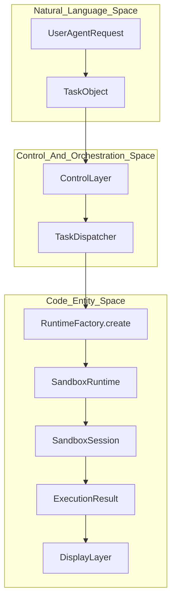
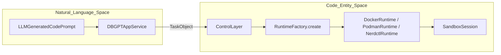

<!-- source: DeepWiki mcp.deepwiki.com · repo eosphoros-ai/DB-GPT · page 10 Sandbox & Code Execution · fetched 2026-10-26 -->

# Sandbox & Code Execution

Relevant source files

The following files were used as context for generating this wiki page:

- [packages/dbgpt-sandbox/src/dbgpt_sandbox/sandbox/config.py](packages/dbgpt-sandbox/src/dbgpt_sandbox/sandbox/config.py)
- [packages/dbgpt-sandbox/src/dbgpt_sandbox/sandbox/execution_layer/base.py](packages/dbgpt-sandbox/src/dbgpt_sandbox/sandbox/execution_layer/base.py)
- [packages/dbgpt-sandbox/src/dbgpt_sandbox/sandbox/execution_layer/docker_runtime.py](packages/dbgpt-sandbox/src/dbgpt_sandbox/sandbox/execution_layer/docker_runtime.py)
- [packages/dbgpt-sandbox/src/dbgpt_sandbox/sandbox/execution_layer/local_runtime.py](packages/dbgpt-sandbox/src/dbgpt_sandbox/sandbox/execution_layer/local_runtime.py)
- [packages/dbgpt-sandbox/src/dbgpt_sandbox/sandbox/execution_layer/nerdctl_runtime.py](packages/dbgpt-sandbox/src/dbgpt_sandbox/sandbox/execution_layer/nerdctl_runtime.py)
- [packages/dbgpt-sandbox/src/dbgpt_sandbox/sandbox/execution_layer/podman_runtime.py](packages/dbgpt-sandbox/src/dbgpt_sandbox/sandbox/execution_layer/podman_runtime.py)
- [packages/dbgpt-sandbox/src/dbgpt_sandbox/sandbox/execution_layer/runtime_factory.py](packages/dbgpt-sandbox/src/dbgpt_sandbox/sandbox/execution_layer/runtime_factory.py)
- [packages/dbgpt-sandbox/src/docs/architecture.md](packages/dbgpt-sandbox/src/docs/architecture.md)
- [packages/dbgpt-sandbox/src/docs/usage.md](packages/dbgpt-sandbox/src/docs/usage.md)
- [packages/dbgpt-sandbox/tests/test_runtime_factory.py](packages/dbgpt-sandbox/tests/test_runtime_factory.py)

The purpose of this page is to provide a high-level overview of the `dbgpt-sandbox` package, which delivers secure, isolated code execution for LLM-generated code and DB-GPT agent workflows [packages/dbgpt-sandbox/src/docs/architecture.md:1-4](). For granular technical details, refer to the child pages:
- [Sandbox Architecture & Layers](#10.1) — covers layers, runtime factory, worker integration, initialization, and security models.
- [Docker & Deployment](#10.2) — covers Docker images, compose configs, and publishing workflows.

---

## High-Level Architecture

The sandbox package uses a layered architecture to transition natural language tasks into isolated runtime executions:

1. **User Layer**: Receives client requests and structures them into `TaskObject` configurations [packages/dbgpt-sandbox/src/docs/architecture.md:22-23]().
2. **Control Layer**: Managed by `ControlLayer`, coordinating session states, execution tasks, and concurrency [packages/dbgpt-sandbox/src/docs/architecture.md:18-19](), [packages/dbgpt-sandbox/src/dbgpt_sandbox/sandbox/control_layer/control_layer.py:15-46]().
3. **Execution Layer**: Implemented via `SandboxRuntime` and `SandboxSession` abstractions, selected through `RuntimeFactory` [packages/dbgpt-sandbox/src/dbgpt_sandbox/sandbox/execution_layer/runtime_factory.py:15-54](), [packages/dbgpt-sandbox/src/dbgpt_sandbox/sandbox/execution_layer/base.py:72-166]().
4. **Display Layer**: Encapsulates results via `DisplayResult` [packages/dbgpt-sandbox/src/docs/architecture.md:20-21](), [packages/dbgpt-sandbox/src/dbgpt_sandbox/sandbox/display_layer/display_layer.py:9-39]().

### Diagram: Natural Language to Code Entity Space (Execution Flow)

Sources: [packages/dbgpt-sandbox/src/docs/architecture.md:11-25](), [packages/dbgpt-sandbox/src/dbgpt_sandbox/sandbox/execution_layer/runtime_factory.py:15-54](), [packages/dbgpt-sandbox/src/dbgpt_sandbox/sandbox/execution_layer/base.py:72-166]()

---

## Core Components Overview

| Component | Class / Symbol | Role / Responsibility |
| --- | --- | --- |
| **Runtime Factory** | `RuntimeFactory` | Instantiates containerized (`DockerRuntime`, `PodmanRuntime`, `NerdctlRuntime`) or `LocalRuntime` backends [packages/dbgpt-sandbox/src/dbgpt_sandbox/sandbox/execution_layer/runtime_factory.py:15-54](). |
| **Control Layer** | `ControlLayer` | Manages task lifecycle, session state, and concurrency [packages/dbgpt-sandbox/src/docs/architecture.md:18-19](). |
| **Execution Layer** | `SandboxRuntime`, `SandboxSession` | Base abstractions for session lifecycle and code execution [packages/dbgpt-sandbox/src/dbgpt_sandbox/sandbox/execution_layer/base.py:72-166](). |
| **Display Layer** | `DisplayLayer`, `DisplayResult` | Wraps execution output for clients [packages/dbgpt-sandbox/src/docs/architecture.md:20-21](). |

For details, see [Sandbox Architecture & Layers](#10.1).

Sources: [packages/dbgpt-sandbox/src/dbgpt_sandbox/sandbox/execution_layer/runtime_factory.py:15-54](), [packages/dbgpt-sandbox/src/dbgpt_sandbox/sandbox/execution_layer/base.py:72-166]()

---

## Security and Isolation

The sandbox enforces resource constraints and runtime isolation to protect the host system:
- **Runtime Strictness**: Unconfigured runtimes default to `LocalRuntime`. Explicitly requested container backends (Docker, Podman, Nerdctl) fail closed if unavailable rather than falling back to local host execution [packages/dbgpt-sandbox/src/dbgpt_sandbox/sandbox/execution_layer/runtime_factory.py:25-54](), [packages/dbgpt-sandbox/src/docs/usage.md:13-23]().
- **Resource Limits**: Enforces limits on memory (256MB), CPU percentage or cores, timeout (30s), and max file sizes [packages/dbgpt-sandbox/src/dbgpt_sandbox/sandbox/config.py:31-37]().

### Diagram: Natural Language to Code Entity Space (Isolation Boundary)

Sources: [packages/dbgpt-sandbox/src/dbgpt_sandbox/sandbox/execution_layer/runtime_factory.py:15-54](), [packages/dbgpt-sandbox/src/dbgpt_sandbox/sandbox/execution_layer/docker_runtime.py:33-85](), [packages/dbgpt-sandbox/src/dbgpt_sandbox/sandbox/config.py:31-37]()

---

## Multi-Language Support and Code Execution

Supported languages map to container images and execution commands via configuration functions [packages/dbgpt-sandbox/src/dbgpt_sandbox/sandbox/config.py:3-28]():
- `python`, `bash`, `javascript`, `java`, `cpp`, `go`, `rust`, and `python-vnc` [packages/dbgpt-sandbox/src/dbgpt_sandbox/sandbox/config.py:3-12]().

Sources: [packages/dbgpt-sandbox/src/dbgpt_sandbox/sandbox/config.py:3-28]()

---

## Containerized Deployment

Code runs in containerized environments by default when `SANDBOX_RUNTIME` is configured [packages/dbgpt-sandbox/src/docs/usage.md:11-25](). For comprehensive details on Docker images, multi-container compose setups, and CI/CD workflows, see [Docker & Deployment](#10.2).

Sources: [packages/dbgpt-sandbox/src/docs/usage.md:11-25]()

---

## Child Pages

- [Sandbox Architecture & Layers](#10.1)
- [Docker & Deployment](#10.2)

Sources: [packages/dbgpt-sandbox/src/docs/architecture.md:1-35](), [packages/dbgpt-sandbox/src/docs/usage.md:1-75]()

---

