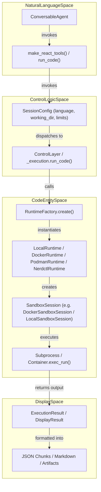

<!-- source: DeepWiki mcp.deepwiki.com · repo eosphoros-ai/DB-GPT · page 10.1 Sandbox Architecture & Layers · fetched 2026-10-26 -->

# Sandbox Architecture & Layers

<details>
<summary>Relevant source files</summary>

The following files were used as context for generating this wiki page:

- [docs/docs/sandbox/index.md](docs/docs/sandbox/index.md)
- [docs/docs/sandbox/runtime.md](docs/docs/sandbox/runtime.md)
- [docs/i18n/zh-CN/docusaurus-plugin-content-docs/current/sandbox/index.md](docs/i18n/zh-CN/docusaurus-plugin-content-docs/current/sandbox/index.md)
- [docs/i18n/zh-CN/docusaurus-plugin-content-docs/current/sandbox/runtime.md](docs/i18n/zh-CN/docusaurus-plugin-content-docs/current/sandbox/runtime.md)
- [packages/dbgpt-app/src/dbgpt_app/openapi/api_v1/subagent/react_tools.py](packages/dbgpt-app/src/dbgpt_app/openapi/api_v1/subagent/react_tools.py)
- [packages/dbgpt-app/src/dbgpt_app/openapi/api_v1/tools/_execution.py](packages/dbgpt-app/src/dbgpt_app/openapi/api_v1/tools/_execution.py)
- [packages/dbgpt-app/src/dbgpt_app/openapi/api_v1/tools/tests/test_execution_docker_integration.py](packages/dbgpt-app/src/dbgpt_app/openapi/api_v1/tools/tests/test_execution_docker_integration.py)
- [packages/dbgpt-app/src/dbgpt_app/openapi/api_v1/tools/tests/test_execution_runtime.py](packages/dbgpt-app/src/dbgpt_app/openapi/api_v1/tools/tests/test_execution_runtime.py)
- [packages/dbgpt-sandbox/src/dbgpt_sandbox/sandbox/config.py](packages/dbgpt-sandbox/src/dbgpt_sandbox/sandbox/config.py)
- [packages/dbgpt-sandbox/src/dbgpt_sandbox/sandbox/execution_layer/base.py](packages/dbgpt-sandbox/src/dbgpt_sandbox/sandbox/execution_layer/base.py)
- [packages/dbgpt-sandbox/src/dbgpt_sandbox/sandbox/execution_layer/docker_runtime.py](packages/dbgpt-sandbox/src/dbgpt_sandbox/sandbox/execution_layer/docker_runtime.py)
- [packages/dbgpt-sandbox/src/dbgpt_sandbox/sandbox/execution_layer/local_runtime.py](packages/dbgpt-sandbox/src/dbgpt_sandbox/sandbox/execution_layer/local_runtime.py)
- [packages/dbgpt-sandbox/src/dbgpt_sandbox/sandbox/execution_layer/nerdctl_runtime.py](packages/dbgpt-sandbox/src/dbgpt_sandbox/sandbox/execution_layer/nerdctl_runtime.py)
- [packages/dbgpt-sandbox/src/dbgpt_sandbox/sandbox/execution_layer/podman_runtime.py](packages/dbgpt-sandbox/src/dbgpt_sandbox/sandbox/execution_layer/podman_runtime.py)
- [packages/dbgpt-sandbox/src/dbgpt_sandbox/sandbox/execution_layer/runtime_factory.py](packages/dbgpt-sandbox/src/dbgpt_sandbox/sandbox/execution_layer/runtime_factory.py)
- [packages/dbgpt-sandbox/src/docs/architecture.md](packages/dbgpt-sandbox/src/docs/architecture.md)
- [packages/dbgpt-sandbox/src/docs/usage.md](packages/dbgpt-sandbox/src/docs/usage.md)
- [packages/dbgpt-sandbox/tests/test_runtime_factory.py](packages/dbgpt-sandbox/tests/test_runtime_factory.py)

</details>


## Purpose and Scope
This page details the architecture, layer responsibilities, runtime selection mechanisms, execution flow, entrypoints, and security model of the `dbgpt-sandbox` package (`packages/dbgpt-sandbox`). The DB-GPT Sandbox provides a secure, isolated execution environment for untrusted code generated by agents, preventing data leakage and host system compromise while supporting multiple container runtimes and local execution.

Sources:
- [packages/dbgpt-sandbox/src/dbgpt_sandbox/sandbox/execution_layer/runtime_factory.py:15-54]()
- [packages/dbgpt-sandbox/src/dbgpt_sandbox/sandbox/config.py:1-44]()
- [packages/dbgpt-sandbox/src/dbgpt_sandbox/sandbox/display_layer/display_layer.py:9-39]()

---

## High-Level Architecture & Layers

The sandbox is architected into four distinct layers:

| Layer            | Role & Responsibility                                                                                               | Key Components / Classes                             |
|------------------|---------------------------------------------------------------------------------------------------------------------|-----------------------------------------------------|
| **User Layer**   | Entry point for agents and users submitting code execution requests via tools and language interpreters.            | `code_interpreter`, `shell_interpreter`, `make_react_tools` (in `dbgpt-app`) |
| **Control Layer** | Orchestrates task lifecycle management, concurrency locking, routing requests to sandbox sessions, and dependency installation. | `ControlLayer` class managing task dispatch and session lifecycle in `control_layer.py` |
| **Execution Layer** | Provides isolated runtime environments supporting multiple container backends (Docker, Podman, Nerdctl) and local execution, managing session lifecycles and resource constraints. | `RuntimeFactory`, `DockerRuntime`, `LocalRuntime`, `PodmanRuntime`, `NerdctlRuntime`, `SandboxSession`, `SessionConfig` |
| **Display Layer** | Captures, formats, and stores execution outputs, exit codes, logs, and GUI rendering artifacts for presentation.  | `DisplayLayer`, `DisplayResult` dataclass            |

Each layer cleanly separates responsibilities, enabling extensibility and maintainability.

Sources:
- [packages/dbgpt-sandbox/src/dbgpt_sandbox/sandbox/execution_layer/runtime_factory.py:15-54]()
- [packages/dbgpt-sandbox/src/dbgpt_sandbox/sandbox/display_layer/display_layer.py:9-39]()

---

### Architecture Diagram: Natural Language Space to Code Entity Space Mapping

This diagram bridges natural language inputs from agents down to concrete sandbox execution entities and display outputs using explicit codebase identifiers.



Sources:
- [packages/dbgpt-app/src/dbgpt_app/openapi/api_v1/subagent/react_tools.py:72-100]()
- [packages/dbgpt-app/src/dbgpt_app/openapi/api_v1/tools/_execution.py:63-116]()
- [packages/dbgpt-sandbox/src/dbgpt_sandbox/sandbox/execution_layer/runtime_factory.py:15-54]()

---

## Runtime Factory & Runtime Selection (`RuntimeFactory`)

The `RuntimeFactory` class (`packages/dbgpt-sandbox/src/dbgpt_sandbox/sandbox/execution_layer/runtime_factory.py`) encapsulates selection of the sandbox runtime backend based on an explicit parameter, the environment variable `SANDBOX_RUNTIME`, or defaults to local execution. The supported runtimes include:

- **local**: Executes code in the host OS environment using `LocalRuntime`.
- **docker**: Runs containerized sessions via Docker API with `DockerRuntime`.
- **podman**: Uses Podman CLI and containers with `PodmanRuntime`.
- **nerdctl**: Uses nerdctl CLI against containerd with `NerdctlRuntime`.

### RuntimeFactory Behavior

- If the explicit preference or environment variable is unset or `"local"`, it returns `LocalRuntime`.
- For container runtimes (`docker`, `podman`, `nerdctl`):
  - Validates the backend is available and responsive (e.g., `docker_client.ping()`).
  - If unavailable, *fails closed* by raising `RuntimeError` rather than falling back to local execution.
- Unknown strings raise `ValueError`.

```mermaid
graph TD
    Start["RuntimeFactory.create(runtime_preference)"] --> EnvCheck{"Preference / SANDBOX_RUNTIME set?"}
    EnvCheck -- "Yes / local" --> UseLocal["Return LocalRuntime()"]
    EnvCheck -- "docker" --> Docker["Initialize DockerRuntime()"]
    EnvCheck -- "podman" --> Podman["Check EnvironmentDetector & PodmanRuntime()"]
    EnvCheck -- "nerdctl" --> Nerdctl["Check EnvironmentDetector & NerdctlRuntime()"]

    Docker -->|ping() == True| UseDocker["Return DockerRuntime"]
    Docker -->|ping() fails / error| FailDocker["Raise RuntimeError (Fail Closed)"]

    Podman -->|Available| UsePodman["Return PodmanRuntime"]
    Podman -->|Unavailable| FailPodman["Raise RuntimeError (Fail Closed)"]

    Nerdctl -->|Available| UseNerdctl["Return NerdctlRuntime"]
    Nerdctl -->|Unavailable| FailNerdctl["Raise RuntimeError (Fail Closed)"]
```

Sources:
- [packages/dbgpt-sandbox/src/dbgpt_sandbox/sandbox/execution_layer/runtime_factory.py:15-54]()
- [packages/dbgpt-sandbox/tests/test_runtime_factory.py:1-129]()

---

## Control Layer & Task Lifecycle Management

The Control Layer (`control_layer.py`) acts as the orchestrator for sandbox lifecycle operations:

- Manages per-task locks (`asyncio.Lock`) to prevent concurrency conflicts.
- Normalizes language parameters (e.g., mapping aliases) for compatibility.
- Manages session creation, execution requests, dependency installation, and status queries.
- Coordinates with the execution layer backend runtime via the `RuntimeFactory` interface.

Sources:
- [packages/dbgpt-sandbox/src/dbgpt_sandbox/sandbox/control_layer/control_layer.py:15-165]()

---

## Execution Layer & Resource Constraints

The Execution Layer implements concrete sandbox runtime backends conforming to base abstractions defined in `packages/dbgpt-sandbox/src/dbgpt_sandbox/sandbox/execution_layer/base.py`:

- `SandboxRuntime`: Abstract runtime managing multiple sandbox sessions.
- `SandboxSession`: Abstract per-execution-session instance interface for code execution lifecycle (`start()`, `execute()`, `stop()`, `install_dependencies()`).

### Supported Runtimes & Resource Bounding

Limits are enforced to safeguard host resources and provide safe sandboxes:

| Resource          | Limit / Configuration                                       |
|-------------------|-------------------------------------------------------------|
| Max Memory        | 256MB (`MAX_MEMORY` in `config.py`, 512MB for Python agents) |
| Max CPU Percentage| 50.0% (`MAX_CPU_PERCENT`)                                   |
| Max Execution Time| 30 seconds (`MAX_EXECUTION_TIME`)                           |
| Max File Size     | 10MB (`MAX_FILE_SIZE`)                                      |
| Max Processes     | 10 (`MAX_PROCESSES`)                                        |
| Network Disabled  | Configurable per-session (`network_disabled`)               |

### Diagram: Tool Execution to Sandbox Session Bridge

This diagram illustrates how an agent tool invocation flows through runtime creation and session execution.

```mermaid
graph TD
    subgraph "NaturalLanguageSpace"
        ToolCall["code_interpreter() / shell_interpreter()"] --> RunCode["_execution.run_code()"]
    end

    subgraph "ControlLogicSpace"
        RunCode -->|instantiates| SessionConfig["SessionConfig(language, working_dir, timeout)"]
        SessionConfig -->|requests| RuntimeFactory["RuntimeFactory.create()"]
    end

    subgraph "CodeEntitySpace"
        RuntimeFactory -->|returns| Runtime["SandboxRuntime (DockerRuntime / LocalRuntime)"]
        Runtime -->|create_session()| Session["SandboxSession.start()"]
        Session -->|execute(code)| Execution["Subprocess / Container exec_run()"]
    end

    subgraph "DisplaySpace"
        Execution -->|returns| Result["ExecutionResult / DisplayResult"]
        Result -->|collected| Artifacts["Artifact Collector & Output Chunks"]
    end
```

Sources:
- [packages/dbgpt-sandbox/src/dbgpt_sandbox/sandbox/config.py:31-38]()
- [packages/dbgpt-sandbox/src/dbgpt_sandbox/sandbox/execution_layer/base.py:23-166]()
- [packages/dbgpt-app/src/dbgpt_app/openapi/api_v1/tools/_execution.py:63-116]()

---

## Display Layer & Results Formatting

The Display Layer encapsulates execution metadata, outputs, and artifacts into a structured result for presentation and storage.

### `DisplayResult` Dataclass

- Holds terminal output, error messages, exit code, execution time, and optional GUI-rendered results.
- Includes file path lists for outputs generated during execution for easy retrieval and download.

### History Management

- `DisplayLayer` maintains an in-memory dictionary mapping `session_id → DisplayResult`.
- Supports retrieval, update, and clean-up of execution results per session for UI components or APIs to consume.

Sources:
- [packages/dbgpt-sandbox/src/dbgpt_sandbox/sandbox/display_layer/display_layer.py:9-39]()

---

## Lyric Workers & Tool Integration

Sub-agents and tools (such as those defined in `packages/dbgpt-app/src/dbgpt_app/openapi/api_v1/subagent/react_tools.py`) utilize the sandbox execution runtimes for task execution within an agent framework. The helper module `packages/dbgpt-app/src/dbgpt_app/openapi/api_v1/tools/_execution.py` provides `run_code()`, which resolves input file paths (`_input_paths`), initializes a `SessionConfig`, invokes `RuntimeFactory.create()`, executes the code, and disposes of the session cleanly.

Sources:
- [packages/dbgpt-app/src/dbgpt_app/openapi/api_v1/subagent/react_tools.py:72-100]()
- [packages/dbgpt-app/src/dbgpt_app/openapi/api_v1/tools/_execution.py:22-116]()

---

## Entrypoint: `initialize_sandbox`

The sandbox initialization and session wiring rely on the following entrypoints:

- `RuntimeFactory.create(runtime_preference)`: Primary entrypoint for runtime instantiation.
- `SandboxRuntime.create_session(session_id, config)`: Provisions a new isolated session (container or local process).
- `SandboxSession.execute(code)`: Executes user or agent code within the isolated boundary.
- `_execution.run_code()`: Orchestrates end-to-end execution for agent tools including artifact collection and cleanup.

Sources:
- [packages/dbgpt-sandbox/src/dbgpt_sandbox/sandbox/execution_layer/runtime_factory.py:15-54]()
- [packages/dbgpt-sandbox/src/dbgpt_sandbox/sandbox/execution_layer/base.py:124-166]()
- [packages/dbgpt-app/src/dbgpt_app/openapi/api_v1/tools/_execution.py:63-116]()

---

## Security Model & Robustness

The sandbox applies defense-in-depth security measures:

1. **Container Isolation**: By default, user code runs inside isolated containers (`DockerRuntime`, `PodmanRuntime`, `NerdctlRuntime`), protecting host filesystems and processes.
2. **Fail-Closed Container Backends**: Explicit container configurations do not silently fall back to host execution if the daemon or CLI is unavailable.
3. **Resource Bounding**: Strict limits on memory (`max_memory`), CPU (`max_cpus`), execution time (`timeout`), and process counts prevent denial-of-service.
4. **Code Safety Validation**: Pre-execution security scans via `SecurityUtils.validate_code()` check for unauthorized operations where enabled.
5. **Session Lifecycle Discipline**: Sessions are ephemeral. Containers or temporary working directories are cleaned up immediately upon completion or cancellation.

Sources:
- [packages/dbgpt-sandbox/src/dbgpt_sandbox/sandbox/execution_layer/runtime_factory.py:15-54]()
- [packages/dbgpt-sandbox/src/dbgpt_sandbox/sandbox/config.py:31-38]()
- [packages/dbgpt-sandbox/src/dbgpt_sandbox/sandbox/execution_layer/local_runtime.py:104-115]()

---

## Summary Table of Key Classes

| Class Name         | Module Path                                                  | Role                                                   |
|--------------------|--------------------------------------------------------------|--------------------------------------------------------|
| `RuntimeFactory`   | `dbgpt_sandbox.sandbox.execution_layer.runtime_factory`     | Factory selecting and instantiating runtime backends. |
| `LocalRuntime`     | `dbgpt_sandbox.sandbox.execution_layer.local_runtime`       | Local host execution driver using subprocesses.        |
| `DockerRuntime`    | `dbgpt_sandbox.sandbox.execution_layer.docker_runtime`      | Docker container execution runtime.                     |
| `PodmanRuntime`    | `dbgpt_sandbox.sandbox.execution_layer.podman_runtime`      | Podman container execution runtime.                     |
| `NerdctlRuntime`   | `dbgpt_sandbox.sandbox.execution_layer.nerdctl_runtime`     | Nerdctl container execution runtime.                    |
| `DisplayLayer`     | `dbgpt_sandbox.sandbox.display_layer.display_layer`         | Manages presentation and storage of execution results.  |
| `DisplayResult`    | `dbgpt_sandbox.sandbox.display_layer.display_layer`         | Data model for execution outputs and artifacts.         |
| `SandboxSession`   | `dbgpt_sandbox.sandbox.execution_layer.base`                 | Abstract session interface for sandbox execution.       |
| `SessionConfig`    | `dbgpt_sandbox.sandbox.execution_layer.base`                 | Configuration model for session parameters.             |

Sources:
- [packages/dbgpt-sandbox/src/dbgpt_sandbox/sandbox/execution_layer/runtime_factory.py:15-54]()
- [packages/dbgpt-sandbox/src/dbgpt_sandbox/sandbox/execution_layer/local_runtime.py:1-209]()
- [packages/dbgpt-sandbox/src/dbgpt_sandbox/sandbox/execution_layer/base.py:72-166]()
- [packages/dbgpt-sandbox/src/dbgpt_sandbox/sandbox/display_layer/display_layer.py:9-39]()

---

