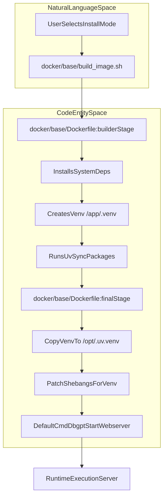
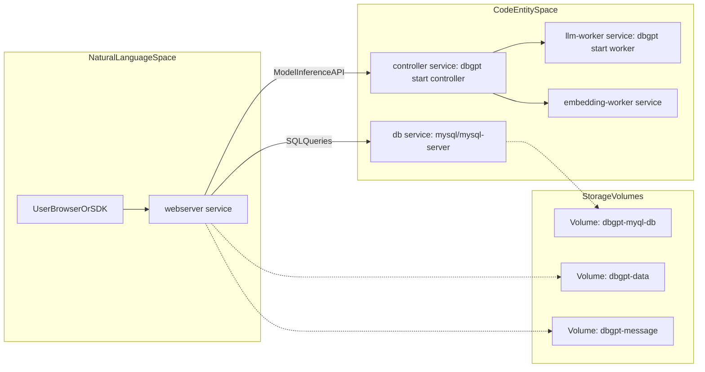

<!-- source: DeepWiki mcp.deepwiki.com · repo eosphoros-ai/DB-GPT · page 10.2 Docker & Deployment · fetched 2026-10-26 -->

# Docker & Deployment

Relevant source files

The following files were used as context for generating this wiki page:

- [.dockerignore](.dockerignore)
- [.github/workflows/docker-image-publish-openai.yml](.github/workflows/docker-image-publish-openai.yml)
- [.github/workflows/docker-image-publish.yml](.github/workflows/docker-image-publish.yml)
- [.github/workflows/python-publish.yml](.github/workflows/python-publish.yml)
- [docker-compose.yml](docker-compose.yml)
- [docker/allinone/Dockerfile](docker/allinone/Dockerfile)
- [docker/allinone/allinone-entrypoint.sh](docker/allinone/allinone-entrypoint.sh)
- [docker/allinone/build_image.sh](docker/allinone/build_image.sh)
- [docker/allinone/run.sh](docker/allinone/run.sh)
- [docker/allinone/run_proxyllm.sh](docker/allinone/run_proxyllm.sh)
- [docker/base/Dockerfile](docker/base/Dockerfile)
- [docker/base/build_image.sh](docker/base/build_image.sh)
- [docker/base/run_sqlite.sh](docker/base/run_sqlite.sh)
- [docker/build_all_images.sh](docker/build_all_images.sh)
- [docker/compose_examples/cluster-docker-compose.yml](docker/compose_examples/cluster-docker-compose.yml)
- [docker/examples/my.cnf](docker/examples/my.cnf)
- [docs/docs/installation/advanced_usage/OpenAI_SDK_call.md](docs/docs/installation/advanced_usage/OpenAI_SDK_call.md)
- [docs/docs/installation/advanced_usage/vLLM_inference.md](docs/docs/installation/advanced_usage/vLLM_inference.md)
- [docs/docs/installation/model_service/cluster.md](docs/docs/installation/model_service/cluster.md)
- [docs/docs/installation/model_service/stand_alone.md](docs/docs/installation/model_service/stand_alone.md)

The purpose and scope of this page is to document the containerized deployment ecosystem of DB-GPT. This includes multi-stage Docker image construction (`docker/base/Dockerfile`), specialized runtime variants (such as `allinone`, `webserver`, and `llmserver`), orchestration configurations (`docker-compose.yml`, `cluster-docker-compose.yml`), image build automation scripts (`docker/base/build_image.sh`, `docker/build_all_images.sh`), and CI/CD publishing workflows.

---

## Docker Architecture & Image Types

DB-GPT utilizes a multi-stage Docker build process to minimize final image size while providing comprehensive environments for LLM serving, RAG components, and agentic application workflows.

### Image Variants

The build system produces several distinct image types based on the `DB_GPT_INSTALL_MODE` and `EXTRAS` parameters defined in `docker/base/build_image.sh` [docker/base/build_image.sh:14-41]().

| **Image Variant** | **Base Image** | **Key Extras / Capabilities** |
|-------------------|---------------------------------------|----------------------------------------------------------------------|
| **Default** | `nvidia/cuda:12.4.0-devel-ubuntu22.04` | `base`, `proxy_openai`, `rag`, `graph_rag`, `storage_chromadb`, `dbgpts` |
| **OpenAI/Proxy** | `ubuntu:22.04` | Lightweight proxy adapters (`proxy_openai`, `proxy_ollama`, `proxy_zhipuai`, etc.) |
| **vLLM** | `nvidia/cuda:12.4.0-devel-ubuntu22.04` | Includes `vllm` for high-performance local inference |
| **Llama-CPP** | `nvidia/cuda:12.4.0-devel-ubuntu22.04` | Includes `llama-cpp-python` with CUDA acceleration |
| **Full** | `nvidia/cuda:12.4.0-devel-ubuntu22.04` | Combines `vllm`, `llama-cpp`, and all proxy adapters |

The extras enable selective installation of optional components such as CUDA-accelerated libraries, proxy adapters for cloud LLMs, and various knowledge retrieval plugins allowing flexible deployment scenarios.

Sources:
[docker/base/build_image.sh:14-41]()

---

### Multi-Stage Build Process

The `docker/base/Dockerfile` implements a two-stage build that separates development dependencies from the runtime environment for optimized image size [docker/base/Dockerfile:5-126]():

- **Builder Stage (`builder`)**:
  - Uses a NVIDIA CUDA or specified base image.
  - Installs system dependencies: Python 3.11, Git, Rust toolchain (conditionally), SQLite3, MySQL client libraries, and build tools.
  - Sets environment variables for trusted PyPI and mirrors.
  - Creates a Python virtual environment in `/app/.venv`.
  - Installs all Python package dependencies using `uv sync`, supporting optional extras controlled by build arguments.
  - Caches dependency installations to speed up rebuilds.

- **Final Stage**:
  - Based on the same base image but minimal install footprint—only Python runtime and minimal system libraries.
  - Copies the prepared Python virtual environment from the builder stage into `/opt/.uv.venv`.
  - Adjusts script shebangs for `dbgpt` and `pip` to correct virtual environment paths.
  - Sets default entrypoint command to start the webserver with a proxy configuration file (modifiable).

Sources:
[docker/base/Dockerfile:5-126]()

---

### Diagram: Docker Build Flow & Code Entities

Sources:
[docker/base/build_image.sh:14-41](), [docker/base/Dockerfile:5-126]()

---

## All-in-One & Specialized Images

### All-in-One Image

The `docker/allinone/Dockerfile` encapsulates both the DB-GPT runtime and a MySQL database server into one container to simplify standalone deployment scenarios [docker/allinone/Dockerfile:1-31]().

- **Base Image:** Inherits from the primary DB-GPT image (`eosphorosai/dbgpt:latest`).
- **MySQL Setup:**
  - Installs `mysql-server` and related dependencies.
  - Configures MySQL for remote access by changing `bind-address` to `0.0.0.0`.
  - Enforces UTF-8 encoding as default for full Unicode support.
  - Initializes MySQL root user with no host restrictions for easy local access.
- **Initialization:**
  - Copies schema SQL files for DB-GPT into MySQL initialization directory to bootstrap database.
- **Entrypoint:**
  - Uses a custom script (`docker/allinone/allinone-entrypoint.sh`) that starts the MySQL server and then launches DB-GPT in the container.

Sources:
[docker/allinone/Dockerfile:1-31]()

---

### Sandbox Isolation

DB-GPT uses the `dbgpt-sandbox` package for secure execution of arbitrary agent-generated code and user-submitted scripts. This ensures that untrusted Python or shell evaluations occur within containerized or isolated sandboxes, preventing system compromise.

Sources:
[docker/allinone/Dockerfile:1-31]()

---

## Build Scripts & CI/CD Pipelines

### build_image.sh & build_all_images.sh

- `docker/base/build_image.sh`: Core script to build the base Docker image. It supports multiple installation modes (e.g. `default`, `openai`, `vllm`, `llama-cpp`, `full`) with environment variables, custom extras, and optional Tsinghua mirrors for Ubuntu and PyPI [docker/base/build_image.sh:1-205]().
- `docker/build_all_images.sh`: Automates sequential building of the base image and then the all-in-one image [docker/build_all_images.sh:1-19]().

Sources:
[docker/base/build_image.sh:1-205](), [docker/build_all_images.sh:1-19]()

---

### GitHub Actions Integration

Multiple CI/CD workflows automate building, packaging, and publishing artifacts:

- **Docker Image Publishing (`.github/workflows/docker-image-publish.yml`):** 
  - Triggers on release creation or manual dispatch.
  - Uses QEMU for multi-architecture builds and Docker Buildx.
  - Logs into Docker Hub with credentials from secrets.
  - Builds and pushes the main DB-GPT Docker images tagged by Git references and `latest` [.github/workflows/docker-image-publish.yml:1-47]().
  
- **OpenAI Proxy Image Publishing (`.github/workflows/docker-image-publish-openai.yml`):**
  - Similar flow targeting the lightweight openai/proxy image variant [.github/workflows/docker-image-publish-openai.yml:1-48]().
  
- **Python Package Publishing (`.github/workflows/python-publish.yml`):**
  - Uploads PyPI package on release or manual workflow dispatch.
  - Handles version synchronization across source files.
  - Builds wheel distributions using `uv`.
  - Supports publishing to TestPyPI or PyPI with secure tokens [.github/workflows/python-publish.yml:1-88]().

Sources:
[.github/workflows/docker-image-publish.yml:1-47](), [.github/workflows/docker-image-publish-openai.yml:1-48](), [.github/workflows/python-publish.yml:1-88]()

---

## Docker Compose Configurations

Local multi-container deployments and GPU cluster orchestrations are facilitated using Docker Compose files.

### Local Development Compose (`docker-compose.yml`)

Defines a simple stack for local dev and testing [docker-compose.yml:1-54]():

- **Services:**
  - `db`: MySQL server with user/database setup, using mounted volumes for persistence.
  - `webserver`: Runs the DB-GPT backend, configured to connect to the MySQL database service, mounts configurations and model data.
- **Volumes:** Persist MySQL data, DB-GPT app data, and message logs.
- **Networks:** Single dedicated bridge network `dbgptnet` to isolate services.

Sources:
[docker-compose.yml:1-54]()

---

### Cluster Compose Example (`cluster-docker-compose.yml`)

Supports a multi-node, GPU-accelerated deployment for scalable model serving [docker/compose_examples/cluster-docker-compose.yml:1-102]() with services:

- `controller`: Cluster orchestration service (`dbgpt start controller`).
- `api-server`: OpenAI-compatible API Gateway linked to controller.
- `llm-worker`: Model inference worker running on GPU with access to local model directory.
- `embedding-worker`: Separate worker for embedding models.
- `webserver`: Frontend backend connecting to the controller and workers.

Sources:
[docker/compose_examples/cluster-docker-compose.yml:1-102]()

---

### Diagram: Service Dependency & Data Flow

Sources:
[docker-compose.yml:1-54](), [docker/compose_examples/cluster-docker-compose.yml:1-102]()

---

## Summary

The DB-GPT containerization and deployment subsystem provides multi-stage Docker image builds [docker/base/Dockerfile:5-126](), specialized images [docker/allinone/Dockerfile:1-31](), automation scripts [docker/base/build_image.sh:1-205](), [docker/build_all_images.sh:1-19](), robust Docker Compose configurations [docker-compose.yml:1-54](), [docker/compose_examples/cluster-docker-compose.yml:1-102](), and automated CI/CD workflows [.github/workflows/python-publish.yml:1-88](), [.github/workflows/docker-image-publish.yml:1-47]().

Sources:
[docker/base/Dockerfile:1-126](), [docker/allinone/Dockerfile:1-31](), [docker/base/build_image.sh:1-205](), [docker/build_all_images.sh:1-19](), [docker-compose.yml:1-54](), [docker/compose_examples/cluster-docker-compose.yml:1-102](), [.github/workflows/python-publish.yml:1-88](), [.github/workflows/docker-image-publish.yml:1-47]()

---

