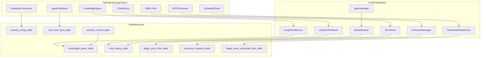
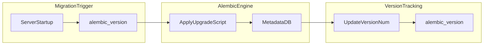

<!-- source: DeepWiki mcp.deepwiki.com · repo eosphoros-ai/DB-GPT · page 12 Database Schema & Migrations · fetched 2026-10-26 -->

# Database Schema & Migrations

Relevant source files

The following files were used as context for generating this wiki page:

- [assets/schema/dbgpt.sql](assets/schema/dbgpt.sql)
- [assets/schema/upgrade/v0_7_1/upgrade_to_v0.7.1.sql](assets/schema/upgrade/v0_7_1/upgrade_to_v0.7.1.sql)
- [assets/schema/upgrade/v0_7_1/v0.7.0.sql](assets/schema/upgrade/v0_7_1/v0.7.0.sql)
- [assets/schema/upgrade/v0_8_0/v0.8.0.sql](assets/schema/upgrade/v0_8_0/v0.8.0.sql)
- [assets/schema/upgrade/v0_8_1/upgrade_to_v0.8.1.sql](assets/schema/upgrade/v0_8_1/upgrade_to_v0.8.1.sql)
- [install_help.py](install_help.py)
- [packages/dbgpt-core/src/dbgpt/agent/core/agent_manage.py](packages/dbgpt-core/src/dbgpt/agent/core/agent_manage.py)
- [web/.env.template](web/.env.template)

DB-GPT utilizes a relational metadata database to persist system state, including knowledge base metadata, conversation histories, agent configurations, and workflow definitions. The system supports both **SQLite** (for local development) and **MySQL** (for production environments) with a default database name (commonly `dbgpt`, configurable via `.env` and environment variables) [assets/schema/dbgpt.sql:1-6](). Schema management and versioning are maintained via **Alembic** tooling, offering safe, incremental upgrades of the database schema [assets/schema/dbgpt.sql:8-13]().

This page provides a high-level overview of the backend metadata storage architecture. For in-depth descriptions of individual tables, see [Core Schema Tables](#12.1). To understand the upgrade process and migration scripts, see [Schema Upgrades & Migration Guide](#12.2).

---

### Metadata Database Architecture

The metadata database serves as the authoritative operational store for various DB-GPT components. While the vector embeddings for semantic search and RAG workflows typically reside in dedicated vector stores, the relational database tracks:

- Knowledge base definitions and document ingest status
- Conversation histories and messages
- Agent application states and AWEL flow definitions
- Datasource connection configurations
- Scheduled task definitions and runtime records
- Connector instances for external services (MCP)

The database access is layered with Data Access Objects (DAOs) and managed by core service components, such as the `AgentManager` which handles agent registrations and interactions [packages/dbgpt-core/src/dbgpt/agent/core/agent_manage.py:47-86]().

#### Natural Language to Code Entity Mapping

The following diagram bridges the **natural language space** of conceptual entities to their associated **code components** and finally to the **database layer** tables that persist their state.

Title: "Natural Language to Code Entity and Database Mapping"

Sources: [assets/schema/dbgpt.sql:15-121](), [packages/dbgpt-core/src/dbgpt/agent/core/agent_manage.py:47-86](), [packages/dbgpt-core/src/dbgpt/agent/core/agent_manage.py:158-176](), [assets/schema/upgrade/v0_8_1/upgrade_to_v0.8.1.sql:7-44]()

---

### Core Schema Tables

The metadata database schema is divided along functional domains, with the major tables summarized below:

| Domain | Primary Tables | Description |
|--------|----------------|-------------|
| **RAG / Knowledge Management** | `knowledge_space`, `knowledge_document`, `document_chunk` | Maintain knowledge space metadata, document ingestion and chunking status including vector embeddings and summaries. Tables store documents' sync states and chunk details [assets/schema/dbgpt.sql:15-64](). |
| **Conversations & Messaging** | `chat_history`, `chat_history_message`, `chat_feed_back` | Store multi-turn conversation logs with message details as JSON, user feedback, and interaction metadata [assets/schema/dbgpt.sql:89-121](). |
| **Agentic Flows & Applications** | `dbgpt_serve_flow`, `gpts_app`, `gpts_conversations`, `gpts_messages` | Persist AWEL workflow definitions, multi-agent application states, and message action reports [assets/schema/upgrade/v0_7_1/upgrade_to_v0.7.1.sql:5-9](). |
| **Connectors & Scheduled Tasks** | `connector_instance`, `dbgpt_serve_scheduled_task`, `dbgpt_serve_scheduled_run` | Manage MCP connector credentials, transport configs, plus cron-based scheduling and run histories for automation tasks like chat replay [assets/schema/upgrade/v0_8_1/upgrade_to_v0.8.1.sql:7-61](). |
| **Infrastructure & Database Config** | `connect_config`, `alembic_version` | Store external datasource connection details, user/system info, and track current DB schema version for migrations [assets/schema/dbgpt.sql:67-87](), [assets/schema/dbgpt.sql:9-12](). |

For complete field definitions, foreign keys, constraints, and indexing strategies, consult the child page [Core Schema Tables](#12.1).

Sources: [assets/schema/dbgpt.sql:15-121](), [assets/schema/upgrade/v0_7_1/v0.7.0.sql:14-117](), [assets/schema/upgrade/v0_7_1/upgrade_to_v0.7.1.sql:5-9](), [assets/schema/upgrade/v0_8_1/upgrade_to_v0.8.1.sql:7-61]()

---

### Schema Upgrades & Migration Guide

DB-GPT uses **Alembic**, a well-established database migration tool, to safely evolve the metadata database schema across versions. Alembic tracks the current schema state within the `alembic_version` table and applies upgrades using versioned scripts located in `assets/schema/upgrade/` [assets/schema/dbgpt.sql:8-13](), [assets/schema/upgrade/v0_7_1/upgrade_to_v0.7.1.sql:1-2]().

#### Migration Workflow

- On server startup, the Alembic system checks the `alembic_version` table to determine the installed schema version.
- If the version is older than the currently supported schema, the system applies incremental upgrade SQL scripts sequentially.
- Upgrade scripts typically include `ALTER TABLE` and `CREATE TABLE` statements to add columns, tables, or modify data types without loss.
- Upon successful completion of each script, the `alembic_version` table is updated to reflect the new schema version.

Title: "Migration Logic Flow"

Sources: [assets/schema/upgrade/v0_7_1/upgrade_to_v0.7.1.sql:1-9](), [assets/schema/upgrade/v0_8_0/v0.8.0.sql:15-87](), [assets/schema/upgrade/v0_8_1/upgrade_to_v0.8.1.sql:1-61](), [assets/schema/dbgpt.sql:8-13]()

#### Notable Recent Schema Changes

- **v0.7.1:** Expanded `action_report` column in `gpts_messages` and made `flow_data` in `dbgpt_serve_flow` a `longtext` for storing detailed JSON [assets/schema/upgrade/v0_7_1/upgrade_to_v0.7.1.sql:5-9]().
- **v0.8.0:** Consolidated core schema baseline, including tables for knowledge spaces, documents, chunks, chat history, and connector configs [assets/schema/upgrade/v0_8_0/v0.8.0.sql:15-87]().
- **v0.8.1:** Added `connector_instance` for encrypted MCP connector credentials and task scheduling tables (`dbgpt_serve_scheduled_task`, `dbgpt_serve_scheduled_run`) for cron-based automation [assets/schema/upgrade/v0_8_1/upgrade_to_v0.8.1.sql:7-61]().
  
For safe upgrade procedures, version-specific SQL patches, and troubleshooting, see [Schema Upgrades & Migration Guide](#12.2).

Sources: [assets/schema/upgrade/v0_7_1/upgrade_to_v0.7.1.sql:1-9](), [assets/schema/upgrade/v0_8_0/v0.8.0.sql:15-87](), [assets/schema/upgrade/v0_8_1/upgrade_to_v0.8.1.sql:1-61](), [assets/schema/dbgpt.sql:8-13]()

---

### Configuration & Initialization

DB-GPT’s metadata database connectivity is configured mainly via environment variables such as `LOCAL_DB_NAME` (default `dbgpt`), which can be set in `.env` or through local profiles. The connection may point to an SQLite file-based database for dev or a MySQL server for production [assets/schema/dbgpt.sql:1-6]().

The package includes helper utilities (e.g., `install_help.py`) to facilitate installation and runtime configuration through interactive presets and command generation for various runtime environments and deployment modes [install_help.py:64-76](), [install_help.py:87-107]().

- **SQLite:** Typically initialized automatically within the local data folder; suitable for lightweight local testing.
- **MySQL:** Requires explicit DB connection configuration with credentials, commonly set via environment vars.
- **Alembic:** Migration runs are automatically triggered on server startup if schema upgrades are required.

Sources: [assets/schema/dbgpt.sql:1-6](), [install_help.py:64-76](), [install_help.py:87-107]()

---

This summary guides you through the key concepts and components of DB-GPT’s backend schema and its migration tooling environment. For further technical details, explore the child pages:

- [Core Schema Tables](#12.1) — Detailed schema field definitions, indexes, and table relationships.
- [Schema Upgrades & Migration Guide](#12.2) — Step-by-step Alembic workflow, upgrade scripts, and safe upgrade procedures.

---

