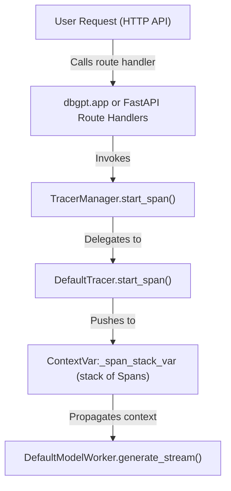
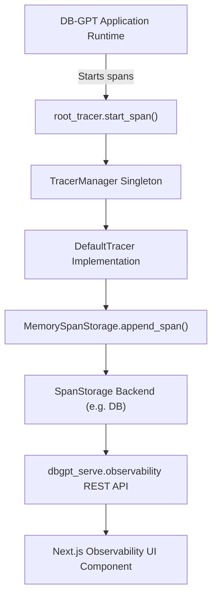

<!-- source: DeepWiki mcp.deepwiki.com · repo eosphoros-ai/DB-GPT · page 13.1 Tracing Internals & Tracer CLI · fetched 2026-10-26 -->

# Tracing Internals & Tracer CLI

Relevant source files

The following files were used as context for generating this wiki page:

- [configs/dbgpt-proxy-burncloud.toml](configs/dbgpt-proxy-burncloud.toml)
- [packages/dbgpt-core/src/dbgpt/cli/cli_scripts.py](packages/dbgpt-core/src/dbgpt/cli/cli_scripts.py)
- [packages/dbgpt-core/src/dbgpt/configs/model_config.py](packages/dbgpt-core/src/dbgpt/configs/model_config.py)
- [packages/dbgpt-core/src/dbgpt/core/interface/llm.py](packages/dbgpt-core/src/dbgpt/core/interface/llm.py)
- [packages/dbgpt-core/src/dbgpt/model/adapter/loader.py](packages/dbgpt-core/src/dbgpt/model/adapter/loader.py)
- [packages/dbgpt-core/src/dbgpt/model/cluster/worker/default_worker.py](packages/dbgpt-core/src/dbgpt/model/cluster/worker/default_worker.py)
- [packages/dbgpt-core/src/dbgpt/model/llm/llama_cpp/llama_cpp.py](packages/dbgpt-core/src/dbgpt/model/llm/llama_cpp/llama_cpp.py)
- [packages/dbgpt-core/src/dbgpt/model/llm/llama_cpp/llama_cpp_server.py](packages/dbgpt-core/src/dbgpt/model/llm/llama_cpp/llama_cpp_server.py)
- [packages/dbgpt-core/src/dbgpt/model/llm/llm_out/hf_chat_llm.py](packages/dbgpt-core/src/dbgpt/model/llm/llm_out/hf_chat_llm.py)
- [packages/dbgpt-core/src/dbgpt/model/llm/llm_out/vllm_llm.py](packages/dbgpt-core/src/dbgpt/model/llm/llm_out/vllm_llm.py)
- [packages/dbgpt-core/src/dbgpt/model/llm/monkey_patch.py](packages/dbgpt-core/src/dbgpt/model/llm/monkey_patch.py)
- [packages/dbgpt-core/src/dbgpt/model/proxy/llms/burncloud.py](packages/dbgpt-core/src/dbgpt/model/proxy/llms/burncloud.py)
- [packages/dbgpt-core/src/dbgpt/model/utils/hf_stream_utils.py](packages/dbgpt-core/src/dbgpt/model/utils/hf_stream_utils.py)
- [packages/dbgpt-core/src/dbgpt/model/utils/llm_metrics.py](packages/dbgpt-core/src/dbgpt/model/utils/llm_metrics.py)
- [packages/dbgpt-core/src/dbgpt/util/dbgpts/cli.py](packages/dbgpt-core/src/dbgpt/util/dbgpts/cli.py)
- [packages/dbgpt-core/src/dbgpt/util/tracer/tracer_impl.py](packages/dbgpt-core/src/dbgpt/util/tracer/tracer_impl.py)

This page provides a comprehensive technical overview of DB-GPT's tracing system internals, focusing on the `Span` model, span storage backends, the default tracer implementation (`DefaultTracer`) including context propagation mechanisms, the tracing command-line tooling, and how tracing data integrates with observability UI pages.

---

## Span Model

The fundamental unit of tracing is the `Span` class, representing a single operation within an execution trace. A trace aggregates multiple spans that chronologically and hierarchically represent a complete workflow.

**Key attributes of `Span` include:**
- `trace_id`: ID identifying the entire trace [packages/dbgpt-core/src/dbgpt/util/tracer/base.py:16-35]().
- `span_id`: Unique ID for the span instance [packages/dbgpt-core/src/dbgpt/util/tracer/base.py:16-35]().
- `parent_span_id`: ID of the parent span, enabling parent-child hierarchy [packages/dbgpt-core/src/dbgpt/util/tracer/base.py:16-35]().
- `operation_name`: Descriptive name of the operation performed [packages/dbgpt-core/src/dbgpt/util/tracer/base.py:16-35]().
- `span_type`: Categorizes the kind of operation (e.g., `SpanType.RUN`, LLM inference) [packages/dbgpt-core/src/dbgpt/util/tracer/base.py:16-35]().
- `start_time_ns`, `end_time_ns`: Nanosecond-precision timestamps marking span boundaries [packages/dbgpt-core/src/dbgpt/util/tracer/base.py:16-35]().
- `metadata`: Arbitrary dictionary for span-specific data [packages/dbgpt-core/src/dbgpt/util/tracer/base.py:16-35]().

Additionally, `Span` supports registering "end callers," which are callback functions triggered when the span ends. One key use is to append the finished span to a storage backend [packages/dbgpt-core/src/dbgpt/util/tracer/tracer_impl.py:69-74]().

Sources: [packages/dbgpt-core/src/dbgpt/util/tracer/base.py:16-68](), [packages/dbgpt-core/src/dbgpt/util/tracer/tracer_impl.py:69-74]()

---

## Span Storage Backends

`SpanStorage` provides persistence and retrieval for spans. DB-GPT defines storage timing policies via the `SpanStorageType` enum:
- `ON_CREATE`: Store spans immediately upon creation [packages/dbgpt-core/src/dbgpt/util/tracer/tracer_impl.py:75-79]().
- `ON_END`: Store spans only once ended [packages/dbgpt-core/src/dbgpt/util/tracer/tracer_impl.py:69-73]().
- `ON_CREATE_END`: Store spans both on creation and on end [packages/dbgpt-core/src/dbgpt/util/tracer/tracer_impl.py:69-79]().

The default storage backend is `MemorySpanStorage`, which holds spans in an in-memory list suitable for debugging and testing [packages/dbgpt-core/src/dbgpt/util/tracer/tracer_impl.py:38-40](). More scalable or persistent backends can be implemented by extending `SpanStorage`.

Sources: [packages/dbgpt-core/src/dbgpt/util/tracer/base.py:17-45](), [packages/dbgpt-core/src/dbgpt/util/tracer/tracer_impl.py:38-40]()

---

## TracerImpl and Context Propagation

### DefaultTracer

The primary tracer implementation is `DefaultTracer`, managing span lifecycles and context propagation for nested operations [packages/dbgpt-core/src/dbgpt/util/tracer/tracer_impl.py:28-104]().
- **Span Stack Context:** `DefaultTracer` maintains an internal span stack using a `ContextVar` (`_span_stack_var`) [packages/dbgpt-core/src/dbgpt/util/tracer/tracer_impl.py:36](). This enables seamless context propagation across coroutines and threads, correctly handling nested spans.
- **Span Creation:** `start_span()` generates a new `Span` [packages/dbgpt-core/src/dbgpt/util/tracer/tracer_impl.py:46-85](). If a `parent_span_id` is given, the trace context is reused; otherwise, a new trace begins. The span is pushed onto the stack.
- **Span Ending:** `end_span()` records the end time and triggers registered callbacks, like appending the span to storage [packages/dbgpt-core/src/dbgpt/util/tracer/tracer_impl.py:87-90]().
- **Current Span Access:** `get_current_span()` inspects the top of the span stack for the active span [packages/dbgpt-core/src/dbgpt/util/tracer/tracer_impl.py:97-99]().

Sources: [packages/dbgpt-core/src/dbgpt/util/tracer/tracer_impl.py:28-104]()

### TracerManager and Global Access

`TracerManager` acts as a singleton façade to the tracer system:
- Holds a `SystemApp` reference for component access [packages/dbgpt-core/src/dbgpt/util/tracer/tracer_impl.py:107-116]().
- Manages a `ContextVar` for `TracerContext` (`_trace_context_var`), storing global trace metadata like current span IDs [packages/dbgpt-core/src/dbgpt/util/tracer/tracer_impl.py:112-115]().
- Provides methods like `start_span()`, `end_span()`, and `get_current_span()` which delegate to `DefaultTracer` [packages/dbgpt-core/src/dbgpt/util/tracer/tracer_impl.py:129-164]().
- Implements a utility `wrapper_async_stream()` to wrap asynchronous generators with a span context automatically [packages/dbgpt-core/src/dbgpt/util/tracer/tracer_impl.py:181-201]().

The global instance `root_tracer` allows system-wide uniform tracing, accessed freely from anywhere in the app [packages/dbgpt-core/src/dbgpt/util/tracer/tracer_impl.py:204]().

Sources: [packages/dbgpt-core/src/dbgpt/util/tracer/tracer_impl.py:107-204]()

### Context Propagation in Action

Tracing context propagation is crucial for linking spans in complex flows, including async coroutines and distributed calls.
- The async-local span stack (`_span_stack_var`) pushes/pops spans per execution context [packages/dbgpt-core/src/dbgpt/util/tracer/tracer_impl.py:36,80-84]().
- `TracerContext` stored in `_trace_context_var` propagates top-level span metadata [packages/dbgpt-core/src/dbgpt/util/tracer/tracer_impl.py:112-115,169-170]().
- Functions and coroutines decorated with `@trace` or using `root_tracer.start_span()` automatically inherit the current span as their parent [packages/dbgpt-core/src/dbgpt/util/tracer/tracer_impl.py:130-151,207-212]().
- Distributed components like `DefaultModelWorker` pass span IDs in parameters and create nested spans, linking invocation traces together [packages/dbgpt-core/src/dbgpt/model/cluster/worker/default_worker.py:158-161]().

Sources: [packages/dbgpt-core/src/dbgpt/util/tracer/tracer_impl.py:36,112-115,130-151](), [packages/dbgpt-core/src/dbgpt/model/cluster/worker/default_worker.py:158-161]()

---

### Diagram: Tracer Context Propagation & Related Code Entities

**Explanation:**
Incoming user API calls trigger a route handler which invokes `TracerManager.start_span()`. This delegates to `DefaultTracer.start_span()`, pushing the span onto the async-local context variable stack (`_span_stack_var`). The context is then propagated into downstream execution contexts such as `DefaultModelWorker.generate_stream()`.

Sources: [packages/dbgpt-core/src/dbgpt/util/tracer/tracer_impl.py:28-104,107-204](), [packages/dbgpt-core/src/dbgpt/model/cluster/worker/default_worker.py:158-161]()

---

## The `dbgpt trace` CLI & Performance Metrics

DB-GPT includes command-line infrastructure and metrics tracking to support operational introspection of execution traces and model performance.

Timing and usage metrics emitted by the LLM model workers integrate closely with the tracing subsystem. The `ModelInferenceMetrics` dataclass collects detailed inference statistics such as:
- First token latency (`first_token_time_ms - start_time_ms`) [packages/dbgpt-core/src/dbgpt/core/interface/llm.py:152-156]()
- Token counts: prompt, completion, total [packages/dbgpt-core/src/dbgpt/core/interface/llm.py:58-65]()
- Speeds: tokens per second for prefill and decode phases [packages/dbgpt-core/src/dbgpt/core/interface/llm.py:67-75]()
- GPU usage info (`current_gpu_infos`, `avg_gpu_infos`) [packages/dbgpt-core/src/dbgpt/core/interface/llm.py:77-81]()

The `to_printable_string()` method formats these metrics for CLI or log displays, while model workers like `DefaultModelWorker.generate_stream` instantiate and update metrics during streaming generation [packages/dbgpt-core/src/dbgpt/core/interface/llm.py:138-185](), [packages/dbgpt-core/src/dbgpt/model/cluster/worker/default_worker.py:174]().

Sources: [packages/dbgpt-core/src/dbgpt/core/interface/llm.py:34-136](), [packages/dbgpt-core/src/dbgpt/model/cluster/worker/default_worker.py:174]()

---

## Observability UI Pages

DB-GPT integrates tracing data collection with observability UI components to facilitate visual insights into distributed workflows. The observability service application is registered under `/api/v1/observability`.

Typical observability UI features include:
- **Trace List**: Displays recent traces with root operation names, trace IDs, and timing.
- **Trace Detail View**: Hierarchical waterfall/Gantt charts showing parent-child spans and timelines.
- **Span Details**: Expandable metadata showing span types, durations, and custom data such as LLM metrics and GPU info.
- **Filtering/Search**: Query traces by operation name, duration, or error presence.

The integration relies on components within the serve layer exposing REST APIs to fetch span data from storage backends, while `ModelInferenceMetrics` enrich the observability UI with LLM-specific performance data [packages/dbgpt-core/src/dbgpt/core/interface/llm.py:34-136]().

Sources: [packages/dbgpt-app/src/dbgpt_app/initialization/serve_initialization.py:135-149]()

---

### Diagram: Tracing Data Flow to Observability UI

**Explanation:**
The application runtime generates spans via the global `root_tracer`. Spans are managed and stored through the `TracerManager` and `DefaultTracer` implementations. Stored span data in memory or persistent backends is exposed via the observability REST API (`dbgpt_serve.observability`), allowing the frontend UI to fetch and render trace information.

Sources: [packages/dbgpt-core/src/dbgpt/util/tracer/tracer_impl.py:28-104,107-204](), [packages/dbgpt-core/src/dbgpt/model/cluster/worker/default_worker.py:158-161](), [packages/dbgpt-core/src/dbgpt/core/interface/llm.py:34-136](), [packages/dbgpt-app/src/dbgpt_app/initialization/serve_initialization.py:135-149]()

---

# Summary

DB-GPT’s tracing system provides robust and flexible tracking for distributed and asynchronous workflows, granting deep observability into critical paths like LLM inference. The core `Span` model, flexible storage backends, and `DefaultTracer` with async context propagation ensure that spans are correctly linked across execution contexts. Integrations with command-line tools and observability UI pages complete the monitoring ecosystem.

Sources:  
- [packages/dbgpt-core/src/dbgpt/util/tracer/base.py:16-68,17-45]()  
- [packages/dbgpt-core/src/dbgpt/util/tracer/tracer_impl.py:28-104,107-204]()  
- [packages/dbgpt-core/src/dbgpt/model/cluster/worker/default_worker.py:158-161,174]()  
- [packages/dbgpt-core/src/dbgpt/core/interface/llm.py:34-136]()
- [packages/dbgpt-app/src/dbgpt_app/initialization/serve_initialization.py:135-149]()

---

