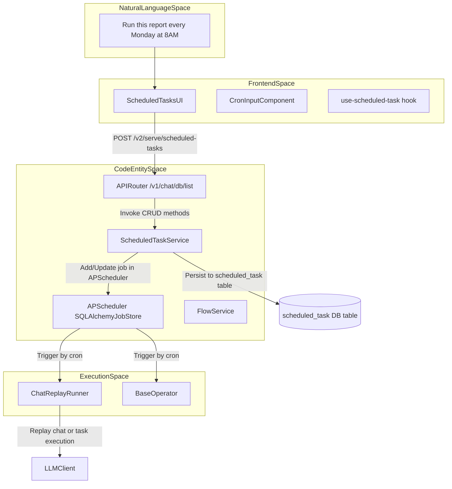
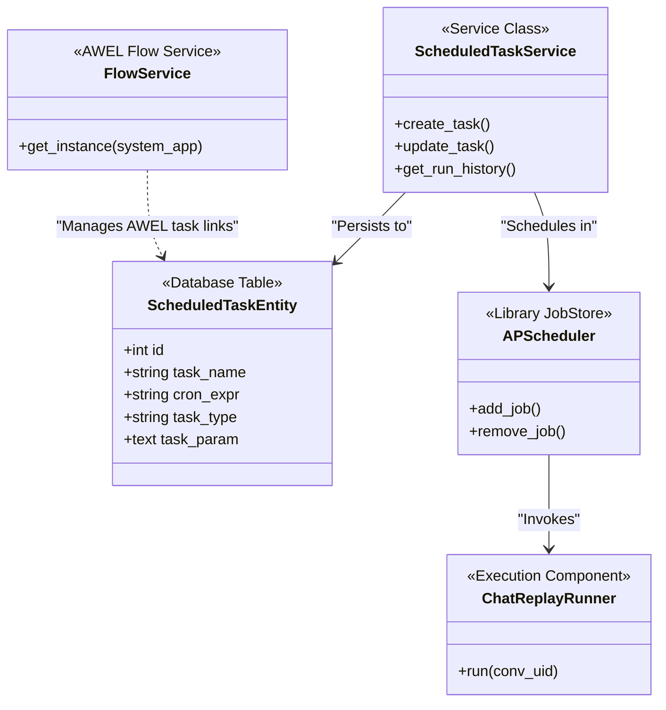

<!-- source: DeepWiki mcp.deepwiki.com · repo eosphoros-ai/DB-GPT · page 15 Scheduled Tasks · fetched 2026-10-26 -->

# Scheduled Tasks

Relevant source files

The following files were used as context for generating this wiki page:

- [packages/dbgpt-app/src/dbgpt_app/component_configs.py](packages/dbgpt-app/src/dbgpt_app/component_configs.py)
- [packages/dbgpt-app/src/dbgpt_app/operators/report.py](packages/dbgpt-app/src/dbgpt_app/operators/report.py)
- [packages/dbgpt-core/src/dbgpt/agent/expand/resources/search_tool.py](packages/dbgpt-core/src/dbgpt/agent/expand/resources/search_tool.py)
- [packages/dbgpt-core/src/dbgpt/agent/expand/resources/tests/__init__.py](packages/dbgpt-core/src/dbgpt/agent/expand/resources/tests/__init__.py)
- [packages/dbgpt-core/src/dbgpt/agent/expand/resources/tests/test_search_tool.py](packages/dbgpt-core/src/dbgpt/agent/expand/resources/tests/test_search_tool.py)
- [packages/dbgpt-core/src/dbgpt/agent/resource/app.py](packages/dbgpt-core/src/dbgpt/agent/resource/app.py)
- [packages/dbgpt-core/src/dbgpt/util/pd_utils.py](packages/dbgpt-core/src/dbgpt/util/pd_utils.py)
- [packages/dbgpt-serve/src/dbgpt_serve/agent/resource/app.py](packages/dbgpt-serve/src/dbgpt_serve/agent/resource/app.py)
- [packages/dbgpt-serve/src/dbgpt_serve/flow/templates/en/chat-data-awel-flow-template.json](packages/dbgpt-serve/src/dbgpt_serve/flow/templates/en/chat-data-awel-flow-template.json)
- [packages/dbgpt-serve/src/dbgpt_serve/flow/templates/zh/chat-data-awel-flow-template.json](packages/dbgpt-serve/src/dbgpt_serve/flow/templates/zh/chat-data-awel-flow-template.json)

The Scheduled Tasks subsystem in DB-GPT provides a robust framework for automated execution of LLM-driven workflows and chat replays orchestrated on a schedule. It enables scheduling of chat replays, AWEL flows, and other automated tasks using cron expressions. The system is designed with strong consistency guarantees by dual-writing task definitions into both the persistent metadata database and the APScheduler runtime job store.

## System Overview

At a high level, scheduled tasks are CRUD-managed through REST endpoints and the frontend UI, and ultimately executed by APScheduler job triggers. The `ScheduledTaskService` is the core coordinating service that maintains consistency between the SQL metadata tables (`scheduled_task` and related run history tables) and the in-memory scheduler jobs. It supports complex scheduling through standard cron syntax, validates schedules, and integrates with the chat conversation replay and AWEL flow execution engines.

This subsystem bridges the natural language intent of recurring jobs to exact code and infrastructure components, ensuring reliability and visibility of scheduling.

### Scheduled Task Execution Lifecycle

Sources:  
- [packages/dbgpt-app/src/dbgpt_app/component_configs.py:24-36]()  
- [packages/dbgpt-core/src/dbgpt/core/awel/trigger/http_trigger.py:43-47]()  

---

## 15.1 Scheduled Task Service & Scheduler

The `ScheduledTaskService` is the backbone of the scheduled tasks subsystem. It ensures that scheduled tasks are always in sync between the SQL metadata store and the APScheduler job store, implementing a dual-write pattern to avoid drift:

- **Dual-write consistency**: Changes to tasks (create, update, delete) atomically reflect in both the `scheduled_task` database table and the APScheduler's `SQLAlchemyJobStore`. This synchronization guarantees that what is visible in the UI matches the job scheduler’s runtime state.
- **Cron expression validation**: Schedules expressed as cron strings are validated before saving to avoid execution errors.
- **Task lifecycle management**: The service handles task CRUD operations, run history querying, and manages task states such as paused or active.
- **Invocation runners**: Specialized runners like `ChatReplayRunner` re-execute stored conversations at scheduled times. For AWEL flows, the service integrates with `FlowService` to trigger complex workflows.
- **SQLAlchemyJobStore**: APScheduler uses a SQLAlchemy-backed JobStore that lets scheduled jobs persist across service restarts, tightly coupling the runtime scheduler with the relational DB.

This service is callable from REST API endpoints and the UI layer to coordinate the entire task scheduling lifecycle.

For details, see [Scheduled Task Service & Scheduler](#15.1).

Sources:  
- [packages/dbgpt-app/src/dbgpt_app/component_configs.py:24-36]()  

---

## 15.2 Scheduled Tasks UI

The DB-GPT frontend includes dedicated pages and components for managing scheduled tasks, aimed at simplifying task creation and monitoring. Key UI features:

- **ScheduledTasksUI pages**: Allow users to list, create, edit, pause, or delete scheduled tasks in a centralized interface.
- **CronInput component**: Provides real-time cron string validation and a readable description for the schedule, improving UX and reducing configuration errors.
- **SaveAsScheduledTaskDrawer**: This drawer in the chat interface lets users convert a current chat session into a scheduled task for replay or automation.
- **EditScheduledTaskDrawer**: Enables detailed editing of existing scheduled tasks including cron expression and task parameters.
- **TaskRunsTable**: Displays historic run data from the database for each scheduled task, showing timestamps, status, and outputs.
- **Hooks** such as `use-scheduled-task` tie the UI components to the backend APIs efficiently.

The UI thus forms a vital front door for users to interactively manage scheduled workflows with immediate feedback on schedule correctness and run status.

For details, see [Scheduled Tasks UI](#15.2).

Sources:  
- [packages/dbgpt-app/src/dbgpt_app/operators/report.py:108-122]()  

---

## Data Schema Association

To relate the high-level concepts of scheduled tasks with their implementation entities:

This mapping shows how scheduled task requests flow through service layer, persist in the DB, and result in executable jobs managed by APScheduler.

Sources:  
- [packages/dbgpt-app/src/dbgpt_app/component_configs.py:24-36]()  

---

This overview covers the design and interaction of the Scheduled Tasks subsystem in DB-GPT. For detailed technical documentation and implementation specifics, please see the child pages:

- **[Scheduled Task Service & Scheduler](#15.1)** — Implementation details of dual-write task management, cron validation, run history, ChatReplayRunner, and APScheduler integration.  
- **[Scheduled Tasks UI](#15.2)** — Frontend components for task scheduling, cron input validation, task editing interfaces, and task run monitoring.

---

