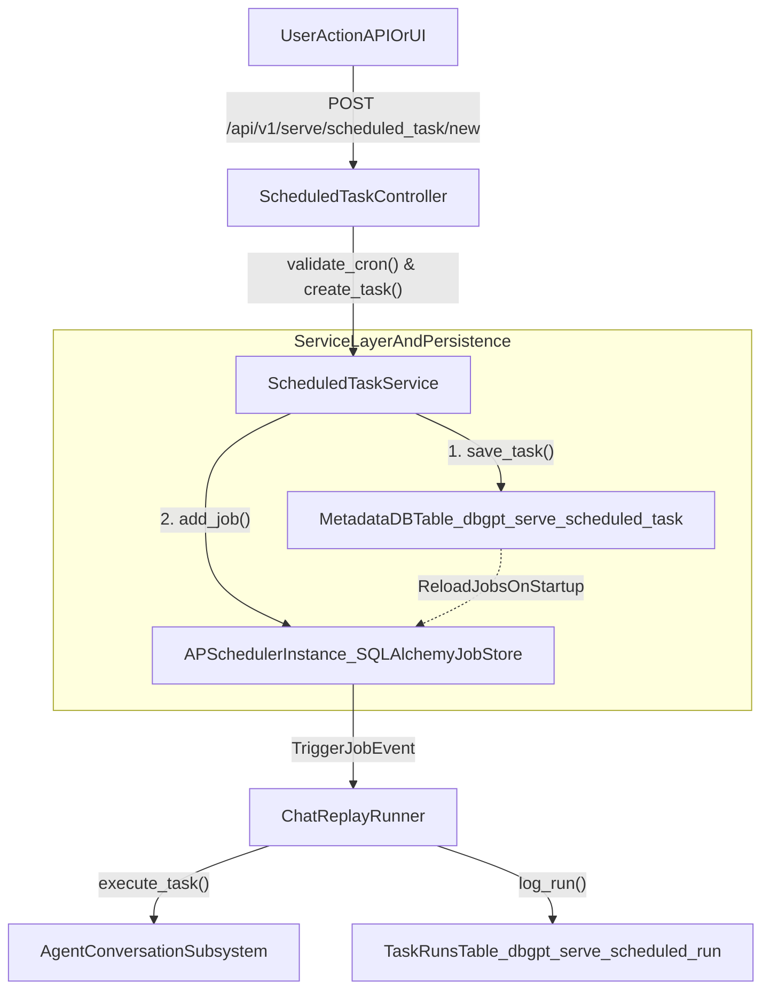
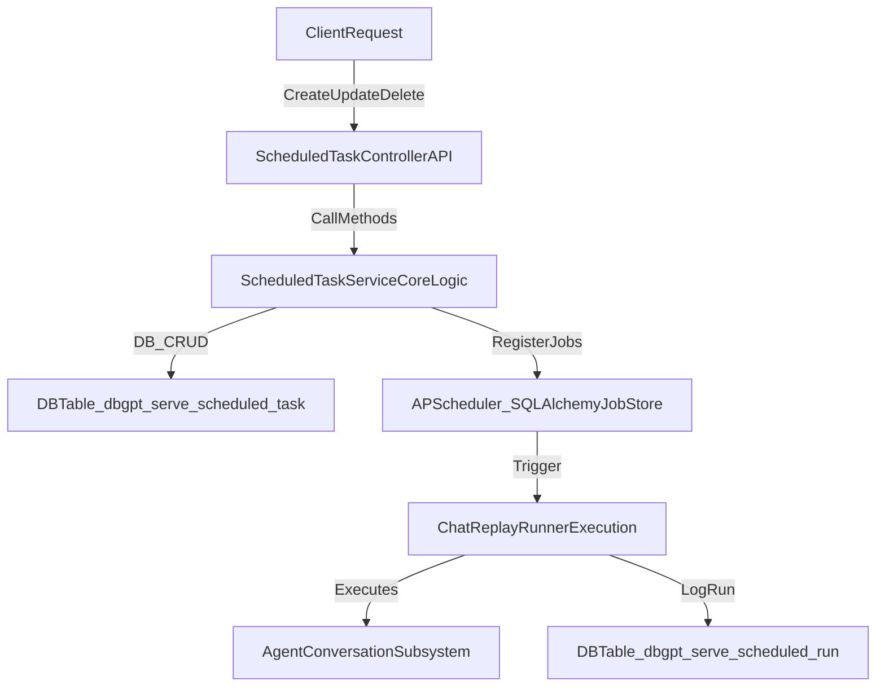

<!-- source: DeepWiki mcp.deepwiki.com · repo eosphoros-ai/DB-GPT · page 15.1 Scheduled Task Service & Scheduler · fetched 2026-10-26 -->

# Scheduled Task Service & Scheduler

Relevant source files

The following files were used as context for generating this wiki page:

- [assets/schema/dbgpt.sql](assets/schema/dbgpt.sql)
- [assets/schema/upgrade/v0_7_1/upgrade_to_v0.7.1.sql](assets/schema/upgrade/v0_7_1/upgrade_to_v0.7.1.sql)
- [assets/schema/upgrade/v0_7_1/v0.7.0.sql](assets/schema/upgrade/v0_7_1/v0.7.0.sql)
- [assets/schema/upgrade/v0_8_0/v0.8.0.sql](assets/schema/upgrade/v0_8_0/v0.8.0.sql)
- [assets/schema/upgrade/v0_8_1/upgrade_to_v0.8.1.sql](assets/schema/upgrade/v0_8_1/upgrade_to_v0.8.1.sql)
- [install_help.py](install_help.py)
- [packages/dbgpt-app/src/dbgpt_app/component_configs.py](packages/dbgpt-app/src/dbgpt_app/component_configs.py)
- [packages/dbgpt-app/src/dbgpt_app/operators/report.py](packages/dbgpt-app/src/dbgpt_app/operators/report.py)
- [packages/dbgpt-core/src/dbgpt/agent/core/agent_manage.py](packages/dbgpt-core/src/dbgpt/agent/core/agent_manage.py)
- [packages/dbgpt-core/src/dbgpt/agent/expand/resources/search_tool.py](packages/dbgpt-core/src/dbgpt/agent/expand/resources/search_tool.py)
- [packages/dbgpt-core/src/dbgpt/agent/expand/resources/tests/__init__.py](packages/dbgpt-core/src/dbgpt/agent/expand/resources/tests/__init__.py)
- [packages/dbgpt-core/src/dbgpt/agent/expand/resources/tests/test_search_tool.py](packages/dbgpt-core/src/dbgpt/agent/expand/resources/tests/test_search_tool.py)
- [packages/dbgpt-core/src/dbgpt/agent/resource/app.py](packages/dbgpt-core/src/dbgpt/agent/resource/app.py)
- [packages/dbgpt-core/src/dbgpt/util/pd_utils.py](packages/dbgpt-core/src/dbgpt/util/pd_utils.py)
- [packages/dbgpt-serve/src/dbgpt_serve/agent/resource/app.py](packages/dbgpt-serve/src/dbgpt_serve/agent/resource/app.py)
- [packages/dbgpt-serve/src/dbgpt_serve/flow/templates/en/chat-data-awel-flow-template.json](packages/dbgpt-serve/src/dbgpt_serve/flow/templates/en/chat-data-awel-flow-template.json)
- [packages/dbgpt-serve/src/dbgpt_serve/flow/templates/zh/chat-data-awel-flow-template.json](packages/dbgpt-serve/src/dbgpt_serve/flow/templates/zh/chat-data-awel-flow-template.json)
- [web/.env.template](web/.env.template)

The Scheduled Task Service in DB-GPT provides a robust mechanism to execute recurring jobs such as automated data analysis, periodic report generation, or chat replays. It employs a dual-write consistency approach between the backend metadata database and an active APScheduler instance. This design ensures persistence and reliability of scheduled tasks while providing immediate in-memory scheduling accuracy and fault tolerance.

Sources: [assets/schema/upgrade/v0_8_1/upgrade_to_v0.8.1.sql:27-61]()

## Architecture Overview

The scheduled task subsystem comprises three main architectural pillars:

1. **Metadata Persistence**  
   Task definitions and execution histories are persisted in dedicated database tables introduced in version v0.8.1:  
   - `dbgpt_serve_scheduled_task` for scheduled task metadata.  
   - `dbgpt_serve_scheduled_run` for recording each task's execution logs and results.  
   These tables provide auditability and durability of scheduled operations.  
   Sources: [assets/schema/upgrade/v0_8_1/upgrade_to_v0.8.1.sql:27-61]()

2. **APScheduler & SQLAlchemyJobStore Integration**  
   APScheduler is configured with an SQLAlchemy job store (`SQLAlchemyJobStore`), which allows the in-memory job scheduler to reflect persisted scheduled tasks, assuring survival across server restarts. Job IDs correspond directly to persistent `task_id`s in the database.  
   Sources: [assets/schema/upgrade/v0_8_1/upgrade_to_v0.8.1.sql:27-44]()

3. **Task Runners (`ChatReplayRunner`)**  
   Runners implement the execution logic triggered by APScheduler jobs. A `ChatReplayRunner` executes a frozen chat payload extracted from stored JSON, replaying conversations or agent workflows on schedule. Runners also handle execution logging, tracking status, start/end times, and error handling within run history tables.

### High-Level Data Flow & Code Entity Bridge

*Figure 1: High-level data flow mapping natural language actions and API requests to underlying code entities like `ScheduledTaskController`, `ScheduledTaskService`, and `ChatReplayRunner`.*

Sources: [assets/schema/upgrade/v0_8_1/upgrade_to_v0.8.1.sql:26-61]()

## Key Components

### ScheduledTaskService

This service class forms the core API for managing scheduled tasks and ensures **dual-write consistency** between the metadata database and the in-memory APScheduler job store. It provides the following capabilities:

- **Cron Validation**  
  Before accepting task definitions, cron expressions are validated to prevent misconfiguration errors that break runtime job triggering.  
- **Task CRUD**  
  Create, update, enable/disable, and delete operations embedded with transactional guarantees affecting both the database and scheduler.  
- **Dual-write Consistency Handling**  
  When a change occurs in task metadata, `ScheduledTaskService` ensures the equivalent job is respectively added, updated, or removed in APScheduler, maintaining synchronization.  
- **Run History Recording**  
  On job execution, run records including start/finish timestamps, status codes (`running`, `success`, `failed`, `timeout`), summaries, and error messages are persisted.

Sources: [assets/schema/upgrade/v0_8_1/upgrade_to_v0.8.1.sql:27-61]()

### ChatReplayRunner

A dedicated runner that executes the scheduled task logic upon APScheduler triggering. It specializes in:

- **Deserializing Payload**  
  Reads the frozen conversation payload JSON stored in `payload_json` and reconstructs the chat or agent state to be replayed.  
- **Context Setup**  
  Applies user context and system codes (`user_name`, `sys_code`) associated with the task for proper authorization and audit trail.  
- **Execution and Error Handling**  
  Wraps the chat replay execution with logging to `dbgpt_serve_scheduled_run`. It updates run status and writes error explanations upon failures like timeouts.  

Sources: [assets/schema/upgrade/v0_8_1/upgrade_to_v0.8.1.sql:26-61]()

### SQLAlchemyJobStore Use

APScheduler uses `SQLAlchemyJobStore` configured to persist jobs in the same metadata database used by DB-GPT. This integration enables:

- **Persistence of Jobs Across Restarts**  
  On system startup, the scheduler loads all persisted jobs, allowing seamless resumption.  
- **Job ID Mapping**  
  Job IDs in APScheduler correspond one-to-one with `task_id` in the `dbgpt_serve_scheduled_task` table.  
- **Fault Tolerance and Logging**  
  Failure in job execution is captured and persisted, keeping the run history consistent with actual processing outcomes.

Sources: [assets/schema/upgrade/v0_8_1/upgrade_to_v0.8.1.sql:27-61]()

## Code Entity Map — Natural Language to Code Entities

*Figure 2: Component interaction map detailing the relationships between `ScheduledTaskControllerAPI`, `ScheduledTaskServiceCoreLogic`, `ChatReplayRunnerExecution`, and persistence tables.*

- `ScheduledTaskController` is the REST API handler that receives client requests.  
- `ScheduledTaskService` contains the core business logic for CRUD and consistency.  
- `APScheduler` manages timed job invocations backed by `SQLAlchemyJobStore`.  
- `ChatReplayRunner` executes the scheduled logic and records run results.  
- The metadata tables `dbgpt_serve_scheduled_task` and `dbgpt_serve_scheduled_run` provide persistent storage.

Sources: [assets/schema/upgrade/v0_8_1/upgrade_to_v0.8.1.sql:26-61]()

## Scheduled Task Persistence Schema

The scheduler subsystem persists task data and execution logs in two principal tables:

| Table Name                      | Description                                              | Key Columns / Notes                                         |
|--------------------------------|----------------------------------------------------------|-------------------------------------------------------------|
| `dbgpt_serve_scheduled_task`   | Stores scheduled task definitions and cron configurations| `task_id` (PK), `task_name`, `description`, `task_type`, `cron_expression`, `payload_json` (frozen chat payload), `enabled` flag, user info, system code, timestamps. [assets/schema/upgrade/v0_8_1/upgrade_to_v0.8.1.sql:27-44]() |
| `dbgpt_serve_scheduled_run`    | Tracks each triggered run of a scheduled task            | `run_id` (PK), `task_id` (FK), `started_at`, `finished_at`, `status` (`running`, `success`, `failed`, `timeout`), `result_summary`, `error_message`, output conversation UID (if generated). [assets/schema/upgrade/v0_8_1/upgrade_to_v0.8.1.sql:47-61]() |

Sources: [assets/schema/upgrade/v0_8_1/upgrade_to_v0.8.1.sql:27-61]()

## Summary

The Scheduled Task Service & Scheduler in DB-GPT seamlessly integrates database-persisted task definitions with a live APScheduler instance using `SQLAlchemyJobStore`. This dual-write pattern ensures that task metadata and scheduling state remain consistent and durable. The system supports comprehensive cron validation, reliable CRUD operations, historical execution logging, and specialized runners like `ChatReplayRunner` for executing predefined chat scenarios or agent workflows.

Sources: [assets/schema/upgrade/v0_8_1/upgrade_to_v0.8.1.sql:26-61]()

---

