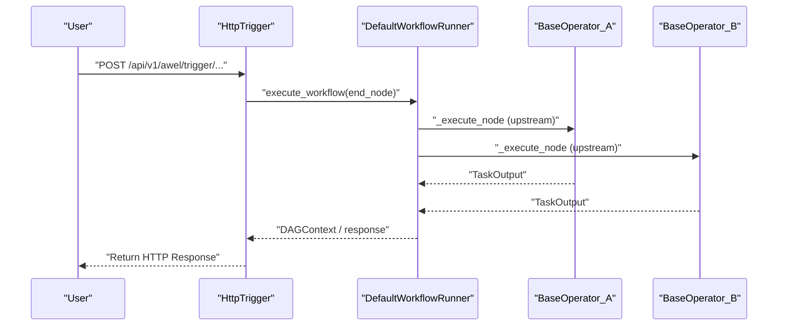
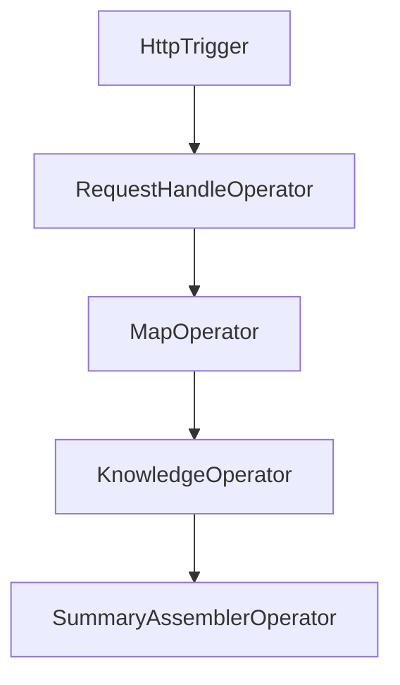
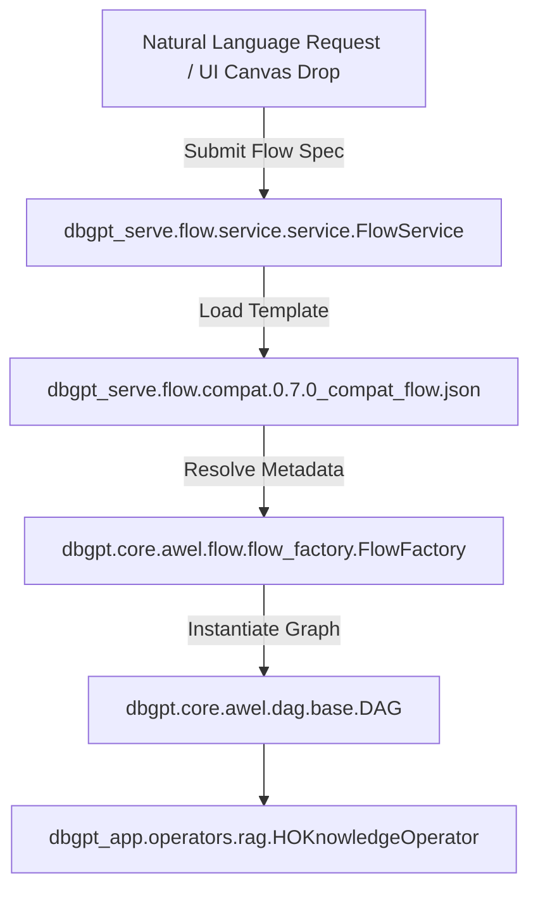
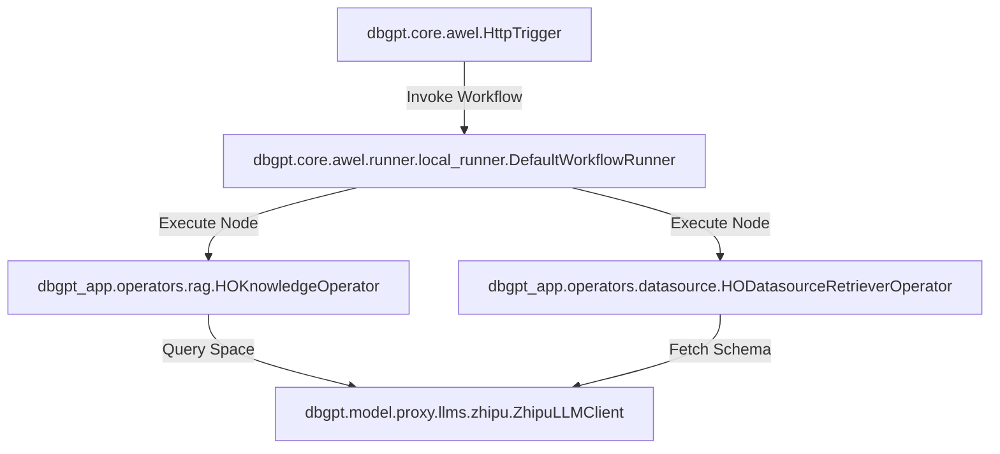

<!-- source: DeepWiki mcp.deepwiki.com · repo eosphoros-ai/DB-GPT · page 2.1 AWEL — Agentic Workflow Expression Language · fetched 2026-10-26 -->

# AWEL — Agentic Workflow Expression Language

Relevant source files

The following files were used as context for generating this wiki page:

- [docs/docs/agents/cookbook/calculator_with_agents.md](docs/docs/agents/cookbook/calculator_with_agents.md)
- [examples/__main__.py](examples/__main__.py)
- [examples/agents/auto_plan_agent_dialogue_example.py](examples/agents/auto_plan_agent_dialogue_example.py)
- [examples/agents/awel_layout_agents_chat_examples.py](examples/agents/awel_layout_agents_chat_examples.py)
- [examples/agents/custom_tool_agent_example.py](examples/agents/custom_tool_agent_example.py)
- [examples/agents/plugin_agent_dialogue_example.py](examples/agents/plugin_agent_dialogue_example.py)
- [examples/agents/retrieve_summary_agent_dialogue_example.py](examples/agents/retrieve_summary_agent_dialogue_example.py)
- [examples/agents/sandbox_code_agent_example.py](examples/agents/sandbox_code_agent_example.py)
- [examples/agents/single_agent_dialogue_example.py](examples/agents/single_agent_dialogue_example.py)
- [examples/agents/single_summary_agent_dialogue_example.py](examples/agents/single_summary_agent_dialogue_example.py)
- [examples/agents/sql_agent_dialogue_example.py](examples/agents/sql_agent_dialogue_example.py)
- [examples/awel/simple_rag_summary_example.py](examples/awel/simple_rag_summary_example.py)
- [packages/dbgpt-app/src/dbgpt_app/operators/datasource.py](packages/dbgpt-app/src/dbgpt_app/operators/datasource.py)
- [packages/dbgpt-app/src/dbgpt_app/operators/rag.py](packages/dbgpt-app/src/dbgpt_app/operators/rag.py)
- [packages/dbgpt-core/src/dbgpt/core/awel/flow/base.py](packages/dbgpt-core/src/dbgpt/core/awel/flow/base.py)
- [packages/dbgpt-core/src/dbgpt/core/awel/flow/compat.py](packages/dbgpt-core/src/dbgpt/core/awel/flow/compat.py)
- [packages/dbgpt-core/src/dbgpt/core/awel/flow/flow_factory.py](packages/dbgpt-core/src/dbgpt/core/awel/flow/flow_factory.py)
- [packages/dbgpt-core/src/dbgpt/core/awel/runner/local_runner.py](packages/dbgpt-core/src/dbgpt/core/awel/runner/local_runner.py)
- [packages/dbgpt-core/src/dbgpt/core/awel/tests/test_run_dag.py](packages/dbgpt-core/src/dbgpt/core/awel/tests/test_run_dag.py)
- [packages/dbgpt-core/src/dbgpt/model/proxy/llms/zhipu.py](packages/dbgpt-core/src/dbgpt/model/proxy/llms/zhipu.py)
- [packages/dbgpt-core/src/dbgpt/util/cli/flow_compat.py](packages/dbgpt-core/src/dbgpt/util/cli/flow_compat.py)
- [packages/dbgpt-core/src/dbgpt/vis/tags/vis_chart.py](packages/dbgpt-core/src/dbgpt/vis/tags/vis_chart.py)
- [packages/dbgpt-core/src/dbgpt/vis/tags/vis_dashboard.py](packages/dbgpt-core/src/dbgpt/vis/tags/vis_dashboard.py)
- [packages/dbgpt-ext/src/dbgpt_ext/rag/knowledge/url.py](packages/dbgpt-ext/src/dbgpt_ext/rag/knowledge/url.py)
- [packages/dbgpt-serve/src/dbgpt_serve/flow/compat/0.7.0_compat_flow.json](packages/dbgpt-serve/src/dbgpt_serve/flow/compat/0.7.0_compat_flow.json)
- [packages/dbgpt-serve/src/dbgpt_serve/flow/service/service.py](packages/dbgpt-serve/src/dbgpt_serve/flow/service/service.py)

## Purpose and Scope

Agentic Workflow Expression Language (AWEL) serves as the foundational orchestration engine of DB-GPT. It is designed to express, construct, and execute agentic workflows as Directed Acyclic Graphs (DAGs). AWEL abstracts complex AI workflows involving multi-agent collaboration, knowledge retrieval, LLM interaction, and external tool integration into modular, typed operators connected by data flows. This page details DAG construction, operators, execution triggers, workflow runners, the flow factory, visual canvas integration, and flow persistence/compatibility mechanisms.

---

## 1. AWEL DAG Construction and Operators

### 1.1 Core Concepts

AWEL models workflows as Directed Acyclic Graphs (DAGs) where nodes are operators that asynchronously process input data to produce outputs. Operators are composed and connected using Python's `>>` operator to form execution graphs. The runtime manages the `DAGContext`, which tracks execution states, shared data across operators, and task outputs [packages/dbgpt-core/src/dbgpt/core/awel/runner/local_runner.py:14-89]().

Workflows support transformations via `MapOperator` [examples/awel/simple_rag_summary_example.py:45-55](), branching logic via `BranchOperator` [packages/dbgpt-core/src/dbgpt/core/awel/tests/test_run_dag.py:129-131](), aggregations through `JoinOperator` [packages/dbgpt-core/src/dbgpt/core/awel/tests/test_run_dag.py:96-98](), and streaming data processing with `ReduceStreamOperator` [packages/dbgpt-core/src/dbgpt/core/awel/tests/test_run_dag.py:75-76]().

### 1.2 Operator Types and Metadata

- `BaseOperator`: The abstract base class defining core interfaces for inputs, outputs, parameters, and async execution logic [packages/dbgpt-core/src/dbgpt/core/awel/operators/base.py]().
- `MapOperator`: Maps input items individually to one output asynchronously [examples/awel/simple_rag_summary_example.py:45-55]().
- `JoinOperator`: Combines multiple upstream inputs into a single output [packages/dbgpt-core/src/dbgpt/core/awel/tests/test_run_dag.py:96-102]().
- `BranchOperator`: Routes inputs to downstream operators conditionally based on predicates [packages/dbgpt-core/src/dbgpt/core/awel/tests/test_run_dag.py:129-131]().

Operators expose metadata via `ViewMetadata` defining input/output ports, parameters, categories, and UI hints [packages/dbgpt-app/src/dbgpt_app/operators/rag.py:107-143]().

Sources:  
- `[examples/awel/simple_rag_summary_example.py:45-55]()`
- `[packages/dbgpt-core/src/dbgpt/core/awel/runner/local_runner.py:14-89]()`
- `[packages/dbgpt-app/src/dbgpt_app/operators/rag.py:34-143]()`
- `[packages/dbgpt-core/src/dbgpt/core/awel/tests/test_run_dag.py:24-131]()`

---

## 2. Triggers and Workflow Runners

### 2.1 Triggers

AWEL workflows utilize event-driven entrypoints:
- **`HttpTrigger`**: Exposes DAG start nodes as REST API endpoints [examples/awel/simple_rag_summary_example.py:58-60]().
- **Timer/Scheduled Triggers**: Integrates with APScheduler for cron-based workflow activation.

### 2.2 Workflow Runners

`DefaultWorkflowRunner` executes AWEL DAGs locally within the current process asynchronously [packages/dbgpt-core/src/dbgpt/core/awel/runner/local_runner.py:24-50](). It executes upstream dependencies recursively [packages/dbgpt-core/src/dbgpt/core/awel/runner/local_runner.py:141-150]() and manages `DAGContext` state [packages/dbgpt-core/src/dbgpt/core/awel/runner/local_runner.py:82-89]().

Title: "AWELWorkflowExecutionSequence"

Sources:  
- `[packages/dbgpt-core/src/dbgpt/core/awel/runner/local_runner.py:24-171]()`
- `[examples/awel/simple_rag_summary_example.py:45-60]()`

---

## 3. Flow Factory and Visual Flow Canvas Integration

### 3.1 FlowFactory and Metadata

The `FlowFactory` dynamically scans modules, registering operator and resource classes by aggregating `ViewMetadata`, parameters, and IO schemas. This enables dynamic instantiation, parameter validation, and JSON serialization.

### 3.2 Visual Flow Canvas Integration

UI metadata (`ViewMetadata`) supplies labels, categories like `OperatorCategory.RAG`, parameters, and UI widgets (e.g., `ui.UISlider`) [packages/dbgpt-app/src/dbgpt_app/operators/rag.py:107-143](). This metadata powers the React Flow visual builder in `dbgpt-web`.

Sources:  
- `[packages/dbgpt-core/src/dbgpt/util/cli/flow_compat.py:125-190]()`
- `[packages/dbgpt-app/src/dbgpt_app/operators/rag.py:107-143]()`

---

## 4. Flow Persistence and Compatibility

AWEL workflows serialize operator configurations, unique instance identifiers, category tags, parameters, IO linkages, and version metadata [packages/dbgpt-serve/src/dbgpt_serve/flow/compat/0.7.0_compat_flow.json:1-38](). 

The CLI tool group `tool_flow_cli_group` provides commands (`gen_compat`) to generate compatibility mapping files and transform legacy JSON definitions [packages/dbgpt-core/src/dbgpt/util/cli/flow_compat.py:25-78]().

Sources:  
- `[packages/dbgpt-core/src/dbgpt/util/cli/flow_compat.py:19-213]()`
- `[packages/dbgpt-serve/src/dbgpt_serve/flow/compat/0.7.0_compat_flow.json:1-185]()`

---

## 5. Key Operators and Flow Examples

- `HOKnowledgeOperator`: Retrieves relevant knowledge chunks from a named knowledge space, supporting reranking and context injection [packages/dbgpt-app/src/dbgpt_app/operators/rag.py:97-209]().
- `HODatasourceRetrieverOperator`: Retrieves table schemas from selected database datasources for Text2SQL pipelines [packages/dbgpt-app/src/dbgpt_app/operators/datasource.py:199-208]().

Title: "SimpleRAGSummaryAWELFlowDAG"

Sources:  
- `[examples/awel/simple_rag_summary_example.py:57-80]()`
- `[packages/dbgpt-app/src/dbgpt_app/operators/rag.py:97-209]()`
- `[packages/dbgpt-app/src/dbgpt_app/operators/datasource.py:199-208]()`

---

## 6. Bridging Natural Language Space to Code Entity Space

AWEL bridges natural language user prompts and visual UI graphs to concrete Python code entities and execution paths.

Title: "NaturalLanguageToAWELFactoryMapping"

Title: "AWELRuntimeExecutionMapping"

Sources:  
- `[packages/dbgpt-core/src/dbgpt/core/awel/runner/local_runner.py:24-171]()`
- `[packages/dbgpt-serve/src/dbgpt_serve/flow/compat/0.7.0_compat_flow.json:1-185]()`
- `[packages/dbgpt-app/src/dbgpt_app/operators/rag.py:97-209]()`
- `[packages/dbgpt-app/src/dbgpt_app/operators/datasource.py:199-208]()`
- `[packages/dbgpt-model/src/dbgpt/model/proxy/llms/zhipu.py:75-127]()`

---

