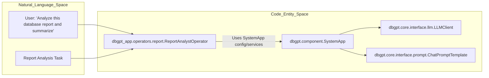
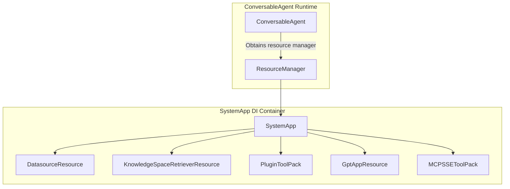
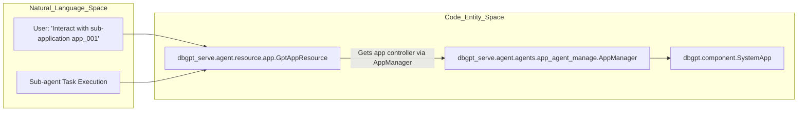
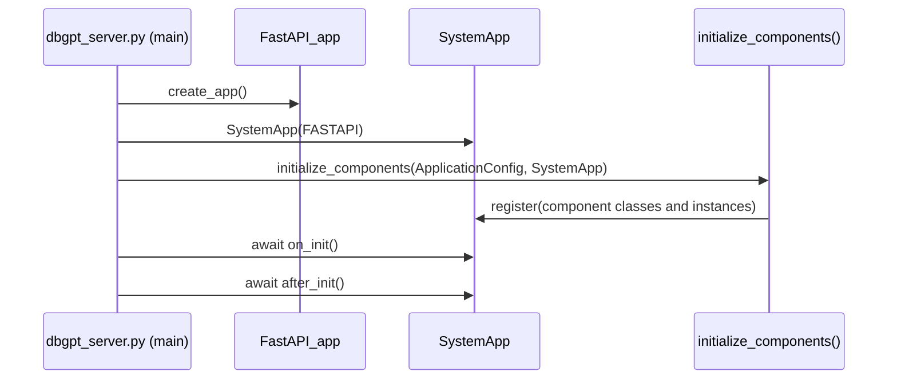

<!-- source: DeepWiki mcp.deepwiki.com · repo eosphoros-ai/DB-GPT · page 2.3 Component & Dependency Injection System · fetched 2026-10-26 -->

# Component & Dependency Injection System

<details>
<summary>Relevant source files</summary>

The following files were used as context for generating this wiki page:

- [docs/docs/modules/observability.md](docs/docs/modules/observability.md)
- [docs/i18n/zh-CN/docusaurus-plugin-content-docs/current/modules/observability.md](docs/i18n/zh-CN/docusaurus-plugin-content-docs/current/modules/observability.md)
- [packages/dbgpt-app/src/dbgpt_app/component_configs.py](packages/dbgpt-app/src/dbgpt_app/component_configs.py)
- [packages/dbgpt-app/src/dbgpt_app/initialization/serve_initialization.py](packages/dbgpt-app/src/dbgpt_app/initialization/serve_initialization.py)
- [packages/dbgpt-app/src/dbgpt_app/operators/report.py](packages/dbgpt-app/src/dbgpt_app/operators/report.py)
- [packages/dbgpt-core/src/dbgpt/agent/core/agent.py](packages/dbgpt-core/src/dbgpt/agent/core/agent.py)
- [packages/dbgpt-core/src/dbgpt/agent/expand/__init__.py](packages/dbgpt-core/src/dbgpt/agent/expand/__init__.py)
- [packages/dbgpt-core/src/dbgpt/agent/expand/resources/search_tool.py](packages/dbgpt-core/src/dbgpt/agent/expand/resources/search_tool.py)
- [packages/dbgpt-core/src/dbgpt/agent/expand/resources/tests/__init__.py](packages/dbgpt-core/src/dbgpt/agent/expand/resources/tests/__init__.py)
- [packages/dbgpt-core/src/dbgpt/agent/expand/resources/tests/test_search_tool.py](packages/dbgpt-core/src/dbgpt/agent/expand/resources/tests/test_search_tool.py)
- [packages/dbgpt-core/src/dbgpt/agent/expand/tool_calling_agent.py](packages/dbgpt-core/src/dbgpt/agent/expand/tool_calling_agent.py)
- [packages/dbgpt-core/src/dbgpt/agent/resource/app.py](packages/dbgpt-core/src/dbgpt/agent/resource/app.py)
- [packages/dbgpt-core/src/dbgpt/util/pd_utils.py](packages/dbgpt-core/src/dbgpt/util/pd_utils.py)
- [packages/dbgpt-serve/src/dbgpt_serve/agent/resource/app.py](packages/dbgpt-serve/src/dbgpt_serve/agent/resource/app.py)
- [packages/dbgpt-serve/src/dbgpt_serve/flow/templates/en/chat-data-awel-flow-template.json](packages/dbgpt-serve/src/dbgpt_serve/flow/templates/en/chat-data-awel-flow-template.json)
- [packages/dbgpt-serve/src/dbgpt_serve/flow/templates/zh/chat-data-awel-flow-template.json](packages/dbgpt-serve/src/dbgpt_serve/flow/templates/zh/chat-data-awel-flow-template.json)

</details>


The Component and Dependency Injection (DI) system in DB-GPT provides a structured and reusable framework to manage system components, their registration, lifecycle, and interdependencies. It underlies the modular architecture of DB-GPT by enabling consistent component discovery, lazy instantiation, service registration, and lifecycle orchestration. The core of this mechanism is the `SystemApp` class, acting as a global component registry and DI container.

This page explains the design and implementation of the component system, how components and services are registered, retrieved, and initialized, and details the startup wiring of `dbgpt-app` that orchestrates the system composition.

Sources:  
- [packages/dbgpt-app/src/dbgpt_app/component_configs.py:14-64]()

---

## SystemApp: The Central Component Registry

`SystemApp` functions as the global singleton registry of all core system components. It wraps the FastAPI application instance, maintains maps of registered component classes and singleton instances, and provides an API for:

- **Component Registration:** by class or instance.
- **Lazy Instantiation:** components registered by class are instantiated on first request with optional constructor arguments.
- **Dependency Resolution:** inject or query component dependencies at runtime.
- **Lifecycle Management:** asynchronous hooks `on_init()` and `after_init()` invoke initialization and post-initialization logic for registered components.

This design enables low coupling, extensibility, and simple test mocking by centralizing component lifecycle and access.

Sources:  
- [packages/dbgpt-app/src/dbgpt_app/component_configs.py:14-64]()

---

## Component Registration and Retrieval

### Registration Patterns

- **Class-Based Registration:**  
  Use `system_app.register(component_class, *args, **kwargs)` to register a component by its class with optional constructor parameters. The component instance will be lazily created on first `get_component()` call.  
  Example components registered this way in startup:
  - `DefaultExecutorFactory` (thread pool executor factory).
  - `DefaultScheduler` (async job scheduler).
  - `ConnectorManager` (manages datasource connectors).
  - `StorageManager` (manages vector, graph, and full-text stores).  
  These registrations are done in the `initialize_components()` function during startup [packages/dbgpt-app/src/dbgpt_app/component_configs.py:14-64]().

- **Instance-Based Registration:**  
  Use `system_app.register_instance(existing_instance)` to register already created singleton objects. For example:
  - `controller` (model cluster controller singleton).
  - `multi_agents` (multi-agent orchestrator singleton).
  - `module_plugin` (plugin manager instance).  
  These instances are registered directly in the same initialization phase [packages/dbgpt-app/src/dbgpt_app/component_configs.py:37-47]().

### Retrieval

Components request dependencies at runtime by invoking `system_app.get_component(ComponentType)`. If the component was registered by class but not instantiated yet, `SystemApp` creates it lazily and caches the instance.

This provides transparent access to shared services across asynchronous contexts and operator executions without explicit wiring.

Sources:  
- [packages/dbgpt-app/src/dbgpt_app/component_configs.py:14-64]()

---

## Component Lifecycle Management

`SystemApp` manages two central asynchronous lifecycle phases during startup:

- **`on_init()`**: Invoked once after all components are registered. Used for asynchronous initialization logic like preparing executors, connectors, or loading cached states.

- **`after_init()`**: Called immediately after `on_init()`. Intended for finalizing setup steps such as database migrations, loading default configurations, or warming caches.

These hooks ensure synchronized readiness and sequential initialization of components across the system before serving requests.

Sources:  
- [packages/dbgpt-app/src/dbgpt_app/component_configs.py:14-64]()

---

## Initialization Wiring in `dbgpt-app`

The function:

```python
initialize_components(param: ApplicationConfig, system_app: SystemApp)
```

is the primary cold-start entrypoint for registering and wiring components into the global `SystemApp`. It receives the parsed application configuration and the shared `SystemApp` instance, then performs stepwise registration and initialization of essential services [packages/dbgpt-app/src/dbgpt_app/component_configs.py:14-64]().

### Main Initialization Steps

1. **Register Core Executors and Scheduler**
   - `DefaultExecutorFactory` registered with `max_workers` from config's thread pool size [packages/dbgpt-app/src/dbgpt_app/component_configs.py:33-35]().
   - `DefaultScheduler` registered to manage asynchronous scheduled jobs [packages/dbgpt-app/src/dbgpt_app/component_configs.py:36]().

2. **Register Model Cluster Controller and Managers**
   - Register singleton instance `controller` for model cluster management [packages/dbgpt-app/src/dbgpt_app/component_configs.py:37]().
   - Register `ConnectorManager` for datasource management [packages/dbgpt-app/src/dbgpt_app/component_configs.py:38]().
   - Register `StorageManager` for vector/graph/full-text storage layers [packages/dbgpt-app/src/dbgpt_app/component_configs.py:39]().

3. **Embedding and Rerank Model Initialization**
   - Initialize embeddings and reranking models lazily with helper functions [packages/dbgpt-app/src/dbgpt_app/component_configs.py:49-50]().

4. **AWEL Flow and Agent Resource Setup**
   - Initialize AWEL (Agentic Workflow Expression Language) DAG flow directories and registry [packages/dbgpt-app/src/dbgpt_app/component_configs.py:52]().
   - Initialize agent resources like `DatasourceResource`, `KnowledgeSpaceRetrieverResource`, `PluginToolPack`, `GptAppResource`, `MCPSSEToolPack`, and skill-related resources [packages/dbgpt-app/src/dbgpt_app/component_configs.py:103-146]().

5. **Register API Services and Operators**
   - Register editor API service (`EditorService`) [packages/dbgpt-app/src/dbgpt_app/component_configs.py:149-152]().
   - Scan and register AWEL operators dynamically [packages/dbgpt-app/src/dbgpt_app/component_configs.py:155-170]().
   - Initialize prompt templates and benchmark data [packages/dbgpt-app/src/dbgpt_app/component_configs.py:61-63]().
   - Register code execution server [packages/dbgpt-app/src/dbgpt_app/component_configs.py:60]().

6. **Register Serve Apps**
   - Register various serve modules such as prompt serve, conversation serve, rag serve, datasource serve, each with their configurations parsed dynamically from application config [packages/dbgpt-app/src/dbgpt_app/initialization/serve_initialization.py:79-201]().

### Initialization Flow Diagram

```mermaid
graph TD
    subgraph "dbgpt-app Startup"
        INIT["initialize_components(ApplicationConfig, SystemApp)"]
    end

    subgraph "SystemApp Registry"
        DEF_EXEC["DefaultExecutorFactory"]
        SCHED["DefaultScheduler"]
        CONTROLLER["controller (Model Cluster)"]
        CONN_MAN["ConnectorManager"]
        STOR_MAN["StorageManager"]
        EMB_MODEL["Embedding Models"]
        RERANK_MODEL["Rerank Models"]
        AGENT_RES["Agent Resources"]
        AWEL_REG["AWEL DAG Registry"]
        EDIT_SRV["EditorService API"]
        PROMPT_TPL["Prompt Templates"]
        CODE_SERV["Code Server"]
        BENCHMARK["Benchmark Data"]
    end

    INIT --> DEF_EXEC
    INIT --> SCHED
    INIT --> CONTROLLER
    INIT --> CONN_MAN
    INIT --> STOR_MAN
    INIT --> EMB_MODEL
    INIT --> RERANK_MODEL
    INIT --> AGENT_RES
    INIT --> AWEL_REG
    INIT --> EDIT_SRV
    INIT --> PROMPT_TPL
    INIT --> CODE_SERV
    INIT --> BENCHMARK
```



Sources:  
- [packages/dbgpt-app/src/dbgpt_app/component_configs.py:14-179]()

---

## Dependency Injection in Runtime Contexts

The `SystemApp` registry is accessible globally throughout the DB-GPT runtime, including within AWEL operator flows, agent execution, and API endpoints. This allows dynamic retrieval and lazy initialization of services and components without explicit wiring dependence in most business logic.

### Example: Bridging Natural Language to Code Components (Datasource Retrieval)

This diagram illustrates how a natural language task to retrieve database context flows through the component and DI system inside the `ReportAnalystOperator`. The operator queries `SystemApp` for configuration and dependent state.



Sources:  
- [packages/dbgpt-app/src/dbgpt_app/operators/report.py:77-182]()

---

## Agent Resource Registration Example

The DI system supports agent resource registration which enables agents to access various runtime capabilities such as database connectors, knowledge retrievers, plugins, and MCP tools. These resources are registered during initialization of the resource manager obtained from `SystemApp` [packages/dbgpt-app/src/dbgpt_app/component_configs.py:103-146]().

| Resource Class                     | Purpose                              | Registered In                                                       |
|----------------------------------|------------------------------------|-------------------------------------------------------------------|
| `DatasourceResource`              | Relational DB adapters for agents  | `_initialize_resource_manager()` [packages/dbgpt-app/src/dbgpt_app/component_configs.py:126]()    |
| `KnowledgeSpaceRetrieverResource`| Knowledge retrieval RAG retrievers | `_initialize_resource_manager()` [packages/dbgpt-app/src/dbgpt_app/component_configs.py:127]()    |
| `PluginToolPack`                  | Plugins and tool integrations       | `_initialize_resource_manager()` [packages/dbgpt-app/src/dbgpt_app/component_configs.py:128]()    |
| `GptAppResource`                 | Agent app access                   | `_initialize_resource_manager()` [packages/dbgpt-app/src/dbgpt_app/component_configs.py:129]()    |
| `MCPSSEToolPack`                 | MCP protocol support               | `_initialize_resource_manager()` [packages/dbgpt-app/src/dbgpt_app/component_configs.py:140]()    |

### Agent Resource Discovery Flow



Sources:
- [packages/dbgpt-app/src/dbgpt_app/component_configs.py:103-146]()

---

### Bridging Natural Language to Code Components (App Resource Execution)

This shows how a user's natural language request to interact with a sub-application is routed through the DI system and the agent app resource [packages/dbgpt-app/src/dbgpt_app/component_configs.py:103-146](), [packages/dbgpt-serve/src/dbgpt_serve/agent/resource/app.py:11-72]().



Sources:  
- [packages/dbgpt-app/src/dbgpt_app/component_configs.py:103-146]()  
- [packages/dbgpt-serve/src/dbgpt_serve/agent/resource/app.py:11-72]()

---

## Server Startup Integration

During server startup, the FastAPI app is created, the global `SystemApp` instance is initialized with the FastAPI app, then `initialize_components()` is called with the parsed configuration and `SystemApp` [packages/dbgpt-app/src/dbgpt_app/component_configs.py:14-64](). This registers all components, instances, providers, and services into the DI system. Then lifecycle hooks `on_init()` and `after_init()` are awaited to finalize initialization.

### Server Startup Sequence Diagram



Sources:  
- [packages/dbgpt-app/src/dbgpt_app/component_configs.py:14-64]()

---

# Summary

The Component & DI system centered on `SystemApp` enables DB-GPT to organize, instantiate, and manage its modular components reliably and efficiently. It supports:

- Lazy and instance-based component registration
- Service discovery and dependency injection
- Lifecycle callbacks during startup
- Centralized system wiring in `dbgpt-app`

This system fosters clean separation of concerns and extensibility in the DB-GPT architecture.

---

# References

- `packages/dbgpt-app/src/dbgpt_app/component_configs.py` [14-179]()  
- `packages/dbgpt-app/src/dbgpt_app/operators/report.py` [77-182]()  
- `packages/dbgpt-serve/src/dbgpt_serve/agent/resource/app.py` [11-72]()

---

