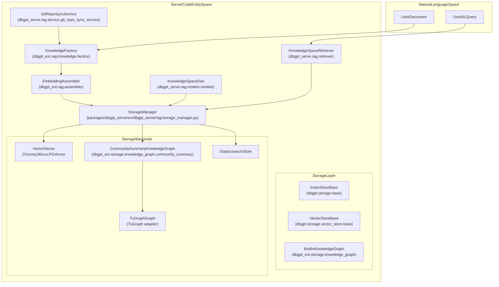
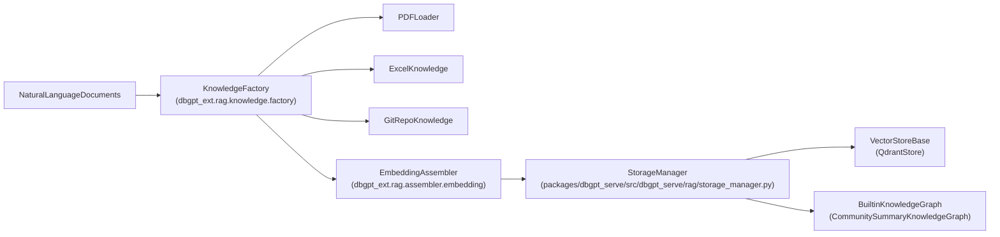

<!-- source: DeepWiki mcp.deepwiki.com · repo eosphoros-ai/DB-GPT · page 4 RAG & Knowledge Management · fetched 2026-10-26 -->

# RAG & Knowledge Management

Relevant source files

The following files were used as context for generating this wiki page:

- [packages/dbgpt-app/src/dbgpt_app/openapi/api_v1/tools/kb_tools.py](packages/dbgpt-app/src/dbgpt_app/openapi/api_v1/tools/kb_tools.py)
- [packages/dbgpt-app/src/dbgpt_app/openapi/api_v1/tools/read_file.py](packages/dbgpt-app/src/dbgpt_app/openapi/api_v1/tools/read_file.py)
- [packages/dbgpt-core/src/dbgpt/agent/core/context/storage.py](packages/dbgpt-core/src/dbgpt/agent/core/context/storage.py)
- [packages/dbgpt-ext/src/dbgpt_ext/rag/knowledge/git_repo.py](packages/dbgpt-ext/src/dbgpt_ext/rag/knowledge/git_repo.py)
- [packages/dbgpt-serve/src/dbgpt_serve/evaluate/service/benchmark/data_compare_service.py](packages/dbgpt-serve/src/dbgpt_serve/evaluate/service/benchmark/data_compare_service.py)
- [packages/dbgpt-serve/src/dbgpt_serve/rag/service/git_repo_sync_service.py](packages/dbgpt-serve/src/dbgpt_serve/rag/service/git_repo_sync_service.py)
- [packages/dbgpt-serve/src/dbgpt_serve/rag/service/service.py](packages/dbgpt-serve/src/dbgpt_serve/rag/service/service.py)
- [packages/dbgpt-serve/src/dbgpt_serve/rag/tools/kb_file_tools.py](packages/dbgpt-serve/src/dbgpt_serve/rag/tools/kb_file_tools.py)
- [packages/dbgpt-serve/src/dbgpt_serve/rag/tools/semantic_search_tool.py](packages/dbgpt-serve/src/dbgpt_serve/rag/tools/semantic_search_tool.py)

The Retrieval-Augmented Generation (RAG) subsystem in DB-GPT, referred to as **Multi-Source RAG (MS-RAG)**, provides a comprehensive framework for managing private knowledge spaces and enriching language model outputs by incorporating external document data. It covers the entire knowledge lifecycle—from ingesting documents (PDF, Markdown, Excel, Git repositories, etc.), through chunking and embedding, to advanced retrieval and reranking using hybrid methods including knowledge graphs.

---

## Architecture Overview

DB-GPT’s RAG subsystem bridges the **Natural Language Space** (user documents and queries) and the **Code Entity Space** (storage backends, embedding models, graph adapters, retrieval and reranking components). The central orchestrator is the `StorageManager` singleton [packages/dbgpt-serve/src/dbgpt_serve/rag/storage_manager.py:18-148](), which manages flexible connectors for vector stores, full-text indexes, and knowledge graphs.

Key system phases include:

- **Indexing (Sync Time):** Documents enter the system through `KnowledgeFactory` selecting appropriate loaders and chunkers, then processed into embeddings and persisted by `EmbeddingAssembler` [packages/dbgpt-serve/src/dbgpt_serve/rag/service/service.py:29-29](). The `GitRepoSyncService` [packages/dbgpt-serve/src/dbgpt_serve/rag/service/git_repo_sync_service.py:29-112]() handles asynchronous cloning and incremental syncing of repositories.

- **Query Time (Conversation):** User queries enter retrievers such as `KnowledgeSpaceRetriever` [packages/dbgpt-serve/src/dbgpt_serve/rag/retriever/knowledge_space.py:1-50](), performing semantic and keyword retrieval. Rerankers like `RerankEmbeddingsRanker` [packages/dbgpt-serve/src/dbgpt_serve/rag/service/service.py:22-22]() refine results for relevance and accurate citation.

### System Entity Mapping Diagram

Mapping the natural language domain concepts to their code components clarifies data flow and architecture:

Sources:  
[packages/dbgpt-serve/src/dbgpt_serve/rag/storage_manager.py:18-148](),  
[packages/dbgpt-serve/src/dbgpt_serve/rag/service/service.py:29-32](),  
[packages/dbgpt-serve/src/dbgpt_serve/rag/service/git_repo_sync_service.py:29-66]()

---

## 4.1 Document Ingestion & Knowledge Pipeline

The ingestion subsystem handles transforming raw input files from various sources into vectorized, retrievable knowledge chunks.

- The `KnowledgeFactory` component orchestrates ingestion from local files, URLs, Excel sheets, PDFs, and Git repositories (`GitRepoKnowledge`) [packages/dbgpt-ext/src/dbgpt_ext/rag/knowledge/git_repo.py:74-126](), selecting suitable parsing and chunking strategies.

- Documents are sliced into semantically meaningful chunks using configurable chunking strategies (`ChunkStrategy`), which can leverage size limits or structural markers like Markdown headings.

- The `EmbeddingAssembler` component asynchronously embeds chunks with selected embedding models and indexes them into vector stores under the control of the `StorageManager` [packages/dbgpt-serve/src/dbgpt_serve/rag/service/service.py:29-192]().

- The `SyncStatus` Enum tracks ingestion lifecycle states (`TODO`, `RUNNING`, `FINISHED`, `FAILED`) allowing the system and clients to monitor sync progress, especially for long-running repository sync tasks [packages/dbgpt-serve/src/dbgpt_serve/rag/service/service.py:56-61]().

- The `GitRepoSyncService` manages asynchronous cloning and incremental sync of Git repo files and triggers the ingestion pipeline [packages/dbgpt-serve/src/dbgpt_serve/rag/service/git_repo_sync_service.py:29-188]().

For details, see [Document Ingestion & Knowledge Pipeline](#4.1).

Sources:  
[packages/dbgpt-serve/src/dbgpt_serve/rag/service/service.py:56-61, 161-192](),  
[packages/dbgpt-ext/src/dbgpt_ext/rag/knowledge/git_repo.py:74-126](),  
[packages/dbgpt-serve/src/dbgpt_serve/rag/service/git_repo_sync_service.py:29-188]()

---

## 4.2 Vector Stores & Storage Backends

DB-GPT's architecture supports multiple pluggable storage backends under the unified `StorageManager` facade [packages/dbgpt-serve/src/dbgpt_serve/rag/storage_manager.py:18-148]():

- **Vector Stores:** Interfaces extend `VectorStoreBase` for popular vector databases such as Chroma, Milvus, PGVector, Weaviate, OceanBase, Qdrant, and Valkey. These provide efficient similarity search on embeddings.

- **Knowledge Graph Stores:** Graph backends such as TuGraph and Neo4j are accessed via graph adapters encapsulated by the knowledge graph subsystem (`BuiltinKnowledgeGraph`, `CommunitySummaryKnowledgeGraph`).

- **Full-Text Search Engines:** Elasticsearch is supported for keyword and BM25 retrieval.

Storage connectors handle document chunk persistence, metadata filtering, and similarity search operations seamlessly.

For implementation details, configuration options, and supported backend comparisons, consult [Vector Stores & Storage Backends](#4.2).

Sources:  
[packages/dbgpt-serve/src/dbgpt_serve/rag/storage_manager.py:18-148]()

---

## 4.3 Knowledge Graph & GraphRAG

The knowledge graph subsystem augments raw text retrieval with relational and symbolic structures for deeper context understanding.

- Components like `BuiltinKnowledgeGraph` create triplet-based knowledge graphs using LLM triplet extraction.

- `CommunitySummaryKnowledgeGraph` extends this with multi-layer summaries and supports hybrid retrieval modes combining graph, embedding, and keyword search.

- Graph store adapters provide integration with high-performance graph databases such as TuGraph and Neo4j.

- Retrieval leverages graph queries (Text2GQL) and hybrid search strategies for rich, structured answers, improving over plain text or vector retrieval.

See [Knowledge Graph & GraphRAG](#4.3) for full details on graph construction, indexing, and retrieval methods.

Sources:  
[packages/dbgpt-serve/src/dbgpt_serve/rag/storage_manager.py:18-148]()

---

## 4.4 Retrieval Strategies & Reranking

The retrieval subsystem orchestrates a multi-step process to deliver the most relevant knowledge chunks during chat sessions:

- **EmbeddingRetriever:** Uses vector similarity on chunk embeddings from vector stores to find relevant content.

- **BM25 Retriever:** Provides keyword-based full-text retrieval.

- **TimeWeightedEmbeddingRetriever:** Incorporates recency by weighting embeddings over time to prioritize fresh documents [packages/dbgpt-core/src/dbgpt/rag/retriever/time_weighted.py:1-50]().

- **Rerankers:** Components like `RerankEmbeddingsRanker` [packages/dbgpt-serve/src/dbgpt_serve/rag/service/service.py:22-22]() apply cross-encoder or LLM-based reranking to refine retrieval order based on query context.

- Query rewriting, scoring thresholds, and metadata filters enhance recall and precision dynamically.

For retrieval algorithms, configurations, and reranking strategies, see [Retrieval Strategies & Reranking](#4.4).

Sources:  
[packages/dbgpt-core/src/dbgpt/rag/retriever/time_weighted.py:1-50](),  
[packages/dbgpt-serve/src/dbgpt_serve/rag/service/service.py:20-22]()

---

## Diagram: Document Ingestion to Storage Flow

Visualizing how documents flow from ingestion through embedding and storage mapping user needs to code modules:

Sources:  
[packages/dbgpt-serve/src/dbgpt_serve/rag/storage_manager.py:18-148]()

---

## Summary

The RAG & Knowledge Management subsystem implements a modular and extensible pipeline that ingests heterogeneous documents into enriched knowledge spaces, indexes them as embeddings and graphs, and applies advanced retrieval and reranking to empower conversational AI with private domain knowledge.

For deep dives, refer to the child pages covering:

- [Document Ingestion & Knowledge Pipeline](#4.1)  
- [Vector Stores & Storage Backends](#4.2)  
- [Knowledge Graph & GraphRAG](#4.3)  
- [Retrieval Strategies & Reranking](#4.4)

Sources:  
[packages/dbgpt-serve/src/dbgpt_serve/rag/storage_manager.py:18-148](),  
[packages/dbgpt-serve/src/dbgpt_serve/rag/service/service.py:20-61,161-192]()

---

