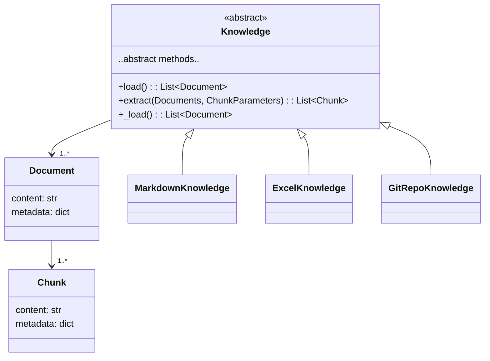
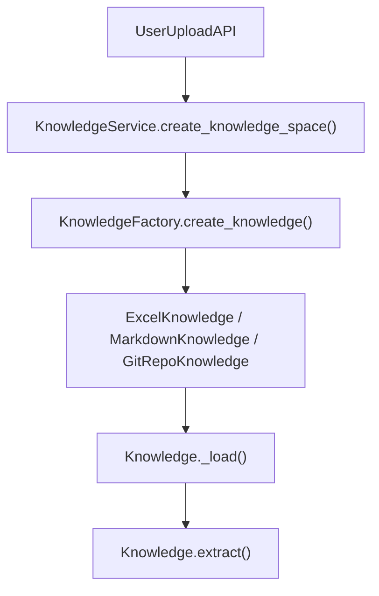
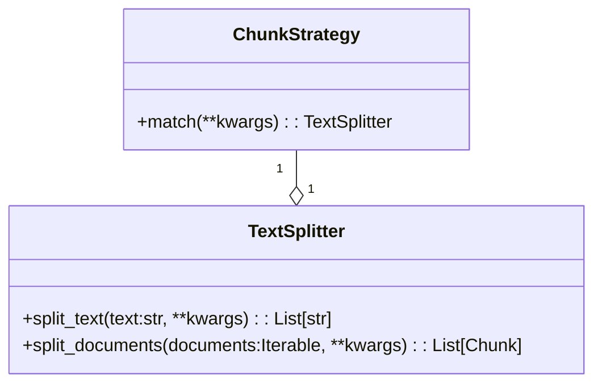
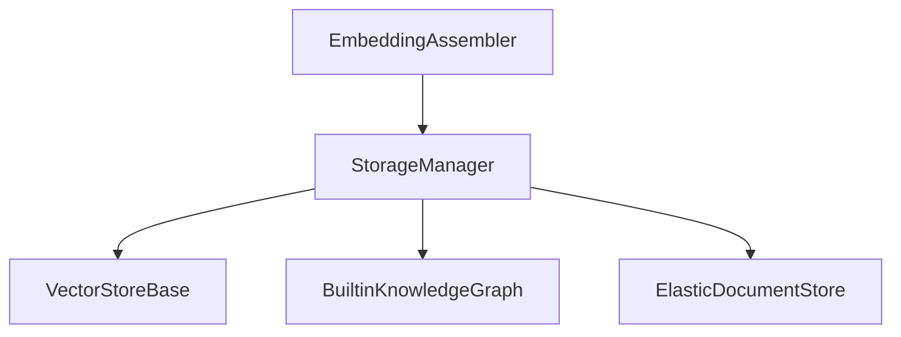
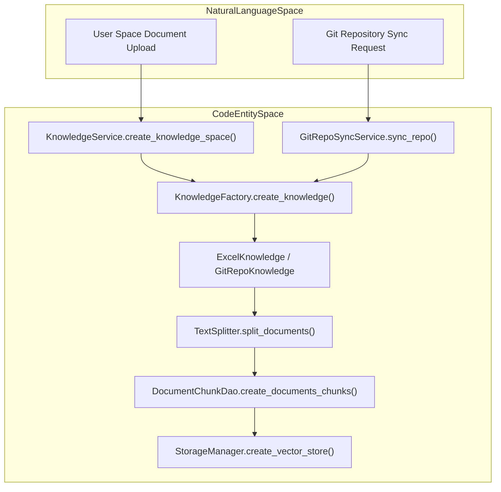
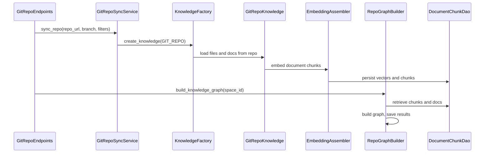
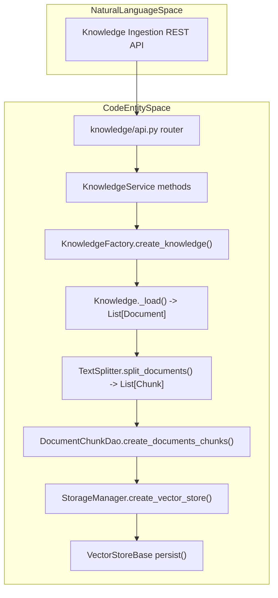

<!-- source: DeepWiki mcp.deepwiki.com · repo eosphoros-ai/DB-GPT · page 4.1 Document Ingestion & Knowledge Pipeline · fetched 2026-10-26 -->

# Document Ingestion & Knowledge Pipeline

Relevant source files

The following files were used as context for generating this wiki page:

- [examples/rag/doc_tree_retriever_example.py](examples/rag/doc_tree_retriever_example.py)
- [packages/dbgpt-app/src/dbgpt_app/knowledge/_cli/knowledge_client.py](packages/dbgpt-app/src/dbgpt_app/knowledge/_cli/knowledge_client.py)
- [packages/dbgpt-app/src/dbgpt_app/knowledge/api.py](packages/dbgpt-app/src/dbgpt_app/knowledge/api.py)
- [packages/dbgpt-app/src/dbgpt_app/scene/chat_knowledge/v1/chat.py](packages/dbgpt-app/src/dbgpt_app/scene/chat_knowledge/v1/chat.py)
- [packages/dbgpt-app/src/dbgpt_app/scene/chat_knowledge/v1/prompt.py](packages/dbgpt-app/src/dbgpt_app/scene/chat_knowledge/v1/prompt.py)
- [packages/dbgpt-app/src/dbgpt_app/tests/test_knowledge_space_scoping.py](packages/dbgpt-app/src/dbgpt_app/tests/test_knowledge_space_scoping.py)
- [packages/dbgpt-core/src/dbgpt/core/interface/knowledge.py](packages/dbgpt-core/src/dbgpt/core/interface/knowledge.py)
- [packages/dbgpt-core/src/dbgpt/rag/knowledge/base.py](packages/dbgpt-core/src/dbgpt/rag/knowledge/base.py)
- [packages/dbgpt-core/src/dbgpt/rag/text_splitter/tests/test_splitters.py](packages/dbgpt-core/src/dbgpt/rag/text_splitter/tests/test_splitters.py)
- [packages/dbgpt-core/src/dbgpt/rag/text_splitter/text_splitter.py](packages/dbgpt-core/src/dbgpt/rag/text_splitter/text_splitter.py)
- [packages/dbgpt-ext/src/dbgpt_ext/rag/graph_builder/repo_graph_builder.py](packages/dbgpt-ext/src/dbgpt_ext/rag/graph_builder/repo_graph_builder.py)
- [packages/dbgpt-ext/src/dbgpt_ext/rag/knowledge/excel.py](packages/dbgpt-ext/src/dbgpt_ext/rag/knowledge/excel.py)
- [packages/dbgpt-ext/src/dbgpt_ext/rag/knowledge/markdown.py](packages/dbgpt-ext/src/dbgpt_ext/rag/knowledge/markdown.py)
- [packages/dbgpt-ext/src/dbgpt_ext/rag/knowledge/tests/test_excel.py](packages/dbgpt-ext/src/dbgpt_ext/rag/knowledge/tests/test_excel.py)
- [packages/dbgpt-ext/src/dbgpt_ext/rag/knowledge/tests/test_markdown.py](packages/dbgpt-ext/src/dbgpt_ext/rag/knowledge/tests/test_markdown.py)
- [packages/dbgpt-serve/src/dbgpt_serve/evaluate/service/benchmark/sql_guard.py](packages/dbgpt-serve/src/dbgpt_serve/evaluate/service/benchmark/sql_guard.py)
- [packages/dbgpt-serve/src/dbgpt_serve/evaluate/tests/__init__.py](packages/dbgpt-serve/src/dbgpt_serve/evaluate/tests/__init__.py)
- [packages/dbgpt-serve/src/dbgpt_serve/evaluate/tests/test_benchmark_output_path.py](packages/dbgpt-serve/src/dbgpt_serve/evaluate/tests/test_benchmark_output_path.py)
- [packages/dbgpt-serve/src/dbgpt_serve/evaluate/tests/test_post_sql_query_guard.py](packages/dbgpt-serve/src/dbgpt_serve/evaluate/tests/test_post_sql_query_guard.py)
- [packages/dbgpt-serve/src/dbgpt_serve/evaluate/tests/test_sql_guard.py](packages/dbgpt-serve/src/dbgpt_serve/evaluate/tests/test_sql_guard.py)
- [packages/dbgpt-serve/src/dbgpt_serve/rag/api/git_repo_endpoints.py](packages/dbgpt-serve/src/dbgpt_serve/rag/api/git_repo_endpoints.py)
- [packages/dbgpt-serve/src/dbgpt_serve/rag/models/chunk_db.py](packages/dbgpt-serve/src/dbgpt_serve/rag/models/chunk_db.py)
- [packages/dbgpt-serve/src/dbgpt_serve/rag/service/codegraph_build_service.py](packages/dbgpt-serve/src/dbgpt_serve/rag/service/codegraph_build_service.py)
- [packages/dbgpt-serve/src/dbgpt_serve/rag/storage_manager.py](packages/dbgpt-serve/src/dbgpt_serve/rag/storage_manager.py)
- [web/components/chat/chat-content/ReferencesContent.tsx](web/components/chat/chat-content/ReferencesContent.tsx)

## Purpose and Scope
The Document Ingestion and Knowledge Pipeline in DB-GPT serves as the foundational subsystem that transforms diverse unstructured or semi-structured data inputs into semantically enriched, chunked documents. These chunks are then embedded and indexed for efficient retrieval in downstream RAG (Retrieval-Augmented Generation) operations or knowledge querying. The pipeline handles data ingestion from varied sources including files (PDF, Markdown, Excel, Word, CSV, PPT), URLs, textual input, and Git repositories. It orchestrates loading, text splitting, embedding assembly, synchronization status lifecycle management, git-repo synchronization, and knowledge graph construction.

---

## Knowledge Architecture

The system is built around the abstract base class `Knowledge` which defines a unified interface for loading and processing data into semantic documents and chunks. Each data source type (Markdown, Excel, Git Repo, etc.) implements a subclass of `Knowledge` that knows how to parse and load data appropriately.

### Core Data Entities

- **Document**: Represents a single logical source unit (a file, URL content, or a datasource) encapsulating the entire content and associated metadata `[packages/dbgpt-core/src/dbgpt/rag/knowledge/base.py:150-179]()`.
- **Chunk**: Represents a smaller segmented unit derived from a Document. Chunks (`DocumentChunkEntity`) are optimized for embedding and similarity search operations `[packages/dbgpt-serve/src/dbgpt_serve/rag/models/chunk_db.py:12-31]()`.

### Enumerations for Classification

- `KnowledgeType` classifies the ingestion source categories: `DOCUMENT`, `TEXT`, `URL`, `YUQUEURL`, and `GIT_REPO` `[packages/dbgpt-core/src/dbgpt/rag/knowledge/base.py:36-44]()`.
- `DocumentType` classifies document formats handled: PDF, CSV, Markdown, PPTX, DOCX, TXT, HTML, Datasource, Excel, DOC `[packages/dbgpt-core/src/dbgpt/rag/knowledge/base.py:21-34]()`.

These enums support dynamic and type-safe handling throughout the pipeline.

Sources:
- `packages/dbgpt-core/src/dbgpt/rag/knowledge/base.py:21-44`
- `packages/dbgpt-core/src/dbgpt/rag/knowledge/base.py:150-179`
- `packages/dbgpt-serve/src/dbgpt_serve/rag/models/chunk_db.py:12-31`

---

## Document Loaders & KnowledgeFactory

In DB-GPT, the ingestion of documents is modularized via `KnowledgeFactory`, which acts as a dynamic factory to instantiate the appropriate `Knowledge` subclass based on file extension or source type.

### Notable Loaders

- **MarkdownKnowledge**: Handles `.md` files with support for hierarchical chunking based on markdown header semantics `[packages/dbgpt-core/src/dbgpt/rag/knowledge/base.py:130-135]()`.

- **ExcelKnowledge**: Loads `.xlsx` files elegantly handling `[packages/dbgpt-ext/src/dbgpt_ext/rag/knowledge/excel.py:17-48]`:
  - Detection of header rows by analyzing patterns in top rows using `_find_header_row` `[packages/dbgpt-ext/src/dbgpt_ext/rag/knowledge/excel.py:49-118]()`.
  - Handling merged cells by propagating merged values across their range `[packages/dbgpt-ext/src/dbgpt_ext/rag/knowledge/excel.py:158-167]()`.
  - Uses `openpyxl` to parse Excel files in data-only mode (fetching formula results, not formulas) `[packages/dbgpt-ext/src/dbgpt_ext/rag/knowledge/excel.py:127-131]()`.
  - Converts rows to documents with proper header mapping `[packages/dbgpt-ext/src/dbgpt_ext/rag/knowledge/excel.py:119-196]()`.

- **GitRepoKnowledge**: Manages cloning and scanning of Git repositories:
  - Supports full cloning and incremental syncing via git diffs `[packages/dbgpt-serve/src/dbgpt_serve/rag/api/git_repo_endpoints.py:75-102]()`.
  - Filters files according to skip/include directory and extension lists.
  - Deduplicates files via hashing.
  - Converts repo files (Markdown and code) into document chunks.

### Service Layer: KnowledgeService & Storage Management

Higher-level orchestration manages knowledge spaces, document life cycles, chunk persistence, synchronization state changes, and embedding dispatch `[packages/dbgpt-app/src/dbgpt_app/knowledge/api.py:69-132]()`. It communicates with the `KnowledgeFactory` to instantiate loaders and ties with storage backends for persistence via `StorageManager` `[packages/dbgpt-serve/src/dbgpt_serve/rag/storage_manager.py:18-88]()`. Additionally, client utilities like `KnowledgeApiClient` facilitate programmatic ingestion via CLI workflows `[packages/dbgpt-app/src/dbgpt_app/knowledge/_cli/knowledge_client.py:52-105]()`.

Sources:
- `packages/dbgpt-ext/src/dbgpt_ext/rag/knowledge/excel.py:17-196`
- `packages/dbgpt-app/src/dbgpt_app/knowledge/api.py:69-132`
- `packages/dbgpt-serve/src/dbgpt_serve/rag/storage_manager.py:18-88`
- `packages/dbgpt-app/src/dbgpt_app/knowledge/_cli/knowledge_client.py:52-105`

---

## Text Splitters & Chunking Strategies

DB-GPT defines a rich `ChunkStrategy` enum to specify how documents are split into chunks `[packages/dbgpt-core/src/dbgpt/rag/knowledge/base.py:69-136]()`. Each strategy targets a different semantic or structural granularity and maps to specific `TextSplitter` implementations `[packages/dbgpt-core/src/dbgpt/rag/text_splitter/text_splitter.py:15-45]()`:

| Strategy                    | Splitter Class                | Description                                         |
|-----------------------------|------------------------------|-----------------------------------------------------|
| `CHUNK_BY_SIZE`             | RecursiveCharacterTextSplitter | Fixed-size chunks with overlaps preserving context.|
| `CHUNK_BY_PAGE`             | PageTextSplitter              | Splits large documents (e.g., PDFs) by pages.        |
| `CHUNK_BY_PARAGRAPH`        | ParagraphTextSplitter         | Splits text by paragraphs including a separator.    |
| `CHUNK_BY_SEPARATOR`        | SeparatorTextSplitter         | Splits on user-defined separators; supports merges. |
| `CHUNK_BY_MARKDOWN_HEADER`  | MarkdownHeaderTextSplitter    | Hierarchical splitting respecting markdown headers. |

Text splitting is performed by calling `split_text()` or `split_documents()` on the configured splitter instance `[packages/dbgpt-core/src/dbgpt/rag/text_splitter/text_splitter.py:47-81]()`. Text splitters handle chunk overlap, size limits, separators, and filters to produce semantically meaningful chunks for indexing `[packages/dbgpt-core/src/dbgpt/rag/text_splitter/text_splitter.py:90-144]()`.

Sources:
- `packages/dbgpt-core/src/dbgpt/rag/knowledge/base.py:69-148`
- `packages/dbgpt-core/src/dbgpt/rag/text_splitter/text_splitter.py:1-81`
- `packages/dbgpt-core/src/dbgpt/rag/text_splitter/text_splitter.py:90-144`

---

## EmbeddingAssembler & Synchronization Lifecycle

### EmbeddingAssembler

`EmbeddingAssembler` acts as the coordinator for embedding document chunks and persisting results in appropriate storage backends `[packages/dbgpt-ext/src/dbgpt_ext/rag/assembler/embedding.py:17-59]()`. It supports both synchronous and asynchronous batch operations and interacts with the `StorageManager` to obtain handles to various storage connectors:

- Vector stores for embedding indices `[packages/dbgpt-serve/src/dbgpt_serve/rag/storage_manager.py:89-108]()`.
- Knowledge graph stores for graph-based knowledge `[packages/dbgpt-serve/src/dbgpt_serve/rag/storage_manager.py:110-148]()`.
- Full-text search stores for BM25 retrieval `[packages/dbgpt-serve/src/dbgpt_serve/rag/storage_manager.py:68-85]()`.

### SyncStatus Lifecycle

In the document ingestion pipeline, document and embedding processing stages are tracked by a sync status system to guarantee pipeline observability and recovery:

- `TODO`: Document queued for processing.
- `RUNNING`: Document currently being ingested and embedded.
- `FAILED`: Processing encountered an error.
- `FINISHED`: Document successfully synced and indexed.

### StorageManager Component

`StorageManager` (`ComponentType.RAG_STORAGE_MANAGER`) is a singleton component responsible for `[packages/dbgpt-serve/src/dbgpt_serve/rag/storage_manager.py:18-28]()`:

- Instantiating and caching storage connectors for vector stores (`VectorStoreBase`), knowledge graph stores (`BuiltinKnowledgeGraph`, `CommunitySummaryKnowledgeGraph`), and full-text search (`ElasticDocumentStore`) `[packages/dbgpt-serve/src/dbgpt_serve/rag/storage_manager.py:39-87]()`.
- Retrieving configuration from app settings and providing factory methods to get or create storage connectors based on type `[packages/dbgpt-serve/src/dbgpt_serve/rag/storage_manager.py:34-38]()`.

Sources:
- `packages/dbgpt-ext/src/dbgpt_ext/rag/assembler/embedding.py:17-59`
- `packages/dbgpt-serve/src/dbgpt_serve/rag/storage_manager.py:18-148`

---

## Natural Language Space to Code Entity Space Bridge

The following diagram bridges user operations ("Natural Language Space") to concrete backend code entities and methods ("Code Entity Space"):

Sources:
- `packages/dbgpt-app/src/dbgpt_app/knowledge/api.py:86-98`
- `packages/dbgpt-serve/src/dbgpt_serve/rag/api/git_repo_endpoints.py:42-63`
- `packages/dbgpt-serve/src/dbgpt_serve/rag/storage_manager.py:89-108`
- `packages/dbgpt-serve/src/dbgpt_serve/rag/models/chunk_db.py:47-64`

---

## Git Repository Sync & Code Graph Building

DB-GPT supports full and incremental syncing of Git repositories as knowledge spaces, tightly integrated into the ingestion and embedding pipelines.

### Git Repository Sync

- Exposed via REST APIs (e.g., `/{space_id}/git/sync` and incremental sync endpoints) `[packages/dbgpt-serve/src/dbgpt_serve/rag/api/git_repo_endpoints.py:42-102]()`.
- Managed by `GitRepoSyncService` which:
  - Clones or pulls repositories.
  - Applies directory and extension filters.
  - Computes file content hashes to deduplicate.
  - Loads files as `Document` instances via `GitRepoKnowledge`.
  - Dispatches embedding via `EmbeddingAssembler`.

### Code Graph Building

- After indexing source code files from git repos or uploaded markdown/code docs, DB-GPT can build structural code graphs via `build_code_graph_from_knowledge_space()` or `build_code_graph_from_files()` `[packages/dbgpt-serve/src/dbgpt_serve/rag/service/codegraph_build_service.py:88-192]()`.
- Reconstructs file contents from stored chunks in `DocumentChunkDao` and builds the graph via `RepoGraphBuilder` `[packages/dbgpt-serve/src/dbgpt_serve/rag/service/codegraph_build_service.py:112-138]()`.
- Triggered via REST API `/knowledge/{space_id}/build-graph` `[packages/dbgpt-serve/src/dbgpt_serve/rag/api/git_repo_endpoints.py:121-147]()`.

Sources:
- `packages/dbgpt-serve/src/dbgpt_serve/rag/api/git_repo_endpoints.py:42-147`
- `packages/dbgpt-serve/src/dbgpt_serve/rag/service/codegraph_build_service.py:88-192`
- `packages/dbgpt-serve/src/dbgpt_serve/rag/models/chunk_db.py:66-104`

---

## Overall Document Ingestion Pipeline Data Flow

This second bridge diagram illustrates the end-to-end processing pipeline from knowledge ingestion requests through loading, chunking, storage management, and vector indexing.

Sources:
- `packages/dbgpt-app/src/dbgpt_app/knowledge/api.py:86-132`
- `packages/dbgpt-core/src/dbgpt/rag/knowledge/base.py:150-179`
- `packages/dbgpt-core/src/dbgpt/rag/text_splitter/text_splitter.py:72-80`
- `packages/dbgpt-serve/src/dbgpt_serve/rag/storage_manager.py:89-108`
- `packages/dbgpt-serve/src/dbgpt_serve/rag/models/chunk_db.py:47-64`

---

