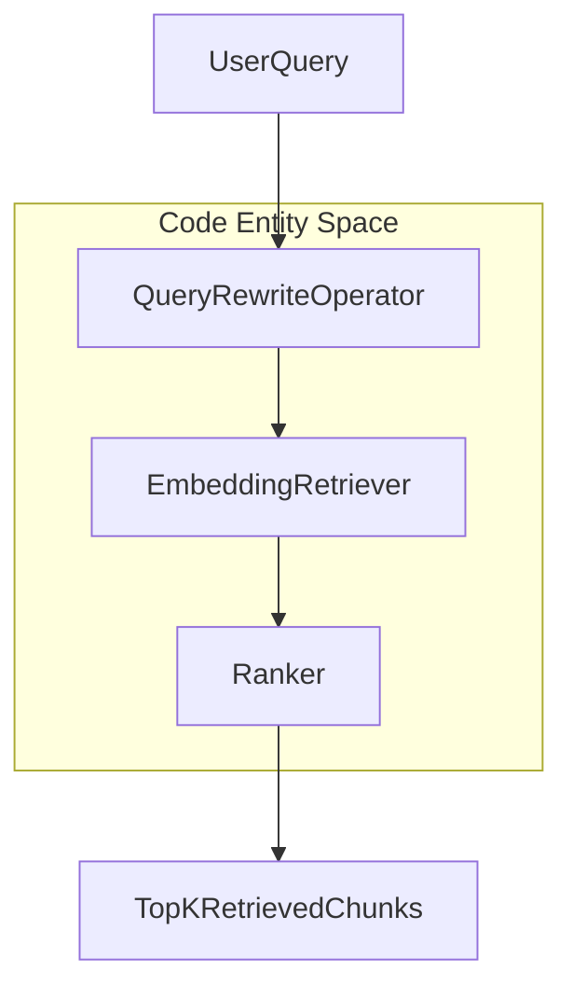
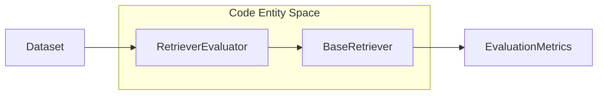
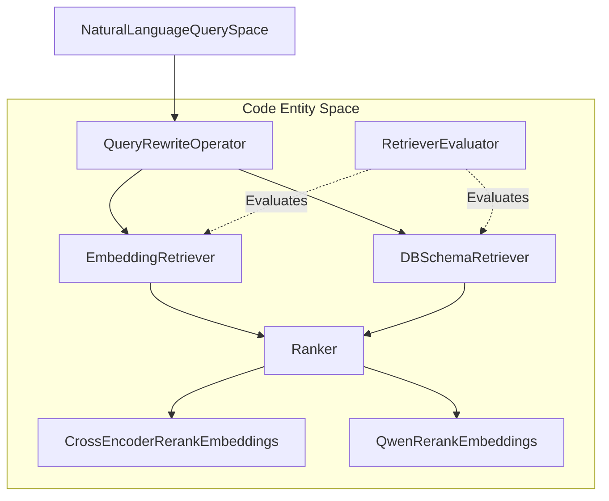

<!-- source: DeepWiki mcp.deepwiki.com · repo eosphoros-ai/DB-GPT · page 4.4 Retrieval Strategies & Reranking · fetched 2026-10-26 -->

# Retrieval Strategies & Reranking

<details>
<summary>Relevant source files</summary>

The following files were used as context for generating this wiki page:

- [assets/dbgpt.png](assets/dbgpt.png)
- [configs/dbgpt-local-qwen3.example.toml](configs/dbgpt-local-qwen3.example.toml)
- [configs/dbgpt-proxy-infiniai.toml](configs/dbgpt-proxy-infiniai.toml)
- [docs/docs/agents/modules/memory/hybrid_memory.md](docs/docs/agents/modules/memory/hybrid_memory.md)
- [docs/docs/agents/modules/memory/long_term_memory.md](docs/docs/agents/modules/memory/long_term_memory.md)
- [docs/docs/awel/cookbook/first_rag_with_awel.md](docs/docs/awel/cookbook/first_rag_with_awel.md)
- [docs/docs/awel/cookbook/write_your_chat_database.md](docs/docs/awel/cookbook/write_your_chat_database.md)
- [examples/awel/simple_nl_schema_sql_chart_example.py](examples/awel/simple_nl_schema_sql_chart_example.py)
- [examples/rag/embedding_rag_example.py](examples/rag/embedding_rag_example.py)
- [examples/rag/rag_embedding_api_example.py](examples/rag/rag_embedding_api_example.py)
- [examples/rag/simple_dbschema_retriever_example.py](examples/rag/simple_dbschema_retriever_example.py)
- [examples/rag/simple_rag_embedding_example.py](examples/rag/simple_rag_embedding_example.py)
- [examples/rag/simple_rag_retriever_example.py](examples/rag/simple_rag_retriever_example.py)
- [examples/sdk/chat_data_with_awel.py](examples/sdk/chat_data_with_awel.py)
- [packages/dbgpt-core/src/dbgpt/agent/resource/database.py](packages/dbgpt-core/src/dbgpt/agent/resource/database.py)
- [packages/dbgpt-core/src/dbgpt/model/adapter/embed_metadata.py](packages/dbgpt-core/src/dbgpt/model/adapter/embed_metadata.py)
- [packages/dbgpt-core/src/dbgpt/model/proxy/llms/infiniai.py](packages/dbgpt-core/src/dbgpt/model/proxy/llms/infiniai.py)
- [packages/dbgpt-core/src/dbgpt/rag/embedding/__init__.py](packages/dbgpt-core/src/dbgpt/rag/embedding/__init__.py)
- [packages/dbgpt-core/src/dbgpt/rag/embedding/embeddings.py](packages/dbgpt-core/src/dbgpt/rag/embedding/embeddings.py)
- [packages/dbgpt-core/src/dbgpt/rag/embedding/rerank.py](packages/dbgpt-core/src/dbgpt/rag/embedding/rerank.py)
- [packages/dbgpt-core/src/dbgpt/rag/evaluation/retriever.py](packages/dbgpt-core/src/dbgpt/rag/evaluation/retriever.py)
- [packages/dbgpt-core/src/dbgpt/rag/retriever/base.py](packages/dbgpt-core/src/dbgpt/rag/retriever/base.py)
- [packages/dbgpt-core/src/dbgpt/rag/retriever/embedding.py](packages/dbgpt-core/src/dbgpt/rag/retriever/embedding.py)
- [packages/dbgpt-ext/src/dbgpt_ext/rag/retriever/db_schema.py](packages/dbgpt-ext/src/dbgpt_ext/rag/retriever/db_schema.py)
- [packages/dbgpt-ext/src/dbgpt_ext/rag/retriever/doc_tree.py](packages/dbgpt-ext/src/dbgpt_ext/rag/retriever/doc_tree.py)
- [packages/dbgpt-ext/src/dbgpt_ext/rag/retriever/tests/test_db_struct.py](packages/dbgpt-ext/src/dbgpt_ext/rag/retriever/tests/test_db_struct.py)
- [packages/dbgpt-serve/src/dbgpt_serve/agent/evaluation/evaluation.py](packages/dbgpt-serve/src/dbgpt_serve/agent/evaluation/evaluation.py)
- [packages/dbgpt-serve/src/dbgpt_serve/rag/api/endpoints.py](packages/dbgpt-serve/src/dbgpt_serve/rag/api/endpoints.py)
- [packages/dbgpt-serve/src/dbgpt_serve/rag/retriever/knowledge_space.py](packages/dbgpt-serve/src/dbgpt_serve/rag/retriever/knowledge_space.py)
- [tests/intetration_tests/datasource/test_conn_starrocks.py](tests/intetration_tests/datasource/test_conn_starrocks.py)

</details>


Retrieval is the core mechanism for fetching the most relevant information from a knowledge base to provide contextual grounding for Large Language Models (LLMs). DB-GPT provides a modular, extensible retrieval and reranking architecture supporting dense vector similarity search, keyword matching, temporal weighting, structured database schema retrieval, tree-structured document traversals, and query rewriting. This page details these retriever implementations, reranking strategies, and evaluation workflows.

Sources:
- [packages/dbgpt-ext/src/dbgpt_ext/rag/retriever/db_schema.py:9-9]()

---

## Retriever Architecture

At the center of DB-GPT's retrieval subsystem is the `BaseRetriever` abstract base class, which specifies the contract for fetching knowledge chunks given a text query. Retrievers integrate seamlessly with Assembler classes and AWEL (Agentic Workflow Expression Language) operators to power end-to-end RAG pipelines.

Diagram: Retriever Architecture Flow


Sources:  
- [packages/dbgpt-ext/src/dbgpt_ext/rag/retriever/db_schema.py:9-9]()

---

## Retrieval Strategies

DB-GPT implements diverse retrieval strategies tailored for specific knowledge types and query modalities:

### 1. EmbeddingRetriever
The default dense vector similarity search retriever uses embedding models and vector stores:
- **Implementation:** Uses embedding models (`Embeddings`) to encode queries and documents into vector representations and performs nearest neighbor search in a vector store [packages/dbgpt-core/src/dbgpt/rag/embedding/embeddings.py:164-206]().
- **Configurable Parameters:** `top_k`, similarity metrics, score thresholds.
- **Use Cases:** General document retrieval, knowledge base search, code repositories.

Sources:
- [packages/dbgpt-core/src/dbgpt/rag/embedding/embeddings.py:164-206]()

### 2. BM25Retriever
A lexical-based keyword matching retriever using the BM25 algorithm. Ideal for exact term matching in technical or structured content where semantic embeddings might be insufficient.

Sources:
- [packages/dbgpt-ext/src/dbgpt_ext/rag/retriever/db_schema.py:27-41]()

### 3. TimeWeightedRetriever
This retriever incorporates temporal decay weights on retrieved chunks to prioritize recent documents or memories. It is especially relevant in agent memory systems, such as long-term memory, combining vector similarity with recency weighting [docs/docs/agents/modules/memory/hybrid_memory.md:136-142]().

Sources:
- [docs/docs/agents/modules/memory/hybrid_memory.md:136-142]()

### 4. DBSchemaRetriever
Specialized for Text-to-SQL and database schema retrieval tasks, this retriever fetches structured schema documents (tables and fields) from vector stores or directly parses live RDBMS metadata when vector stores are not provided [packages/dbgpt-ext/src/dbgpt_ext/rag/retriever/db_schema.py:27-41]().
- **Class:** `DBSchemaRetriever` implements this behavior [packages/dbgpt-ext/src/dbgpt_ext/rag/retriever/db_schema.py:27-41]().
- **Features:**
  - Retrieves both table-level and field-level schema embeddings using separate vector store connectors.
  - When embeddings are unavailable, falls back to extracting database summary via live connector (`_parse_db_summary`) [packages/dbgpt-ext/src/dbgpt_ext/rag/retriever/db_schema.py:136-137]().
  - Supports query rewriting and reranking integration [packages/dbgpt-ext/src/dbgpt_ext/rag/retriever/db_schema.py:38-39]().

Sources:
- [packages/dbgpt-ext/src/dbgpt_ext/rag/retriever/db_schema.py:27-137]()

### 5. Document Tree Retriever (`doc-tree`)
Provides retrieval over hierarchical document trees, preserving parent-child relationships and context. This enables retrieval of not only the target chunk but also the relevant surrounding document structure to provide richer context [packages/dbgpt-ext/src/dbgpt_ext/rag/retriever/db_schema.py:27-41]().

Sources:
- [packages/dbgpt-ext/src/dbgpt_ext/rag/retriever/db_schema.py:27-41]()

---

## Reranking Strategies

Initial retrievers often fetch a broader candidate pool to maximize recall. Reranking applies more computationally intensive cross-encoder models or LLM evaluators to order candidates precisely by their relevance to the query.

### Cross-Encoder Reranking
Jointly evaluates pairs of `[query, candidate]` texts with a cross-encoder architecture to produce fine-grained relevance scores [packages/dbgpt-core/src/dbgpt/rag/embedding/rerank.py:148-166]().
- **Class:** `CrossEncoderRerankEmbeddings` wraps the HuggingFace `sentence_transformers.CrossEncoder` [packages/dbgpt-core/src/dbgpt/rag/embedding/rerank.py:88-116]().
- **Flow:** Composes query-candidate pairs and uses the cross-encoder model's `predict()` to return ranked float scores [packages/dbgpt-core/src/dbgpt/rag/embedding/rerank.py:160-165]().

### LLM & Proxy-Based Reranking
Supports models like `QwenRerankEmbeddings` that may deploy custom rerankers proxied through LLM APIs or local transformer models [packages/dbgpt-core/src/dbgpt/rag/embedding/rerank.py:169-208]().

Diagram: Reranking Hierarchy Class Diagram
```mermaid
classDiagram
    direction LR
    class RerankEmbeddings {
        <<interface>>
        predict(query: str, candidates: List[str]) -> List[float]
    }

    class CrossEncoderRerankEmbeddings {
        +client: Any
        +model_name: str
        +predict(query: str, candidates: List[str]) List[float]
    }

    class QwenRerankEmbeddings {
        +client: Any
        +model_name: str
        +predict(query: str, candidates: List[str]) List[float]
    }

    RerankEmbeddings <|-- CrossEncoderRerankEmbeddings
    RerankEmbeddings <|-- QwenRerankEmbeddings

    subgraph CodeEntitySpace ["Code Entity Space"]
        CrossEncoderRerankEmbeddings
        QwenRerankEmbeddings
    end
```

Sources:  
- [packages/dbgpt-core/src/dbgpt/rag/embedding/rerank.py:88-166]()  
- [packages/dbgpt-core/src/dbgpt_ext/rag/retriever/db_schema.py:9-9]()

---

## Query Rewriting

Query rewriting assists in refining input queries before retrieval:
- **Purpose:** Improves recall and precision by reformulating ambiguous or incomplete queries, expanding acronyms, or restructuring questions.
- **Implementation:** Handled as AWEL operators (`QueryRewriteOperator`) placed upstream of retrievers in execution DAGs [packages/dbgpt-ext/src/dbgpt_ext/rag/retriever/db_schema.py:38-38]().

Sources:
- [packages/dbgpt-ext/src/dbgpt_ext/rag/retriever/db_schema.py:38-38]()

---

## Retriever Evaluation

DB-GPT includes evaluation utilities to measure and benchmark retriever performance against ground-truth benchmarks.
- **Class:** `RetrieverEvaluator` runs evaluation against labeled datasets, computing retrieval quality metrics [packages/dbgpt-serve/src/dbgpt_serve/agent/evaluation/evaluation.py:170-176]().
- **Metrics:** Hit Rate, Mean Reciprocal Rank (MRR), Precision, Recall.

Diagram: Retriever Evaluation Flow


Sources:  
- [packages/dbgpt-serve/src/dbgpt_serve/agent/evaluation/evaluation.py:170-176]()  
- [packages/dbgpt-ext/src/dbgpt_ext/rag/retriever/db_schema.py:9-9]()  

---

## Summary Diagram: Natural Language Query to Code Entities in Retrieval & Reranking

This diagram bridges the conceptual space of user natural language queries to the backend code entities implementing query rewriting, retrieval, reranking, and evaluation.

Diagram: Natural Language Space to Code Entity Space


Sources:  
- [packages/dbgpt-core/src/dbgpt/rag/embedding/rerank.py:1-208]()  
- [packages/dbgpt-core/src/dbgpt/rag/embedding/embeddings.py:1-206]()  
- [packages/dbgpt-ext/src/dbgpt_ext/rag/retriever/db_schema.py:9-200]()  
- [packages/dbgpt-serve/src/dbgpt_serve/agent/evaluation/evaluation.py:170-176]()

---

