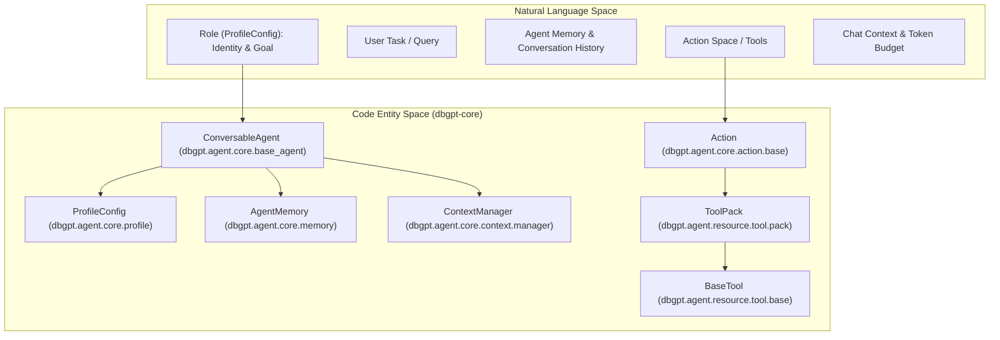
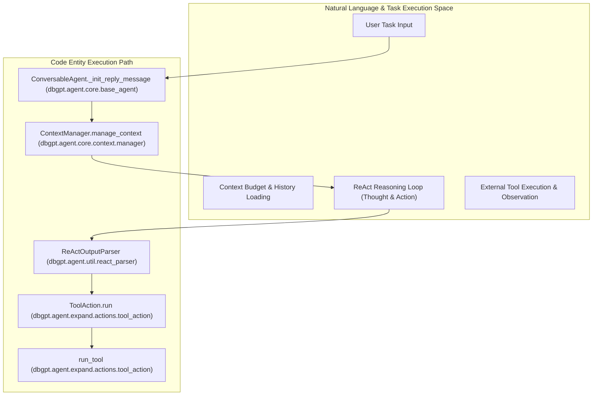

<!-- source: DeepWiki mcp.deepwiki.com · repo eosphoros-ai/DB-GPT · page 5 Agent Framework · fetched 2026-10-26 -->

# Agent Framework

Relevant source files

The following files were used as context for generating this wiki page:

- [packages/dbgpt-core/src/dbgpt/agent/core/action/base.py](packages/dbgpt-core/src/dbgpt/agent/core/action/base.py)
- [packages/dbgpt-core/src/dbgpt/agent/core/base_agent.py](packages/dbgpt-core/src/dbgpt/agent/core/base_agent.py)
- [packages/dbgpt-core/src/dbgpt/agent/core/context/__init__.py](packages/dbgpt-core/src/dbgpt/agent/core/context/__init__.py)
- [packages/dbgpt-core/src/dbgpt/agent/core/context/budget.py](packages/dbgpt-core/src/dbgpt/agent/core/context/budget.py)
- [packages/dbgpt-core/src/dbgpt/agent/core/context/compact.py](packages/dbgpt-core/src/dbgpt/agent/core/context/compact.py)
- [packages/dbgpt-core/src/dbgpt/agent/core/context/manager.py](packages/dbgpt-core/src/dbgpt/agent/core/context/manager.py)
- [packages/dbgpt-core/src/dbgpt/agent/core/role.py](packages/dbgpt-core/src/dbgpt/agent/core/role.py)
- [packages/dbgpt-core/src/dbgpt/agent/expand/actions/tool_action.py](packages/dbgpt-core/src/dbgpt/agent/expand/actions/tool_action.py)
- [packages/dbgpt-core/src/dbgpt/agent/expand/react_agent.py](packages/dbgpt-core/src/dbgpt/agent/expand/react_agent.py)
- [packages/dbgpt-core/src/dbgpt/agent/util/llm/llm_client.py](packages/dbgpt-core/src/dbgpt/agent/util/llm/llm_client.py)
- [packages/dbgpt-core/src/dbgpt/core/interface/prompt.py](packages/dbgpt-core/src/dbgpt/core/interface/prompt.py)

The purpose of this page is to provide a high-level overview of DB-GPT's multi-agent system, covering agent roles, memory systems, planning modules, action execution mechanisms, resource management, skills, and connectors. As a parent page, it introduces each major subsystem and points to dedicated child pages for detailed technical reference.

---

## Core Architecture

At the heart of the Agent Framework lies the `ConversableAgent` class (`[packages/dbgpt-core/src/dbgpt/agent/core/base_agent.py:39-64]()`), which extends low-level roles with multi-step conversational capabilities, memory integration, and action management. Each agent is defined primarily by a **Role** expressed via a `ProfileConfig` object (`[packages/dbgpt-core/src/dbgpt/agent/core/role.py:40-57]()`) that specifies identity, goals, prompt templates, constraints, and execution behavior.

Conversational context and reasoning outputs are managed and tracked using `AgentMemory`, supporting different memory types such as short-term, long-term, hybrid, and LLM-enhanced stores (`[packages/dbgpt-core/src/dbgpt/agent/core/role.py:49-49]()`).

Agents operate by selecting and performing `Action` instances (`[packages/dbgpt-core/src/dbgpt/agent/core/action/base.py:98-124]()`), which are discrete capability units including tool invocation, conversation steps, or planning commands. These actions are defined via the `Action` base class and specialized subclasses, and can depend on external resources.

To handle token limits in extended conversations, the agent framework incorporates a layered `ContextManager` (`[packages/dbgpt-core/src/dbgpt/agent/core/context/manager.py:27-52]()`) that progressively applies compaction strategies to truncate, summarize, or prune history while preserving relevant conversation and task details.

A central abstraction is the **Resource** system, encapsulating external capabilities such as tools, knowledge bases, databases, and connectors (`[packages/dbgpt-core/src/dbgpt/agent/expand/actions/tool_action.py:15-16]()`). Resources are organized into collections or packs, e.g. `ToolPack` for aggregated tools accessible by agents.

### Architecture Mapping: Natural Language to Code Entities

Sources: 
`[packages/dbgpt-core/src/dbgpt/agent/core/base_agent.py:39-64]()`, 
`[packages/dbgpt-core/src/dbgpt/agent/core/role.py:40-57]()`, 
`[packages/dbgpt-core/src/dbgpt/agent/core/action/base.py:98-124]()`, 
`[packages/dbgpt-core/src/dbgpt/agent/core/context/manager.py:27-52]()`, 
`[packages/dbgpt-core/src/dbgpt/agent/expand/actions/tool_action.py:15-16]()`

---

## Key Subsystems Overview

### Agent Core: Roles, Actions & Planning

Agent roles encapsulate identity, goals, and prompting behavior through `ProfileConfig` and the `Role` class (`[packages/dbgpt-core/src/dbgpt/agent/core/role.py:40-57]()`). The core agent class `ConversableAgent` enables multi-turn conversation and task management. A prominent example is the `ReActAgent` (`[packages/dbgpt-core/src/dbgpt/agent/expand/react_agent.py:96-120]()`) which implements the ReAct paradigm—with iterative loops of reasoning ("Thought"), action selection, and execution from a defined action space.

This subsystem handles the selection and execution of actions (e.g., tool use, data insertion), context management including compaction for token budgeting, and multi-agent team workflows such as AutoPlan and AWEL-layout teams.

For full details, see [Agent Core: Roles, Actions & Planning](#5.1).

Sources: 
`[packages/dbgpt-core/src/dbgpt/agent/expand/react_agent.py:96-120]()`, 
`[packages/dbgpt-core/src/dbgpt/agent/core/role.py:40-57]()`

---

### Agent Memory System

The memory system integrates various layers of memory to retain agent state and conversation history. It includes short-term and long-term memory, hybrid models, and LLM-enhanced memory storage (`AgentMemory`).

The framework uses a multi-layered context management system (`ContextManager`) that orchestrates progressive compaction to manage token budgets during conversation (`[packages/dbgpt-core/src/dbgpt/agent/core/context/manager.py:27-52]()`):

- **Layer 1**: `ObservationMicroCompact` truncates old observations to reduce verbosity (`[packages/dbgpt-core/src/dbgpt/agent/core/context/compact.py:87-140]()`).
- **Layer 2**: `SessionMemoryCompact` drops older conversation rounds relying on the incremental task progress summary (`[packages/dbgpt-core/src/dbgpt/agent/core/context/compact.py:145-200]()`).
- **Layer 3**: `FullContextCompression` generates an LLM-based summary to compress history.
- **Layer 4**: `ReactiveCompact` applies emergency context trimming to avoid failing requests.

For detailed architecture and implementation, see [Agent Memory System](#5.2).

Sources: 
`[packages/dbgpt-core/src/dbgpt/agent/core/context/manager.py:27-52]()`, 
`[packages/dbgpt-core/src/dbgpt/agent/core/context/compact.py:87-140]()`, 
`[packages/dbgpt-core/src/dbgpt/agent/core/context/compact.py:145-200]()`

---

### Agent Resources: Tools, Knowledge & MCP

Agents interact with external systems via a resource abstraction layer. This includes collections such as `ToolPack`, which bundle tools like SQL query executors, code interpreters, or domain-specific analyzers, encapsulated by `BaseTool` classes (`[packages/dbgpt-core/src/dbgpt/agent/expand/actions/tool_action.py:15-16]()`).

The `ToolAction` class (`[packages/dbgpt-core/src/dbgpt/agent/expand/actions/tool_action.py:37-160]()`) defines the execution of these external tools by agents. The asynchronous `run_tool` function resolves the correct tool and runs it with provided input arguments, returning structured outputs (`[packages/dbgpt-core/src/dbgpt/agent/expand/actions/tool_action.py:162-193]()`).

Resources also include knowledge bases and application integrations, with MCP server integration for plugin and connector lifecycle.

For comprehensive details, see [Agent Resources: Tools, Knowledge & MCP](#5.3).

Sources: 
`[packages/dbgpt-core/src/dbgpt/agent/expand/actions/tool_action.py:15-16]()`, 
`[packages/dbgpt-core/src/dbgpt/agent/expand/actions/tool_action.py:37-160]()`, 
`[packages/dbgpt-core/src/dbgpt/agent/expand/actions/tool_action.py:162-193]()`

---

### Skills System

The skills subsystem provides a structured way to integrate reusable, high-level capabilities into agents. This includes skill definition (`SkillBase`), management (`SkillManager`), loading (`SkillLoader`), and building (`SkillBuilder`).

Skills can be found as independent modules (e.g., `csv-data-analysis`, `financial-report-analyzer`) and are accessible via UI components, enabling extensible agent functionalities for specialized tasks.

For in-depth explanations, see [Skills System](#5.4).

Sources: 
`[packages/dbgpt-core/src/dbgpt/agent/core/base_agent.py:39-64]()`

---

### Connector & External Integration Manager

This subsystem manages external API connectors, credentials, and integrations through the `ConnectorManager`. It includes discovery, lifecycle management, cataloging, and seamless integration with MCP servers to scale agent access to diverse data sources and services.

The manager supports caching, TTL, locking, and frontend UI for connector management and tool discovery.

For detailed information, see [Connector & External Integration Manager](#5.5).

Sources: 
`[packages/dbgpt-core/src/dbgpt/agent/core/base_agent.py:39-64]()`

---

### Agent Tool Endpoints & Interpreters

The agent framework exposes multiple HTTP endpoints under `api_v1/tools/*` to support executing shell commands, running code, interpreting HTML, executing SQL queries, retrieving knowledge, managing questions, and file loading.

This suite of interpreters and endpoints enables conversational agents to perform real-time data processing, analysis, and interaction with external systems via structured tool calls.

For details, see [Agent Tool Endpoints & Interpreters](#5.6).

Sources: 
`[packages/dbgpt-core/src/dbgpt/agent/expand/actions/tool_action.py:162-193]()`

---

## Agent Execution Flow

The agent operates in an iterative loop combining natural language understanding, planning, action execution, and memory update. It typically follows these stages:

- Receives user input or task query.
- Loads relevant conversation and memory context.
- Applies token budget management with layered context compaction.
- Generates internal reasoning steps ("Thought").
- Selects an appropriate action from its action space (including external tool invocations).
- Executes the action asynchronously.
- Records observations, updates memory, and optionally presents intermediate reasoning.
- Continues this loop until a termination action signals the final answer.

### Execution Mapping: Natural Language State to Code Entity Execution

Sources: 
`[packages/dbgpt-core/src/dbgpt/agent/expand/react_agent.py:96-120]()`, 
`[packages/dbgpt-core/src/dbgpt/agent/core/context/manager.py:27-52]()`, 
`[packages/dbgpt-core/src/dbgpt/agent/expand/actions/tool_action.py:37-160]()`, 
`[packages/dbgpt-core/src/dbgpt/agent/expand/actions/tool_action.py:162-193]()`

---

## Summary Table of Core Components

| Component | Code Symbol | Responsibility |
|---|---|---|
| **Agent Core** | `ConversableAgent` | Orchestrates LLM interaction, actions, planning, and memory management (`[packages/dbgpt-core/src/dbgpt/agent/core/base_agent.py:39-64]()`) |
| **Role & Profile** | `Role`, `ProfileConfig` | Defines agent identity, goals, and prompt templates (`[packages/dbgpt-core/src/dbgpt/agent/core/role.py:40-57]()`) |
| **Agent Memory** | `AgentMemory` | Manages conversation history and reasoning traces (`[packages/dbgpt-core/src/dbgpt/agent/core/role.py:49-49]()`) |
| **Actions** | `Action` | Defines executable capabilities and tool invocations (`[packages/dbgpt-core/src/dbgpt/agent/core/action/base.py:98-124]()`) |
| **Tool Execution** | `ToolAction`, `run_tool` | Executes external tools asynchronously within resource packs (`[packages/dbgpt-core/src/dbgpt/agent/expand/actions/tool_action.py:37-160]()`) |
| **Context Management** | `ContextManager` | Handles multi-layer token budget enforcement and context compaction (`[packages/dbgpt-core/src/dbgpt/agent/core/context/manager.py:27-52]()`) |

Sources: 
`[packages/dbgpt-core/src/dbgpt/agent/core/base_agent.py:39-64]()`, 
`[packages/dbgpt-core/src/dbgpt/agent/core/role.py:40-57]()`, 
`[packages/dbgpt-core/src/dbgpt/agent/core/action/base.py:98-124]()`, 
`[packages/dbgpt-core/src/dbgpt/agent/core/context/manager.py:27-52]()`, 
`[packages/dbgpt-core/src/dbgpt/agent/expand/actions/tool_action.py:37-160]()`

---

## Related Child Pages

More comprehensive information about each subsystem is available in the following child pages:

- [Agent Core: Roles, Actions & Planning](#5.1) — Details on `BaseAgent`, `ConversableAgent`, `Role`, ReAct agent and parser, action definitions, context management, and planning.
- [Agent Memory System](#5.2) — Overview of short-term, long-term, hybrid, and LLM-based memory strategies with chat persistence.
- [Agent Resources: Tools, Knowledge & MCP](#5.3) — Resource layer abstractions including `ToolPack`, databases, knowledge resources, and MCP server integration.
- [Skills System](#5.4) — Skill loading, management, and execution system with UI examples.
- [Connector & External Integration Manager](#5.5) — Connector lifecycle, catalog, credentials, integration with external APIs, and MCP server.
- [Agent Tool Endpoints & Interpreters](#5.6) — Agent-exposed API endpoints for shell/code/HTML interpreters, SQL queries, knowledge retrieval, and human-in-the-loop operations.

---

