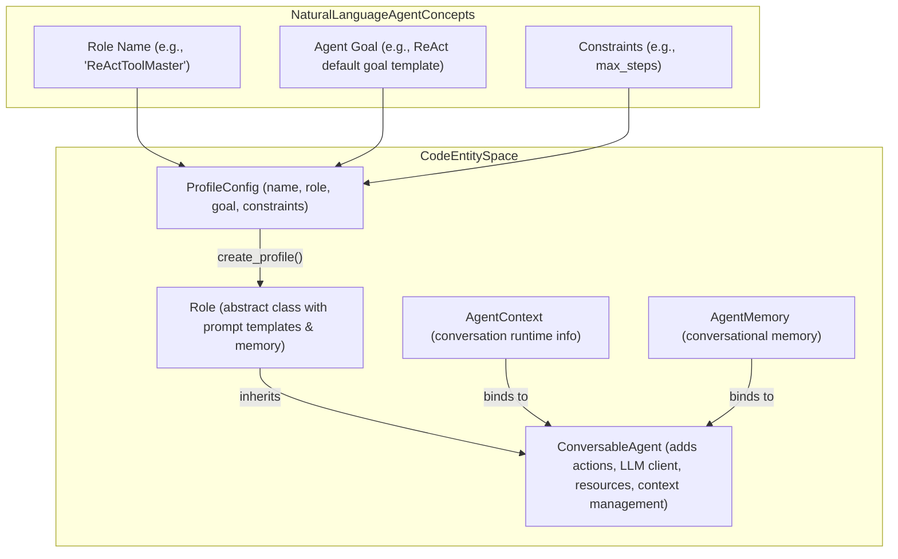
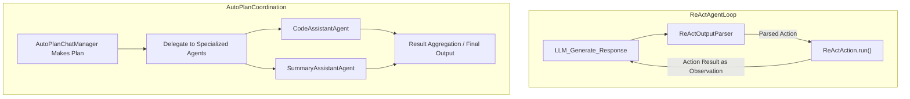
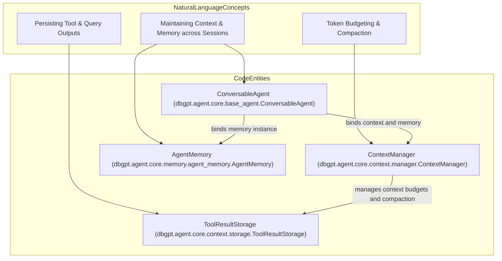

<!-- source: DeepWiki mcp.deepwiki.com · repo eosphoros-ai/DB-GPT · page 5.1 Agent Core: Roles, Actions & Planning · fetched 2026-10-26 -->

# Agent Core: Roles, Actions & Planning

Relevant source files

The following files were used as context for generating this wiki page:

- [configs/dbgpt-proxy-deepseek.toml](configs/dbgpt-proxy-deepseek.toml)
- [docs/docs/getting-started/providers/deepseek.md](docs/docs/getting-started/providers/deepseek.md)
- [docs/docs/getting-started/troubleshooting/llm.md](docs/docs/getting-started/troubleshooting/llm.md)
- [docs/docs/installation/advanced_usage/More_proxyllms.md](docs/docs/installation/advanced_usage/More_proxyllms.md)
- [docs/i18n/zh-CN/docusaurus-plugin-content-docs/current/getting-started/providers/deepseek.md](docs/i18n/zh-CN/docusaurus-plugin-content-docs/current/getting-started/providers/deepseek.md)
- [docs/i18n/zh-CN/docusaurus-plugin-content-docs/current/getting-started/troubleshooting/llm.md](docs/i18n/zh-CN/docusaurus-plugin-content-docs/current/getting-started/troubleshooting/llm.md)
- [examples/agents/auto_search_agent_example.py](examples/agents/auto_search_agent_example.py)
- [examples/agents/data_manus_example.py](examples/agents/data_manus_example.py)
- [examples/agents/db_create_example.py](examples/agents/db_create_example.py)
- [examples/agents/react_agent_example.py](examples/agents/react_agent_example.py)
- [packages/dbgpt-core/src/dbgpt/agent/core/action/base.py](packages/dbgpt-core/src/dbgpt/agent/core/action/base.py)
- [packages/dbgpt-core/src/dbgpt/agent/core/base_agent.py](packages/dbgpt-core/src/dbgpt/agent/core/base_agent.py)
- [packages/dbgpt-core/src/dbgpt/agent/core/context/__init__.py](packages/dbgpt-core/src/dbgpt/agent/core/context/__init__.py)
- [packages/dbgpt-core/src/dbgpt/agent/core/context/budget.py](packages/dbgpt-core/src/dbgpt/agent/core/context/budget.py)
- [packages/dbgpt-core/src/dbgpt/agent/core/context/compact.py](packages/dbgpt-core/src/dbgpt/agent/core/context/compact.py)
- [packages/dbgpt-core/src/dbgpt/agent/core/context/manager.py](packages/dbgpt-core/src/dbgpt/agent/core/context/manager.py)
- [packages/dbgpt-core/src/dbgpt/agent/core/memory/long_term.py](packages/dbgpt-core/src/dbgpt/agent/core/memory/long_term.py)
- [packages/dbgpt-core/src/dbgpt/agent/core/role.py](packages/dbgpt-core/src/dbgpt/agent/core/role.py)
- [packages/dbgpt-core/src/dbgpt/agent/expand/actions/insert_action.py](packages/dbgpt-core/src/dbgpt/agent/expand/actions/insert_action.py)
- [packages/dbgpt-core/src/dbgpt/agent/expand/actions/react_action.py](packages/dbgpt-core/src/dbgpt/agent/expand/actions/react_action.py)
- [packages/dbgpt-core/src/dbgpt/agent/expand/actions/tests/test_parallel_tool_action.py](packages/dbgpt-core/src/dbgpt/agent/expand/actions/tests/test_parallel_tool_action.py)
- [packages/dbgpt-core/src/dbgpt/agent/expand/actions/tests/test_tool_calling_agent.py](packages/dbgpt-core/src/dbgpt/agent/expand/actions/tests/test_tool_calling_agent.py)
- [packages/dbgpt-core/src/dbgpt/agent/expand/actions/tool_action.py](packages/dbgpt-core/src/dbgpt/agent/expand/actions/tool_action.py)
- [packages/dbgpt-core/src/dbgpt/agent/expand/actions/websearch_action.py](packages/dbgpt-core/src/dbgpt/agent/expand/actions/websearch_action.py)
- [packages/dbgpt-core/src/dbgpt/agent/expand/excel_table_agent.py](packages/dbgpt-core/src/dbgpt/agent/expand/excel_table_agent.py)
- [packages/dbgpt-core/src/dbgpt/agent/expand/react_agent.py](packages/dbgpt-core/src/dbgpt/agent/expand/react_agent.py)
- [packages/dbgpt-core/src/dbgpt/agent/expand/web_assistant_agent.py](packages/dbgpt-core/src/dbgpt/agent/expand/web_assistant_agent.py)
- [packages/dbgpt-core/src/dbgpt/agent/util/agent_errors.py](packages/dbgpt-core/src/dbgpt/agent/util/agent_errors.py)
- [packages/dbgpt-core/src/dbgpt/agent/util/llm/llm_client.py](packages/dbgpt-core/src/dbgpt/agent/util/llm/llm_client.py)
- [packages/dbgpt-core/src/dbgpt/agent/util/react_parser.py](packages/dbgpt-core/src/dbgpt/agent/util/react_parser.py)
- [packages/dbgpt-core/src/dbgpt/agent/util/tests/test_agent_errors.py](packages/dbgpt-core/src/dbgpt/agent/util/tests/test_agent_errors.py)
- [packages/dbgpt-core/src/dbgpt/agent/util/tests/test_react_parser.py](packages/dbgpt-core/src/dbgpt/agent/util/tests/test_react_parser.py)
- [packages/dbgpt-core/src/dbgpt/core/interface/prompt.py](packages/dbgpt-core/src/dbgpt/core/interface/prompt.py)
- [packages/dbgpt-core/src/dbgpt/model/cluster/base.py](packages/dbgpt-core/src/dbgpt/model/cluster/base.py)
- [packages/dbgpt-core/src/dbgpt/model/proxy/llms/deepseek.py](packages/dbgpt-core/src/dbgpt/model/proxy/llms/deepseek.py)
- [packages/dbgpt-core/src/dbgpt/model/proxy/tests/test_deepseek.py](packages/dbgpt-core/src/dbgpt/model/proxy/tests/test_deepseek.py)
- [packages/dbgpt-core/src/dbgpt/storage/graph_store/graph.py](packages/dbgpt-core/src/dbgpt/storage/graph_store/graph.py)
- [packages/dbgpt-ext/src/dbgpt_ext/storage/knowledge_graph/community/neo4j_store_adapter.py](packages/dbgpt-ext/src/dbgpt_ext/storage/knowledge_graph/community/neo4j_store_adapter.py)
- [packages/dbgpt-ext/src/dbgpt_ext/storage/knowledge_graph/community/tugraph_store_adapter.py](packages/dbgpt-ext/src/dbgpt_ext/storage/knowledge_graph/community/tugraph_store_adapter.py)
- [packages/dbgpt-serve/src/dbgpt_serve/agent/agents/expand/volatility_analysis_agent.py](packages/dbgpt-serve/src/dbgpt_serve/agent/agents/expand/volatility_analysis_agent.py)

The Agent Core in DB-GPT provides the foundational framework for creating autonomous and collaborative agents. It revolves around defining agent **Roles** that encapsulate identity, goals, and constraints, equipping agents with executable **Actions** (such as tool calls, chart generation, and data insertion), and employing various **Planning** paradigms including loop-driven ReAct reasoning, AutoPlan, and AWEL-layout multi-agent coordination.

---

## Base Architecture: Role & ConversableAgent

### Role Class

The `Role` class is an abstract base representing the identity and conversational persona of an agent. It encapsulates:

- A **`ProfileConfig`** containing configured metadata such as the agent's name, role, goals, constraints, and prompt templates [packages/dbgpt-core/src/dbgpt/agent/core/role.py:40-48]().
- An **`AgentMemory`** instance which stores the memory fragments of the conversation [packages/dbgpt-core/src/dbgpt/agent/core/role.py:49-49]().
- A **`SandboxedEnvironment`** from Jinja2 used for safely rendering prompt templates with dynamic variables [packages/dbgpt-core/src/dbgpt/agent/core/role.py:57-57]().

The class exposes properties dynamically reflecting the current profile's state, such as `name`, `role`, `goal`, `constraints`, and `expand_prompt`. Task progress is managed with an internal `_task_progress` list for multi-step operations, preserved across retries [packages/dbgpt-core/src/dbgpt/agent/core/role.py:59-62]().

Prompt building is performed by rendering either system or user templates with parameters including the current question, language, retry flags, and injected runtime variables [packages/dbgpt-core/src/dbgpt/agent/core/role.py:64-96]().

Key responsibilities:

- Store the conversational persona and config via `profile: ProfileConfig`.
- Manage memory fragments via `memory: AgentMemory`.
- Provide prompt template rendering using Jinja2 sandbox for system and user prompts.
- Track task progress internally during multi-step interaction.

_Primary code location_: `packages/dbgpt-core/src/dbgpt/agent/core/role.py:40-203`()

Sources:  
`packages/dbgpt-core/src/dbgpt/agent/core/role.py:40-203`()

---

### ConversableAgent Class

Building on `Role`, the `ConversableAgent` class adds operational semantics required for an interacting agent [packages/dbgpt-core/src/dbgpt/agent/core/base_agent.py:39-40](). Key responsibilities include:

- Managing **actions**: a list of executable `Action` instances describing capabilities such as tool invocation or data processing [packages/dbgpt-core/src/dbgpt/agent/core/base_agent.py:45-45]().
- Binding to **resources** like datasets or API toolkits [packages/dbgpt-core/src/dbgpt/agent/core/base_agent.py:46-46]().
- Holding an LLM client wrapper (`AIWrapper`) for interacting with large language models [packages/dbgpt-core/src/dbgpt/agent/core/base_agent.py:52-52]().
- Supporting multiple **run modes**, notably `AgentRunMode.LOOP` where the agent iteratively reasons and acts [packages/dbgpt-core/src/dbgpt/agent/core/base_agent.py:49-49]().
- Implementing **multi-layer context management** via a `ContextManager` which enforces token budget constraints and tool result persistence [packages/dbgpt-core/src/dbgpt/agent/core/base_agent.py:58-64]().
- Managing asynchronous execution via a thread pool executor or other executor implementation [packages/dbgpt-core/src/dbgpt/agent/core/base_agent.py:61-64]().
- Checking runtime availability including resource and action requirements [packages/dbgpt-core/src/dbgpt/agent/core/base_agent.py:146-173]().

Key features:

- An executor for asynchronous task running.
- `init_context_management()` to enable multi-layer context/budget management with persistent storage of tool results [packages/dbgpt-core/src/dbgpt/agent/core/base_agent.py:71-112]().
- `check_available()` enforcing preconditions such as resource availability and action registration [packages/dbgpt-core/src/dbgpt/agent/core/base_agent.py:146-173]().

_Primary code location_: `packages/dbgpt-core/src/dbgpt/agent/core/base_agent.py:39-173`()

Sources:  
`packages/dbgpt-core/src/dbgpt/agent/core/base_agent.py:39-173`()

---

### Agent Identity Mapping Diagram

This diagram maps the natural language agent concepts—such as named roles, goals, and constraints—to the core code entities (`ProfileConfig`, `Role`, `ConversableAgent`) that implement them.

Title: "Agent Identity and Concept Mapping"

Sources:  
`packages/dbgpt-core/src/dbgpt/agent/core/role.py:40-203`()  
`packages/dbgpt-core/src/dbgpt/agent/core/base_agent.py:39-114`()  
`packages/dbgpt-core/src/dbgpt/agent/expand/react_agent.py:100-119`()  

---

## Actions & Tool Execution

**Actions** form the operational building blocks of an agent's capabilities. An agent is configured with a list of `Action` instances that describe discrete functions it can invoke. These include tool calls, SQL chart generation, insert actions, and termination commands.

### Action Lifecycle & Types

- **Initialization**: Agents initialize their supported actions during construction, e.g. by calling `_init_actions()` with action classes [packages/dbgpt-core/src/dbgpt/agent/expand/react_agent.py:126-126]().
- **Execution**: Each action implements an asynchronous `run` method. This method takes the raw AI assistant message, parses parameters from the agent's reasoning output, and performs the concrete operation [packages/dbgpt-core/src/dbgpt/agent/expand/actions/react_action.py:134-141]().
- **Specialized Action Subclasses**:
  - `ToolAction`: Runs generic plugin tools from resource packs with JSON-based input parsing and fallback heuristics [packages/dbgpt-core/src/dbgpt/agent/expand/actions/tool_action.py:37-160]().
  - `ChartAction`: Executes SQL queries on database resources and renders resulting data as visual charts via the GPT-Vis protocol [packages/dbgpt-core/src/dbgpt/agent/expand/actions/chart_action.py:31-115]().
  - `Terminate`: Signals task completion or failure, outputting a final answer or reason [packages/dbgpt-core/src/dbgpt/agent/expand/actions/react_action.py:17-36]().
  - `ReActAction`: Specific to ReAct agent reasoning steps; it parses the structured ReAct output and executes the indicated action [packages/dbgpt-core/src/dbgpt/agent/expand/actions/react_action.py:108-173]().

### Key Action Classes Summary

| Class / Function   | Purpose                                              | File & Lines                              |
|--------------------|------------------------------------------------------|------------------------------------------|
| `Terminate`        | Signals end of task with final result or failure     | `packages/dbgpt-core/src/dbgpt/agent/expand/actions/react_action.py:17-36`()  |
| `ReActAction`      | Parses and executes ReAct reasoning steps            | `packages/dbgpt-core/src/dbgpt/agent/expand/actions/react_action.py:108-173`() |
| `ToolAction`       | Generic wrapper class for tool plugin actions        | `packages/dbgpt-core/src/dbgpt/agent/expand/actions/tool_action.py:37-160`()  |
| `ChartAction`      | Executes SQL on DBResource and formats chart outputs | `packages/dbgpt-core/src/dbgpt/agent/expand/actions/chart_action.py:31-116`() |
| `run_tool()`       | Executes a tool with argument parsing and fallbacks  | `packages/dbgpt-core/src/dbgpt/agent/expand/actions/tool_action.py:162-205`() |

Sources:  
`packages/dbgpt-core/src/dbgpt/agent/expand/react_agent.py:126-126`()  
`packages/dbgpt-core/src/dbgpt/agent/expand/actions/react_action.py:17-173`()  
`packages/dbgpt-core/src/dbgpt/agent/expand/actions/tool_action.py:37-205`()  
`packages/dbgpt-core/src/dbgpt/agent/expand/actions/chart_action.py:31-116`()  

---

### Action Execution Flow

When an agent receives a response from the LLM in the ReAct format, it uses `ReActOutputParser` to extract the current reasoning step, including `Thought`, `Phase`, `Action Intention`, `Action Reason`, `Action`, and `Action Input` [packages/dbgpt-core/src/dbgpt/agent/util/react_parser.py:33-46](). The agent will then:

1. Parse the action string and parameters from the LLM output [packages/dbgpt-core/src/dbgpt/agent/expand/actions/react_action.py:144-156]().
2. Identify the corresponding `Action` instance from its actions [packages/dbgpt-core/src/dbgpt/agent/expand/actions/react_action.py:157-159]().
3. Invoke the action's `run()` method asynchronously [packages/dbgpt-core/src/dbgpt/agent/expand/actions/react_action.py:157-157]().
4. Obtain an `ActionOutput` consisting of execution success, content, and optional visualization [packages/dbgpt-core/src/dbgpt/agent/expand/actions/react_action.py:32-36]().
5. Feed the result back as observation in subsequent reasoning iterations or to terminate the loop.

Sources:  
`packages/dbgpt-core/src/dbgpt/agent/expand/actions/react_action.py:17-173`()  
`packages/dbgpt-core/src/dbgpt/agent/expand/actions/tool_action.py:37-205`()  
`packages/dbgpt-core/src/dbgpt/agent/expand/actions/chart_action.py:31-116`()  
`packages/dbgpt-core/src/dbgpt/agent/util/react_parser.py:33-46`()  

---

## Planning Strategies

DB-GPT employs sophisticated agentic reasoning and planning mechanisms:

### 1. ReAct Agent & Output Parser

The `ReActAgent` embodies the classic "Reason + Act" loop:

- The agent's system prompt enforces strict response formatting where each output must contain one `Action` and an associated `Action Input` [packages/dbgpt-core/src/dbgpt/agent/expand/react_agent.py:33-78]().
- The prefix-based `ReActOutputParser` extracts individual structured reasoning steps safely, ignoring markdown fences or special tool calling tokens that may interfere with JSON parsing [packages/dbgpt-core/src/dbgpt/agent/util/react_parser.py:48-160]().

The planning loop is controlled by `AgentRunMode.LOOP`, iterating until reaching a terminal `Action: terminate` or hitting max retry counts [packages/dbgpt-core/src/dbgpt/agent/expand/react_agent.py:97-98]().

### 2. AutoPlan Coordination

`AutoPlanChatManager` implements higher-level plan construction and delegation, where a global task plan is drafted and split into subtasks. These subtasks are assigned to specialized subagents, such as code assistants or summary assistants, enabling modular and parallel workflows.

### 3. AWEL-Layout Multi-Agent Teams

AWEL (Agentic Workflow Expression Language) supports composing agents in DAG-based workflows with triggers, operators, and runners. This lets developers design complex, scalable multi-agent teams following declarative layouts. AWEL integrates retrieval, knowledge, and custom logic enabling enterprise-grade agent orchestration.

Sources:  
`packages/dbgpt-core/src/dbgpt/agent/expand/react_agent.py:33-98`()  
`packages/dbgpt-core/src/dbgpt/agent/util/react_parser.py:48-160`()  

---

### Planning Flow Diagram: ReAct vs AutoPlan

Title: "Agent Planning Strategies Data Flow"

Sources:  
`packages/dbgpt-core/src/dbgpt/agent/expand/react_agent.py:96-120`()  
`packages/dbgpt-core/src/dbgpt/agent/util/react_parser.py:48-205`()  

---

## Implementation Details: Context Management & Compaction

To support long-running interactive sessions and multi-step reasoning, DB-GPT agents are equipped with multi-layer context and memory management:

- **Multi-layer Context Manager**: Enabled via `ConversableAgent.init_context_management()`, it manages token budgets based on model limits, warning and error thresholds, and can push live context status events [packages/dbgpt-core/src/dbgpt/agent/core/base_agent.py:71-107](). It also supports multi-layered compaction strategies reducing context size while preserving important memory.

- **Tool Result Storage**: Persistent disk storage of bulky execution results (`ToolResultStorage`) is bound to an agent's conversation. It stores execution outputs separately from main chat memory, enabling efficient context token usage and retrieval for large history [packages/dbgpt-core/src/dbgpt/agent/core/base_agent.py:114-144]().

- **Context Compaction**: The `dbgpt.agent.core.context.compact` module contains implementations of memory summarization and fragment trimming, helping maintain essential information without exceeding LLM input limits.

Sources:  
`packages/dbgpt-core/src/dbgpt/agent/core/base_agent.py:71-144`()  

---

### Context Management & Memory Entities Mapping

Title: "Context Management and Memory Architecture"

Sources:  
`packages/dbgpt-core/src/dbgpt/agent/core/base_agent.py`()  
`packages/dbgpt-core/src/dbgpt/agent/core/context/manager.py`()  
`packages/dbgpt-core/src/dbgpt/agent/core/context/storage.py`()  
`packages/dbgpt-core/src/dbgpt/agent/core/memory/agent_memory.py`()  

---

## Summary

This section 5.1 provides a comprehensive technical walkthrough of DB-GPT’s agent core fundamentals:

- **Roles & ConversableAgents** define agent identity, goals, constraints, memory, and actions [packages/dbgpt-core/src/dbgpt/agent/core/role.py:40-48](), [packages/dbgpt-core/src/dbgpt/agent/core/base_agent.py:39-46]().
- **Actions** enable agents to invoke diverse capabilities — tools, SQL charting, insertions, and flow control (termination) [packages/dbgpt-core/src/dbgpt/agent/expand/actions/react_action.py:17-36](), [packages/dbgpt-core/src/dbgpt/agent/expand/actions/tool_action.py:37-59](), [packages/dbgpt-core/src/dbgpt/agent/expand/actions/chart_action.py:31-53]().
- **Planning** styles, especially the ReAct reasoning loop, AutoPlan multi-agent plans, and AWEL layout teams, orchestrate autonomous workflows [packages/dbgpt-core/src/dbgpt/agent/expand/react_agent.py:96-120]().
- **Context management & compaction** mechanisms ensure memory and interaction remain bounded within model token limits with robust persistent storage [packages/dbgpt-core/src/dbgpt/agent/core/base_agent.py:71-144]().

Together, these components form the foundational base for building powerful, interactive, and extensible autonomous agents in DB-GPT.

---

Sources Summary:  
- `packages/dbgpt-core/src/dbgpt/agent/core/role.py`()  
- `packages/dbgpt-core/src/dbgpt/agent/core/base_agent.py`()  
- `packages/dbgpt-core/src/dbgpt/agent/expand/react_agent.py`()  
- `packages/dbgpt-core/src/dbgpt/agent/expand/actions/react_action.py`()  
- `packages/dbgpt-core/src/dbgpt/agent/expand/actions/tool_action.py`()  
- `packages/dbgpt-core/src/dbgpt/agent/expand/actions/chart_action.py`()  
- `packages/dbgpt-core/src/dbgpt/agent/util/react_parser.py`()  
- `packages/dbgpt-core/src/dbgpt/agent/core/context/compact.py`()

---

