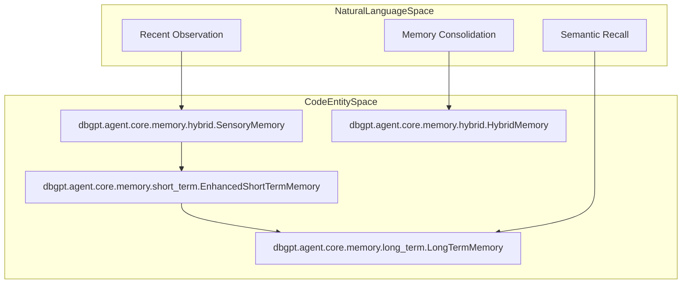
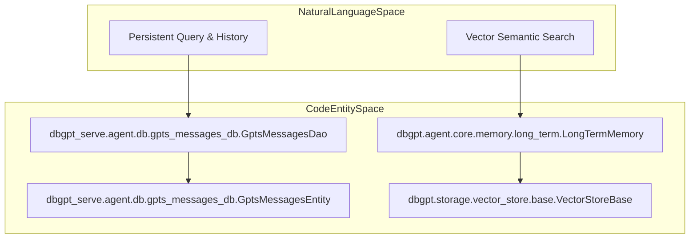

<!-- source: DeepWiki mcp.deepwiki.com · repo eosphoros-ai/DB-GPT · page 5.2 Agent Memory System · fetched 2026-10-26 -->

# Agent Memory System

Relevant source files

The following files were used as context for generating this wiki page:

- [docs/blog/2025-04-29-db-gpt-qwen3-support.md](docs/blog/2025-04-29-db-gpt-qwen3-support.md)
- [packages/dbgpt-app/src/dbgpt_app/openapi/api_v2.py](packages/dbgpt-app/src/dbgpt_app/openapi/api_v2.py)
- [packages/dbgpt-app/src/dbgpt_app/scene/chat_db/professional_qa/chat.py](packages/dbgpt-app/src/dbgpt_app/scene/chat_db/professional_qa/chat.py)
- [packages/dbgpt-client/src/dbgpt_client/schema.py](packages/dbgpt-client/src/dbgpt_client/schema.py)
- [packages/dbgpt-core/src/dbgpt/agent/core/memory/hybrid.py](packages/dbgpt-core/src/dbgpt/agent/core/memory/hybrid.py)
- [packages/dbgpt-core/src/dbgpt/agent/resource/base.py](packages/dbgpt-core/src/dbgpt/agent/resource/base.py)
- [packages/dbgpt-core/src/dbgpt/agent/resource/pack.py](packages/dbgpt-core/src/dbgpt/agent/resource/pack.py)
- [packages/dbgpt-core/src/dbgpt/agent/resource/tool/base.py](packages/dbgpt-core/src/dbgpt/agent/resource/tool/base.py)
- [packages/dbgpt-core/src/dbgpt/agent/resource/tool/pack.py](packages/dbgpt-core/src/dbgpt/agent/resource/tool/pack.py)
- [packages/dbgpt-core/src/dbgpt/agent/util/mcp_utils.py](packages/dbgpt-core/src/dbgpt/agent/util/mcp_utils.py)
- [packages/dbgpt-core/src/dbgpt/core/interface/media.py](packages/dbgpt-core/src/dbgpt/core/interface/media.py)
- [packages/dbgpt-core/src/dbgpt/core/interface/message.py](packages/dbgpt-core/src/dbgpt/core/interface/message.py)
- [packages/dbgpt-core/src/dbgpt/util/json_utils.py](packages/dbgpt-core/src/dbgpt/util/json_utils.py)
- [packages/dbgpt-core/src/dbgpt/vis/tags/vis_thinking.py](packages/dbgpt-core/src/dbgpt/vis/tags/vis_thinking.py)
- [packages/dbgpt-serve/src/dbgpt_serve/agent/agents/controller.py](packages/dbgpt-serve/src/dbgpt_serve/agent/agents/controller.py)
- [packages/dbgpt-serve/src/dbgpt_serve/agent/agents/db_gpts_memory.py](packages/dbgpt-serve/src/dbgpt_serve/agent/agents/db_gpts_memory.py)
- [packages/dbgpt-serve/src/dbgpt_serve/agent/chat/tests/test_gpts_messages_db.py](packages/dbgpt-serve/src/dbgpt_serve/agent/chat/tests/test_gpts_messages_db.py)
- [packages/dbgpt-serve/src/dbgpt_serve/agent/db/gpts_app.py](packages/dbgpt-serve/src/dbgpt_serve/agent/db/gpts_app.py)
- [packages/dbgpt-serve/src/dbgpt_serve/agent/db/gpts_conversations_db.py](packages/dbgpt-serve/src/dbgpt_serve/agent/db/gpts_conversations_db.py)
- [packages/dbgpt-serve/src/dbgpt_serve/agent/db/gpts_messages_db.py](packages/dbgpt-serve/src/dbgpt_serve/agent/db/gpts_messages_db.py)
- [packages/dbgpt-serve/src/dbgpt_serve/agent/resource/mcp.py](packages/dbgpt-serve/src/dbgpt_serve/agent/resource/mcp.py)
- [packages/dbgpt-serve/src/dbgpt_serve/conversation/api/endpoints.py](packages/dbgpt-serve/src/dbgpt_serve/conversation/api/endpoints.py)
- [packages/dbgpt-serve/src/dbgpt_serve/conversation/api/schemas.py](packages/dbgpt-serve/src/dbgpt_serve/conversation/api/schemas.py)
- [packages/dbgpt-serve/src/dbgpt_serve/conversation/models/models.py](packages/dbgpt-serve/src/dbgpt_serve/conversation/models/models.py)
- [packages/dbgpt-serve/src/dbgpt_serve/datasource/manages/connect_config_db.py](packages/dbgpt-serve/src/dbgpt_serve/datasource/manages/connect_config_db.py)

The DB-GPT Agent Memory System provides a layered memory architecture for multi-agent workflows, managing short-term, long-term, hybrid, and LLM-driven memory components. It supports persistent chat history storage via relational databases, semantic vector retrieval, conversation context binding, and memory consolidation across sessions.

Sources: [packages/dbgpt-core/src/dbgpt/agent/core/memory/hybrid.py:31-65](), [packages/dbgpt-serve/src/dbgpt_serve/agent/agents/controller.py:97-100]()

---

## Memory Architecture Overview

The subsystem models cognitive memory layers using specialized abstractions to optimize agent context retention and retrieval performance.

| Memory Layer | Description | Key Code Entities |
| --- | --- | --- |
| **Sensory Memory** | Buffers raw conversational inputs or observations temporarily before processing or discarding. | `SensoryMemory` [packages/dbgpt-core/src/dbgpt/agent/core/memory/hybrid.py:22]() |
| **Short-Term Memory** | Holds recent conversational context within a sliding buffer window, integrating embeddings and thread executors. | `EnhancedShortTermMemory` [packages/dbgpt-core/src/dbgpt/agent/core/memory/hybrid.py:137-138]() |
| **Long-Term Memory** | Persistent vector store-backed memory for semantic retrieval and long-range information persistence. | `LongTermMemory` [packages/dbgpt-core/src/dbgpt/agent/core/memory/hybrid.py:139-143]() |
| **Hybrid Memory** | Coordinates sensory, short-term, and long-term memory components with write-through consolidation routines. | `HybridMemory` [packages/dbgpt-core/src/dbgpt/agent/core/memory/hybrid.py:31-65]() |
| **GPTs Memory Store** | Manages persistent conversation records, agent messaging history, and execution plans in the backend database. | `GptsMemory`, `MetaDbGptsMessageMemory`, `MetaDbGptsPlansMemory` [packages/dbgpt-serve/src/dbgpt_serve/agent/agents/controller.py:51-100]() |

Sources: [packages/dbgpt-core/src/dbgpt/agent/core/memory/hybrid.py:31-65](), [packages/dbgpt-serve/src/dbgpt_serve/agent/agents/controller.py:51-100]()

---

## Data Flow and Memory Consolidation

Memory data flows through multiple cognitive stages, moving from immediate sensory buffering to structured short-term and consolidated long-term stores.

### Writing and Consolidation Flow

1. **Sensory Ingestion**: Incoming user queries or observations are temporarily received by `SensoryMemory` [packages/dbgpt-core/src/dbgpt/agent/core/memory/hybrid.py:177-185]().
2. **Short-Term Buffering**: Context fragments pass into `EnhancedShortTermMemory`, where vector embeddings are computed and recent turns are maintained within a bounded buffer window (`buffer_size`) [packages/dbgpt-serve/src/dbgpt_serve/agent/agents/controller.py:150-152]().
3. **Long-Term Consolidation**: Utilizing LLM evaluation components (`ImportanceScorer`, `InsightExtractor`), critical fragments are indexed and committed to vector persistence layers managed by `LongTermMemory` [packages/dbgpt-core/src/dbgpt/agent/core/memory/hybrid.py:42-43,139-143]().
4. **Hybrid Orchestration**: `HybridMemory` coordinates read/write operations across all layers, providing a unified access point for agents [packages/dbgpt-core/src/dbgpt/agent/core/memory/hybrid.py:177-189]().

### Diagram: Natural Language Space to Code Entity Space (Memory Flow)

Sources: [packages/dbgpt-core/src/dbgpt/agent/core/memory/hybrid.py:31-189](), [packages/dbgpt-serve/src/dbgpt_serve/agent/agents/controller.py:150-161]()

---

## Technical Implementation Details

### `HybridMemory` Initialization and Assembly

`HybridMemory` can be instantiated directly or through factories like `HybridMemory.from_vstore()` or `HybridMemory.from_chroma()` [packages/dbgpt-core/src/dbgpt/agent/core/memory/hybrid.py:70-144](). In multi-agent services (e.g., `MultiAgents`), hybrid memory instances are dynamically configured per conversation or application scope using vector store collections (`agent_memory_long_term`) and embedding factories [packages/dbgpt-serve/src/dbgpt_serve/agent/agents/controller.py:136-161]().

Sources: [packages/dbgpt-core/src/dbgpt/agent/core/memory/hybrid.py:70-144](), [packages/dbgpt-serve/src/dbgpt_serve/agent/agents/controller.py:136-161]()

### Persistent Chat History: `GptsMessagesDao`

Conversation messaging is backed by SQLAlchemy models defined in `GptsMessagesEntity` and managed via `GptsMessagesDao` [packages/dbgpt-serve/src/dbgpt_serve/agent/db/gpts_messages_db.py:29-143]().

Key implementation characteristics include:
- **Large Text Support**: Employs database-specific types, mapping `content` and `action_report` to `LONGTEXT` on MySQL while retaining portable `TEXT` types on SQLite and PostgreSQL [packages/dbgpt-serve/src/dbgpt_serve/agent/db/gpts_messages_db.py:26]().
- **Traceability**: Links individual message turns to distributed tracing spans via `trace_id` [packages/dbgpt-serve/src/dbgpt_serve/agent/db/gpts_messages_db.py:78-83]().
- **Custom Querying**: Supports retrieving messages by agent or conversation ID (`conv_id`), parsing numeric suffixes and dialogue rounds to maintain chronological integrity [packages/dbgpt-serve/src/dbgpt_serve/agent/db/gpts_messages_db.py:145-172]().

### Diagram: Natural Language Space to Code Entity Space (Storage & Retrieval)

Sources: [packages/dbgpt-core/src/dbgpt/agent/core/memory/long_term.py](), [packages/dbgpt-serve/src/dbgpt_serve/agent/db/gpts_messages_db.py:29-172]()

---

## Conversation Binding and Chat History Persistence

### Conversation Context Binding

Conversations are tracked using a unique identifier (`conv_id`). To handle multi-turn sub-discussions or delegated agent tasks, conversation identifiers support numeric suffix parsing (e.g., `conv_id_1`, `conv_id_2`) [packages/dbgpt-serve/src/dbgpt_serve/agent/db/gpts_messages_db.py:164-168](). This binding ensures that agents inherit precise conversational context and state boundaries during execution.

### `GptsMemory` Integration

The `GptsMemory` class encapsulates storage for plans and message histories (`MetaDbGptsMessageMemory` and `MetaDbGptsPlansMemory`), linking runtime agent decisions back to database entities [packages/dbgpt-serve/src/dbgpt_serve/agent/agents/controller.py:51-100](). This dual-store setup guarantees that both structured execution plans and unstructured dialogue histories persist across system restarts.

Sources: [packages/dbgpt-serve/src/dbgpt_serve/agent/agents/controller.py:51-100](), [packages/dbgpt-serve/src/dbgpt_serve/agent/db/gpts_messages_db.py:145-182]()

---

