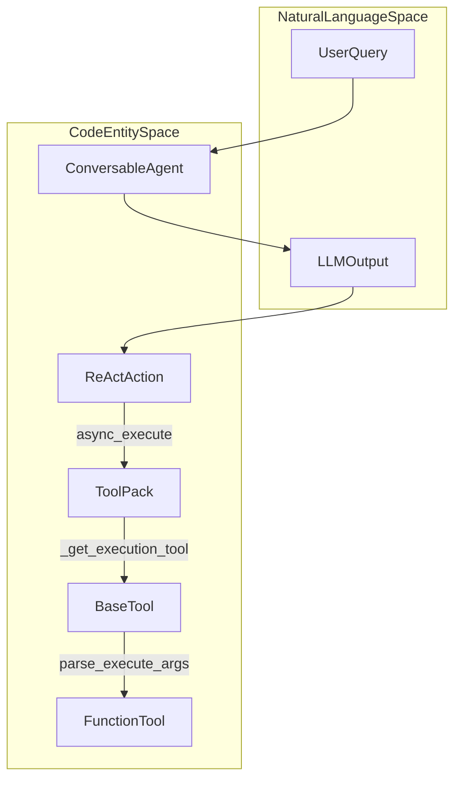
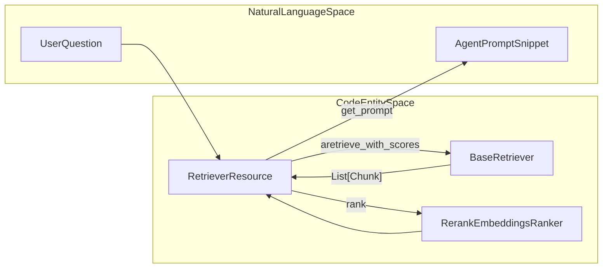

<!-- source: DeepWiki mcp.deepwiki.com · repo eosphoros-ai/DB-GPT · page 5.3 Agent Resources: Tools, Knowledge & MCP · fetched 2026-10-26 -->

# Agent Resources: Tools, Knowledge & MCP

Relevant source files

The following files were used as context for generating this wiki page:

- [packages/dbgpt-core/src/dbgpt/agent/core/memory/hybrid.py](packages/dbgpt-core/src/dbgpt/agent/core/memory/hybrid.py)
- [packages/dbgpt-core/src/dbgpt/agent/resource/base.py](packages/dbgpt-core/src/dbgpt/agent/resource/base.py)
- [packages/dbgpt-core/src/dbgpt/agent/resource/knowledge.py](packages/dbgpt-core/src/dbgpt/agent/resource/knowledge.py)
- [packages/dbgpt-core/src/dbgpt/agent/resource/pack.py](packages/dbgpt-core/src/dbgpt/agent/resource/pack.py)
- [packages/dbgpt-core/src/dbgpt/agent/resource/tool/base.py](packages/dbgpt-core/src/dbgpt/agent/resource/tool/base.py)
- [packages/dbgpt-core/src/dbgpt/agent/resource/tool/pack.py](packages/dbgpt-core/src/dbgpt/agent/resource/tool/pack.py)
- [packages/dbgpt-core/src/dbgpt/agent/util/mcp_utils.py](packages/dbgpt-core/src/dbgpt/agent/util/mcp_utils.py)
- [packages/dbgpt-core/src/dbgpt/util/dbgpts/repo.py](packages/dbgpt-core/src/dbgpt/util/dbgpts/repo.py)
- [packages/dbgpt-core/src/dbgpt/util/json_utils.py](packages/dbgpt-core/src/dbgpt/util/json_utils.py)
- [packages/dbgpt-core/src/dbgpt/util/tests/test_dbgpts_repo.py](packages/dbgpt-core/src/dbgpt/util/tests/test_dbgpts_repo.py)
- [packages/dbgpt-serve/src/dbgpt_serve/agent/agents/controller.py](packages/dbgpt-serve/src/dbgpt_serve/agent/agents/controller.py)
- [packages/dbgpt-serve/src/dbgpt_serve/agent/resource/mcp.py](packages/dbgpt-serve/src/dbgpt_serve/agent/resource/mcp.py)

## Purpose and Scope
This page details the agent resource abstraction layer in DB-GPT (`packages/dbgpt-core/src/dbgpt/agent/resource/`), which encapsulates external components, knowledge bases, structured databases, tools, applications, and remote Model Context Protocol (MCP) servers. The architecture provides a unified interface (`Resource`) for uniform management, prompt injection, and execution across heterogeneous capability types utilized by multi-agent workflows.

---

## 1. Resource Abstraction Layer

All agent resources inherit from the generic `Resource` base class (`[packages/dbgpt-core/src/dbgpt/agent/resource/base.py:90-120]()`), establishing a consistent contract for resource identification, parameter schema mapping (`ResourceParameters`), prompt generation (`get_prompt`), and asynchronous execution (`async_execute`). Resources are classified via the `ResourceType` enumeration (`[packages/dbgpt-core/src/dbgpt/agent/resource/base.py:40-59]()`).

- `ResourceType` defines concrete types including `Tool`, `Knowledge`, `DB`, `App`, `Connector`, and composite containers (`Pack`).
- Composite resources aggregate multiple underlying resources using `ResourcePack` (`[packages/dbgpt-core/src/dbgpt/agent/resource/pack.py:21-42]()`), allowing recursive traversal and batch prompt aggregation.

Sources: `[packages/dbgpt-core/src/dbgpt/agent/resource/base.py:40-120]()`, `[packages/dbgpt-core/src/dbgpt/agent/resource/pack.py:21-42]()`

---

## 2. Tools and ToolPack

### Tool Representation and Execution
Executable capabilities are represented via `BaseTool` (`[packages/dbgpt-core/src/dbgpt/agent/resource/tool/base.py:64-81]()`) and instantiated as either explicit tool subclasses or function wrappers (`FunctionTool`, `[packages/dbgpt-core/src/dbgpt/agent/resource/tool/base.py:140-166]()`) that inspect docstrings and type annotations to generate structured parameter schemas (`ToolParameter`).

### ToolPack Container
`ToolPack` extends `ResourcePack` (`[packages/dbgpt-core/src/dbgpt/agent/resource/tool/pack.py:79-88]()`) to aggregate tool collections:
- Normalizes heterogeneous inputs (single tools, callables, or nested packs) into a flat list of `BaseTool` instances (`[packages/dbgpt-core/src/dbgpt/agent/resource/tool/pack.py:37-67]()`).
- Provides legacy command registration (`add_command`) for backward compatibility with plugin ecosystems (`[packages/dbgpt-core/src/dbgpt/agent/resource/tool/pack.py:103-163]()`).
- Implements `parse_execute_args` to deserialize raw LLM strings into typed Python positional and keyword arguments (`[packages/dbgpt-core/src/dbgpt/agent/resource/tool/pack.py:180-185]()`).

### Diagram: Tool Execution Flow

*Figure 1: Bridging natural language tool selection to concrete Python execution via `ToolPack` and `FunctionTool`.*

Sources: `[packages/dbgpt-core/src/dbgpt/agent/resource/tool/pack.py:37-185]()`, `[packages/dbgpt-core/src/dbgpt/agent/resource/tool/base.py:64-180]()`

---

## 3. Knowledge Resources

`RetrieverResource` (`[packages/dbgpt-core/src/dbgpt/agent/resource/knowledge.py:30-35]()`) abstracts vector retrieval and knowledge bases for agents.

### Implementation Details
- Wraps a `BaseRetriever` implementation to perform asynchronous semantic search via `aretrieve_with_scores` (`[packages/dbgpt-core/src/dbgpt/agent/resource/knowledge.py:169-185]()`).
- Conditionally applies a reranking stage using `RerankEmbeddingsRanker` when system configuration specifies rerankers (`[packages/dbgpt-core/src/dbgpt/agent/resource/knowledge.py:41-50]()`).
- Formats retrieved chunks into localized system prompts (`get_prompt`) and compiles citation metadata dictionaries (`_get_references`) for UI traceability (`[packages/dbgpt-core/src/dbgpt/agent/resource/knowledge.py:83-161]()`).

### Diagram: Knowledge Retriever Flow

*Figure 2: Data flow from natural language query through `RetrieverResource`, vector retrieval, and reranking to agent prompt context.*

Sources: `[packages/dbgpt-core/src/dbgpt/agent/resource/knowledge.py:30-185]()`

---

## 4. Database & Application Resources

- **Database Resources (`DBResource`)**: Expose database schemas and support structured SQL execution pipelines through database connectors.
- **Application Resources (`GptAppResource`)**: Encapsulate DB-GPT applications and AWEL workflows, allowing agents to invoke nested multi-agent apps or structured task graphs (`[packages/dbgpt-serve/src/dbgpt_serve/agent/resource/app.py]()`).

Sources: `[packages/dbgpt-serve/src/dbgpt_serve/agent/resource/app.py]()`

---

## 5. Model Context Protocol (MCP) Integration

DB-GPT integrates with external tool servers adhering to the Model Context Protocol (MCP) over Server-Sent Events (SSE).

### MCPSSEToolPack
- `MCPSSEToolPack` (`[packages/dbgpt-serve/src/dbgpt_serve/agent/resource/mcp.py:50-52]()`) manages SSE-based connections to remote MCP servers.
- Handles authorization headers, Bearer tokens, custom SSL CA contexts, and transport-level configuration via `sse_client` (`[packages/dbgpt-core/src/dbgpt/agent/util/mcp_utils.py:25-31]()`).

Sources: `[packages/dbgpt-serve/src/dbgpt_serve/agent/resource/mcp.py:50-145]`, `[packages/dbgpt-core/src/dbgpt/agent/util/mcp_utils.py:25-60]()`

---

## 6. Resource Manager and Plugin Hub

The resource plugin hub manages dynamic loading and packaging of external extensions.
- Utilizes `_build_package` and `_install_wheel` utilities to build and install tool packs and plugins from repositories (`[packages/dbgpt-core/src/dbgpt/util/dbgpts/repo.py:87-146]()`).
- Registers providers during system initialization into the global `SystemApp` dependency container.

Sources: `[packages/dbgpt-core/src/dbgpt/util/dbgpts/repo.py:87-210]()`

---

## 7. JSON Utilities and Parsing Robustness

LLM tool outputs often contain unstructured text around JSON payloads. DB-GPT provides dedicated parsing routines (`[packages/dbgpt-core/src/dbgpt/util/json_utils.py:50-105]()`):
- `find_json_objects` scans raw output strings to isolate valid JSON structures with nested bracket and escape handling (`[packages/dbgpt-core/src/dbgpt/util/json_utils.py:50-95]()`).
- `parse_or_raise_error` parses extracted objects and raises precise decoding errors for agent feedback loops (`[packages/dbgpt-core/src/dbgpt/util/json_utils.py:98-105]()`).

Sources: `[packages/dbgpt-core/src/dbgpt/util/json_utils.py:50-105]()`

---

