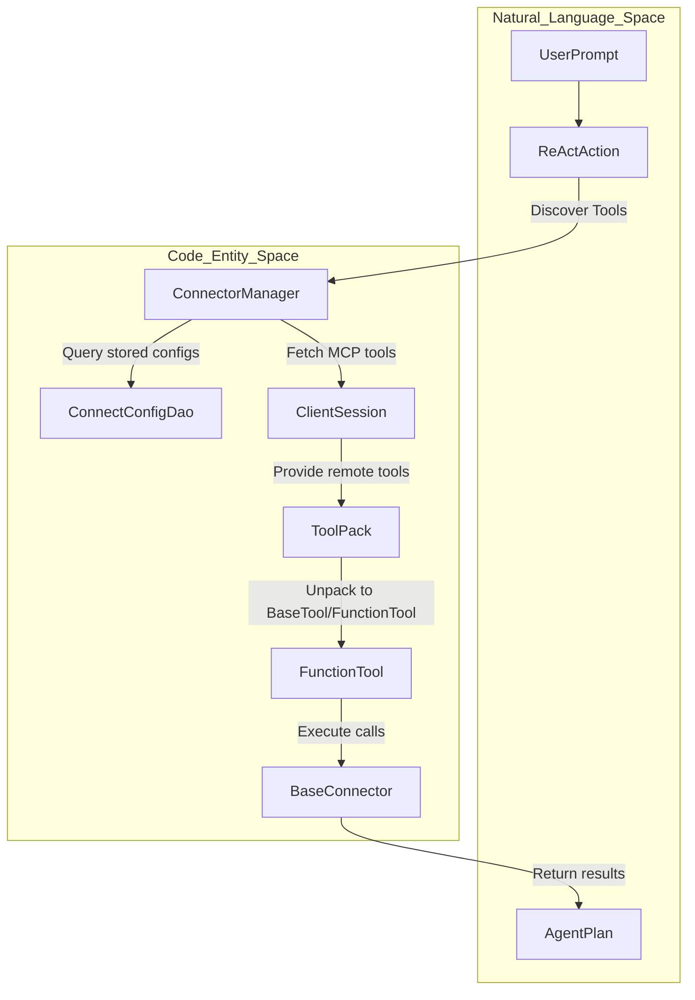
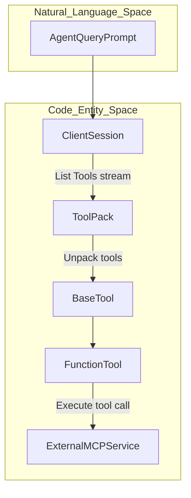
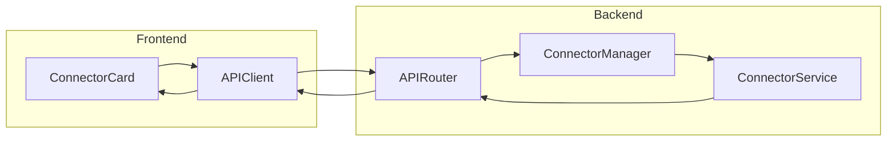

<!-- source: DeepWiki mcp.deepwiki.com · repo eosphoros-ai/DB-GPT · page 5.5 Connector & External Integration Manager · fetched 2026-10-26 -->

# Connector & External Integration Manager

Relevant source files

The following files were used as context for generating this wiki page:

- [docs/docs/application/mcp_connectors.md](docs/docs/application/mcp_connectors.md)
- [docs/i18n/zh-CN/docusaurus-plugin-content-docs/current/application/mcp_connectors.md](docs/i18n/zh-CN/docusaurus-plugin-content-docs/current/application/mcp_connectors.md)
- [packages/dbgpt-ext/src/dbgpt_ext/connector/catalog.json](packages/dbgpt-ext/src/dbgpt_ext/connector/catalog.json)
- [packages/dbgpt-serve/src/dbgpt_serve/connector/api/endpoints.py](packages/dbgpt-serve/src/dbgpt_serve/connector/api/endpoints.py)
- [packages/dbgpt-serve/src/dbgpt_serve/connector/tests/test_endpoints.py](packages/dbgpt-serve/src/dbgpt_serve/connector/tests/test_endpoints.py)
- [web/new-components/connector/ConnectorCard.tsx](web/new-components/connector/ConnectorCard.tsx)
- [web/public/icons/connectors/keenable.svg](web/public/icons/connectors/keenable.svg)

The **Connector & External Integration Manager** subsystem in DB-GPT coordinates external integrations with diverse data sources, relational databases, analytical stores, and external services. It handles the complete lifecycle of connectors—including creation, caching, concurrent access control via locks, credential storage, configuration persistence, tool discovery, and execution. It also integrates with Model Context Protocol (MCP) servers for dynamic exposure of remote tool packs.

This subsystem unifies access to relational databases, graph stores, MCP servers, and other external resources, enabling agents to dynamically discover, invoke, and execute external tools. The Connectors UI page is backed by this manager, facilitating administration and interactive configuration for end users.

---

## Architecture & Data Flow

The connector subsystem acts as a bridge mapping natural language agent intents to concrete external systems by maintaining catalogs of connectors, persistent credential stores, and cached connector instances for efficient reuse.

### Connector Subsystem Architecture

- Agents interpret user natural language into execution plans that may call external APIs or databases.
- `ConnectorManager` coordinates these operations: it queries internal datasource configs and uses `ClientSession` to fetch MCP server tool packs [packages/dbgpt-serve/src/dbgpt_serve/datasource/manages/connector_manager.py:30-112]() [packages/dbgpt-serve/src/dbgpt_serve/datasource/manages/connect_config_db.py]().
- Remote and local tools are wrapped as `ToolPack` and `FunctionTool` resources, which can be invoked seamlessly.
- The manager provides tool discovery, lifecycle management, and thread-safe concurrency control for connector instantiation.

Sources:  
- [packages/dbgpt-serve/src/dbgpt_serve/datasource/manages/connector_manager.py:30-112]()  
- [packages/dbgpt-serve/src/dbgpt_serve/datasource/manages/connect_config_db.py]()  

---

## ConnectorManager: Core Implementation & Lifecycle

### Class Overview

`ConnectorManager` inherits from `BaseComponent`, implementing connector lifecycle management and registered under component registries [packages/dbgpt-serve/src/dbgpt_serve/datasource/manages/connector_manager.py:30-34]().

Key responsibilities include:
- Managing a connector catalog that enumerates supported connector types and metadata (including templates like Feishu, DingTalk, GitHub, Notion, Tavily, Keenable, and DeepWiki) [packages/dbgpt-ext/src/dbgpt_ext/connector/catalog.json:1-94]().
- Persisting and retrieving connector configurations from SQLAlchemy-backed stores [packages/dbgpt-serve/src/dbgpt_serve/datasource/manages/connect_config_db.py]().
- Securely storing and resolving credential fields (such as tokens with `bearer`, `token`, or `none` auth types) [packages/dbgpt-serve/src/dbgpt_serve/connector/api/endpoints.py:100-158]().
- Creating live connector instances (`BaseConnector` subclasses) with thread-safe caching [packages/dbgpt-serve/src/dbgpt_serve/datasource/manages/connector_manager.py:66-112]().
- Integrating with MCP servers for dynamic tool discovery.

### Initialization & Connector Discovery

- During initialization (`on_init`), the manager dynamically imports and registers connector classes across RDBMS, analytical, and graph categories [packages/dbgpt-serve/src/dbgpt_serve/datasource/manages/connector_manager.py:66-112]() [packages/dbgpt_ext/src/dbgpt_ext/datasource/schema.py:17-38]().
- It exposes a catalog via `/api/v1/connector/types` containing connector type metadata, parameter schemas, and labels to frontend UI layers and API clients [packages/dbgpt-serve/src/dbgpt_serve/connector/api/endpoints.py:161-193]().

### Caching & Concurrency Control

- Connector creation involves expensive operations and database schema reflection calls.
- To optimize, `ConnectorManager` maintains an internal cache (`_connector_cache`) keyed by database name with a time-to-live (`_CONNECTOR_CACHE_DEFAULT_TTL` set to 1800 seconds) [packages/dbgpt-serve/src/dbgpt_serve/datasource/manages/connector_manager.py:35-53]().
- To prevent race conditions when multiple concurrent requests attempt to instantiate the same cold connector, a per-database creation lock dictionary (`_connector_creation_locks`) serializes initialization [packages/dbgpt-serve/src/dbgpt_serve/datasource/manages/connector_manager.py:50-57]().

Sources:  
- [packages/dbgpt-ext/src/dbgpt_ext/connector/catalog.json:1-94]()  
- [packages/dbgpt-serve/src/dbgpt_serve/datasource/manages/connector_manager.py:30-112]()  
- [packages/dbgpt-serve/src/dbgpt_serve/connector/api/endpoints.py:100-193]()  
- [packages/dbgpt_ext/src/dbgpt_ext/datasource/schema.py:17-38]()  

---

## MCP Server Integration & Tool Discovery

DB-GPT supports integration with external Model Context Protocol (MCP) servers using transports such as Server-Sent Events (`sse`) and `streamable_http`, broadening agent capabilities with remote tools.

### MCP Tool Discovery Flow

- `ClientSession` opens streaming connections to MCP servers and fetches remote tool definitions [packages/dbgpt-core/src/dbgpt/agent/util/mcp_utils.py:20-140]().
- Built-in templates like Keenable Search (`https://api.keenable.ai/mcp`) or GitHub expose tools like `search_web_pages`, `fetch_page_content`, or issue management tools which are wrapped into `ToolPack` and associated `BaseTool`/`FunctionTool` objects [packages/dbgpt-ext/src/dbgpt_ext/connector/catalog.json:1-94]() [packages/dbgpt-core/src/dbgpt/agent/resource/tool/pack.py:15-185]() [packages/dbgpt-core/src/dbgpt/agent/resource/tool/base.py:60-209]().
- Agents invoke `FunctionTool.execute`, which sends requests to the external MCP service. Write actions (such as create/update/delete) trigger confirmation checkpoints via human-in-the-loop flows.

Sources:  
- [packages/dbgpt-ext/src/dbgpt_ext/connector/catalog.json:1-94]()  
- [packages/dbgpt-serve/src/dbgpt_serve/datasource/manages/connector_manager.py:30-112]()  
- [packages/dbgpt-core/src/dbgpt/agent/resource/tool/pack.py:15-185]()  
- [packages/dbgpt-core/src/dbgpt/agent/util/mcp_utils.py:20-140]()  

---

## Connector Tool Lifecycle: Create, Test, Delete

### Creation & Update

- Connectors are created and updated through REST API endpoints defined in `dbgpt_serve.connector.api.endpoints` backed by `ConnectorService` and `ConnectorManager` [packages/dbgpt-serve/src/dbgpt_serve/connector/api/endpoints.py:195-205]() [packages/dbgpt-serve/src/dbgpt_serve/datasource/service/service.py:101-196]().
- The service validates parameters, persists configuration via database DAOs, and handles encryption for tokens/credentials at rest.
- API key validation checks are enforced via `check_api_key` using HTTP Bearer tokens when configured [packages/dbgpt-serve/src/dbgpt_serve/connector/api/endpoints.py:55-98]() [packages/dbgpt-serve/src/dbgpt_serve/connector/tests/test_endpoints.py:58-93]().

### Connection Testing

- During creation or update, connectivity can be tested by instantiating the connector and verifying transport health or database engine binding.
- If a server or connection is offline at startup, the connector status reflects the error state (e.g., `needs_reactivation` or `error`), allowing users to re-test directly from the Connectors UI card.

Sources:  
- [packages/dbgpt-serve/src/dbgpt_serve/connector/api/endpoints.py:55-205]()  
- [packages/dbgpt-serve/src/dbgpt_serve/connector/tests/test_endpoints.py:58-93]()  
- [packages/dbgpt-serve/src/dbgpt_serve/datasource/service/service.py:101-196]()  

---

## Connectors UI Page & Frontend Metadata

### UI-Backend Data Flow

- The frontend presents connector templates (such as Feishu, DingTalk, Yuque, GitHub, Notion, Linear, Tavily, Keenable, DeepWiki) and custom MCP servers using distinct brand styling and cards in `ConnectorCard.tsx` [web/new-components/connector/ConnectorCard.tsx:1-120]().
- Users can filter by status (`active`, `needs_reactivation`, `error`, `disconnected`), inspect tool definitions via `ConnectorToolsModal`, and attach specific connectors per conversation composer session.

Sources:  
- [web/new-components/connector/ConnectorCard.tsx:1-120]()  
- [packages/dbgpt-serve/src/dbgpt_serve/connector/api/endpoints.py:161-193]()  

---

## Summary Table: Key Connector & Integration Classes

| Component / Class             | Role & Description                                                     | File & Lines                                      |
|------------------------------|------------------------------------------------------------------------|--------------------------------------------------|
| `ConnectorManager`            | Manages connector lifecycle, caching, concurrency, and supported types | `packages/dbgpt-serve/src/dbgpt_serve/datasource/manages/connector_manager.py:30-171` |
| `ConnectorService`            | Business logic for connector CRUD, test, and execution management     | `packages/dbgpt-serve/src/dbgpt_serve/datasource/service/service.py:35-164` |
| `Router` (`endpoints.py`)     | REST API routes for connector management, types, and pending confirms   | `packages/dbgpt-serve/src/dbgpt_serve/connector/api/endpoints.py:26-205` |
| `ClientSession`               | MCP client streaming session for fetching remote tool packs            | `packages/dbgpt-core/src/dbgpt/agent/util/mcp_utils.py:20-140` |
| `ToolPack`                   | Pack of resources (tools) returned from MCP or connector enumeration    | `packages/dbgpt-core/src/dbgpt/agent/resource/tool/pack.py:79-185` |
| `BaseTool` and `FunctionTool`| Tool abstraction for individual callable tools                         | `packages/dbgpt-core/src/dbgpt/agent/resource/tool/base.py:60-209` |
| `ConnectorCard`              | Frontend UI component rendering connector templates and instances     | `web/new-components/connector/ConnectorCard.tsx:1-175` |

Sources:  
- [packages/dbgpt-serve/src/dbgpt_serve/datasource/manages/connector_manager.py:30-171]()  
- [packages/dbgpt-serve/src/dbgpt_serve/datasource/service/service.py:35-164]()  
- [packages/dbgpt-serve/src/dbgpt_serve/connector/api/endpoints.py:26-205]()  
- [web/new-components/connector/ConnectorCard.tsx:1-175]()  

---

# Appendices: Connector-Related Components and Utilities

- The connector catalog (`catalog.json`) defines built-in integrations, their default transport protocols (`sse` or `streamable_http`), and confirmation actions required for write operations [packages/dbgpt-ext/src/dbgpt_ext/connector/catalog.json:1-94]().
- Endpoint security tests in `test_endpoints.py` verify API key authentication enforcement for sensitive operations like listing pending confirmations and approvals [packages/dbgpt-serve/src/dbgpt_serve/connector/tests/test_endpoints.py:58-122]().

Sources:  
- [packages/dbgpt-ext/src/dbgpt_ext/connector/catalog.json:1-94]()  
- [packages/dbgpt-serve/src/dbgpt_serve/connector/tests/test_endpoints.py:58-122]()

---

