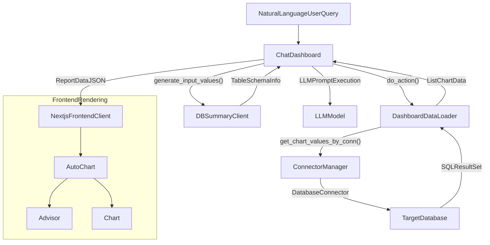
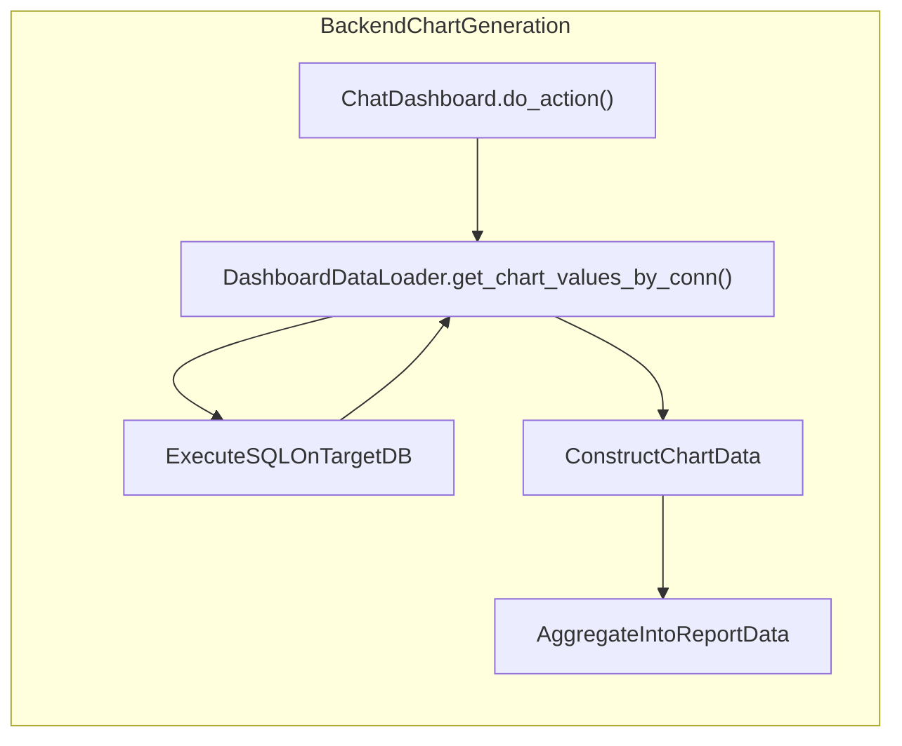
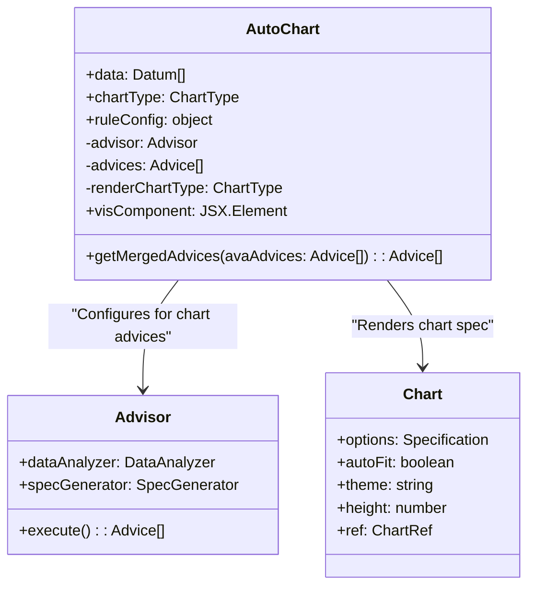
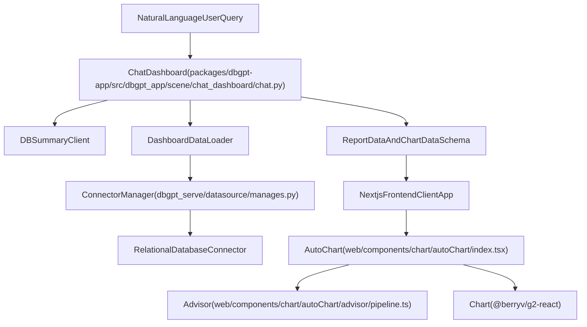

<!-- source: DeepWiki mcp.deepwiki.com · repo eosphoros-ai/DB-GPT · page 6.2 Chat Dashboard & Data Visualization · fetched 2026-10-26 -->

# Chat Dashboard & Data Visualization

Relevant source files

The following files were used as context for generating this wiki page:

- [packages/dbgpt-app/src/dbgpt_app/initialization/app_initialization.py](packages/dbgpt-app/src/dbgpt_app/initialization/app_initialization.py)
- [packages/dbgpt-app/src/dbgpt_app/scene/__init__.py](packages/dbgpt-app/src/dbgpt_app/scene/__init__.py)
- [packages/dbgpt-app/src/dbgpt_app/scene/base.py](packages/dbgpt-app/src/dbgpt_app/scene/base.py)
- [packages/dbgpt-app/src/dbgpt_app/scene/base_chat.py](packages/dbgpt-app/src/dbgpt_app/scene/base_chat.py)
- [packages/dbgpt-app/src/dbgpt_app/scene/chat_dashboard/chat.py](packages/dbgpt-app/src/dbgpt_app/scene/chat_dashboard/chat.py)
- [packages/dbgpt-core/src/dbgpt/agent/resource/tool/autogpt/plugins_util.py](packages/dbgpt-core/src/dbgpt/agent/resource/tool/autogpt/plugins_util.py)
- [packages/dbgpt-core/src/dbgpt/core/awel/dag/base.py](packages/dbgpt-core/src/dbgpt/core/awel/dag/base.py)
- [packages/dbgpt-core/src/dbgpt/model/cluster/worker/manager.py](packages/dbgpt-core/src/dbgpt/model/cluster/worker/manager.py)
- [packages/dbgpt-core/src/dbgpt/model/proxy/base.py](packages/dbgpt-core/src/dbgpt/model/proxy/base.py)
- [packages/dbgpt-core/src/dbgpt/model/utils/token_utils.py](packages/dbgpt-core/src/dbgpt/model/utils/token_utils.py)
- [packages/dbgpt-core/src/dbgpt/util/model_utils.py](packages/dbgpt-core/src/dbgpt/util/model_utils.py)
- [packages/dbgpt-core/src/dbgpt/util/speech/eleven_labs.py](packages/dbgpt-core/src/dbgpt/util/speech/eleven_labs.py)
- [packages/dbgpt-serve/src/dbgpt_serve/prompt/models/models.py](packages/dbgpt-serve/src/dbgpt_serve/prompt/models/models.py)
- [web/app/i18n.ts](web/app/i18n.ts)
- [web/components/chart/autoChart/advisor/pipeline.ts](web/components/chart/autoChart/advisor/pipeline.ts)
- [web/components/chart/autoChart/charts/multi-line-chart.ts](web/components/chart/autoChart/charts/multi-line-chart.ts)
- [web/components/chart/autoChart/charts/multi-measure-line-chart.ts](web/components/chart/autoChart/charts/multi-measure-line-chart.ts)
- [web/components/chart/autoChart/charts/util.ts](web/components/chart/autoChart/charts/util.ts)
- [web/components/chart/autoChart/index.tsx](web/components/chart/autoChart/index.tsx)
- [web/components/chart/helpers/downloadChartImage.ts](web/components/chart/helpers/downloadChartImage.ts)

The purpose of this page is to detail the **Chat Dashboard** scene within DB-GPT (`ChatDashboard`), covering its report schema, backend chart generation logic, GPT-Vis protocol, visualization tags, and the `AutoChart` frontend component implementation.

---

## 1. Scene Architecture & Data Flow

The **ChatDashboard** scene is realized by the `ChatDashboard` class in `packages/dbgpt-app/src/dbgpt_app/scene/chat_dashboard/chat.py` [packages/dbgpt-app/src/dbgpt_app/scene/chat_dashboard/chat.py:23-48](), which inherits from the abstract base `BaseChat` in `packages/dbgpt-app/src/dbgpt_app/scene/base_chat.py` [packages/dbgpt-app/src/dbgpt_app/scene/base_chat.py:113-184](). This scene focuses on transforming user natural language inputs into dynamic multi-chart dashboard visualizations driven by SQL queries against relational databases.

### Key Components & Data Flow

- **User Input:** User provides a natural language query describing desired dashboard charts.
- **`ChatDashboard`:** Parses input, retrieves database schema summaries, orchestrates LLM prompts, and interprets chart generation responses [packages/dbgpt-app/src/dbgpt_app/scene/chat_dashboard/chat.py:63-98]().
- **`DBSummaryClient`:** Provides detailed table and schema info about the target database [packages/dbgpt-app/src/dbgpt_app/scene/chat_dashboard/chat.py:65-78]().
- **`DashboardDataLoader`:** Executes SQL queries generated by LLM, parses query output into structured chart data [packages/dbgpt-app/src/dbgpt_app/scene/chat_dashboard/chat.py:104-128]().
- **`ConnectorManager`:** Retrieves and manages connection objects to target databases (`dbgpt_serve/datasource/manages.py`) [packages/dbgpt-app/src/dbgpt_app/scene/chat_dashboard/chat.py:47-48]().
- **`AutoChart` React Component:** Client-side visualizer using AntV AVA for chart recommendation and G2-react for rendering (`web/components/chart/autoChart/index.tsx`) [web/components/chart/autoChart/index.tsx:17-170]().

**Sources:**  
[packages/dbgpt-app/src/dbgpt_app/scene/chat_dashboard/chat.py:23-48]()  
[packages/dbgpt-app/src/dbgpt_app/scene/chat_dashboard/chat.py:63-98]()  
[packages/dbgpt-app/src/dbgpt_app/scene/chat_dashboard/chat.py:100-128]()  
[packages/dbgpt-app/src/dbgpt_app/scene/base_chat.py:113-184]()  
[web/components/chart/autoChart/index.tsx:17-170]()

---

## 2. Report Schema & Backend Chart Generation

### Report Data Models

DB-GPT uses dedicated data classes for report and chart representation, defined in the report schema module and imported into `chat_dashboard/chat.py` [packages/dbgpt-app/src/dbgpt_app/scene/chat_dashboard/chat.py:14-17]():

- **`ChartData`:** Represents an individual chart's metadata and data payload.
  - Fields include:
    - `chart_uid`: Unique identifier (UUID string).
    - `chart_name`: Chart title.
    - `chart_type`: Chart visualization type (e.g., line, pie).
    - `chart_desc`: Optional descriptive text.
    - `chart_sql`: SQL query producing chart data.
    - `column_name`: List of column names (field names).
    - `values`: Query result rows for rendering [packages/dbgpt-app/src/dbgpt_app/scene/chat_dashboard/chat.py:110-120]().

- **`ReportData`:** Aggregates multiple `ChartData` for a dashboard.
  - Includes:
    - `conv_uid`: Conversation session ID for contextual binding.
    - `template_name`: Dashboard template identifier.
    - `charts`: List of `ChartData` objects [packages/dbgpt-app/src/dbgpt_app/scene/chat_dashboard/chat.py:123-128]().

### Backend Processing Workflow

1. **Initialization:**
   - `ChatDashboard.__init__()` validates required parameters (e.g., database name) and initializes database connectors via `ConnectorManager` [packages/dbgpt-app/src/dbgpt_app/scene/chat_dashboard/chat.py:32-48]().
   - Loads dashboard template JSON describing supported chart types [packages/dbgpt-app/src/dbgpt_app/scene/chat_dashboard/chat.py:51-60]().

2. **Schema Retrieval:**
   - `generate_input_values()` is an async function querying `DBSummaryClient.get_db_summary()` to fetch top-k table schema summaries relevant to user input [packages/dbgpt-app/src/dbgpt_app/scene/chat_dashboard/chat.py:63-78]().
   - Upon failure, requests a fallback simple table schema info via `database.table_simple_info()` [packages/dbgpt-app/src/dbgpt_app/scene/chat_dashboard/chat.py:80-90]().

3. **Action Execution:**
   - Upon receiving the LLM prompt response containing chart descriptions and SQL queries, `do_action()` iterates over each chart descriptor [packages/dbgpt-app/src/dbgpt_app/scene/chat_dashboard/chat.py:100-105]().
   - Runs each SQL on the database via `DashboardDataLoader.get_chart_values_by_conn()` [packages/dbgpt-app/src/dbgpt_app/scene/chat_dashboard/chat.py:107-109]().
   - Wraps results into `ChartData` instances and aggregates them into a `ReportData` object [packages/dbgpt-app/src/dbgpt_app/scene/chat_dashboard/chat.py:110-128]().

**Sources:**  
[packages/dbgpt-app/src/dbgpt_app/scene/chat_dashboard/chat.py:14-17]()  
[packages/dbgpt-app/src/dbgpt_app/scene/chat_dashboard/chat.py:32-60]()  
[packages/dbgpt-app/src/dbgpt_app/scene/chat_dashboard/chat.py:63-90]()  
[packages/dbgpt-app/src/dbgpt_app/scene/chat_dashboard/chat.py:100-128]()  
[packages/dbgpt-app/src/dbgpt_app/scene/base_chat.py:57-86]()

---

## 3. GPT-Vis Protocol and Visualization Tags

DB-GPT uses an internal **GPT-Vis protocol** to semantically annotate visualizations emitted by agents or scenes for structured interpretation by the frontend:

- **`vis_chart`:** Tag representing a single chart configuration and data payload.
- **`vis_dashboard`:** Tag for multi-chart dashboards aggregating multiple `vis_chart` elements.
- Additional tags such as `vis_code`, `vis_plugin`, `vis_agent_plans`, and `vis_thinking` support extended rendering and agent interpretability.

These tags enable message streams from backend to frontend to carry rich structured visualization instructions. Backend handling of these capabilities is integrated into prompt responses and tool/action executions.

**Sources:**  
[packages/dbgpt-app/src/dbgpt_app/scene/chat_dashboard/chat.py:123-128]()

---

## 4. Frontend Component: `AutoChart`

The primary frontend visualization component for dashboards is the **`AutoChart` React component** located at `web/components/chart/autoChart/index.tsx` [web/components/chart/autoChart/index.tsx:17-170]().

### Core Responsibilities

- **Data Preprocessing:** Converts backend data to a visualization-friendly format by cleaning null-like placeholder values (`'-'`) using `processNilData` [web/components/chart/autoChart/charts/util.ts:76-84]().
  
- **Advisor Setup:** Initializes an AntV `Advisor` configured with custom chart definitions (such as `multi_line_chart` and `multi_measure_line_chart`) and rules based on AVA (AntV Visualization Advisor) technology [web/components/chart/autoChart/index.tsx:28-39](), [web/components/chart/autoChart/charts/multi-line-chart.ts:6-47](), [web/components/chart/autoChart/charts/multi-measure-line-chart.ts:6-44]().

- **Chart Recommendations & Merging:** Combines chart types suggested from LLM output and AVA advisor recommendations via `getVisAdvices()` and a custom merge function `getMergedAdvices()` [web/components/chart/autoChart/index.tsx:41-88]().

- **Rendering:** Utilizes the `@berryv/g2-react` `<Chart>` component to render charts dynamically from specification objects (`Specification`) derived from AVA advices [web/components/chart/autoChart/index.tsx:112-121]().

- **Chart Switching:** Provides a UI `Select` dropdown for switching visible chart types within the recommended set [web/components/chart/autoChart/index.tsx:134-152]().

- **Image Export:** Supports exporting currently displayed charts as PNG images via `downloadImage()` [web/components/chart/autoChart/index.tsx:155-161](), [web/components/chart/helpers/downloadChartImage.ts:24-40]().

- **Localization:** Integrates i18n for UI strings and chart names through `i18next` [web/app/i18n.ts:11-24]().

### Component Architecture

### Specialized Utility Functions in Chart Rendering

- **`processDateEncode(field, dataProps)`:** Converts date-encoded fields to JavaScript `Date` objects for time axis rendering [web/components/chart/autoChart/charts/util.ts:11-18]().
  
- **`sortData({ data, chartType, xField })`:** Sorts datasets for line and step line charts based on date or numeric x-axis fields [web/components/chart/autoChart/charts/util.ts:52-74]().
  
- **`getLineSize(...)`:** Adjusts stroke width in line charts when only a single data point is present [web/components/chart/autoChart/charts/util.ts:35-50]().

**Sources:**  
[web/components/chart/autoChart/index.tsx:17-170]()  
[web/components/chart/autoChart/charts/util.ts:11-84]()  
[web/components/chart/autoChart/charts/multi-line-chart.ts:6-47]()  
[web/components/chart/autoChart/charts/multi-measure-line-chart.ts:6-44]()  
[web/components/chart/helpers/downloadChartImage.ts:24-40]()  
[web/app/i18n.ts:11-24]()

---

## 5. Natural Language Space to Code Entity Mapping

This section bridges the natural language user request domain with concrete code entities responsible for fulfilling requests end-to-end:

This flow enables a developer or engineer to trace from user intent (natural language) to backend data access, SQL execution, and frontend rendering.

**Sources:**  
[packages/dbgpt-app/src/dbgpt_app/scene/chat_dashboard/chat.py:23-128]()  
[web/components/chart/autoChart/index.tsx:17-170]()

# End of 6.2 Chat Dashboard & Data Visualization

---

