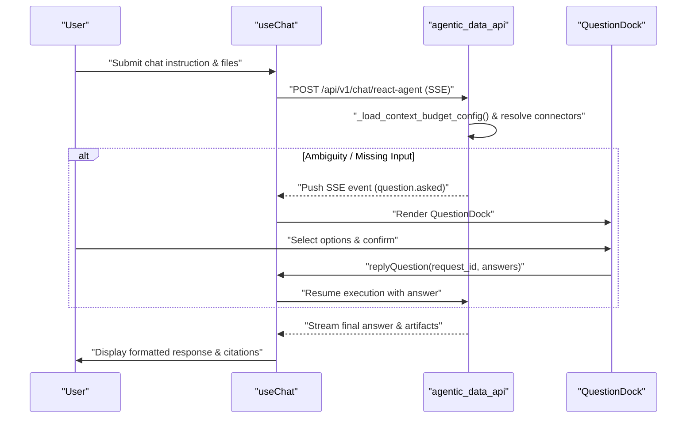
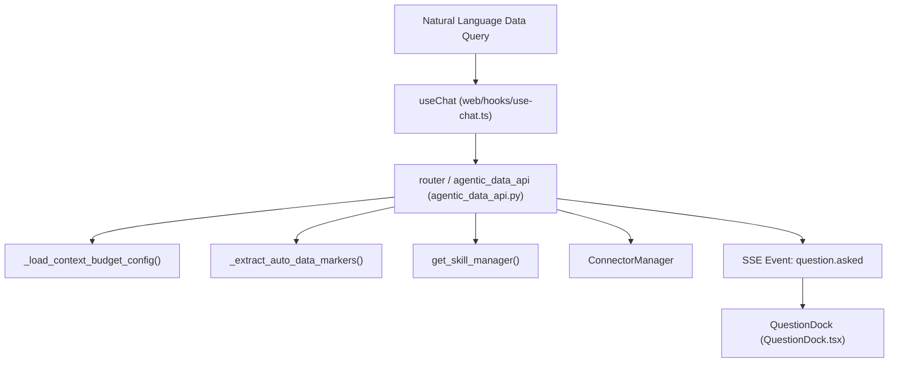
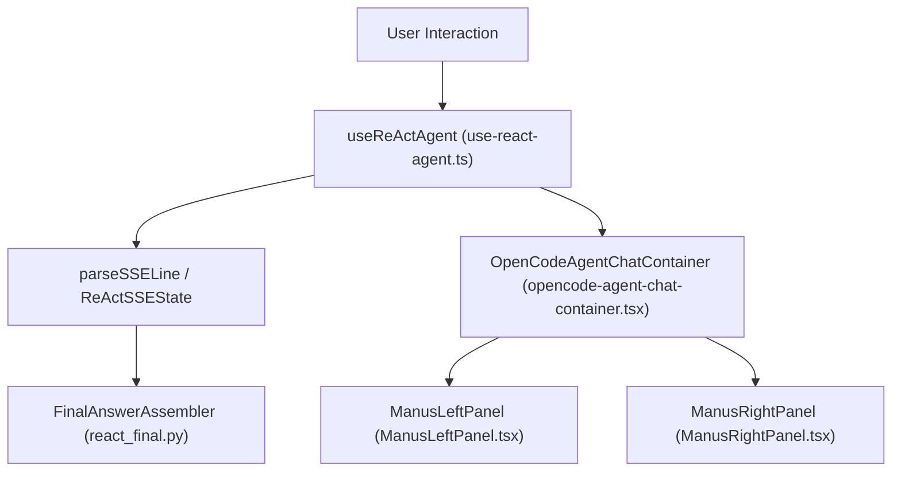

<!-- source: DeepWiki mcp.deepwiki.com · repo eosphoros-ai/DB-GPT · page 6.4 Agentic Data Assistant (ReAct Chat) · fetched 2026-10-26 -->

# Agentic Data Assistant (ReAct Chat)

Relevant source files

The following files were used as context for generating this wiki page:

- [docs/docs/sandbox/index.md](docs/docs/sandbox/index.md)
- [docs/docs/sandbox/runtime.md](docs/docs/sandbox/runtime.md)
- [docs/i18n/zh-CN/docusaurus-plugin-content-docs/current/sandbox/index.md](docs/i18n/zh-CN/docusaurus-plugin-content-docs/current/sandbox/index.md)
- [docs/i18n/zh-CN/docusaurus-plugin-content-docs/current/sandbox/runtime.md](docs/i18n/zh-CN/docusaurus-plugin-content-docs/current/sandbox/runtime.md)
- [packages/dbgpt-app/src/dbgpt_app/openapi/api_v1/agentic_data_api.py](packages/dbgpt-app/src/dbgpt_app/openapi/api_v1/agentic_data_api.py)
- [packages/dbgpt-app/src/dbgpt_app/openapi/api_v1/subagent/react_tools.py](packages/dbgpt-app/src/dbgpt_app/openapi/api_v1/subagent/react_tools.py)
- [packages/dbgpt-app/src/dbgpt_app/openapi/api_v1/tools/_execution.py](packages/dbgpt-app/src/dbgpt_app/openapi/api_v1/tools/_execution.py)
- [packages/dbgpt-app/src/dbgpt_app/openapi/api_v1/tools/tests/test_execution_docker_integration.py](packages/dbgpt-app/src/dbgpt_app/openapi/api_v1/tools/tests/test_execution_docker_integration.py)
- [packages/dbgpt-app/src/dbgpt_app/openapi/api_v1/tools/tests/test_execution_runtime.py](packages/dbgpt-app/src/dbgpt_app/openapi/api_v1/tools/tests/test_execution_runtime.py)
- [packages/dbgpt-app/src/dbgpt_app/tests/test_skill_upload_api.py](packages/dbgpt-app/src/dbgpt_app/tests/test_skill_upload_api.py)
- [web/components/chat/opencode-agent-chat-container.tsx](web/components/chat/opencode-agent-chat-container.tsx)
- [web/hooks/use-chat.ts](web/hooks/use-chat.ts)
- [web/hooks/use-react-agent-chat.ts](web/hooks/use-react-agent-chat.ts)
- [web/hooks/use-react-agent.ts](web/hooks/use-react-agent.ts)
- [web/locales/en/chat.ts](web/locales/en/chat.ts)
- [web/locales/zh/chat.ts](web/locales/zh/chat.ts)
- [web/new-components/chat/content/ManusLeftPanel.tsx](web/new-components/chat/content/ManusLeftPanel.tsx)
- [web/new-components/chat/content/ManusRightPanel.tsx](web/new-components/chat/content/ManusRightPanel.tsx)
- [web/new-components/chat/content/OpenCodeChatCompletion.tsx](web/new-components/chat/content/OpenCodeChatCompletion.tsx)
- [web/new-components/chat/content/QuestionDock.tsx](web/new-components/chat/content/QuestionDock.tsx)
- [web/new-components/chat/content/SessionTurn.tsx](web/new-components/chat/content/SessionTurn.tsx)
- [web/pages/chat/index.tsx](web/pages/chat/index.tsx)
- [web/pages/index.tsx](web/pages/index.tsx)

## Purpose and Scope

This section documents the **Agentic Data Assistant** implemented using a ReAct (Reasoning + Acting) style chat agent in DB-GPT. It centers on the `agentic_data_api` streaming REST endpoint (`[packages/dbgpt-app/src/dbgpt_app/openapi/api_v1/agentic_data_api.py]()`) and the end-to-end agentic chat flow that combines skill selection, connector integration, session file management, subagents, human-in-the-loop questioning via `[web/new-components/chat/content/QuestionDock.tsx]()`, and final answer composition.

Sources:
- `packages/dbgpt-app/src/dbgpt_app/openapi/api_v1/agentic_data_api.py:1-204`
- `web/new-components/chat/content/QuestionDock.tsx:1-166`

---

## 1. Overview of the Agentic Data API Endpoint & Streaming Architecture

The Agentic Data Assistant provides a composable, multi-agent ReAct chat experience tailored for data analysis scenarios. It orchestrates agents that reason and act by dynamically selecting and invoking skills and connectors, handling session-scoped files, spawning subagents for parallel subtasks, and soliciting human feedback when ambiguity arises.

### Key Implementation Details

- **Streaming REST Endpoint**: The core REST router defined as `router = APIRouter()` (`[packages/dbgpt-app/src/dbgpt_app/openapi/api_v1/agentic_data_api.py:63]()`) serves `POST` requests with natural language input plus metadata and streams responses as Server-Sent-Events (SSE). The server side orchestrates the reasoning and acting cycle in streaming fashion.

- **Context Budget Management**: Token budget and warning thresholds are resolved from configuration and runtime LLM model metadata by `_load_context_budget_config()` (`[packages/dbgpt-app/src/dbgpt_app/openapi/api_v1/agentic_data_api.py:116]()`) that returns a `ContextBudgetConfig` structure (`[packages/dbgpt/_private/pydantic.py]()`). Model context length may be resolved asynchronously from model metadata APIs via `_resolve_model_context_tokens()` (`[packages/dbgpt-app/src/dbgpt_app/openapi/api_v1/agentic_data_api.py:97-113]()`).

- **Generic Data Marker Extraction**: The function `_extract_auto_data_markers()` (`[packages/dbgpt-app/src/dbgpt_app/openapi/api_v1/agentic_data_api.py:185]()`) uses a regex pattern `AUTO_DATA_MARKER_PATTERN` (`[packages/dbgpt-app/src/dbgpt_app/openapi/api_v1/agentic_data_api.py:75]()`) to parse specially formatted output blocks in the text of the form `###KEY_START### ... ###KEY_END###` to extract key-value pairs useful for script outputs or automatic data passing.

- **Filename Validation**: Protection against malicious upload paths is ensured by `_validate_upload_filename(filename: str)` (`[packages/dbgpt-app/src/dbgpt_app/openapi/api_v1/agentic_data_api.py:80-94]()`) which rejects null bytes, absolute paths, or directory traversal attempts in uploaded files and skill packages (tested extensively in `[packages/dbgpt-app/src/dbgpt_app/tests/test_skill_upload_api.py:41-192]()`).

Sources:
- `packages/dbgpt-app/src/dbgpt_app/openapi/api_v1/agentic_data_api.py:15-204`
- `packages/dbgpt-app/src/dbgpt_app/tests/test_skill_upload_api.py:41-192`

---

## 2. Agentic Chat Flow Detail: Skill Selection, Connectors, Session Files, Subagents

The agentic data assistant's chat flow coordinates multiple subsystems, forming a powerful data analysis and chat orchestration platform.

### 2.1 Skill Selection

- The agent dynamically loads and manages skills via the global skill manager instance obtained from `get_skill_manager` (`[packages/dbgpt-app/src/dbgpt_app/openapi/api_v1/agentic_data_api.py:32]()`).
- Skills encode domain-specific logic, e.g., SQL query generation, charting rendering, PDF interpretation, or financial report analysis.
- Skills are organized under a configured directory (`DEFAULT_SKILLS_DIR = SKILLS_DIR`, `[packages/dbgpt-app/src/dbgpt_app/openapi/api_v1/agentic_data_api.py:34-74]()`), and can be uploaded by users, validated, and installed.

### 2.2 Datasource Connectors (MCP Integration)

- Datasource connectors are managed via a `ConnectorManager` (`[packages/dbgpt-app/src/dbgpt_app/openapi/api_v1/agentic_data_api.py:42]()`) and selected dynamically based on user input or execution context.
- Agent steps may invoke queries on relational databases, graph stores, or Model-Context-Protocol (MCP) tool servers.
- Connector IDs and credentials are extracted and injected dynamically from request extension info.

### 2.3 Session Files and Attachments

- The chat accepts file uploads (CSV, Excel, PDF, text, images). Files are processed via attachment adapters (`[packages/dbgpt-app/src/dbgpt_app/openapi/api_v1/attachment_react_adapter.py]()`) and normalized as immutable display snapshots for consistent referencing in UI and agent memory (`[web/modules/session-files/index.ts]()`).
- Session files enable multi-modal reasoning across text, tabular, and document data and are integrated into agent context.

### 2.4 Subagents and Parallel Tasks

- Subagents are spawned via subagent dispatchers (`[packages/dbgpt-app/src/dbgpt_app/openapi/api_v1/subagent/dispatcher.py]()`) to decompose complex queries into subqueries or subtasks that can execute concurrently.
- Subagent execution history, step status, and outputs are tracked and merged back into the primary conversation timeline via history snapshot utilities (`[packages/dbgpt-app/src/dbgpt_app/openapi/api_v1/subagent/history.py:57-61]()`).

Sources:
- `packages/dbgpt-app/src/dbgpt_app/openapi/api_v1/agentic_data_api.py:32-61`
- `web/modules/session-files/index.ts:1-28`

---

## 3. Human-in-the-Loop & Final Answer Assembly

Human interaction is vital for clarifications and confirmations during ambiguous or uncertain reasoning phases.

### 3.1 Question and Confirmation Flow

- When the agent encounters ambiguity or needs validation, it raises a `question.asked` SSE event (`[web/hooks/use-chat.ts:156-159]()`, `[web/hooks/use-react-agent.ts:49]()`) describing a set of questions to the frontend.
- The React UI component `QuestionDock` (`[web/new-components/chat/content/QuestionDock.tsx:27-106]()`) visualizes questions with selectable options and/or custom input fields.
- User responses are submitted via `replyQuestion(requestId, answers)` or dismissed via `rejectQuestion(requestId)` (`[web/new-components/chat/content/QuestionDock.tsx:76-87]()`), which resume or guide the agentic assistant's execution.

### 3.2 ReAct Parsing and Termination

- Agent output over the streaming connection is parsed by frontend and backend parsers to extract thought phases, tool actions, and observations.
- Final answer assembly is handled by `FinalAnswerAssembler` (`[packages/dbgpt-app/src/dbgpt_app/openapi/api_v1/react_final.py:55]()`) and decoded via client utilities (`[web/utils/react-agent-final.ts:1-56]()`), combining raw text content with structured citations (`AgentCitation`).

Sources:
- `web/hooks/use-chat.ts:156-163`
- `web/new-components/chat/content/QuestionDock.tsx:27-166`
- `packages/dbgpt-app/src/dbgpt_app/openapi/api_v1/react_final.py:55`

---

## 4. Key Classes and Functions Reference

| Symbol | Description | Location |
|---|---|---|
| `_resolve_model_context_tokens(llm_client, model_name)` | Asynchronously obtains model token limits from metadata | `[packages/dbgpt-app/src/dbgpt_app/openapi/api_v1/agentic_data_api.py:97-113]()` |
| `_load_context_budget_config(llm_client?, model_name?)` | Creates `ContextBudgetConfig` from config + model data | `[packages/dbgpt-app/src/dbgpt_app/openapi/api_v1/agentic_data_api.py:116-183]()` |
| `_extract_auto_data_markers(text)` | Parses generic marker blocks in script output text | `[packages/dbgpt-app/src/dbgpt_app/openapi/api_v1/agentic_data_api.py:185-204]()` |
| `_validate_upload_filename(filename)` | Validates safe plain filename for skill uploads | `[packages/dbgpt-app/src/dbgpt_app/openapi/api_v1/agentic_data_api.py:80-94]()` |
| `FinalAnswerAssembler` | Assembles final answers and citations from agent output | `[packages/dbgpt-app/src/dbgpt_app/openapi/api_v1/react_final.py:55]()` |
| `QuestionDock` | Human-in-the-loop question and option selection component | `[web/new-components/chat/content/QuestionDock.tsx:27-166]()` |
| `useReActAgent` | Custom React hook handling ReAct agent SSE streams | `[web/hooks/use-react-agent.ts:69-113]()` |

Sources:
- `packages/dbgpt-app/src/dbgpt_app/openapi/api_v1/agentic_data_api.py:80-204`
- `web/new-components/chat/content/QuestionDock.tsx:27-166`
- `web/hooks/use-react-agent.ts:69-113`

---

## 5. Frontend Integration & State Management

The frontend chat experience with ReAct Agent mode is managed through several hooks and UI components:

- **`useChat()`** (`[web/hooks/use-chat.ts:62-191]()`) handles SSE streaming with the backend, parses special events like `question.asked`, tracks context usage, and delegates chat message consumption.
- **`useReActAgent()`** (`[web/hooks/use-react-agent.ts:69-223]()`) manages state for ReAct execution steps, parts, final answers, and cancellation.
- **`QuestionDock`** (`[web/new-components/chat/content/QuestionDock.tsx:27-166]()`) renders interactive forms when `question.asked` events arrive.
- **`OpenCodeAgentChatContainer`** (`[web/components/chat/opencode-agent-chat-container.tsx:44-210]()`) integrates the ReAct agent chat stream with conversational history and OpenCode-style UI rendering.

Sources:
- `web/hooks/use-chat.ts:62-191`
- `web/hooks/use-react-agent.ts:69-223`
- `web/new-components/chat/content/QuestionDock.tsx:27-166`
- `web/components/chat/opencode-agent-chat-container.tsx:44-210`

---

## 6. Data Flow and Sequence Diagram

Sources:
- `packages/dbgpt-app/src/dbgpt_app/openapi/api_v1/agentic_data_api.py:1-204`
- `web/hooks/use-chat.ts:62-191`
- `web/new-components/chat/content/QuestionDock.tsx:27-166`

---

## 7. Natural Language to Code Entity Space Mapping

Sources:
- `packages/dbgpt-app/src/dbgpt_app/openapi/api_v1/agentic_data_api.py:32-204`
- `web/hooks/use-chat.ts:156-163`
- `web/new-components/chat/content/QuestionDock.tsx:27-106`

Sources:
- `web/hooks/use-react-agent.ts:1-223`
- `web/components/chat/opencode-agent-chat-container.tsx:44-210`
- `packages/dbgpt-app/src/dbgpt_app/openapi/api_v1/react_final.py:55`

---

## 8. Module Roles Summary Table

| Module / Component | Role & Responsibility | Code Reference |
|---|---|---|
| `agentic_data_api.py` | ReAct streaming REST endpoint, context budget & connector parsing | `[packages/dbgpt-app/src/dbgpt_app/openapi/api_v1/agentic_data_api.py]()` |
| `use-chat.ts` | Frontend SSE stream manager, context status tracking, event dispatch | `[web/hooks/use-chat.ts]()` |
| `use-react-agent.ts` | Custom hook for managing ReAct agent requests and SSE states | `[web/hooks/use-react-agent.ts]()` |
| `QuestionDock.tsx` | Human-in-the-loop UI component for user confirmation and answers | `[web/new-components/chat/content/QuestionDock.tsx]()` |
| `react_final.py` | Final answer assembly and citation formatting | `[packages/dbgpt-app/src/dbgpt_app/openapi/api_v1/react_final.py]()` |

Sources:
- `packages/dbgpt-app/src/dbgpt_app/openapi/api_v1/agentic_data_api.py:1-204`
- `web/hooks/use-chat.ts:1-191`
- `web/hooks/use-react-agent.ts:1-223`
- `web/new-components/chat/content/QuestionDock.tsx:1-166`
- `packages/dbgpt-app/src/dbgpt_app/openapi/api_v1/react_final.py:1-55`

---

# Summary

The Agentic Data Assistant powered by a streaming ReAct chat agent provides a robust backend endpoint and frontend integration for conversational data querying, multi-skill coordination, and interactive human-in-the-loop validation. Its design carefully manages context budget, extensible skills, connector integration, session artifacts, subagent delegation, and final answer synthesis with citations.

---

# References

- `packages/dbgpt-app/src/dbgpt_app/openapi/api_v1/agentic_data_api.py:1-204`
- `web/hooks/use-chat.ts:62-191`
- `web/hooks/use-react-agent.ts:69-223`
- `web/new-components/chat/content/QuestionDock.tsx:27-166`
- `web/components/chat/opencode-agent-chat-container.tsx:44-210`
- `packages/dbgpt-app/src/dbgpt_app/openapi/api_v1/react_final.py:1-55`
- `packages/dbgpt-app/src/dbgpt_app/tests/test_skill_upload_api.py:41-192`

---

