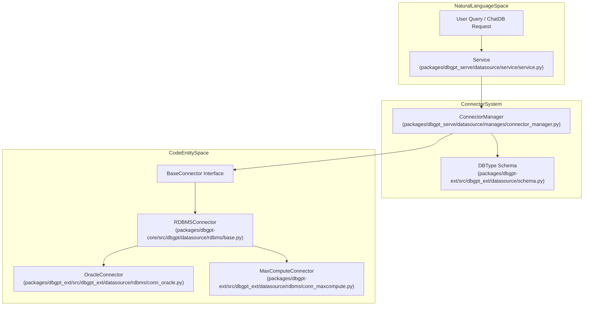
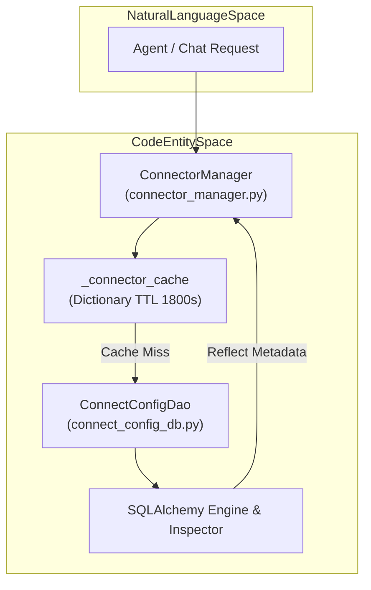

<!-- source: DeepWiki mcp.deepwiki.com · repo eosphoros-ai/DB-GPT · page 7 Datasource Connectors · fetched 2026-10-26 -->

# Datasource Connectors

Relevant source files

The following files were used as context for generating this wiki page:

- [packages/dbgpt-ext/src/dbgpt_ext/datasource/rdbms/conn_maxcompute.py](packages/dbgpt-ext/src/dbgpt_ext/datasource/rdbms/conn_maxcompute.py)
- [packages/dbgpt-ext/src/dbgpt_ext/datasource/schema.py](packages/dbgpt-ext/src/dbgpt_ext/datasource/schema.py)
- [packages/dbgpt-serve/src/dbgpt_serve/datasource/manages/connector_manager.py](packages/dbgpt-serve/src/dbgpt_serve/datasource/manages/connector_manager.py)
- [packages/dbgpt-serve/src/dbgpt_serve/datasource/service/service.py](packages/dbgpt-serve/src/dbgpt_serve/datasource/service/service.py)
- [web/public/icons/maxcompute.png](web/public/icons/maxcompute.png)
- [web/types/db.ts](web/types/db.ts)
- [web/utils/constants.ts](web/utils/constants.ts)

DB-GPT provides a unified datasource abstraction layer enabling seamless interaction with various databases and data stores under a consistent programming model. This abstraction bridges the gap between the **Natural Language Space**, where user queries and LLM operations occur, and the **Code Entity Space**, where concrete data source connectors and drivers execute database operations.

The foundational class underlying these connectors is `BaseConnector`, which defines the common interface for connector implementations including schema introspection, query execution, lifecycle management, and dialect-specific behavior. These connectors are orchestrated by the `ConnectorManager` component, which handles discovery, caching, locking, and instantiation of connector instances keyed by database types defined in the `DBType` enumeration [packages/dbgpt-serve/src/dbgpt_serve/datasource/manages/connector_manager.py:30-113]().

---

## Architecture Overview

The datasource connectors are centrally managed by the `ConnectorManager`. On startup, it loads all available connector classes, including relational (RDBMS) and non-relational/graph connectors. It exposes the supported database types and factory methods to instantiate connectors by type, ensuring extensibility and modularity [packages/dbgpt-serve/src/dbgpt_serve/datasource/manages/connector_manager.py:30-113]().

Connectors implement the `BaseConnector` interface, or extend from specialized base classes such as `RDBMSConnector` for relational databases. These classes encapsulate connection details, SQL dialect quirks, metadata reflection, and query execution with underlying database drivers (e.g., SQLAlchemy engines) [packages/dbgpt-core/src/dbgpt/datasource/rdbms/base.py:114-169]().

### Natural Language Space to Code Entity Space: Datasource Routing

Sources:  
- [packages/dbgpt-serve/src/dbgpt_serve/datasource/service/service.py:35-100]()  
- [packages/dbgpt-serve/src/dbgpt_serve/datasource/manages/connector_manager.py:30-60]()  
- [packages/dbgpt-ext/src/dbgpt_ext/datasource/schema.py:17-38]()  
- [packages/dbgpt-core/src/dbgpt/datasource/rdbms/base.py:114-169]()  

---

## Connector Management & Lifecycle

The `ConnectorManager` is responsible for the lifecycle and caching of connector instances. Because constructing relational connectors involves expensive introspection (e.g., SQLAlchemy `MetaData.reflect`), the manager caches connector instances keyed by database name with a default TTL of 30 minutes [packages/dbgpt-serve/src/dbgpt_serve/datasource/manages/connector_manager.py:30-60]().

It enforces thread-safe cache access and uses per-database "creation" locks to avoid concurrent connector construction under heavy load. These design choices improve performance for multi-user or multi-chat concurrent access patterns [packages/dbgpt-serve/src/dbgpt_serve/datasource/manages/connector_manager.py:30-60]().

### Natural Language Space to Code Entity Space: Lifecycle & Caching

Sources:  
- [packages/dbgpt-serve/src/dbgpt_serve/datasource/manages/connector_manager.py:30-60]()  
- [packages/dbgpt-serve/src/dbgpt_serve/datasource/manages/connect_config_db.py:1-25]()  

---

## Supported Datasource Types & Child Pages Overview

DB-GPT supports a broad variety of datasource types grouped into three main categories: relational databases (RDBMS), non-relational & graph datasources, and lifecycle & management services. The key classification and their associated connector implementations are:

- **7.1 Relational Database Connectors (RDBMS)**  
  RDBMS connectors extend the `RDBMSConnector` base class implementing SQL dialect specifics, connection parameters, and schema introspection. Supported systems include MySQL, PostgreSQL, SQLite, DuckDB, ClickHouse, Doris, StarRocks, OceanBase, Oracle, MSSQL, Hive, Vertica, GaussDB, and MaxCompute [packages/dbgpt-ext/src/dbgpt_ext/datasource/schema.py:17-38]().  
  
  For instance, the `MaxComputeConnector` connects to Alibaba Cloud MaxCompute using a specialized SQLAlchemy dialect and maps its unique connection parameters to the common datasource schema [packages/dbgpt-ext/src/dbgpt_ext/datasource/rdbms/conn_maxcompute.py:1-185]().

  For detailed discussion on parameter schemas, connection details, and implementation, see [Relational Database Connectors (RDBMS)](#7.1).

- **7.2 Non-Relational & Graph Datasources**  
  Includes connectors to graph databases like Neo4j and TuGraph, distributed data platforms like Spark, caching layers such as Redis, and their integration in the knowledge graph and retrieval augmented generation (RAG) subsystems [packages/dbgpt-ext/src/dbgpt_ext/datasource/schema.py:17-38]().

  For more information, see [Non-Relational & Graph Datasources](#7.2).

- **7.3 Datasource Service & Connector Lifecycle**  
  The service layer built on top of datasources offers CRUD APIs for datasource management, connection testing, and asynchronous background tasks like database summary embedding refresh [packages/dbgpt-serve/src/dbgpt_serve/datasource/service/service.py:101-163]().  

  This layer leverages the `ConnectorManager` for caching, locking, and connector instance lifecycle management [packages/dbgpt-serve/src/dbgpt_serve/datasource/manages/connector_manager.py:30-60]().  

  For comprehensive details, see [Datasource Service & Connector Lifecycle](#7.3).

---

### See Also

- [Relational Database Connectors (RDBMS)](#7.1)  
- [Non-Relational & Graph Datasources](#7.2)  
- [Datasource Service & Connector Lifecycle](#7.3)  

---

**Sources:**  
- [packages/dbgpt-core/src/dbgpt/datasource/rdbms/base.py:114-169]()  
- [packages/dbgpt-serve/src/dbgpt_serve/datasource/manages/connector_manager.py:30-113]()  
- [packages/dbgpt-ext/src/dbgpt_ext/datasource/schema.py:17-38]()  
- [packages/dbgpt-serve/src/dbgpt_serve/datasource/service/service.py:35-163]()  
- [packages/dbgpt-ext/src/dbgpt_ext/datasource/rdbms/conn_maxcompute.py:1-185]()

---

