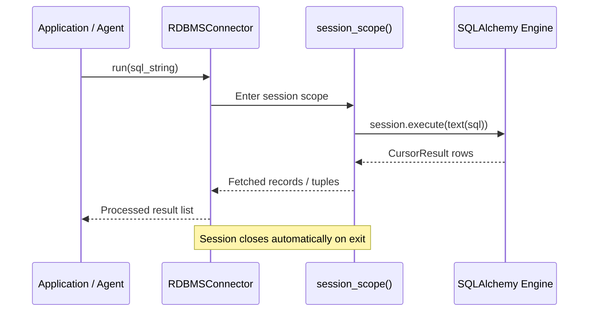
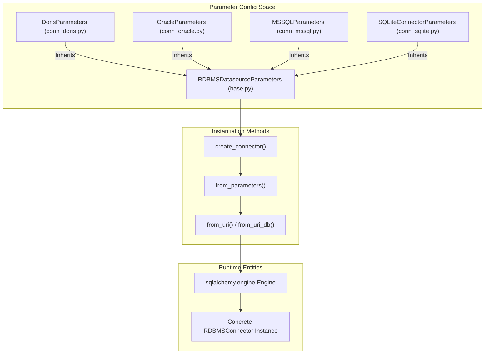
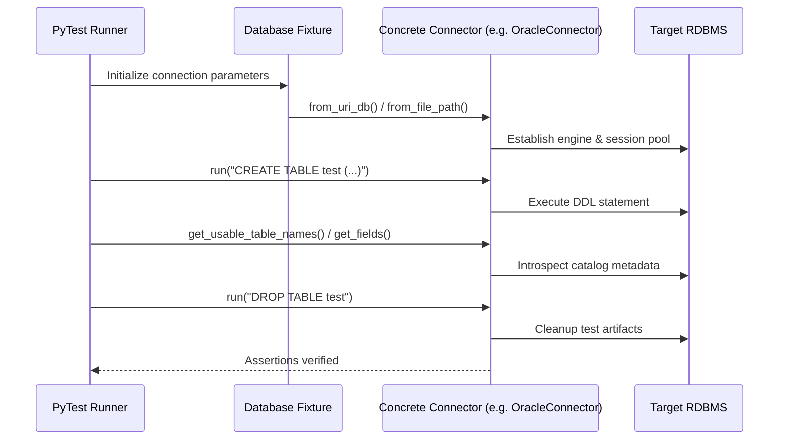

<!-- source: DeepWiki mcp.deepwiki.com · repo eosphoros-ai/DB-GPT · page 7.1 Relational Database Connectors (RDBMS) · fetched 2026-10-26 -->

# Relational Database Connectors (RDBMS)

<details>
<summary>Relevant source files</summary>

The following files were used as context for generating this wiki page:

- [docs/docs/application/datasources.md](docs/docs/application/datasources.md)
- [docs/docs/application/fine_tuning_manual/dbgpt_hub.md](docs/docs/application/fine_tuning_manual/dbgpt_hub.md)
- [docs/docs/installation/integrations.md](docs/docs/installation/integrations.md)
- [docs/docs/installation/integrations/opengauss_install.md](docs/docs/installation/integrations/opengauss_install.md)
- [docs/i18n/zh-CN/docusaurus-plugin-content-docs/current/application/datasources.md](docs/i18n/zh-CN/docusaurus-plugin-content-docs/current/application/datasources.md)
- [docs/i18n/zh-CN/docusaurus-plugin-content-docs/current/installation/integrations.md](docs/i18n/zh-CN/docusaurus-plugin-content-docs/current/installation/integrations.md)
- [docs/i18n/zh-CN/docusaurus-plugin-content-docs/current/installation/integrations/opengauss_install.md](docs/i18n/zh-CN/docusaurus-plugin-content-docs/current/installation/integrations/opengauss_install.md)
- [docs/static/img/ft/baseline.png](docs/static/img/ft/baseline.png)
- [packages/dbgpt-app/src/dbgpt_app/scene/chat_data/chat_excel/excel_learning/chat.py](packages/dbgpt-app/src/dbgpt_app/scene/chat_data/chat_excel/excel_learning/chat.py)
- [packages/dbgpt-core/src/dbgpt/datasource/rdbms/base.py](packages/dbgpt-core/src/dbgpt/datasource/rdbms/base.py)
- [packages/dbgpt-ext/src/dbgpt_ext/datasource/rdbms/conn_doris.py](packages/dbgpt-ext/src/dbgpt_ext/datasource/rdbms/conn_doris.py)
- [packages/dbgpt-ext/src/dbgpt_ext/datasource/rdbms/conn_duckdb.py](packages/dbgpt-ext/src/dbgpt_ext/datasource/rdbms/conn_duckdb.py)
- [packages/dbgpt-ext/src/dbgpt_ext/datasource/rdbms/conn_mssql.py](packages/dbgpt-ext/src/dbgpt_ext/datasource/rdbms/conn_mssql.py)
- [packages/dbgpt-ext/src/dbgpt_ext/datasource/rdbms/conn_openGauss.py](packages/dbgpt-ext/src/dbgpt_ext/datasource/rdbms/conn_openGauss.py)
- [packages/dbgpt-ext/src/dbgpt_ext/datasource/rdbms/conn_oracle.py](packages/dbgpt-ext/src/dbgpt_ext/datasource/rdbms/conn_oracle.py)
- [packages/dbgpt-ext/src/dbgpt_ext/datasource/rdbms/conn_sqlite.py](packages/dbgpt-ext/src/dbgpt_ext/datasource/rdbms/conn_sqlite.py)
- [packages/dbgpt-ext/src/dbgpt_ext/datasource/rdbms/tests/test_conn_openGauss.py](packages/dbgpt-ext/src/dbgpt_ext/datasource/rdbms/tests/test_conn_openGauss.py)
- [packages/dbgpt-ext/src/dbgpt_ext/datasource/rdbms/tests/test_conn_sqlite.py](packages/dbgpt-ext/src/dbgpt_ext/datasource/rdbms/tests/test_conn_sqlite.py)
- [tests/intetration_tests/datasource/__init__.py](tests/intetration_tests/datasource/__init__.py)
- [tests/intetration_tests/datasource/test_conn_clickhouse.py](tests/intetration_tests/datasource/test_conn_clickhouse.py)
- [tests/intetration_tests/datasource/test_conn_doris.py](tests/intetration_tests/datasource/test_conn_doris.py)
- [tests/intetration_tests/datasource/test_conn_mysql.py](tests/intetration_tests/datasource/test_conn_mysql.py)
- [tests/intetration_tests/datasource/test_conn_oracle.py](tests/intetration_tests/datasource/test_conn_oracle.py)

</details>


This page documents the architecture, implementation, and integration details of the Relational Database Management System (RDBMS) connectors in DB-GPT. It covers the foundational `RDBMSConnector` base class, the parameter configuration system via `RDBMSDatasourceParameters`, and specialized implementations tailored for various databases including MySQL, PostgreSQL, SQLite, DuckDB, ClickHouse, Doris, StarRocks, OceanBase, Oracle, MSSQL, Hive, Vertica, GaussDB, and MaxCompute.

---

## Overview and Architecture

DB-GPT provides a unified datasource abstraction layer allowing seamless integration with multiple SQL engines via SQLAlchemy. This abstraction enables consistent execution of raw and parameterized SQL, metadata inspection, schema reflection, sampling, and privilege auditing across heterogeneous relational databases.

### Core Components

- **`BaseConnector`**: The abstract superclass interface for all datasource connectors within DB-GPT [packages/dbgpt-core/src/dbgpt/datasource/rdbms/base.py:35]().
- **`RDBMSDatasourceParameters`**: A dataclass that encapsulates connection parameters such as host, port, user credentials, driver selection, and connection pool tuning parameters (`pool_size`, `max_overflow`, `pool_timeout`, `pool_recycle`, `pool_pre_ping`) enabling unified configuration management [packages/dbgpt-core/src/dbgpt/datasource/rdbms/base.py:51-88]().
- **`RDBMSConnector`**: A concrete SQLAlchemy-based connector wrapping the engine, session management, metadata reflection, and schema introspection functionalities [packages/dbgpt-core/src/dbgpt/datasource/rdbms/base.py:114-168]().

### Supported RDBMS Implementations

| Database       | Connector Class       | Default Driver        | Dialect    |
|----------------|----------------------|-----------------------|------------|
| MySQL          | `MySQLConnector`     | `mysql+pymysql`       | `mysql`    |
| PostgreSQL     | `PostgreSQLConnector`| `postgresql+psycopg2` | `postgresql`|
| Oracle         | `OracleConnector`    | `oracle+oracledb`     | `oracle`   |
| Apache Doris   | `DorisConnector`     | `mysql+pymysql`       | `mysql`    |
| SQLite         | `SQLiteConnector`    | `sqlite`              | `sqlite`   |
| DuckDB         | `DuckDbConnector`    | `duckdb`              | `duckdb`   |
| ClickHouse     | `ClickHouseConnector`| `clickhouse`          | `clickhouse`|
| OceanBase      | `OceanBaseConnector` | `mysql+pymysql`       | `oceanbase`|
| StarRocks      | `StarRocksConnector` | `mysql+pymysql`       | `mysql`    |
| MSSQL          | `MSSQLConnector`     | `mssql+pymssql`       | `mssql`    |
| Hive           | `HiveConnector`      | `hive`                | `hive`     |
| Vertica        | `VerticaConnector`   | `vertica+vertica_python`| `vertica`|
| GaussDB        | `GaussDBConnector`   | `postgresql+psycopg2` | `postgresql`|
| MaxCompute     | `MaxComputeConnector`| —                     | —          |

---

### Diagram: Natural Language Space to Code Entity Space Runtime Routing

```mermaid
graph TD
    subgraph NaturalLanguageSpace["Natural Language Space"]
        UserPrompt["\"Query active users in Oracle\""]
        NLSchema["Table & Column Context"]
    end

    subgraph CodeEntitySpace["Code Entity Space (dbgpt-core & dbgpt-ext)"]
        BaseConn["RDBMSConnector (base.py)"]
        Params["RDBMSDatasourceParameters (base.py)"]
        Engine["sqlalchemy.engine.Engine"]
        Session["sqlalchemy.orm.scoped_session"]
        
        subgraph ConnectorSubclasses["Connector Subclasses"]
            Oracle["OracleConnector (conn_oracle.py)"]
            Doris["DorisConnector (conn_doris.py)"]
            MSSQL["MSSQLConnector (conn_mssql.py)"]
            SQLite["SQLiteConnector (conn_sqlite.py)"]
            DuckDB["DuckDbConnector (conn_duckdb.py)"]
        end
    end

    UserPrompt -->| "Agent Dispatch" | Oracle
    Oracle -->| "Extends" | BaseConn
    Oracle -->| "Configured_By" | Params
    Params -->| "Creates" | Engine
    BaseConn -->| "Manages" | Session
    Session -->| "Executes SQL" | Engine
    NLSchema ---| "Reflected via" | BaseConn
```

Sources:  
[packages/dbgpt-core/src/dbgpt/datasource/rdbms/base.py:35-112](),  
[packages/dbgpt-ext/src/dbgpt_ext/datasource/rdbms/conn_oracle.py:27-77](),  
[packages/dbgpt-ext/src/dbgpt_ext/datasource/rdbms/conn_doris.py:28-55]()

---

## The RDBMSConnector Base Class

The `RDBMSConnector` class provides the foundational implementation that wraps a SQLAlchemy engine, manages sessions, and reflects database schema metadata. It offers a thread-safe session factory and utility functions for querying and introspecting the database schema.

### Key Methods and Functionality

- **Constructor `__init__`**: Initializes with a SQLAlchemy `engine`, sets up an `Inspector` for schema introspection, and configures a thread-safe `scoped_session` factory. The connector automatically reflects tables and views into `self._metadata` [packages/dbgpt-core/src/dbgpt/datasource/rdbms/base.py:117-166]().
- **`from_parameters()`**: Instantiates the connector from an `RDBMSDatasourceParameters` object, building the database URL and engine arguments [packages/dbgpt-core/src/dbgpt/datasource/rdbms/base.py:176-180]().
- **`session_scope()`**: A context manager yielding transactional SQLAlchemy `Session` objects with commit/rollback semantics ensuring safe lifecycle management of sessions [packages/dbgpt-core/src/dbgpt/datasource/rdbms/base.py:270-285]().
- **`run()`**: Executes arbitrary SQL statements inside a managed session, returning results as a list of tuples for downstream consumption [packages/dbgpt-core/src/dbgpt/datasource/rdbms/base.py:316-351]().
- **`get_table_info()`**: Synthesizes DDL statements combined with sample rows of a table to deliver rich textual schema context to downstream LLM components [packages/dbgpt-core/src/dbgpt/datasource/rdbms/base.py:494-521]().

---

### Diagram: Session and Query Execution Flow



Sources:  
[packages/dbgpt-core/src/dbgpt/datasource/rdbms/base.py:114-168, 270-285, 316-351]()

---

## Database Connector Implementations

Individual RDBMS connectors extend `RDBMSConnector` to handle database-specific protocols, custom metadata queries, and vendor-specific optimizations. Each implementation registers itself as a resource via `@auto_register_resource` with metadata including label, category, and descriptions.

### Apache Doris

- Implements using the MySQL-compatible driver `mysql+pymysql` [packages/dbgpt-ext/src/dbgpt_ext/datasource/rdbms/conn_doris.py:36-43]().
- Overrides the constructor to avoid automatic SQLAlchemy metadata reflection which can cause Doris type-parsing issues [packages/dbgpt-ext/src/dbgpt_ext/datasource/rdbms/conn_doris.py:69-103]().
- Synchronizes tables via `information_schema.tables` scoped to `database()` and parses `SHOW GRANTS` output [packages/dbgpt-ext/src/dbgpt_ext/datasource/rdbms/conn_doris.py:126-150]().

Sources:  
[packages/dbgpt-ext/src/dbgpt_ext/datasource/rdbms/conn_doris.py:28-150]()

### Oracle

- Uses the modern `oracle+oracledb` driver leveraging `python-oracledb` [packages/dbgpt-ext/src/dbgpt_ext/datasource/rdbms/conn_oracle.py:27-37]().
- Constructs connection strings with support for either `service_name` or `sid` (System Identifier), generating a valid Oracle DSN [packages/dbgpt-ext/src/dbgpt_ext/datasource/rdbms/conn_oracle.py:39-68]().
- Introspects schema and metadata using Oracle data dictionary views such as `user_tab_columns` and `user_col_comments` [packages/dbgpt-ext/src/dbgpt_ext/datasource/rdbms/conn_oracle.py:117-167]().

Sources:  
[packages/dbgpt-ext/src/dbgpt_ext/datasource/rdbms/conn_oracle.py:27-167]()

### Microsoft SQL Server (MSSQL)

- Uses driver `mssql+pymssql` [packages/dbgpt-ext/src/dbgpt_ext/datasource/rdbms/conn_mssql.py:30-35]().
- Overrides `get_fields()` to fetch column comments through `sys.extended_properties` using MS convention `MS_Description` [packages/dbgpt-ext/src/dbgpt_ext/datasource/rdbms/conn_mssql.py:81-140]().
- Inspects user logins via `sys.server_principals` and permissions via `sys.server_permissions` [packages/dbgpt-ext/src/dbgpt_ext/datasource/rdbms/conn_mssql.py:142-172]().

Sources:  
[packages/dbgpt-ext/src/dbgpt_ext/datasource/rdbms/conn_mssql.py:25-172]()

### SQLite and DuckDB

- **SQLiteConnector**: Uses local file or in-memory DB with the `sqlite` driver [packages/dbgpt-ext/src/dbgpt_ext/datasource/rdbms/conn_sqlite.py:32-69](). Supports thread-safety configurations and schema inspection via `sqlite_master` and `PRAGMA` queries [packages/dbgpt-ext/src/dbgpt_ext/datasource/rdbms/conn_sqlite.py:106-136]().
- **DuckDbConnector**: Manages in-memory or persistent analytical storage using the `duckdb` driver, inheriting inspection patterns compatible with SQLite [packages/dbgpt-ext/src/dbgpt_ext/datasource/rdbms/conn_duckdb.py:25-133]().

Sources:  
[packages/dbgpt-ext/src/dbgpt_ext/datasource/rdbms/conn_sqlite.py:31-136](),  
[packages/dbgpt-ext/src/dbgpt_ext/datasource/rdbms/conn_duckdb.py:25-133]()

---

### Diagram: Connector Initialization Flow (Config to Runtime)



Sources:  
[packages/dbgpt-core/src/dbgpt/datasource/rdbms/base.py:51-112, 176-180](),  
[packages/dbgpt-ext/src/dbgpt_ext/datasource/rdbms/conn_doris.py:28-47](),  
[packages/dbgpt-ext/src/dbgpt_ext/datasource/rdbms/conn_oracle.py:27-70]()

---

## Integration Testing Lifecycle

Integration tests in the test suite validate the connection initialization, metadata introspection, and statement execution workflow for different RDBMS drivers.



Sources:  
[tests/intetration_tests/datasource/test_conn_oracle.py:31-60](),  
[tests/intetration_tests/datasource/test_conn_mysql.py:32-49](),  
[tests/intetration_tests/datasource/test_conn_sqlite.py:13-39]()

---

## Summary

The DB-GPT RDBMS connector framework provides a robust infrastructure for connecting to heterogeneous relational databases. By leveraging SQLAlchemy, it unifies connection pooling, schema reflection, session scoping, and query execution across embedded, OLTP, and analytical systems. Subclasses tailor dialect-specific operations to support downstream features like Text2SQL generation and schema caching.

Sources:  
[packages/dbgpt-core/src/dbgpt/datasource/rdbms/base.py:35-196]()

---

